# ĐẠI VIỆT CHIẾN KỲ (DAI VIET CHRONICLES)
## TÀI LIỆU THIẾT KẾ TOÀN DIỆN & KẾ HOẠCH TRIỂN KHAI SẢN XUẤT
### MASTER GAME DESIGN DOCUMENT (GDD) & PRODUCTION BLUEPRINT — PHIÊN BẢN 3.4 (BẢN ĐỒNG BỘ HÓA)
**Trạng thái tài liệu:** Bản Hợp Nhất Hoàn Chỉnh (Consolidated Master v3.4.1) — Đồng bộ Thiết kế, Công thức Toán học & Kiến trúc Kỹ thuật  
**Ngày cập nhật:** 18/11/2026 | **Động cơ:** Godot 4.7 (Thuần GDScript 2.0 — Static Typing) | **Renderer:** `gl_compatibility` | **Mục tiêu:** Web (HTML5/Wasm) + Android (60 FPS)

---

## PHẦN MỞ ĐẦU: SỔ TAY TỔNG QUAN & CÁC QUYẾT ĐỊNH TRỌNG YẾU (EXECUTIVE GUIDE)

### 1. Tóm Tắt Dự Án Trong 60 Giây (Elevator Pitch)
- **Tên dự án:** Đại Việt Chiến Kỳ (*Dai Viet Chronicles*).
- **Thể loại:** Chiến thuật theo lượt quân sự lịch sử (Turn-Based Hex Wargame).
- **Phạm vi lịch sử:** Từ thời dựng nước & Bắc thuộc đến thế kỷ XVIII (Triều Tây Sơn), phát triển cuốn chiếu theo từng *Gói Thời Kỳ (Era Pack)*, mở màn bằng **Slice-01: Đại Chiến Bạch Đằng 1288 (Gói Thời Trần)**.
- **Logline:** Chỉ huy các đạo quân Đại Việt qua những chiến dịch lịch sử hào hùng, làm chủ địa hình sông ngòi rừng núi, vận dụng thời cơ thủy triều, bẫy cọc ngầm, bọc sườn và sĩ khí để biến quyết định chiến thuật thành chiến thắng có thể giải thích.
- **Điểm nhấn tạo khác biệt (Unique Selling Points):**
  1. *Bản sắc quân sự Việt Nam:* Tái hiện cơ chế thủy chiến Bạch Đằng (thủy triều rút ở Vòng 4 làm lộ bãi cọc nhọn đâm thủng chiến thuyền quân Nguyên), thế trận cướp lương "Vườn không nhà trống", tượng binh xung kích và phục kích rừng rậm.
  2. *Controlled RNG Tất Định & Minh Bạch:* Dao động sát thương có kiểm soát (`80%–100%`) kết hợp Bạo kích trên nền `Seeded RandomNumberGenerator` độc lập, đường cong Giáp `100 / (100 + EffectiveDef)`, gộp cờ `TroopStack` (1x–3x) mượt không đứt gãy và `Combat Preview` 2 bước minh bạch.
  3. *Tiến trình Meta & Duyên phận F2P thân thiện:* Hệ thống Duyên phận lịch sử (*Trần Triều Tam Kiệt*, *Hào Khí Mê Linh*, *Hội Thề Lũng Nhai*) cho phép tích lũy Ngọc Bích từ thành tựu/sự kiện để chiêu mộ mọi bậc danh tướng; khóa hồ sơ tướng (`Preset Loadout`) trong *Historical Scenario*.
  4. *Kiến trúc Thuần GDScript 2.0 tối ưu 60 FPS:* Vận hành trên Godot 4.7 (`gl_compatibility`), xuất bản liền mạch lên trình duyệt Web (Wasm) và thiết bị di động Android với *Strategic Zoom* và Object Pooling.

---

### 2. Bảng Tổng Hợp Trạng Thái Quyết Định Thiết Kế & Kỹ Thuật (`D-01` đến `D-17`)

| Mã ID | Nội Dung Quyết Định | Trạng Thái | Phương Án Đã Chốt / Định Hướng Thực Thi |
| :---: | :--- | :---: | :--- |
| **D-01** | Thể loại cốt lõi (Turn-based Hex Wargame vs RTS) | **LOCKED** | Chốt Turn-based Hex Wargame trên lưới Pointy-topped Axial `(q, r)`. |
| **D-02** | Tách bạch cân bằng Lịch sử vs Tiến trình Meta | **LOCKED** | *Historical Scenario* khóa `Preset Loadout`; tiến trình Meta áp dụng cho *Conquest/Legion/Domination*. |
| **D-03** | Chiến lược sản xuất cuốn chiếu theo Vertical Slice | **LOCKED** | Hoàn thiện & kiểm chứng **Slice-01 (Bạch Đằng 1288)** trước khi mở rộng các *Era Pack*. |
| **D-06** | Nền tảng mục tiêu phát hành | **LOCKED** | **Web (HTML5/Wasm) + Android** (phát triển & kiểm thử trên Windows Desktop), mục tiêu 60 FPS. |
| **D-07** | Định hướng Thương mại hóa & Chính sách Gacha | **LOCKED** | Không Gacha ở MVP/Slice-01; giai đoạn mở rộng áp dụng **F2P thân thiện** (tích Ngọc Bích từ thành tựu/sự kiện để mở mọi phẩm tướng, không khóa paywall tướng lịch sử). |
| **D-09** | Ngôn ngữ lập trình & Kiến trúc Engine | **LOCKED** | **Godot 4.7 + Thuần GDScript 2.0 (Static Typing)** thay cho C# .NET để đảm bảo tương thích 100% WebAssembly & Android. |
| **D-10** | Trình kết xuất đồ họa (Renderer) | **LOCKED** | `gl_compatibility` kết hợp `CPUParticles2D` pooling, Local Hit-Stop và Strategic Zoom (`< 0.65x`). |
| **D-11** | Thứ tự Công – Phản kích & Giới hạn phản kích | **LOCKED** | Công đánh trước – Thủ còn sống phản kích sau (`75%` sát thương), tối đa **1 lần phản kích/vòng**, bắt buộc thỏa tầm & LOS. |
| **D-12** | Quy tắc dừng ZoC, CoC & Hình học Flank | **LOCKED** | Bước vào ZoC tiêu hết `remaining_mp`; CoC Thành trì nhân `2x` chi phí địa hình; Flank kích hoạt ở góc $120^\circ$ hoặc $180^\circ$. |
| **D-13** | Mô hình Sĩ khí & Trạng thái chạm đáy (`CHAOS`) | **LOCKED** | **4 bậc Enum rời rạc** (`HIGH`, `NORMAL`, `LOW`, `CHAOS`); `CHAOS` khóa hành động theo số lượt rồi tự hồi về `LOW`. |
| **D-14** | Cơ chế Thủy triều rút & Bãi cọc Bạch Đằng (`StakedWater`) | **LOCKED** | Triều rút đầu **Vòng 4**: lộ bãi cọc, thuyền địch trên bãi cọc mất `35% MaxHP`, dính `MarchDisabled` (2 lượt) & `CHAOS` (1 lượt). |
| **D-15** | Hệ quả khi Tướng chỉ huy bị loại khỏi vòng chiến | **LOCKED** | Mất `UniqueSkill` gắn với đạo quân đó và gây chấn động `-1 bậc` Sĩ khí đồng minh trong bán kính 2 hex (riêng Chủ soái tử trận sẽ xử thua nếu kịch bản quy định). |
| **D-16** | Cơ chế kiểm soát `SignalDock` & Chống Turtling ở Slice-01 | **LOCKED** | Thắng ngay khi hạ Ô Mã Nhi và giữ vững `SignalDock` (cho phép đạt 2 Sao `<= 8 lượt`), hoặc giữ `SignalDock` hết Vòng 10 kèm diệt `>= 75%` quân địch; ẩn Kinh tế sang P3. |
| **D-04** | Kiến trúc Bản đồ chế độ Chinh Phục (Conquest Map) | **OPEN (Trước P3)** | Đang cân nhắc giữa bản đồ Lưới Hex dọc Bắc–Nam (`120 × 240 hex`) và bản đồ Node/Tỉnh thành liên kết sa bàn trận đánh. |
| **D-05** | Độ sâu Kinh tế & Ngoại giao trong Conquest | **OPEN (Trước P3)** | Mặc định ưu tiên mô phỏng gọn (4 tài nguyên `Coin, Food, Tech, Mana` + giao thương/tuyển quân cốt lõi). |
| **D-08** | Quy trình Thẩm định Sử liệu cho từng Era Pack | **OPEN (Trước P2)** | Áp dụng Evidence Grade A–D & gắn nhãn `abstraction/fixture`; rà soát hồ sơ Bạch Đằng 1288 với nguồn chính sử `[S12]–[S16]`. |
| **D-17** | Ngưỡng nghiệm thu Playtest thực tế cho Slice-01 | **OPEN (Trước P2)** | Tối thiểu 5 người chơi ngoài dev; `>= 4/5` nắm rõ điều kiện thắng/thua và giải thích được bước ngoặt chiến thuật. |

---

## MỤC LỤC TỔNG THỂ (TABLE OF CONTENTS)

  - [PHẦN MỞ ĐẦU: SỔ TAY TỔNG QUAN & CÁC QUYẾT ĐỊNH TRỌNG YẾU (EXECUTIVE GUIDE)](#phần-mở-đầu-sổ-tay-tổng-quan--các-quyết-định-trọng-yếu-executive-guide)
- **[CHƯƠNG I: QUẢN LÝ DỰ ÁN, QUY ƯỚC & TỔNG QUAN SẢN PHẨM](#chương-i-quản-lý-dự-án-quy-ước--tổng-quan-sản-phẩm)**
  - [1.1. Quản lý tài liệu (Document Control)](#11-quản-lý-tài-liệu-document-control)
  - [1.2. Quy ước đọc tài liệu và thuật ngữ](#12-quy-ước-đọc-tài-liệu-và-thuật-ngữ)
  - [1.3. Tóm tắt sản phẩm](#13-tóm-tắt-sản-phẩm)
  - [1.4. Lịch sử Tiến hóa Phiên bản & Bảng Ánh xạ Cấu trúc (Changelog 0.1 → 3.4.1)](#14-lịch-sử-tiến-hóa-phiên-bản--bảng-ánh-xạ-cấu-trúc-changelog-01--341)
- **[CHƯƠNG II: TẦM NHÌN, ĐỊNH VỊ & TRẢI NGHIỆM NGƯỜI CHƠI](#chương-ii-tầm-nhìn-định-vị--trải-nghiệm-người-chơi)**
  - [2.1. Tầm nhìn, định vị và trụ cột thiết kế](#21-tầm-nhìn-định-vị-và-trụ-cột-thiết-kế)
  - [2.2. Người chơi và trải nghiệm mục tiêu](#22-người-chơi-và-trải-nghiệm-mục-tiêu)
- **[CHƯƠNG III: HỆ THỐNG GAMEPLAY & VÒNG LẶP TRẬN ĐÁNH](#chương-iii-hệ-thống-gameplay--vòng-lặp-trận-đánh)**
  - [3.1. Core Loop và cấu trúc lượt](#31-core-loop-và-cấu-trúc-lượt)
  - [3.2. Các mode chơi](#32-các-mode-chơi)
  - [3.3. Hệ thống chiến trường](#33-hệ-thống-chiến-trường)
  - [3.4. Tướng lĩnh, binh chủng và quân đội](#34-tướng-lĩnh-binh-chủng-và-quân-đội)
  - [3.5. Thế lực và kinh tế chiến lược (Factions & Strategic Economy)](#35-thế-lực-và-kinh-tế-chiến-lược-factions--strategic-economy)
  - [3.6. Tiến trình và nguyên tắc cân bằng (Meta-Progression & Balance)](#36-tiến-trình-và-nguyên-tắc-cân-bằng-meta-progression--balance)
- **[CHƯƠNG IV: ĐẶC TẢ CHI TIẾT CƠ CHẾ CHIẾN THUẬT (TACTICAL MECHANICS DEEP-DIVE)](#chương-iv-đặc-tả-chi-tiết-cơ-chế-chiến-thuật-tactical-mechanics-deep-dive)**
  - [4.1. Đặc Tả Chi Tiết Công Thức Chiến Đấu & Tính Toán Sát Thương](#41-đặc-tả-chi-tiết-công-thức-chiến-đấu--tính-toán-sát-thương)
  - [4.2. Đặc Tả Hệ Thống Sĩ Khí, Bao Vây & Hiệu Ứng Trạng Thái](#42-đặc-tả-hệ-thống-sĩ-khí-bao-vây--hiệu-ứng-trạng-thái)
  - [4.3. Đặc Tả Hệ Thống Lưới Hex, 9 Loại Địa Hình, LOS & Vùng Kiểm Soát (`ZoC` / `CoC`)](#43-đặc-tả-hệ-thống-lưới-hex-9-loại-địa-hình-los--vùng-kiểm-soát-zoc--coc)
  - [4.4. Kinh Tế Chiến Trường & Hậu Cần Trong Trận (In-Battle Tactical Economy)](#44-kinh-tế-chiến-trường--hậu-cần-trong-trận-in-battle-tactical-economy)
- **[CHƯƠNG V: TIẾN TRÌNH META, DANH TƯỚNG & KINH TẾ NGOẠI TRẬN](#chương-v-tiến-trình-meta-danh-tướng--kinh-tế-ngoại-trận)**
  - [5.1. Hệ Thống Tướng & Kinh Tế Meta (Generals & Meta-Progression)](#51-hệ-thống-tướng--kinh-tế-meta-generals--meta-progression)
- **[CHƯƠNG VI: THIẾT KẾ MÀN CHƠI & DỰNG KỊCH BẢN (LEVEL DESIGN & SCRIPTING)](#chương-vi-thiết-kế-màn-chơi--dựng-kịch-bản-level-design--scripting)**
  - [6.1. ĐẶC TẢ THIẾT KẾ MÀN CHƠI, HỆ THỐNG SỰ KIỆN & BỘ QUY CHUẨN KỊCH BẢN](#61-đặc-tả-thiết-kế-màn-chơi-hệ-thống-sự-kiện--bộ-quy-chuẩn-kịch-bản)
- **[CHƯƠNG VII: HỆ THỐNG TRÍ TUỆ NHÂN TẠO (AI SYSTEM & DECISION MATRIX)](#chương-vii-hệ-thống-trí-tuệ-nhân-tạo-ai-system--decision-matrix)**
  - [7.1. AI và độ khó](#71-ai-và-độ-khó)
  - [7.2. ĐẶC TẢ KIẾN TRÚC RA QUYẾT ĐỊNH CỦA AI MÁY (AI DECISION MATRIX)](#72-đặc-tả-kiến-trúc-ra-quyết-định-của-ai-máy-ai-decision-matrix)
- **[CHƯƠNG VIII: KIẾN TRÚC KỸ THUẬT, DỮ LIỆU & SAVE/LOAD](#chương-viii-kiến-trúc-kỹ-thuật-dữ-liệu--saveload)**
  - [8.1. ĐẶC TẢ KIẾN TRÚC DỮ LIỆU, VÒNG LẶP 7 PHA & HỆ THỐNG SAVE/LOAD](#81-đặc-tả-kiến-trúc-dữ-liệu-vòng-lặp-7-pha--hệ-thống-saveload)
- **[CHƯƠNG IX: GIAO DIỆN, KẾT XUẤT ĐỒ HỌA & PHẢN HỒI VA CHẠM (UI/UX, RENDERING & JUICE)](#chương-ix-giao-diện-kết-xuất-đồ-họa--phản-hồi-va-chạm-uiux-rendering--juice)**
  - [9.1. UI/UX và khả năng tiếp cận](#91-uiux-và-khả-năng-tiếp-cận)
  - [9.2. ĐẶC TẢ GIAO DIỆN CHIẾN TRƯỜNG, ĐỒ HỌA & KẾT XUẤT (UI/UX & RENDERING)](#92-đặc-tả-giao-diện-chiến-trường-đồ-họa--kết-xuất-uiux--rendering)
  - [9.3. Mỹ thuật, âm thanh và tường thuật (Audio/Visual & Narrative)](#93-mỹ-thuật-âm-thanh-và-tường-thuật-audiovisual--narrative)
  - [9.4. Hệ Thống VFX, SFX & Đánh Bóng Phản Hồi (Audio/Visual FX & Polish)](#94-hệ-thống-vfx-sfx--đánh-bóng-phản-hồi-audiovisual-fx--polish)
- **[CHƯƠNG X: KHUNG NGHIÊN CỨU & THẨM ĐỊNH LỊCH SỬ](#chương-x-khung-nghiên-cứu--thẩm-định-lịch-sử)**
  - [10.1. Nội dung lịch sử và quy trình thẩm định](#101-nội-dung-lịch-sử-và-quy-trình-thẩm-định)
- **[CHƯƠNG XI: KẾ HOẠCH SẢN XUẤT, ROADMAP & QUẢN TRỊ RỦI RO](#chương-xi-kế-hoạch-sản-xuất-roadmap--quản-trị-rủi-ro)**
  - [11.1. Phạm vi sản xuất, Slice-01, Release MVP và tiêu chí nghiệm thu](#111-phạm-vi-sản-xuất-slice-01-release-mvp-và-tiêu-chí-nghiệm-thu)
  - [11.2. Rủi ro, giả định và quản trị quyết định thiết kế](#112-rủi-ro-giả-định-và-quản-trị-quyết-định-thiết-kế)
  - [11.3. Kế hoạch triển khai kỹ thuật, lộ trình thực thi và cổng kiểm duyệt](#113-kế-hoạch-triển-khai-kỹ-thuật-lộ-trình-thực-thi-và-cổng-kiểm-duyệt)
- **[CHƯƠNG XII: PHỤ LỤC & SỔ TAY QUẢN LÝ TÀI NGUYÊN](#chương-xii-phụ-lục--sổ-tay-quản-lý-tài-nguyên)**
  - [12.1. Phụ lục A. Feature Reference Matrix & Checklist Đo lường Định lượng](#121-phụ-lục-a-feature-reference-matrix--checklist-đo-lường-định-lượng)
  - [12.2. Phụ lục B. Danh mục Nguồn Sử liệu, Khảo cổ học và Benchmark](#122-phụ-lục-b-danh-mục-nguồn-sử-liệu-khảo-cổ-học-và-benchmark)
  - [12.3. Phụ lục C. Bảng giải nghĩa thuật ngữ chuyên sâu mở rộng (Extended Glossary)](#123-phụ-lục-c-bảng-giải-nghĩa-thuật-ngữ-chuyên-sâu-mở-rộng-extended-glossary)
  - [12.4. SỔ TAY QUẢN LÝ TÀI NGUYÊN (ASSET CATALOG & TECHNICAL AUDIT)](#124-sổ-tay-quản-lý-tài-nguyên-asset-catalog--technical-audit)

---

# CHƯƠNG I: QUẢN LÝ DỰ ÁN, QUY ƯỚC & TỔNG QUAN SẢN PHẨM

## 1.1. Quản lý tài liệu (Document Control)


### Thông tin tài liệu

| Trường | Giá trị |
|---|---|
| Tên sản phẩm | Đại Việt Chiến Kỳ (Dai Viet Chronicles) |
| Tài liệu | Game Design Document (GDD) — Kiến trúc Module hóa |
| Phiên bản | **3.4.1** (Cập nhật đồng bộ sau kiểm toán thiết kế ngày 18/11/2026) |
| Trạng thái | **Baseline Candidate — Freeze sau khi đạt cả CP4 (Tech) và Gate P2 (Design)** |
| Engine & Công nghệ | **Godot 4.7**; ngôn ngữ **Thuần GDScript 2.0 (Typed GDScript)**; Renderer **`gl_compatibility`**; mục tiêu **60 FPS** |
| Kiến trúc mã nguồn | Phân lớp GDScript sạch: `scripts/core/` (mô phỏng tất định độc lập `SceneTree`) và `scripts/presentation/` (hiển thị, UI, VFX/SFX) |
| Nền tảng mục tiêu | **Web (HTML5/Wasm) + Android** (`D-06`, `D-09`, `D-10`); phát triển và kiểm thử nguyên mẫu trên **Windows Desktop** (Single-player) |
| Vertical slice đầu tiên | **Slice-01: Đại Chiến Bạch Đằng 1288 (`stage_id: 10101`)**; dữ liệu kịch bản hiện tại gắn nhãn `fixture / gameplay abstraction`, chờ hội đồng thẩm định lịch sử |
| Phạm vi lịch sử dài hạn | Từ thời dựng nước & Bắc thuộc đến thế kỷ XVIII (Triều Tây Sơn), triển khai cuốn chiếu theo từng *Era Pack* |
| Đối tượng sử dụng | Thiết kế gameplay, lập trình hệ thống, mỹ thuật/UI, biên tập kịch bản và cố vấn lịch sử |

---

### Trạng thái Baseline (LOCKED vs OPEN)

Baseline Candidate 3.4.1 khóa toàn bộ khung công nghệ, luật cốt lõi của chiến trường và đặc tả mục tiêu Slice-01 để đội ngũ lập trình triển khai các mốc kỹ thuật `CP1–CP4` mà không bị xung đột tài liệu. Tuy nhiên, tài liệu chưa chuyển sang trạng thái *Frozen*: các con số cân bằng (`fixture`), trọng số AI và hồ sơ lịch sử (`Dossier`) Bạch Đằng 1288 cần được kiểm chứng thực tế qua vòng Playtest ngoài đội phát triển (`[D-17]`) trước khi duyệt Gate `P2`.

| **LOCKED** — Đã chốt chuẩn, thay đổi phải qua Design & Tech Lead duyệt | **OPEN** — Sẽ tinh chỉnh và khóa theo từng Milestone Gate |
|---|---|
| **Tech Stack & Kiến trúc (`D-01`, `D-06`, `D-09`, `D-10`):** Hex Wargame theo lượt trên **Godot 4.7**, **Thuần GDScript 2.0** (`scripts/core/` độc lập `SceneTree` + `scripts/presentation/`), renderer `gl_compatibility`, ưu tiên **Web + Android** ở **60 FPS** (xem [data_and_save_system.md](gdd/architecture/data_and_save_system.md) & [implementation_plan.md](gdd/04_production_roadmap/implementation_plan.md)). | **Thông số cân bằng `fixture`:** Toàn bộ chỉ số cụ thể `HP/ATK/DEF/MP`, hệ số địa hình và chi phí đơn vị cần tinh chỉnh qua playtest (xem [combat_formulas.md](gdd/mechanics/combat_formulas.md) & [hex_grid_pathfinding.md](gdd/mechanics/hex_grid_pathfinding.md)). |
| **Combat `Seeded RNG` & Công thức Giáp:** Mô hình **Controlled RNG có Seed tất định** (biên độ dao động `80%–100%` + Bạo kích, không có đánh trượt/`miss` ngẫu nhiên), toán học số nguyên `RoundHalfUp`, công thức giáp chuẩn `100 / (100 + EffectiveDef)`, dùng `RandomNumberGenerator` riêng lưu `seed/state` đảm bảo **100% Deterministic Replay** và hiển thị minh bạch khoảng Min–Max + `% Crit` trên Combat Preview (xem [combat_formulas.md](gdd/mechanics/combat_formulas.md)). | **Thẩm định Dossier Lịch sử (`D-08`):** Đối chiếu chi tiết biên chế, địa danh và lời thoại kịch bản Bạch Đằng 1288 với nguồn chính sử/khảo cổ `[S12]–[S16]` trước khi gỡ nhãn `fixture` (xem [historical_framework.md](gdd/03_content_presentation/historical_framework.md) & [appendix_b_sources.md](gdd/appendices/appendix_b_sources.md)). |
| **Sĩ khí 4 Bậc & Tương tác Chiến thuật (`D-11..D-13`):** **4 bậc Enum rời rạc** (`HIGH` Hưng Phấn, `NORMAL` Ổn Định, `LOW` Dao Động, `CHAOS` Hỗn Loạn — khóa hành động tạm thời theo lượt rồi tự hồi về `LOW`, không dùng thang điểm liên tục hay trạng thái xóa đơn vị vĩnh viễn); phản kích tối đa 1 lần/lượt; ZoC dừng bước ngay (`MP = 0`) (xem [morale_and_status.md](gdd/mechanics/morale_and_status.md) & [battlefield_rules.md](gdd/02_gameplay_systems/battlefield_rules.md)). | **Trọng số AI & Cân bằng Chống Co cụm (`D-15`, `D-16`):** Tinh chỉnh điểm Utility AI, phạm vi phạt sĩ khí khi tướng rời trận (`D-15`) và nhịp áp lực lên `SignalDock (2, 8)` (`D-16`) (xem [ai_decision_matrix.md](gdd/ai/ai_decision_matrix.md)). |
| **Đặc tả Slice-01 Bạch Đằng 1288 (`D-03`, `D-14`):** `stage_id: 10101`, bản đồ `12 × 10` hex (`Pointy-topped Axial`), tối đa **10 lượt**, phe địch **Đại Nguyên (Quân Nguyên)**; đầu **Vòng 4** kích hoạt `MapPhase_TideFall` lộ bãi cọc (`-35% MaxHP`, `MarchDisabled` 2 lượt, `CHAOS` 1 lượt) + phục binh; thắng ngay khi hạ Ô Mã Nhi lúc giữ `SignalDock (2, 8)` hoặc giữ hết lượt 10 & diệt `>= 75%` địch; **ẩn kinh tế (`enable_economy = false`, thuộc P3)** (xem [production_scope_mvp.md](gdd/04_production_roadmap/production_scope_mvp.md)). | **Kiến trúc Mở rộng Chiến lược (`D-04`, `D-05`, `D-07` chi tiết):** Cấu trúc bản đồ Conquest, độ sâu ngoại giao ở mốc P3, cấu hình ngưỡng bảo hiểm Pity ở mốc P4+ và nghiệm thu Playtest `>= 4/5` người chơi ngoài dev (`D-17`) (xem [risks_open_decisions.md](gdd/04_production_roadmap/risks_open_decisions.md)). |
| **Phân tách Chế độ & Thương mại hóa F2P Thân thiện (`D-02`, `D-07`):** Khóa hồ sơ tướng `Preset Loadout` trong Historical Scenario; không có Gacha ở Slice-01/MVP; giai đoạn P4+ áp dụng F2P thân thiện tích lũy Ngọc Bích chiêu mộ được mọi phẩm tướng kể cả bậc Đỏ, không khóa danh tướng lịch sử sau paywall nạp tiền (xem [generals_and_meta_economy.md](gdd/progression/generals_and_meta_economy.md)). | **Hoàn thiện UI, Tutorial & Thay thế Asset Thương mại:** Tinh chỉnh bố cục HUD cảm ứng Mobile, kịch bản hướng dẫn theo ngữ cảnh và thay thế toàn bộ placeholder asset trước phát hành (xem [battle_ui_and_rendering.md](gdd/ui_ux/battle_ui_and_rendering.md) & [risks_open_decisions.md](gdd/04_production_roadmap/risks_open_decisions.md)). |

> **Nguyên tắc quản trị dữ liệu `fixture`:** Mọi chỉ số hoặc tình tiết kịch bản gắn nhãn `fixture` chỉ đóng vai trò dữ liệu mồi phục vụ lập trình và kiểm thử lối chơi. Với nội dung lịch sử, `fixture` chỉ được chuyển thành `historical claim` sau khi có hồ sơ `Dossier` kèm `sourceRef` và `Evidence grade` được phê duyệt; với cân bằng gameplay, `fixture` phải trải qua đo đạc playtest định lượng.

---

### Lịch sử phiên bản

| Phiên bản | Ngày | Thay đổi trọng tâm |
|---|---|---|
| **3.3** | 13/11/2026 | Đưa đặc tả sơ khởi cho Slice-01 (combat, địa hình, morale, thủy chiến, dữ liệu kịch bản) vào tài liệu đơn khối; vẫn còn tồn tại xung đột giữa định hướng triệt tiêu ngẫu nhiên cũ và bảng chỉ số chi tiết, cùng giả định C# .NET chưa kiểm chứng xuất bản Web. |
| **3.4** | 13–15/11/2026 | Tái cấu trúc thành hệ thống GDD phân tách theo cây thư mục module dưới `docs/gdd/`; bổ sung các micro-modules kỹ thuật – cơ chế (`mechanics/`, `progression/`, `ai/`, `architecture/`, `ui_ux/`, `vfx_sfx/`, `level_design/`) và danh mục tài nguyên [ASSET_CATALOG.md](assets/ASSET_CATALOG.md); làm rõ quy trình thẩm định lịch sử tách `Evidence grade` khỏi `ModelingType`. |
| **3.4.1** | 18/11/2026 | **Đồng bộ chuẩn hóa toàn diện sau Kiểm toán GDD:** (1) Chốt `D-06/D-09/D-10` chuyển hoàn toàn sang **Godot 4.7 + Thuần GDScript 2.0 + `gl_compatibility`** hướng tới **Web + Android 60 FPS** (`scripts/core/` & `scripts/presentation/`); (2) Đồng bộ cơ chế **Seeded RNG** (`80%–100%` + Crit, 100% Deterministic Replay), giáp `100/(100+EffectiveDef)` và **4 bậc Enum Sĩ khí** (`HIGH/NORMAL/LOW/CHAOS`); (3) Chuẩn hóa Slice-01 Bạch Đằng 1288 (`stage_id: 10101`, Vòng 4 triều rút, điều kiện thắng tức thì tương thích 2 Sao, `enable_economy = false`); (4) Mở rộng phạm vi lịch sử từ thời dựng nước & Bắc thuộc đến thế kỷ XVIII (Tây Sơn) và chốt chính sách **F2P thân thiện (`D-07`)**; (5) Xóa sạch toàn bộ tham chiếu tới các tệp ngoài không tồn tại và khôi phục [CHANGELOG_3.3_to_3.4.md](gdd/00_overview/CHANGELOG_3.3_to_3.4.md). |

> Xem lịch sử tiến hóa đầy đủ từ `v0.1` đến `v3.4.1`, giải trình các quyết định nền tảng `D-01..D-03`, `D-09` và bảng ánh xạ tệp tại: [CHANGELOG_3.3_to_3.4.md](gdd/00_overview/CHANGELOG_3.3_to_3.4.md).

---

## 1.2. Quy ước đọc tài liệu và thuật ngữ


Bộ tài liệu GDD này là nguồn chân lý duy nhất (*Single Source of Truth*) cho cả thiết kế trải nghiệm lẫn đặc tả hệ thống của **Đại Việt Chiến Kỳ**:
- Tầm nhìn, luật gameplay tổng quát và quy trình thẩm định lịch sử nằm tại các thư mục `00_overview/` đến `03_content_presentation/`.
- Công thức toán học, cấu trúc dữ liệu JSON, thuật toán AI và pipeline kết xuất nằm trực tiếp trong các micro-modules chuyên sâu: [combat_formulas.md](gdd/mechanics/combat_formulas.md), [morale_and_status.md](gdd/mechanics/morale_and_status.md), [hex_grid_pathfinding.md](gdd/mechanics/hex_grid_pathfinding.md), [data_and_save_system.md](gdd/architecture/data_and_save_system.md), [ai_decision_matrix.md](gdd/ai/ai_decision_matrix.md), [battle_ui_and_rendering.md](gdd/ui_ux/battle_ui_and_rendering.md) và [scenario_scripting_and_events.md](gdd/level_design/scenario_scripting_and_events.md).
- Phạm vi MVP, quản trị rủi ro và lộ trình kỹ thuật `CP1–CP5` / `W1–W12` nằm tại [production_scope_mvp.md](gdd/04_production_roadmap/production_scope_mvp.md), [risks_open_decisions.md](gdd/04_production_roadmap/risks_open_decisions.md) và [implementation_plan.md](gdd/04_production_roadmap/implementation_plan.md).
- Lịch sử tiến hóa phiên bản và bảng ánh xạ tách module nằm trong [CHANGELOG_3.3_to_3.4.md](gdd/00_overview/CHANGELOG_3.3_to_3.4.md).

---

### Quy ước đọc (Normative Keywords)

- **MUST**: Yêu cầu thiết kế hoặc kỹ thuật bắt buộc tuân thủ 100% trong phạm vi đã khóa (`LOCKED`).
- **SHOULD**: Định hướng chuẩn khuyến nghị mạnh; chỉ điều chỉnh khi có số liệu playtest hoặc lý do thiết kế được duyệt.
- **MAY**: Tính năng hoặc biến thể tùy chọn theo từng kịch bản (`Scenario`) hoặc chế độ chơi (`Game Mode`).
- **OPEN**: Hạng mục chưa khóa cứng, có phương án mặc định (*Default*), người phụ trách (*Owner*) và hạn chốt cụ thể tại [risks_open_decisions.md](gdd/04_production_roadmap/risks_open_decisions.md).
- **Fixture**: Dữ liệu hoặc thông số mồi dùng để dựng nguyên mẫu và kiểm thử luật chơi; không được coi là thông số cân bằng cuối cùng hay sự thật lịch sử đã duyệt.
- **Quy ước toàn vẹn lịch sử**: Mọi tuyên bố lịch sử chính thức phải đính kèm `sourceRef` (trỏ tới [Phụ lục B](gdd/appendices/appendix_b_sources.md)) và `Evidence grade` (`A/B/C/D`). Độ vững bằng chứng (`Evidence grade`) tách biệt hoàn toàn với nhãn mô hình hóa (`ModelingType`: `historical claim`, `gameplay abstraction`, `What-if`, `fictional`). Nội dung chưa qua thẩm định bắt buộc gắn nhãn `[CẦN THẨM ĐỊNH]` hoặc `fixture / gameplay abstraction`.

---

### Glossary (Thuật ngữ nền tảng — Core Glossary)

Bảng dưới đây định nghĩa các khái niệm nền tảng xuất hiện xuyên suốt toàn bộ GDD. Các thuật ngữ chuyên sâu về công thức, hiệu ứng không gian, dữ liệu kịch bản và thẩm định lịch sử được định nghĩa riêng (không trùng lặp) tại [Phụ lục C: Glossary mở rộng](gdd/appendices/appendix_c_extended_glossary.md).

| Thuật ngữ | Nghĩa chuẩn dùng trong GDD |
|---|---|
| **Action** | Lệnh hành động chính của một đơn vị trong lượt (như tấn công, thi triển kỹ năng hoặc phòng thủ tại chỗ); theo quy tắc chuẩn, sau khi thực hiện Action chính, đơn vị kết thúc lượt của mình. |
| **Controlled RNG (`Seeded RNG`)** | Cơ chế ngẫu nhiên có kiểm soát và có hạt giống tất định: lực đánh cơ bản dao động trong dải `80%–100%` kèm tỷ lệ Bạo kích (`Crit`), không có đánh trượt (`miss`) ngẫu nhiên, công khai khoảng `[Min, Max]` & `% Crit` trên Combat Preview và lưu `seed/state` trong `RandomNumberGenerator` riêng để đảm bảo **100% Deterministic Replay**. |
| **Core Loop** | Chuỗi hoạt động cốt lõi lặp lại tạo nên trải nghiệm trung tâm của trò chơi (Đọc tình thế & chuẩn bị $\to$ Điều quân chiến thuật theo lượt $\to$ Xử lý bước ngoặt chiến trường $\to$ Tổng kết & mở khóa lịch sử). |
| **Era Pack** | Gói nội dung lịch sử phát triển cuốn chiếu theo từng thời kỳ (khởi đầu bằng Gói Thời Trần ở MVP, sau đó mở rộng từ thời dựng nước & Bắc thuộc đến thế kỷ XVIII — Triều Tây Sơn). |
| **Fixture** | Bộ thông số hoặc kịch bản mẫu phục vụ kiểm thử nguyên mẫu (prototype/playtest) trước khi cân bằng cuối hoặc thẩm định sử học hoàn tất. |
| **Hex Axial (`q, r`)** | Hệ lưới lục giác cạnh nhọn (*Pointy-topped Axial Grid*) dùng làm không gian bản đồ chiến trường chuẩn, bảo đảm 6 hướng tiếp cận đồng đều. |
| **LOS (Line of Sight)** | Đường ngắm thông thoáng cần thiết để quan sát mục tiêu hoặc phát động đòn tấn công/phản kích tầm xa; bị che khuất bởi rừng rậm hoặc đồi núi tùy luật địa hình. |
| **Morale (Sĩ khí)** | Trạng thái tinh thần tổ chức của đơn vị, biểu diễn bằng **4 bậc Enum rời rạc**: `HIGH` (Hưng Phấn), `NORMAL` (Ổn Định), `LOW` (Dao Động) và `CHAOS` (Hỗn Loạn — khóa hành động tạm thời theo lượt rồi tự hồi về `LOW`); không sử dụng thang điểm phần trăm liên tục. |
| **MP (Movement Points)** | Ngân sách điểm di chuyển mà đơn vị có thể tiêu hao để đi qua các ô địa hình trong một lượt. |
| **Scenario** | Màn chơi lịch sử được biên tập có bối cảnh, phe phái, địa hình, chuỗi sự kiện kịch bản và điều kiện thắng/3 sao xác định. |
| **Slice-01** | Vertical slice đầu tiên của dự án (Mốc `P2`): màn **Đại Chiến Bạch Đằng 1288 (`stage_id: 10101`)**, bản đồ `12 × 10` hex, tối đa 10 lượt, ẩn lớp kinh tế (`enable_economy = false`). |
| **Supply (Hậu cần)** | Hệ thống duy trì lương thảo và khả năng tác chiến của đạo quân trong trận đánh hoặc chiến dịch dài ngày *(thuộc phạm vi P3 Alpha, không bật trong Slice-01)*. |
| **ZOC (Zone of Control)** | Vùng kiểm soát bao phủ 6 ô Hex liền kề của mỗi đơn vị đang còn tổ chức (không ở trạng thái `CHAOS`), buộc đơn vị đối phương bước vào phải dừng di chuyển ngay lập tức (`RemainingMP = 0`). |

> Tra cứu tiếp hơn 20 thuật ngữ cơ chế chuyên sâu (`TroopStack`, `TrappedLevel`, `StakedWater`, `SignalDock`, `Flank`, `CHAOS`, `Retaliation`, `IgnoreZoc`, `DevoidZoc`, `CoC`, `FondTerrain`, `Starvation`, `MealFood`, `Fetters`, `UniqueSkill`, `CommandProfile`, `Dossier`, `ModelingType`, `sourceRef`, `StrategicZoom`,...) tại [Phụ lục C: Glossary mở rộng](gdd/appendices/appendix_c_extended_glossary.md).

---

## 1.3. Tóm tắt sản phẩm


**Đại Việt Chiến Kỳ** (*Dai Viet Chronicles*) là trò chơi chiến thuật quân sự theo lượt trên lưới lục giác (*Turn-Based Hex Wargame*), đưa người chơi vào vai người chỉ huy trong các trận đánh và chiến dịch tiêu biểu xuyên suốt lịch sử Việt Nam **từ thời dựng nước & Bắc thuộc đến thế kỷ XVIII (Triều Tây Sơn)**. Người chơi đọc địa hình sông ngòi rừng núi, tính toán nhịp thủy triều, thiết lập thế trận bao vây bọc sườn, quản trị 4 bậc sĩ khí và vận dụng năng lực danh tướng để xoay chuyển cục diện chiến trường. Toàn bộ nội dung lịch sử được triển khai cuốn chiếu theo từng **Gói Thời Kỳ (*Era Pack*)** và chỉ được trình bày như dữ kiện lịch sử chính thức sau khi có hồ sơ thẩm định (`Dossier`) được phê duyệt.

**Logline:** Chỉ huy các đạo quân qua hàng nghìn năm lịch sử Việt Nam — từ buổi đầu dựng nước, kháng chiến chống Bắc thuộc đến kỷ nguyên Đại Việt và hào khí Tây Sơn — làm chủ địa hình, thủy triều và thời cơ để biến mọi quyết định chiến thuật thành chiến thắng có thể giải thích.

---

### 1.1. Định dạng và phạm vi sản phẩm

| Thuộc tính | Định hướng chuẩn đã chốt |
|---|---|
| **Thể loại** | Turn-Based Military Strategy / Historical Hex Wargame (Single-player) |
| **Công nghệ & Nền tảng** | **Godot 4.7**, ngôn ngữ **Thuần GDScript 2.0 (Typed GDScript)**, Renderer **`gl_compatibility`**, mục tiêu **60 FPS** trên **Web (HTML5/Wasm) + Android** (phát triển & kiểm thử trên **Windows Desktop**) |
| **Không gian trận đánh** | Bản đồ lưới Hex cạnh nhọn (`Pointy-topped Axial`), nhiều đơn vị gộp cờ (`TroopStack` 1x–3x), lượt người chơi và AI luân phiên, cơ chế **Seeded RNG** minh bạch trên Combat Preview (100% Deterministic Replay) |
| **Vertical Slice đầu tiên (Mốc P2)** | **Slice-01: Đại Chiến Bạch Đằng 1288 (`stage_id: 10101`)** — bản đồ `12 × 10` hex, tối đa 10 lượt, Đại Việt đối đầu **Đại Nguyên (Quân Nguyên)**, sự kiện thủy triều rút đầu Vòng 4; ẩn kinh tế (`enable_economy = false`, thuộc P3); gắn nhãn `fixture / gameplay abstraction` |
| **Phạm vi Release MVP (Mốc P5)** | **Gói Chiến dịch Thời Trần** hoàn chỉnh (6–8 màn lịch sử, 10–12 binh chủng, 8–10 danh tướng, Tutorial theo tình huống & Codex lịch sử) phát hành trên Web + Android + Windows Desktop |
| **Phạm vi lịch sử dài hạn** | Triển khai cuốn chiếu theo từng *Era Pack* **từ thời dựng nước & Bắc thuộc (Văn Lang – Âu Lạc, Hai Bà Trưng, Bà Triệu, Lý Bí, Ngô Quyền) qua Đinh – Tiền Lê – Lý – Trần – Hồ – Lê Sơ đến thế kỷ XVIII (Tây Sơn)** |
| **Định hướng thương mại hóa (`D-07`)** | Không có Gacha trong Slice-01 và MVP; ở giai đoạn mở rộng (P4+), áp dụng mô hình **F2P thân thiện** (người chơi tích lũy Ngọc Bích & Lệnh Chiêu Mộ qua thành tựu/3 sao/sự kiện để sở hữu mọi phẩm tướng kể cả bậc Đỏ, **không khóa cứng danh tướng lịch sử sau paywall tiền thật**; khóa hồ sơ tướng `Preset Loadout` trong Historical Scenario) |

---

### 1.2. Phạm vi lịch sử và nguyên tắc phân tách kịch bản

Danh mục các thời kỳ, chiến dịch và danh tướng dài hạn được quản lý theo lộ trình *Era Pack*, không sản xuất dàn trải cùng lúc và không tự động tuyên bố mọi chi tiết thiết kế là sự thật lịch sử khi chưa hoàn tất thẩm định. Mỗi *Era Pack* phải xây dựng bộ hồ sơ `Dossier` độc lập xác định rõ niên đại, thế lực đối chiến, danh xưng đương thời, biên chế binh chủng, địa mạo và các vùng còn tranh luận sử học (xem [historical_framework.md](gdd/03_content_presentation/historical_framework.md)).

Đặc biệt, ba trận thủy chiến trên sông **Bạch Đằng (938, 981 và 1288)** bắt buộc được phát triển thành các kịch bản và hồ sơ lịch sử hoàn toàn tách biệt, tuyệt đối không dùng chung một bản đồ, biên chế hay nguồn tư liệu chỉ vì trùng địa danh:
- **Bạch Đằng 938** (Ngô Quyền đánh tan quân Nam Hán): tham chiếu nguồn mộc bản `[S7]` và tổng quan `[S6]`.
- **Bạch Đằng 1288** (Quân dân nhà Trần đại thắng hạm đội **Đại Nguyên** do Ô Mã Nhi, Phàn Tiếp chỉ huy — trọng tâm của **Slice-01**): đối chiếu chéo từ hệ thống nguồn chính sử Việt Nam – Trung Hoa và báo cáo khảo cổ học thực địa `[S6]`, `[S12]`, `[S13]`, `[S14]`, `[S15]`, `[S16]` tại [Phụ lục B](gdd/appendices/appendix_b_sources.md). Các chi tiết bố cục lưới Hex `12 × 10` và thông số chiến đấu trong Slice-01 hiện được gắn nhãn rõ là `fixture / gameplay abstraction` và `[CẦN THẨM ĐỊNH]` cho đến khi hoàn tất Gate `P2`.

---

## 1.4. Lịch sử Tiến hóa Phiên bản & Bảng Ánh xạ Cấu trúc (Changelog 0.1 → 3.4.1)


Tài liệu này ghi lại toàn bộ quá trình tiến hóa thiết kế và kỹ thuật của dự án **Đại Việt Chiến Kỳ** (*Dai Viet Chronicles*) từ bản phác thảo đầu tiên (`v0.1`) đến bản đồng bộ chuẩn hóa sau kiểm toán (`v3.4.1`), đồng thời giải trình đầy đủ các quyết định nền tảng đã khóa từ đầu (`D-01..D-03`, `D-06`, `D-09`, `D-10`) và bảng ánh xạ từ các tài liệu tham chiếu cũ sang cấu trúc module thực tế hiện hành.

---

### 1. Dòng thời gian tiến hóa các phiên bản (`v0.1` → `v3.4.1`)

| Phiên bản | Mốc thời gian | Trọng tâm thay đổi & Bước ngoặt thiết kế |
|---|---|---|
| **v0.1 – v1.0** | Giai đoạn Khởi thảo | Hình thành ý tưởng trò chơi chiến thuật lịch sử Việt Nam; chốt **3 quyết định nền tảng đầu tiên (`D-01`, `D-02`, `D-03`)**: chọn thể loại Hex Wargame theo lượt thay vì RTS, tách biệt chế độ Lịch sử khóa hồ sơ tướng với chế độ Tự do, và chọn trận Bạch Đằng 1288 làm Vertical Slice mở màn. |
| **v2.0 – v3.2** | Giai đoạn Định hình Hệ thống | Xây dựng khung 4 chế độ chơi (*Scenario, Conquest, Legion, Domination*) tham chiếu dòng game EasyTech và *Panzer Corps 2*; thiết lập bộ tiêu chuẩn thẩm định lịch sử (`Evidence grade` A–D) và danh sách ứng viên chiến dịch đa triều đại. |
| **v3.3** | 13/11/2026 | Gom đặc tả Slice-01 Bạch Đằng 1288, công thức sát thương, sĩ khí, thủy chiến và giả định kỹ thuật Godot .NET (C#) vào một tệp GDD đơn khối lớn. Phát sinh xung đột nội bộ giữa ghi chú "No-RNG" và công thức dao động sát thương, đồng thời gắn nhãn "Freeze" sớm khi dữ liệu `fixture` chưa qua playtest. |
| **v3.4** | 13–15/11/2026 | **Tách module hóa toàn bộ GDD** thành cây thư mục dưới `docs/gdd/` để tối ưu ngữ cảnh làm việc cho đội ngũ & AI Agent; bổ sung 7 cụm micro-modules chuyên sâu (`mechanics/`, `progression/`, `ai/`, `architecture/`, `ui_ux/`, `vfx_sfx/`, `level_design/`) cùng [ASSET_CATALOG.md](assets/ASSET_CATALOG.md) và công cụ hợp nhất `docs/build_master_gdd.py`. Tuy nhiên, quá trình tách tệp để sót một số tham chiếu tới các tệp dự kiến chưa tạo (`TDD`, `Content Spec`, `Content Schema`, `Production_Roadmap_3_4.md`) và chưa cập nhật kịp quyết định chuyển đổi ngôn ngữ engine. |
| **v3.4.1** | **18/11/2026** | **Kiểm toán & Chuẩn hóa Đồng bộ Toàn diện:**<br/>1. Chốt lại `D-06`, `D-09`, `D-10`: Chuyển từ C# .NET sang **Thuần GDScript 2.0 trên Godot 4.7** (`gl_compatibility`, **60 FPS**) để xuất bản liền mạch **Web (HTML5/Wasm) + Android**.<br/>2. Thống nhất cơ chế **Controlled RNG có Seed tất định (`Seeded RNG`: `80%–100%` + Bạo kích, 100% Deterministic Replay)**, công thức giáp chuẩn `100 / (100 + EffectiveDef)` và **4 bậc Enum Sĩ khí rời rạc** (`HIGH`, `NORMAL`, `LOW`, `CHAOS`).<br/>3. Chuẩn hóa kịch bản **Slice-01 Bạch Đằng 1288 (`stage_id: 10101`)**: `12 × 10` hex, 10 lượt, phe địch **Đại Nguyên**, triều rút đầu **Vòng 4**, điều kiện thắng tức thì tương thích mốc 2 Sao (`<= 8` lượt), ẩn kinh tế (`enable_economy = false`).<br/>4. Mở rộng phạm vi lịch sử thành **"Từ thời dựng nước & Bắc thuộc đến thế kỷ XVIII (Triều Tây Sơn)"** theo *Era Pack* và chốt chính sách **F2P thân thiện (`D-07`)** không khóa danh tướng lịch sử sau paywall nạp tiền.<br/>5. Khử sạch 100% tham chiếu "bóng ma", tạo mới tệp Changelog này, khử trùng lặp Glossary và bổ sung nguồn sử liệu gốc `[S11]–[S16]`. |

---

### 2. Giải trình các Quyết định Kiến trúc & Thiết kế Đã Khóa Nền Tảng

Trong các bản nháp trước, bảng quyết định mở tại Mục 15 bắt đầu từ `D-04` vì ba quyết định gốc `D-01`, `D-02`, `D-03` đã được khóa ngay từ giai đoạn định hình dự án. Dưới đây là hồ sơ lưu trữ chính thức của các quyết định nền tảng này cùng quyết định chuyển đổi công nghệ `D-09`:

### `D-01` — Chọn Turn-Based Hex Wargame thay vì Chiến thuật Thời gian thực (RTS) *(LOCKED từ v0.1)*
- **Bối cảnh lựa chọn:** Chiến tranh lịch sử Việt Nam (như bẫy cọc thủy triều Bạch Đằng, vây thành Chi Lăng, hành quân thần tốc Tây Sơn) có sức hấp dẫn cốt lõi nằm ở **mưu lược chọn thế đất, nắm bắt thời điểm và phối hợp binh chủng**, không phải tốc độ bấm phím vi mô (APM).
- **Quyết định:** Khóa thể loại **Chiến thuật theo lượt trên lưới lục giác cạnh nhọn (`Pointy-topped Axial Hex`)**.
- **Lý do cốt lõi:** Lưới 6 hướng loại bỏ sai lệch đường chéo của lưới vuông, làm nổi bật hình học bao vây (`TrappedLevel`) và bọc sườn (`Flank`), đồng thời tương thích tự nhiên với thao tác chạm `<= 2 bước` trên màn hình cảm ứng Android và trình duyệt Web.

### `D-02` — Tách biệt Chế độ Lịch sử (`Preset Loadout`) và Chế độ Tự do (`Meta Progression`) *(LOCKED từ v1.0)*
- **Bối cảnh lựa chọn:** Trong nhiều game chiến thuật di động, người chơi có thể nạp tiền hoặc cày cấp tướng quá cao khiến các trận đánh lịch sử mất sạch tính thử thách và làm sai lệch bối cảnh.
- **Quyết định:** Trong **Historical Scenario**, toàn bộ danh tướng và đạo quân cốt lõi sử dụng **hồ sơ khóa theo kịch bản (`Preset Loadout`)** đúng với thiết kế màn chơi. Các trục nâng cấp tự do, trang bị và chiêu mộ danh tướng đa thời kỳ được tách riêng sang các chế độ mở rộng (*Conquest / Domination / Legion* từ mốc `P3/P4+`).
- **Lý do cốt lõi:** Bảo vệ tuyệt đối trụ cột *"Dễ đọc, khó làm chủ"* và *"Lịch sử có căn cứ"*, đảm bảo mọi người chơi vượt ải Bạch Đằng bằng tư duy chiến thuật thực chất.

### `D-03` — Chiến lược Sản xuất Cuốn chiếu từ Vertical Slice Bạch Đằng 1288 *(LOCKED từ v1.0)*
- **Bối cảnh lựa chọn:** Lịch sử quân sự Việt Nam kéo dài hàng thiên niên kỷ từ thời dựng nước & Bắc thuộc đến thế kỷ XVIII; nếu sản xuất dàn trải nhiều thời kỳ ngay từ đầu sẽ dẫn tới vỡ tiến độ và loãng bản sắc.
- **Quyết định:** Dồn toàn bộ nguồn lực giai đoạn đầu (`P0 → P2`) để hoàn thiện duy nhất **Slice-01: Đại Chiến Bạch Đằng 1288 (`stage_id: 10101`)** đạt chuẩn chơi được trọn vẹn và kiểm chứng qua Playtest độc lập (`[D-17]`), sau đó mở rộng thành **Gói Chiến dịch Thời Trần** cho Release MVP (`P5`), rồi mới phát hành cuốn chiếu các *Era Pack* tiếp theo.

### `D-09` (Cập nhật v3.4.1) — Chuyển từ C# .NET sang Thuần GDScript 2.0 trên Godot 4.7 *(LOCKED ngày 18/11/2026)*
- **Thay đổi so với v3.3:** Hủy bỏ định hướng sử dụng Godot .NET (C#) và cấu trúc assembly `DaiViet.Core / DaiViet.Godot` cũ; chuyển hoàn toàn sang **Godot 4.7** sử dụng **100% Thuần GDScript 2.0 (Static Typing)** kết hợp **`gl_compatibility` Renderer** (đồng bộ với `D-06` ưu tiên **Web + Android** và `D-10` mục tiêu **60 FPS**).
- **Lý do kỹ thuật quyết định:**
  1. **Xuất bản Web (HTML5/Wasm) liền mạch:** GDScript biên dịch/đóng gói trực tiếp trên template chuẩn của Godot 4.7 với dung lượng tải nhỏ, khởi động nhanh và tương thích ổn định trên cả trình duyệt PC lẫn trình duyệt di động, tránh được rào cản kích thước runtime .NET Wasm và giới hạn bộ nhớ trình duyệt.
  2. **Đồng nhất đa nền tảng Web + Android + Windows Desktop:** Một codebase GDScript duy nhất chạy đồng nhất không cần cầu nối interop C#–GDScript, hỗ trợ kiểm thử tự động `--headless` cực nhanh.
  3. **Bảo toàn kiến trúc tách tầng sạch sẽ:** Thay thế mô hình tách project C# cũ bằng kiến trúc hai phân lớp thư mục nghiêm ngặt trong GDScript:
     - `res://scripts/core/`: Chứa toàn bộ logic mô phỏng chiến thuật, lưới Hex, định tuyến A*, `CombatResolver` dùng `RandomNumberGenerator` lưu `seed/state`, `MoraleEngine` và `CommandQueue` — kế thừa `RefCounted`/`Resource`, **tuyệt đối không phụ thuộc `SceneTree` hay Node đồ họa** để chạy unit test headless và đảm bảo 100% Deterministic Replay.
     - `res://scripts/presentation/`: Chứa Scene, Node2D, 15 Render Layers, Camera `StrategicZoom`, UI Controls, VFX và Audio Pooling.

---

### 3. Bảng Ánh xạ Tách Module & Khử Tham chiếu Cũ (Migration Crosswalk)

Khi chuyển từ bản đơn khối `v3.3` sang kiến trúc module `v3.4 / v3.4.1`, toàn bộ nội dung từng được dự kiến tách ra các tệp ngoài (`TDD`, `Content Spec`, `Content Schema`, `Production_Roadmap_3_4.md`) đã được **tích hợp trực tiếp vào các module chuyên sâu ngay trong `docs/gdd/`**. Bảng dưới đây ánh xạ chính xác vị trí tra cứu mới:

| Tham chiếu cũ (đã bãi bỏ ở v3.4.1) | Tệp thực tế hiện hành trong dự án | Nội dung đảm nhiệm |
|---|---|---|
| `[TDD §6.1]`, `[TDD §6.3]` (Hex, MP, LOS, ZoC) | [hex_grid_pathfinding.md](gdd/mechanics/hex_grid_pathfinding.md) | Hệ tọa độ Axial `(q, r)`, chi phí địa hình, `FondTerrain`, `ZoC`/`CoC`, `IgnoreZoc`, `DevoidZoc` và định tuyến A*. |
| `[TDD §6.4]`, `[TDD §6.5]` (Combat, Rounding, Flank) | [combat_formulas.md](gdd/mechanics/combat_formulas.md) | Công thức sát thương `Seeded RNG` (`80%–100%` + Crit), giáp `100/(100+EffectiveDef)`, `RoundHalfUp`, `TroopStack` (1x–3x), ma trận khắc chế & Flank. |
| `[TDD §6.6]` (Morale, Status, Bao vây) | [morale_and_status.md](gdd/mechanics/morale_and_status.md) | 4 bậc Enum Sĩ khí (`HIGH/NORMAL/LOW/CHAOS`), 7 hiệu ứng khống chế CC, `TrappedLevel` và lan truyền tâm lý. |
| `[TDD §7.2]`, `[TDD §7.3]`, `[Content Schema §General/Unit/Skill]` | [data_and_save_system.md](gdd/architecture/data_and_save_system.md) & [generals_and_meta_economy.md](gdd/progression/generals_and_meta_economy.md) | Cấu trúc JSON tĩnh cho Binh chủng, Tướng, Kỹ năng, Duyên phận (`Fetters`) và Trang bị. |
| `[TDD §11]` (Render Layers, Input FSM, Camera) | [battle_ui_and_rendering.md](gdd/ui_ux/battle_ui_and_rendering.md) | 15 Render Layers, FSM tương tác 5 trạng thái, xác nhận đòn đánh 2 bước và `StrategicZoom` 60 FPS. |
| `[TDD §12]` (AI Scoring & Architecture) | [ai_decision_matrix.md](gdd/ai/ai_decision_matrix.md) | Kiến trúc AI 3 pha (Generators, Evaluators, Utility Scoring) trên GDScript Godot 4.7. |
| `[TDD §18.4]` & `Dai_Viet_Chronicles_Production_Roadmap_3_4.md` | [implementation_plan.md](gdd/04_production_roadmap/implementation_plan.md) | Bảng Checkpoints kỹ thuật `CP1–CP5` ánh xạ `P0–P5`, lộ trình 12 tuần `W1–W12`, Gates `P1–P5` và quy trình kiểm thử headless + screenshot. |
| `Dai_Viet_Chronicles_Slice01_Content_Spec_3_4.md` | [scenario_scripting_and_events.md](gdd/level_design/scenario_scripting_and_events.md) & [production_scope_mvp.md](gdd/04_production_roadmap/production_scope_mvp.md) | Schema kịch bản `stage_id: 10101` (Bạch Đằng 1288), sự kiện `MapPhase_TideFall` Vòng 4, điều kiện thắng & 3 Sao. |
| Nguồn tham chiếu kỹ thuật & lịch sử rải rác bản 3.3 | [appendix_b_sources.md](gdd/appendices/appendix_b_sources.md) & [ASSET_CATALOG.md](assets/ASSET_CATALOG.md) | Danh mục chuẩn hóa `[S1]–[S16]` (chính sử, khảo cổ học Bạch Đằng & benchmark) và sổ tay `2,464` tệp tài nguyên tham chiếu. |

---

# CHƯƠNG II: TẦM NHÌN, ĐỊNH VỊ & TRẢI NGHIỆM NGƯỜI CHƠI

## 2.1. Tầm nhìn, định vị và trụ cột thiết kế


### 2.1. Tầm nhìn

Kiến tạo một trò chơi chiến thuật lịch sử Việt Nam dễ tiếp cận ngay trên trình duyệt **Web và thiết bị di động Android (60 FPS)** nhờ giao diện trực quan và thao tác gọn gàng, nhưng mang chiều sâu chiến thuật thực thụ từ địa hình sông ngòi rừng núi, nhịp thủy triều, thế trận bao vây bọc sườn, quản trị 4 bậc sĩ khí và hậu cần tác chiến. Người chơi phải cảm nhận rõ mỗi thời kỳ lịch sử — **từ buổi đầu dựng nước & Bắc thuộc đến thế kỷ XVIII (Triều Tây Sơn)** — đều sở hữu học thuyết tác chiến và bản sắc riêng biệt, thay vì chỉ thay đổi lớp vỏ hình ảnh trên cùng một công thức quân đội.

---

### 2.2. Định vị và phân vai Benchmark

Không có một tựa game tham chiếu đơn lẻ nào bao phủ trọn vẹn cả chiến dịch lịch sử trung đại, chiến trường lưới Hex rõ nét, hậu cần tác chiến và khả năng vận hành mượt mà trên Web/Mobile. Do đó, nhóm thiết kế phân vai **7 game benchmark** (đối chiếu chi tiết tại [Phụ lục A](gdd/appendices/appendix_a_benchmark_matrix.md) và nguồn [Phụ lục B](gdd/appendices/appendix_b_sources.md)):

| Benchmark | Bài học thiết kế cốt lõi | Áp dụng có chọn lọc trong Đại Việt Chiến Kỳ |
|---|---|---|
| **Great Conqueror 2: Shogun** `[S1]`, `[S8]` | Tổ chức chương hồi chiến dịch, thế lực, gộp cờ `TroopStack`, 4 bậc Sĩ khí và kiến trúc 15 lớp kết xuất 2D. | Tham chiếu khung hệ thống chiến trường và cấu trúc dữ liệu; viết lại toàn bộ bối cảnh, binh chủng và kịch bản cho lịch sử Việt Nam trên Godot 4.7 GDScript. |
| **European War 7: Medieval** `[S11]`, `[S8]` | Bản sắc chiến tranh trung đại, kỹ năng chủ động của danh tướng, duyên phận lịch sử (`Fetters`) và cơ chế công thành cổ trung đại. | Tham chiếu cách khắc họa danh tướng và công sự phong kiến; **không sao chép** việc khóa cứng danh tướng lịch sử sau paywall nạp tiền thật (`D-07`). |
| **European War 6: 1914** `[S9]`, `[S8]` | Mạch nhiệm vụ theo giai đoạn, hệ thống thử thách 3 sao và cơ sở kinh tế trên bản đồ trận đánh. | Tham chiếu cách thiết kế mục tiêu phụ và nhịp sự kiện trong trận; tránh lặp màn hoặc ép người chơi cày cuốc lặp lại. |
| **Panzer Corps 2** `[S3]`, `[S10]` | Hình học lưới Hex, phân vai khắc chế binh chủng, vùng kiểm soát (`ZOC`), bao vây và sự tiếp nối lực lượng qua chiến dịch. | Tham chiếu độ sâu vị trí và giá trị bảo toàn quân số (tiêu chí 3 sao); không sao chép biên chế sư đoàn hiện đại hay mật độ thông số phức tạp. |
| **Unity of Command II** `[S4]` | Biến tuyến tiếp tế, trinh sát và sương mù chiến tranh thành các quyết định không gian trực quan trên bản đồ. | Tham chiếu cách làm cho Hậu cần/Lương thảo (`P3 scope`) dễ đọc bằng mắt thường thay vì bảng biểu vi mô nặng nề. |
| **Hearts of Iron IV** `[S5]` | Khái niệm nguồn cung ứng, kho lương trung tâm và điểm nghẽn giao thông chiến lược. | Tham khảo tư duy cắt tuyến lương thảo (như trận Vân Đồn hay kế *Vườn không nhà trống* ở `P3+`); không mô phỏng công nghiệp hay quản trị vĩ mô toàn quốc. |
| **World Conqueror 4** `[S2]`, `[S8]` | Cấu trúc 4 chế độ chơi bổ trợ nhau (*Scenario, Conquest, Legion, Domination*). | Tham chiếu cách mở rộng vòng đời sản phẩm dài hạn; mọi chế độ trong *Đại Việt Chiến Kỳ* đều dùng chung một bộ luật chiến trường cốt lõi. |

**Design Rationale — Phân vai benchmark:** Tách bạch bài học từ từng tựa game giúp dự án chắt lọc được sự gọn nhẹ, đầm tay của dòng wargame di động Á Đông kết hợp cùng tính kỷ luật không gian của wargame PC phương Tây, đồng thời chủ động loại bỏ các yếu tố thương mại hóa gây mất cân bằng.

---

### 2.3. Năm trụ cột thiết kế (Design Pillars)

| Trụ cột | Nguyên tắc thiết kế | Dấu hiệu kiểm chứng trong Playtest |
|---|---|---|
| **1. Lịch sử có căn cứ** | Phân biệt minh bạch giữa dữ kiện lịch sử (`historical claim`), trừu tượng hóa lối chơi (`gameplay abstraction`) và giả định (`What-if`); mọi tuyên bố lịch sử có `sourceRef` và `Evidence grade` (xem [historical_framework.md](gdd/03_content_presentation/historical_framework.md)). | Người chơi nhận biết rõ đâu là sự kiện có nguồn sử liệu/khảo cổ và đâu là cơ chế mô hình hóa của game. |
| **2. Dễ đọc, khó làm chủ** | Mọi nước đi có nhân quả rõ ràng; cơ chế **Controlled RNG có Seed tất định (`Seeded RNG`)** hiển thị công khai dải sát thương `[Min, Max]`, `% Crit`, phản kích và các hệ số địa hình/sĩ khí trên **Combat Preview** (không có đánh trượt ngẫu nhiên). | Ít nhất `4/5` người chơi thử (`[D-17]`) tự giải thích được nguyên nhân thắng, thua hoặc mất thế trận mà không cần dev giải thích. |
| **3. Bản sắc quân sự Việt Nam** | Thủy triều lên xuống, bãi cọc ngầm (`StakedWater`), rừng rậm phục kích, voi chiến phá tuyến và kế cắt lương thảo (`Starvation` ở `P3`) tạo ra lối đánh đặc trưng cho từng thời kỳ. | Trận Bạch Đằng 1288 đòi hỏi tư duy nhử địch theo con nước hoàn toàn khác một trận công thành hay giao chiến đồng bằng. |
| **4. Quyết định có đánh đổi** | Ngân sách điểm di chuyển (`MP`), 1 hành động chính/lượt, giới hạn 1 phản kích/lượt và áp lực số lượt (`<= 8` lượt cho 2 Sao) buộc người chơi liên tục cân nhắc giữa tiến công, khép vây và giữ cứ điểm. | Mỗi lượt người chơi đứng trước ít nhất 2 phương án khả thi có rủi ro – phần thưởng khác biệt rõ rệt, không có nước đi auto-win. |
| **5. Mở rộng bền vững đa nền tảng** | Phát triển cuốn chiếu theo từng *Era Pack* trên kiến trúc dữ liệu JSON và **Godot 4.7 GDScript 2.0**, duy trì **60 FPS** ổn định trên cả Web lẫn Android nhờ `gl_compatibility` và `StrategicZoom`. | Bổ sung kịch bản và thời kỳ mới bằng dữ liệu mà không phải viết lại core engine hay làm sụt giảm hiệu năng thiết bị. |

---

### 2.4. Non-goals (Những điều dự án chủ động KHÔNG làm)

- **Không mô phỏng đại chiến lược vĩ mô toàn diện:** Không quản lý dân số chi tiết, thuế khóa phức tạp, nội chính triều đình hay cây công nghiệp quốc gia.
- **Không làm RTS thao tác nhanh:** Không yêu cầu phản xạ thời gian thực hay điều khiển vi mô từng người lính riêng lẻ.
- **Không áp đặt học thuyết quân sự cận – hiện đại:** Không gán ghép cấp sư đoàn, lữ đoàn hay thông số đạn đạo hiện đại lên các đạo quân cổ – trung đại Việt Nam.
- **Không đưa Multiplayer, PvP xếp hạng hay Gacha vào Slice-01 và MVP (`P2–P5`):** Toàn bộ giai đoạn đầu tập trung 100% cho trải nghiệm chiến thuật đơn người chơi chất lượng cao. Ở giai đoạn mở rộng về sau (`P4+`), hệ thống chiêu mộ tướng bắt buộc tuân thủ nguyên tắc **F2P thân thiện (`D-07`)** — không khóa cứng bất kỳ danh tướng lịch sử nào sau paywall tiền thật và giữ nguyên `Preset Loadout` công bằng trong Historical Scenario.
- **Không biến dữ liệu tạm (`fixture`) thành tuyên bố sử học:** Không khẳng định bất kỳ hình ảnh minh họa, vị trí ô Hex hay con số sát thương nào là sự thật lịch sử tuyệt đối nếu chưa qua thẩm định `Dossier`.

---

## 2.2. Người chơi và trải nghiệm mục tiêu


### 3.1. Chân dung người chơi mục tiêu

| Nhóm người chơi | Nhu cầu cốt lõi | Đáp ứng thiết kế trong Đại Việt Chiến Kỳ |
|---|---|---|
| **Người chơi chiến thuật phổ thông (Web & Mobile)** | Vào trận nhanh không cần cài đặt nặng, hiểu luật trực quan trong vài phút, hoàn thành ván chơi gọn trong một phiên nghỉ ngắn. | Chạy mượt 60 FPS ngay trên trình duyệt Web & Android; Briefing ngắn gọn, mục tiêu nổi bật, thao tác `<= 2 chạm` với xác nhận 2 bước và hướng dẫn theo ngữ cảnh. |
| **Người yêu thích lịch sử Việt Nam** | Được trực tiếp chỉ huy các trận đánh hào hùng từ thời dựng nước & Bắc thuộc đến Tây Sơn với thái độ trân trọng sử liệu. | Hồ sơ Codex trích dẫn nguồn rõ ràng (`[S6]`, `[S12]–[S16]`), phân biệt minh bạch dữ kiện lịch sử (`historical claim`) với mô hình hóa lối chơi (`gameplay abstraction`). |
| **Người chơi đam mê Wargame theo lượt** | Đòi hỏi chiều sâu vị trí, tương khắc binh chủng, quản trị rủi ro có cơ sở toán học và AI đối thủ công bằng. | Lưới Hex Axial chuẩn xác, ZoC/CoC, bọc sườn (`Flank`), bao vây đa cấp (`TrappedLevel`), 4 bậc Sĩ khí Enum và Combat Preview minh bạch. |

---

### 3.2. Hành trình cảm xúc trong trận đánh

### Trước trận — Đọc thế đất và lập mưu có chủ đích
- Người chơi đọc Briefing ngắn gọn, quan sát toàn cảnh bản đồ (hỗ trợ thu phóng mượt qua `StrategicZoom`) để nhận diện luồng sông, bãi cạn, rừng phục kích, cao điểm và vị trí cứ điểm trọng yếu.
- Trong chế độ **Historical Scenario**, trò chơi áp dụng hồ sơ tướng khóa sẵn (`Preset Loadout` — quyết định `D-02`) đúng bối cảnh trận đánh; người chơi tập trung đọc tương quan binh chủng, kỹ năng tướng (`UniqueSkill`) và địa hình sở trường (`FondTerrain`) để vạch kế hoạch tác chiến.
- Cảm giác mong muốn: *“Mình đã nhìn ra chỗ hiểm của bản đồ và nhịp con nước — giờ là lúc bày thế trận thực thi.”* Khi thất bại, người chơi truy nguyên được nguyên nhân từ quyết định chọn tuyến, giữ nhịp hoặc phân tán lực lượng của chính mình; trò chơi vận hành bằng **Controlled RNG có Seed tất định (`Seeded RNG`)** công khai toàn bộ dải sát thương `[Min, Max]` và `% Crit`, hoàn toàn không có đòn đánh trượt (`miss`) ngẫu nhiên gây ức chế vô lý.

### Trong trận — Cảm giác cầm quân và nắm bắt thời cơ
- Ngân sách điểm di chuyển (`MP`) và quy tắc dừng bước khi chạm `ZOC` khiến từng ô tiến hay lùi đều mang tính cam kết vị trí; đơn vị đã thực hiện hành động chính không thể rút lui thêm trong cùng lượt (trừ phi sở hữu đặc tính du kích chuyên biệt).
- **Combat Preview 2 bước** đóng vai trò công cụ dự tính chiến thuật tức thời: trước khi xác nhận giao tranh, người chơi thấy rõ khoảng sát thương dự kiến `[Min, Max]` (biên độ `80%–100%` + xác suất Bạo kích), lượng sát thương phản kích (`Retaliation`), cùng các hệ số từ Giáp `100 / (100 + EffectiveDef)`, `TroopStack`, Sĩ khí (`HIGH / NORMAL / LOW / CHAOS`) và `Flank`. Nhờ bộ tạo số ngẫu nhiên gắn `seed/state` riêng, mọi pha giao tranh đều bảo đảm **100% Deterministic Replay**.
- Người chơi liên tục đứng trước các bài toán đánh đổi chiến thuật sắc nét: **dùng thủy đội nhẹ nhử và khép vây chiến thuyền quân Đại Nguyên lọt vào khu vực bãi cọc ngầm đúng thời điểm thủy triều rút (`MapPhase_TideFall` đầu Vòng 4), hay rút bớt chủ lực về gia cố tuyến phòng thủ quanh Bến Hiệu Lệnh (`SignalDock`) trước sức ép mũi đột kích địch** — không có lựa chọn máy móc nào luôn đúng trong mọi tình huống.
- Mỗi lượt trôi qua làm dịch chuyển thế trận, bậc Sĩ khí và tiến độ mục tiêu 3 sao; kết thúc trận, người chơi giải thích rành mạch vì sao kế hoạch thành công hay vỡ trận.

### Sau trận — Thấu hiểu nhân quả và được ghi nhận xứng đáng
- Màn hình **Battle Result** tổng kết kết quả mục tiêu chính, đánh giá 3 mốc Sao (Thắng trận / Thắng nhanh `<= 8` lượt / Bảo toàn lực lượng tổn thất HP `<= 20%`), thống kê thiệt hại hai phe và nhật ký điểm nhấn chiến thuật.
- Trong các chế độ chiến dịch mở rộng về sau (`P3+`), kết quả trận đánh kết nối trực tiếp sang phần thưởng Quân công, Ngọc Bích tích lũy F2P và mở khóa mục từ mới trong **Codex Lịch sử** kèm trích dẫn nguồn đã duyệt.
- Người chơi có động lực rõ ràng để thử lại trận đánh với phương án điều quân tối ưu hơn nhằm chinh phục đủ 3 Sao hoặc thử sức ở bậc độ khó cao hơn.

### Hành trình trải nghiệm mẫu trong Slice-01 (`stage_id: 10101` — Bạch Đằng 1288)
Người chơi đọc Briefing trận Bạch Đằng 1288 (gắn nhãn `fixture / gameplay abstraction`), xác định hai trọng tâm sống còn: bảo vệ vững chắc **Bến Hiệu Lệnh (`SignalDock` tại `(2, 8)`)** và tận dụng con nước triều rút ở đầu **Vòng 4** để tiêu diệt hạm đội **Đại Nguyên** do **Ô Mã Nhi** thống lĩnh. Trong 3 vòng đầu, người chơi dùng Combat Preview tính toán dải sát thương để vừa kìm chân tiền quân giặc, vừa khéo léo nhử và ép các chiến thuyền chủ lực của địch tiến sâu vào vùng nước bãi cọc ngầm. Đầu Vòng 4, sự kiện `MapPhase_TideFall` kích hoạt: bãi cọc nhọn nhô lên đâm thủng thuyền giặc đang đứng trên cọc (`-35% MaxHP`, khóa di chuyển `MarchDisabled` 2 lượt và đẩy Sĩ khí địch sụp xuống `CHAOS` 1 lượt), đồng thời phục binh Đại Việt hai bên bờ xuất kích khép gọng kìm (`Flank` / `TrappedLevel`). Người chơi chớp thời cơ dồn hỏa lực hạ gục soái hạm Ô Mã Nhi trong khi vẫn giữ vững `SignalDock (2, 8)` để giành **Chiến thắng tức thì** trước lượt thứ 8 (đạt mốc 2 Sao và hướng tới mốc 3 Sao tổn thất `<= 20%` HP).

---

### 3.3. Nhịp độ và thời lượng mục tiêu

| Hoạt động trải nghiệm | Thời lượng mục tiêu |
|---|---:|
| Một trận Historical Scenario quy mô gọn (như Slice-01: 10 lượt) | **8–15 phút** |
| Một trận chiến dịch quy mô lớn (nhiều giai đoạn / có kinh tế hậu cần P3) | **15–25 phút** |
| Thời gian thao tác của người chơi trong 1 lượt trung bình | **45–90 giây** |
| Thời gian máy xử lý lượt AI (kèm lia camera phản hồi) | **1.5–3.0 giây** |
| Một phiên chơi trọn vẹn trên Web / Mobile | **10–30 phút** |

Các ngưỡng trên là mục tiêu thiết kế dùng để đo kiểm trong vòng Playtest (`[D-17]`): hệ thống cần ghi nhận thời lượng trung vị hoàn thành màn, số lượt thực tế đạt chiến thắng, số chạm trung bình mỗi lệnh (`<= 2 chạm`) và tỷ lệ bỏ dở giữa chừng để tinh chỉnh trước Gate `P2`.

---

### 3.4. Anti-experience — Những trải nghiệm tuyệt đối tránh

- **“Tôi thua/thắng chỉ vì một cú đánh trượt may rủi vô lý.”** Trò chơi loại bỏ hoàn toàn cơ chế đánh trượt (`miss`) ngẫu nhiên; **Seeded RNG** chỉ tạo biên độ dao động hẹp (`80%–100%` + `% Crit`) được hiển thị minh bạch ngay trên Combat Preview, đặt quyền quản trị rủi ro vào tay người chỉ huy.
- **“Tôi thua vì game giấu luật hoặc bất ngờ bẫy người chơi không báo trước.”** Mọi hệ số địa hình, trạng thái `CHAOS`, `MarchDisabled`, điều kiện thắng tức thì và dấu hiệu thủy triều đều được báo hiệu rõ qua Briefing, cảnh báo đầu vòng, tooltip và Combat Log.
- **“Tôi phải nạp tiền thật hoặc cày tướng thật mạnh mới qua được ải lịch sử.”** Chế độ Historical Scenario khóa cứng `Preset Loadout` (`D-02`); đồng thời ở giai đoạn mở rộng (`P4+`), chính sách **F2P thân thiện (`D-07`)** cam kết người chơi có thể tích lũy Ngọc Bích và Lệnh Chiêu Mộ miễn phí để sở hữu mọi phẩm tướng kể cả bậc Đỏ, không khóa danh tướng lịch sử sau paywall.
- **“Tôi phải học hàng chục bảng số liệu mới bắt đầu chơi được.”** Áp dụng nguyên tắc tiết lộ tiệm tiến (*Progressive Disclosure*): Slice-01 ẩn lớp kinh tế (`enable_economy = false`) để người chơi làm chủ không gian Hex, Sĩ khí và địa hình trước khi tiếp cận Hậu cần ở các chương nâng cao (`P3`).
- **“Cứ co cụm thủ một góc chờ hết lượt là thắng.”** Mốc 2 Sao (`<= 8` lượt), ngưỡng tiêu diệt `>= 75%` quân địch khi đánh hết 10 lượt và cơ hội vàng lúc triều rút Vòng 4 khuyến khích người chơi chủ động điều quân giăng bẫy thay vì phòng ngự thụ động.
- **“Đây chỉ là game nước ngoài thay hình lính Việt.”** Từ con nước Bạch Đằng, thế trận cọc ngầm, hỏa thuyền cho đến ngữ cảnh lịch sử có thẩm định đều được thiết kế xoay quanh đặc trưng địa quân sự Việt Nam.

---

# CHƯƠNG III: HỆ THỐNG GAMEPLAY & VÒNG LẶP TRẬN ĐÁNH

## 3.1. Core Loop và cấu trúc lượt


### 4.1. Vòng lặp chính (Core Loop)

1. **Chọn chế độ và màn chơi:** Lựa chọn Scenario, Conquest, Legion hoặc Domination.
2. **Chuẩn bị trước trận (Briefing & Deployment):** Đọc mục tiêu nhiệm vụ, địa hình, điều kiện 3 sao; bố trí đội hình và gắn tối đa **1 Tướng chỉ huy / đạo quân** trong giới hạn ô tướng (`general_seat`) của kịch bản.
3. **Quan sát và ra lệnh theo lượt:** Đọc thế trận trên lưới Hex, kiểm tra tầm nhìn (LOS), vùng kiểm soát (`ZoC`/`CoC`) và bảng dự báo giao tranh (`CombatPreview`) trước khi xác nhận lệnh.
4. **Theo dõi phản ứng chiến trường:** Quan sát đòn phản kích, biến động 4 bậc Sĩ khí, sự kiện kịch bản (`MapPhase` thủy triều, phục binh) và lượt hành động của đối phương.
5. **Tổng kết và tiến trình:** Nhận kết quả Thắng/Thua, đối chiếu nhật ký chiến đấu (`CombatLog`), nhận thưởng tiến trình và mở khóa màn chơi tiếp theo.

---

### 4.2. Battle Loop (Vòng lặp Chiến trường 7 Pha)

Vòng lặp trận đánh vận hành trên **Godot 4.7 (Typed GDScript 2.0)** theo chu trình chuẩn **OnBeginRound → Faction Turn Loop (Player → Ally → Enemy → Neutral) → OnEndRound** (đặc tả kiến trúc lưu trữ tại [data_and_save_system.md](gdd/architecture/data_and_save_system.md) và trạng thái sĩ khí tại [morale_and_status.md](gdd/mechanics/morale_and_status.md)):

| Pha | Tên Pha Kỹ thuật | Xử lý Hệ thống & Điều người chơi nhận biết |
|---|---|---|
| **1. Khởi tạo Vòng** | `OnBeginRound` | Nếu màn chơi bật kinh tế (`enable_economy == true`, phạm vi P3+), thu hoạch tài nguyên từ công trình, khấu trừ `MealFood` và xét `Starvation` (hạ tối đa xuống `LOW`, `-25%` sát thương, khóa hồi HP). Thực thi `ScenarioEvents` đầu vòng và chuyển pha bản đồ `MapPhase` (ví dụ: thủy triều rút lộ bãi cọc). |
| **2. Khởi tạo Lượt Phe** | `FactionTurnStart` | Phe đến lượt được hồi đầy điểm di chuyển (`current_mp = max_mp`), đặt lại trạng thái hành động (`has_acted = false`), lượt phản kích (`has_retaliated_this_round = false`), quyền hoàn tác (`has_used_undo = false`) và giảm `-1` bộ đếm hồi chiêu kỹ năng tướng (`skill_cooldown`). |
| **3. Quan sát & Dự báo** | `DecisionAndPreview` | Người chơi (hoặc AI) kiểm tra đơn vị, địa hình, LOS/Fog of War; xem đường đi A* kèm cảnh báo dừng bước `ZoC` / phạt `CoC` và bảng `CombatPreview` (`[D_min, D_max]`, `CritRate`, sát thương phản kích dự kiến). |
| **4. Thực thi Mệnh lệnh** | `CommandExecution` | Đóng gói và thực thi các lệnh `BattleCommand`: Di chuyển (`March`), Tấn công (`Attack`), Kỹ năng Tướng (`CastSkill`), Mưu lược Quân sư toàn phe (`ApplyTactic`), Chiêu mộ (`Recruit`), Giao thương khẩn cấp (`Trade`). |
| **5. Giải quyết Tức thì & Xét Thắng/Thua** | `ImmediateResolutionAndVictoryCheck` | Giải quyết hậu quả ngay sau mỗi lệnh: tính sát thương và phản kích, kích hoạt lan truyền tâm lý `NeighboringDeadMates`, xét hợp vây `TrappedLevel 2/3` gây `CHAOS` tức thời, chạy `ScenarioEvents` giữa lượt, **kiểm tra điều kiện Thắng/Thua tức thì** (như hạ Tướng chủ soái, mất cứ điểm sống còn) và ghi Auto-Save Checkpoint. |
| **6. Kết thúc Lượt Phe** | `FactionTurnEnd` | Khi gửi `EndTurn`: xét `TrappedLevel` cuối lượt cho các đơn vị thuộc phe vừa kết thúc lượt (`TrappedLevel 1` giảm `-1 bậc` Sĩ khí); giảm `-1` các bộ đếm khống chế (`chaos_turns`, `attack_disabled_turns`, `march_disabled_turns`, `skill_disabled_turns`) của phe đó. Khi `chaos_turns == 0` và không bị giam trong `TrappedLevel 3`, đơn vị tự hồi phục `CHAOS → LOW`. Chuyển lượt sang phe kế tiếp. |
| **7. Kết thúc Vòng** | `OnEndRound` | Sau khi mọi phe hoàn tất lượt trong vòng: tăng bộ đếm vòng (`current_round += 1`) và kiểm tra giới hạn `max_rounds` (xét thắng phòng thủ trụ vững hoặc thua do quá số vòng quy định). |

---

### 4.3. Nguyên tắc Hành động, Phân quyền Kỹ năng & Replay Tất định

* **Ngân sách hành động mỗi lượt:** Mỗi đạo quân không ở trạng thái `MoraleLevel.CHAOS` có thể di chuyển trong phạm vi `current_mp` (nếu `march_disabled_turns == 0`) rồi thực hiện tối đa **1 hành động chính** (`Attack` hoặc `CastSkill`). Sau hành động chính, đơn vị kết thúc lượt tại chỗ (không cho phép `move – attack – move`).
* **Phân tách `CastSkill` và `ApplyTactic`:**
  * **Kỹ năng Tướng (`CastSkill`):** Gắn với đạo quân có Tướng chỉ huy, dùng bộ đếm hồi chiêu riêng theo lượt (`skill_cooldown`) và điều kiện kích hoạt nội tại — **không tiêu tốn `Mana` chung của phe**.
  * **Mưu lược Quân sư (`ApplyTactic`):** Mệnh lệnh chiến trường cấp toàn phe, tiêu tốn bể tài nguyên **`Mana`** chung của Faction và không làm mất lượt hành động của từng đạo quân riêng lẻ.
* **Quy tắc Hoàn tác 1 bước (`1-Step Undo`):** Trong lượt của mình (`has_used_undo == false`), người chơi được phép hoàn tác lệnh `March` cuối cùng để đưa đơn vị về ô xuất phát **chỉ khi** lệnh di chuyển đó chưa làm lộ thông tin mới từ Fog of War, chưa kích hoạt bẫy/sự kiện ẩn và đơn vị chưa thực hiện `Attack` hay `CastSkill`.
* **Command Pattern & Deterministic Replay:** Mọi `BattleCommand` cùng trạng thái bộ sinh số giả ngẫu nhiên có hạt giống (`rng_seed` và `rng_state` của `RandomNumberGenerator`) đều được tuần tự hóa vào phiên lưu trận đánh, đảm bảo phát lại (Replay) và khôi phục phiên chơi chính xác 100% trên cả Web và Android. Xem chi tiết tại [data_and_save_system.md](gdd/architecture/data_and_save_system.md).

---

## 3.2. Các mode chơi


Scenario, Conquest, Legion và Domination là bốn chế độ chơi dài hạn của **Đại Việt Chiến Kỳ** (100% Single-player trên Web và Android); tất cả dùng chung hệ lưới Hex, 9 loại địa hình, vai trò binh chủng, 4 bậc Sĩ khí và công thức chiến đấu để người chơi không phải học lại luật cốt lõi khi chuyển chế độ. Khác biệt giữa các mode nằm ở quy mô mục tiêu, quản trị nguồn lực và cách tổ chức lực lượng.

**Design Rationale — Dùng chung luật chiến trường:** Khi mọi chế độ chia sẻ cùng quy tắc di chuyển, vùng kiểm soát (`ZoC`/`CoC`), giao tranh và Sĩ khí, kỹ năng đọc địa hình học được từ một kịch bản lịch sử sẽ chuyển hóa trực tiếp sang chiến dịch Chinh phạt hoặc Thử thách tác chiến.

---

### 5.1. Scenario — Chiến dịch và trận kịch bản

Scenario là trải nghiệm lịch sử được biên tập chặt chẽ, gồm briefing bối cảnh, lực lượng, bản đồ chiến thuật, mục tiêu chính/phụ (1–3 sao) và sự kiện theo lượt (`ScenarioEvents` / `MapPhase`). Các trận trong cùng một chương nối tiếp nhau theo dòng thời gian lịch sử. **Historical Scenario** khóa hồ sơ tướng và biên chế cốt lõi theo kịch bản để bảo toàn tính toàn vẹn lịch sử và độ khó chuẩn; nhánh giả định (*What-if*) nếu có bắt buộc gắn nhãn riêng.

Nhiệm vụ có thể yêu cầu trấn giữ cứ điểm, bảo vệ chủ tướng hoặc đoàn thuyền lương, phá vây, nghi binh dụ địch vào trận địa mai phục, tiêu diệt soái kỳ địch hoặc trụ vững đến lượt quy định.

### Kết quả và phản hồi thất bại
Sau trận, màn hình `Battle Result` tổng kết rõ các mục tiêu đạt/trượt (1–3 sao), thương vong và các bước ngoặt quyết định; người chơi có thể mở `CombatLog` để tra cứu từng pha giao tranh. Từ đây có thể chơi lại ngay, quay về bước bố trí trước trận (`Pre-Battle Deployment`), hoặc rời màn. Khi thất bại, giao diện chỉ rõ nguyên nhân chiến thuật trực tiếp (ví dụ: mất `SignalDock`, chủ tướng bị hợp vây `CHAOS`, quá giới hạn `max_rounds`) thay vì chỉ báo "Thất bại" chung chung.

### Quy chuẩn Quy mô & Sa bàn Phóng đại Chiến thuật (Tactical Zoom-in Map)
* **Kích thước trung bình:** `18 × 16` hex (~288 hex).
* **Phân cấp quy mô màn chơi:**
  * *Nhỏ / Mở màn (Skirmish):* `12 × 10` đến `14 × 12` hex (`8–12` vòng, ví dụ: Slice-01 Bạch Đằng 1288).
  * *Tiêu chuẩn (Standard):* `16 × 14` đến `18 × 16` hex (`12–16` vòng, 220–290 hex).
  * *Đại chiến dịch (Major Decisive):* `24 × 20` đến `34 × 28` hex (`18–25` vòng, 480–950 hex).
* **Nguyên lý Sa bàn Phóng đại Tỷ lệ Chiến thuật (`Tactical Zoom-in Map`):** Mỗi màn Scenario được gắn neo vào một tọa độ địa chiến lược `anchor_hex (q, r)` trên bản đồ toàn quốc để hiển thị vị trí lịch sử trên giao diện chọn màn, nhưng bản thân lưới Hex trong trận (như lòng sông, bãi bồi, rừng rậm và bãi cọc Bạch Đằng `12 × 10`) là **sa bàn chiến thuật được thiết kế và phóng đại riêng theo tỷ lệ trận đánh**, tuyệt đối không cắt thô 12 ô vĩ mô từ bản đồ chiến lược Conquest.

### Slice-01 (Bạch Đằng 1288)
Slice-01 là kịch bản trọng tâm của giai đoạn Vertical Slice (P2): bản đồ `12 × 10` hex, giới hạn `10` vòng, có chuyển pha thủy triều `MapPhase` làm lộ bãi cọc ngầm (`STAKED_WATER`) và mục tiêu giữ vững Bến Hiệu Lệnh (`SignalDock`). Đặc tả chi tiết nhịp độ 3 hồi, điều kiện 3 sao và dữ liệu kịch bản xem tại [production_scope_mvp.md](gdd/04_production_roadmap/production_scope_mvp.md) và [scenario_scripting_and_events.md](gdd/level_design/scenario_scripting_and_events.md).

---

### 5.2. Conquest — Chinh phạt toàn cục

Conquest mở ra khả năng chơi lại cao bằng cách cho người chơi chọn một thế lực trong một niên đại lịch sử và tranh quyền kiểm soát giang sơn. Mỗi vòng bật đầy đủ hệ thống kinh tế chiến trường (`enable_economy = true`, xem [battlefield_economy.md](gdd/mechanics/battlefield_economy.md)): thu hoạch `Coin / Food / Tech / Mana`, cân đối quân lương `MealFood`, bổ nhiệm danh tướng tại Thành chính, nâng cấp công sự và điều phối nhiều mặt trận cùng lúc.

### Quy chuẩn Bản đồ Chiến lược Trục Dọc Bắc – Nam (Conquest Map Dimension)
Khác với bản đồ nằm ngang của quần đảo Nhật Bản, bản đồ chiến lược Đại Việt được thiết kế theo **trục dọc Bắc – Nam** ôm trọn địa hình dải chữ S, lưu vực sông Hồng – sông Mã – sông Lam, dãy Trường Sơn, vùng biên viễn phía Bắc và thềm biển Đông:
* **Bản đồ Tiêu chuẩn (`1.0x`):** **`120 × 240 hex`** (~28.800 hex theo hệ Offset `odd-r` quy đổi sang Pointy-topped Axial), hỗ trợ `15–25` thế lực, thời lượng trung bình `40–80` vòng.
* **Bản đồ Mở rộng Liên khu vực (`1.5x – 2.0x`):** Mở rộng lên **`180 × 360 hex`** hoặc **`240 × 480 hex`** cho các kịch bản đại chiến khu vực Đông Á – Đông Nam Á.

> **Phạm vi sản xuất:** Out of scope cho Slice-01; triển khai từ mốc **P3 Alpha** trở đi.

---

### 5.3. Legion — Thử thách tác chiến (Challenge Mode)

Legion cung cấp các bài toán chiến thuật chuyên biệt với quy tắc ràng buộc rõ ràng: hộ tống thuyền lương qua luồng hẹp, đột kích phá kho lương địch, tử thủ cửa ải qua nhiều đợt công kích hoặc giới hạn số ô tướng. Để đảm bảo chiến thuật thuần túy và chống lấy cấp độ đè bài toán (*anti-grind*), các ải thử thách áp dụng **Giới hạn Cấp Trần (`Level / Stat Cap`)** công khai trước trận.

> **Phạm vi sản xuất:** Out of scope cho Slice-01; triển khai từ mốc **P3 Alpha**.

---

### 5.4. Domination — Tổng hành dinh và phát triển lực lượng

Domination là tầng quản lý ngoại trận (Meta Layer) giữa các màn chơi để chiêu mộ, bồi dưỡng Danh tướng theo 4 trục, rèn Bảo vật Đại Việt và kích hoạt Duyên phận lịch sử (xem chi tiết tại [meta_progression.md](gdd/02_gameplay_systems/meta_progression.md) và [generals_and_meta_economy.md](gdd/progression/generals_and_meta_economy.md)). Hệ thống mở khóa hướng tới mở rộng lựa chọn phối hợp đội hình và thân thiện với người chơi miễn phí (F2P), không thay thế vai trò của địa hình, bao vây hay khắc chế binh chủng trên chiến trường.

> **Phạm vi sản xuất:** Out of scope cho Slice-01; triển khai từ mốc **P3 Alpha**.

---

## 3.3. Hệ thống chiến trường


### 6.1. Bản đồ và topology

Trò chơi sử dụng lưới lục giác đỉnh nhọn (**Pointy-topped Axial Hex Grid `(q, r)`**) kết hợp công thức quy đổi hai chiều với lưới chữ nhật **Offset `odd-r` `(col, row)`** phục vụ thiết kế bản đồ trong Godot `TileMapLayer`. Sáu hướng tiếp cận có khoảng cách hình học đồng đều theo **Khoảng cách Cube/Hex (`hex_distance`)**, loại bỏ sai lệch đường chéo của lưới vuông và giúp người chơi đọc chính xác cự ly bọc sườn, tầm bắn cũng như vùng kiểm soát.

> 📖 Đặc tả toán học tọa độ Axial/Offset, định tuyến A* và kiểm tra tầm nhìn: xem [hex_grid_pathfinding.md](gdd/mechanics/hex_grid_pathfinding.md).

---

### 6.2. Chín loại địa hình chuẩn hóa & Địa hình sở trường (`fond_terrain`)

Hệ thống bản đồ thống nhất **9 loại địa hình** chiến thuật. Thiết kế tách bạch rõ hai lớp hiệu ứng:
1. **Hiệu ứng nội tại của địa hình (Intrinsic Effect):** Áp dụng cho **mọi đơn vị** đứng trên hoặc đi qua ô đó (chi phí MP nguyên `int`, hệ số giáp địa hình `TerrainDefMult`, cản tầm nhìn LOS).
2. **Hiệu ứng Địa hình sở trường (`fond_terrain` Bonus):** Chỉ kích hoạt khi đơn vị hoặc tướng có thuộc tính `fond_terrain` trùng khớp với địa hình ô hiện tại — thưởng thêm **`+15% ATK/DEF`** và giảm **`-1 MP`** chi phí bước vào ô đó (sàn tối thiểu **`1 MP`**).

| # | Địa hình (`TerrainType`) | MP Cơ bản (Bộ / Kỵ-Pháo / Thủy) | Hiệu ứng Nội tại (Mọi đơn vị) | Ý nghĩa Chiến thuật & `fond_terrain` tiêu biểu |
|:-:|---|:---:|---|---|
| 1 | **Đồng bằng** (`PLAINS`) | `2` / `2` / Cấm | `TerrainDefMult = 1.00`; không cản LOS. | Không gian mở thuận lợi dàn trận. *Sở trường:* Kỵ binh xung kích, Thiết kỵ. |
| 2 | **Rừng rậm** (`FOREST`) | `3` / `4` / Cấm | `TerrainDefMult = 1.20` (+20% Giáp); **chặn LOS** mặt đất; hỗ trợ ẩn thân `is_invisible` & phục kích. | Điểm tựa phòng ngự và mai phục. *Sở trường:* Tản binh du kích, Cung nỏ rừng. |
| 3 | **Đồi núi / Cao điểm** (`HILLS`) | `4` / `5` / Cấm | `TerrainDefMult = 1.15` (+15% Giáp); đơn vị tầm xa đứng trên cao `+10% ATK` và nhìn xuyên `FOREST`; **chặn LOS** từ dưới thấp. | Chiếm lĩnh tầm nhìn và chế áp hỏa lực. *Sở trường:* Cung nỏ, Sơn binh, Pháo binh. |
| 4 | **Đầm lầy / Bãi bùn** (`SWAMP`) | `4` / `6` / `4`* | `TerrainDefMult = 0.90` (-10% Giáp); Kỵ/Pháo giảm `-15% ATK` nội tại; che khuất `is_invisible` trong lau sậy (*chỉ thuyền nhỏ đi được*). | Kìm chân kỵ binh và trọng binh địch. *Sở trường:* Tản binh đầm lầy, Thủy lục binh. |
| 5 | **Sông cạn / Bờ sông** (`SHALLOW_RIVER`) | `4` / `5` / `2` | Lục quân lội nước chịu `TerrainDefMult = 0.90` (-10% Giáp; Thủy quân giữ `1.00`); không cản LOS. | Điểm nghẽn vượt sông, ranh giới thủy–bộ. *Sở trường:* Thủy binh ven sông, Tượng binh. |
| 6 | **Mặt nước sâu** (`DEEP_WATER`) | Cấm* / Cấm* / `2` | `TerrainDefMult = 1.00` (*Lục quân chỉ đi được khi lên thuyền vận tải tại Bến với `3 MP`, chịu `TerrainDefMult = 0.80` và `-20% ATK`*). | Chiến trường chính của hạm đội. *Sở trường:* Chiến thuyền, Mông đồng, Lâu thuyền. |
| 7 | **Thành trì / Công sự** (`FORT`) | `2` / `3` / Cấm | `TerrainDefMult = 1.30` (+30% Giáp); phát vùng **`CoC`** nhân `2` MP tiếp cận của địch; **chặn LOS** địch. | Cứ điểm phòng ngự và mục tiêu công phá. *Sở trường:* Cấm vệ thủ thành, Nỏ thủ giữ lũy. |
| 8 | **Đường cái / Bến thuyền** (`ROAD_PORT`) | `1` / `1` / `2` (tại Bến) | `TerrainDefMult = 1.00`; trục cơ động nhanh; Bến thuyền cho phép chuyển đổi Lục quân ↔ Thuyền vận tải (`2 MP`). | Mạch giao thông huyết mạch và bến đổ bộ (như `SignalDock`). *Sở trường:* Khinh kỵ, Đoàn vận lương. |
| 9 | **Bãi cọc ngầm lộ diện** (`STAKED_WATER`) | Cấm / Cấm / `4` (Địch) · `2` (Ta) | `TerrainDefMult = 0.85`; kích hoạt qua sự kiện `MapPhase` (triều rút): gây `35% max_hp` sát thương xuyên giáp và gán `march_disabled_turns = 2` lên tàu địch mắc cọc. | Bước ngoặt kịch bản thủy chiến (như Bạch Đằng 1288). *Sở trường:* Thủy quân khinh tiễn Đại Việt (miễn nhiễm bẫy cọc). |

---

### 6.3. Di chuyển, tầm nhìn (LOS) và vùng kiểm soát (`ZoC` / `CoC`)

* **Vùng khống chế binh chủng (`ZoC` — Zone of Control):**
  * Mọi đơn vị còn sống và **không ở trạng thái `MoraleLevel.CHAOS`** phát `ZoC` ra 6 ô Hex liền kề (trừ khi đơn vị địch đó đang đứng kề một đồng minh của phe di chuyển có thuộc tính phá vây `devoid_zoc`).
  * **Bước từ ngoài vào ô `ZoC` địch:** Nếu đơn vị không có `ignore_zoc`, chi phí bước vào ô đó bằng `max(step_cost, remaining_mp)` (tính trên `remaining_mp` còn lại tại bước đang xét trên đường đi A*, không dùng `max_mp` đầu lượt). Đơn vị dừng di chuyển ngay tại ô đó (`remaining_mp = 0`), nhưng **vẫn giữ quyền thực hiện hành động chính** (`Attack` hoặc `CastSkill`).
  * **Quy tắc rút lui khi đầu lượt đã đứng sẵn trong `ZoC`:** Đơn vị được phép rút thẳng ra một ô liền kề nằm ngoài mọi `ZoC` địch với chi phí địa hình bình thường; tuy nhiên nếu bước trượt trực tiếp từ một ô `ZoC` sang **một ô `ZoC` khác** của địch (không có `ignore_zoc`), đơn vị bị ghìm chân ngay lập tức (`max(step_cost, remaining_mp)`), ngăn chặn việc luồn ra sau lưng tuyến phòng ngự trong cùng một lượt.
* **Vùng khống chế thành quách (`CoC` — Castle of Control):**
  * Ô `FORT` của địch phát `CoC` ra 6 ô xung quanh: nhân **`2` lần chi phí địa hình (`terrain_cost * 2`)** đối với quân tiếp cận (miễn nhiễm nếu có `ignore_coc`) và gây sát thương hỏa lực công sự tự động vào cuối lượt địch.
* **Tầm nhìn (`LOS`) & Sương mù chiến tranh (`Fog of War`):**
  * Đường ngắm tính bằng thuật toán nội suy tuyến tính `hex_linedraw`. Các ô trung gian thuộc `FOREST`, `HILLS` hoặc `FORT` chặn tầm nhìn của đơn vị đứng dưới thấp; đơn vị đứng trên `HILLS` hoặc `FORT` nhìn vượt qua `FOREST` và đội hình quân.
  * Bản đồ chia 3 trạng thái: `UNEXPLORED` (chưa khám phá), `SHROUDED` (đã mở bản đồ nhưng khuất tầm nhìn hiện tại — ẩn vị trí quân địch) và `VISIBLE` (đang quan sát trực tiếp).

> 📖 Chi tiết thuật toán A*, `ZoC`/`CoC` và `hex_linedraw` bằng GDScript 2.0: xem [hex_grid_pathfinding.md](gdd/mechanics/hex_grid_pathfinding.md).

---

### 6.4. Giải quyết Giao tranh (Combat Resolution)

> 📖 **Đặc tả toán học & mã nguồn mẫu GDScript 2.0 đầy đủ:**  
> Xem [Công Thức Chiến Đấu & Sát Thương (combat_formulas.md)](gdd/mechanics/combat_formulas.md).

### Nguyên lý thiết kế chuẩn hóa
1. **Controlled RNG có Seed tất định (`Seeded RandomNumberGenerator`):**
   * Sát thương cơ bản dao động trong biên độ mặc định **`80% – 100%`** `base_atk` (khinh binh/du kích `75% – 95%`, cấm vệ tinh nhuệ `85% – 100%`).
   * Phiên trận lưu trữ `rng_seed` và `rng_state` sau mỗi lệnh để đảm bảo **100% Deterministic Replay** đa nền tảng (Web & Android), chống gian lận tải lại vô hạn nhưng vẫn giữ nhịp điệu bất ngờ hợp lý của chiến trường.
   * Mọi kết quả sát thương chốt bằng hàm làm tròn số nguyên **`round_half_up(x)`** với sàn tối thiểu `max(1, final_damage)` khi đòn đánh hợp lệ.
2. **Đường cong Giáp phi tuyến thống nhất (`DefReduction`):**
   $$\text{EffectiveDef} = \text{BaseDef} \times \text{TerrainDefMult} \times \text{MoraleDefMult}$$
   $$\text{DefReduction} = \frac{100.0}{100.0 + \max(0.0, \text{EffectiveDef})}$$
   Trong đó `MoraleDefMult = 0.80` khi mục tiêu ở trạng thái `MoraleLevel.LOW` (*Dao Động*, giảm 20% Giáp), còn lại bằng `1.00`. Hàm `max(0.0, EffectiveDef)` chặn biên an toàn tuyệt đối.
3. **Quy mô Gộp cờ (`TroopStack`: 1x, 2x, 3x) không "vách đá sát thương":**
   * Quy mô biên chế đầu trận `max_stack` (`1`, `2`, `3`) ấn định cố định `max_hp = base_hp * max_stack` và hệ số quy mô `M_stack` (`1.00`, `1.65`, `2.20`).
   * Khi tổn thất máu trong trận, lực đánh giảm mượt liên tục theo `M_hp = 0.50 + 0.50 * (float(current_hp) / float(max_hp))`. Số lá cờ hiển thị trên đầu đơn vị (`active_banners = 3 / 2 / 1` ứng với `>66%`, `33%–66%`, `<33%` `max_hp`) đóng vai trò tín hiệu thị giác trực quan, không trừ kép vào `M_stack`.
4. **Hệ số toàn diện trong `FinalDamage`:**
   * Kết hợp khắc chế `6 AttackMode × 5 DefenseMode` (`DamagePercent`), thông thạo binh chủng sở trường của tướng `CommandProfile` (`M_command`: `S = +25%`, `A = +15%`, `B = +8%`, `C = +0%`, `D = -10%`) cùng `GenBonus = GeneralCommandStat * 1` (`1..30`) và Hào quang Chỉ huy `CommandAura` (`1–2 hex`), Sĩ khí bên công `M_morale` (`1.15 / 1.00 / 0.75 / 0.00`), phạt mục tiêu hỗn loạn `M_target_chaos` (`1.30` khi mục tiêu `CHAOS`), bọc sườn `M_flank` (`1.15`), địa hình `M_terrain`, nạn đói `M_starvation` (`0.75` ở P3+), và kháng sát thương chặn biên `clampi(damage_resist, -50, 75)`.
5. **Bạo kích (`Crit`) & Phản kích (`Retaliation`):**
   * **Bạo kích:** `crit_rate = clampi(base_crit + int(hp_ratio * 10.0) + int(general_luck * 0.15) + morale_crit_mod + crit_rate_bonus, 0, 100)`. Khi nổ Crit, sát thương nhân `(1.50 + crit_damage_bonus / 100.0)` (làm tròn `round_half_up`) và giáng ngay **`-1 bậc` Sĩ khí** lên mục tiêu.
   * **Phản kích:** Bên công đánh trước; nếu bên thủ còn sống (`current_hp > 0`), không bị `CHAOS` hay `attack_disabled_turns > 0`, chưa dùng lượt phản kích trong vòng đối phương (`not has_retaliated_this_round`), và kẻ tấn công nằm trong `[min_range, max_range]` **kèm LOS hợp lệ**, bên thủ phản kích với sát thương `round_half_up(counter_raw_damage * counter_percent / 100.0)` (mặc định `counter_percent = 75`).

---

### 6.5. Bọc sườn (Flank)

Flank thưởng cho việc phối hợp thế trận từ nhiều hướng mà không bắt người chơi quản lý hướng quay mặt (facing) rườm rà:
* **Điều kiện hình học chuẩn:** Đơn vị tấn công có ít nhất **1 đơn vị đồng minh khác** (còn sống và không ở trạng thái `MoraleLevel.CHAOS`) đang đứng kề mục tiêu tại một ô Hex **không kề cạnh** với ô của đơn vị tấn công (tức hợp lệ ở cả góc kẹp chéo $120^\circ$ lẫn góc đối xứng gọng kìm $180^\circ$).
* **Tác động:** Đòn đánh nhận hệ số `M_flank = 1.15` (+15% sát thương) và giáng **`-1 bậc` Sĩ khí** lên mục tiêu. Riêng thế kẹp đối xứng $180^\circ$ đồng thời thỏa mãn điều kiện hợp vây `TrappedLevel 2` (xem mục 6.6).

---

### 6.6. Sĩ khí 4 Bậc (`MoraleLevel`) & Bao vây (`TrappedLevel`)

Hệ thống Sĩ khí vận hành hoàn toàn bằng **4 bậc Enum rời rạc** (không dùng thang điểm số `0–100` và không xóa sổ đơn vị tự động):

1. **`HIGH` (*Hưng Phấn*):** `M_morale = 1.15` (+15% sát thương), `+20%` tỷ lệ Crit.
2. **`NORMAL` (*Ổn Định* — Mặc định khởi đầu trận):** `M_morale = 1.00`, `MoraleDefMult = 1.00`.
3. **`LOW` (*Dao Động*):** `M_morale = 0.75` (-25% sát thương), `MoraleDefMult = 0.80` (-20% Giáp), `-5%` tỷ lệ Crit.
4. **`CHAOS` (*Hỗn Loạn*):** `M_morale = 0.00` — **khóa toàn bộ di chuyển, tấn công, kỹ năng và phản kích**, mất khả năng phát `ZoC`, và chịu thêm **`+30%` sát thương nhận vào** (`M_target_chaos = 1.30`). Đơn vị vẫn hiện diện trên bản đồ để đồng minh có cơ hội giải vây hoặc dùng mưu lược khích lệ.

* **Dịch chuyển bậc (`±1 bậc`):**
  * **Tăng `+1 bậc` (tối đa `HIGH`):** Kết liễu hoàn toàn 1 đơn vị địch (`+1 bậc` cho người hạ gục; nếu hạ Tướng địch thì toàn bộ quân ta trong bán kính `2 hex` được `+1 bậc`), nhận Kỹ năng khích lệ / Trống đồng / Hịch truyền, hoặc chiếm lĩnh cứ điểm mục tiêu.
  * **Giảm `-1 bậc` (trừ khi có `is_morale_locked`):** Bị đánh `Flank`, trúng đòn `Crit`, có đồng minh sát cạnh tử trận (`NeighboringDeadMates` bán kính `1 hex` — được miễn nếu đứng cạnh Tướng Cam/Đỏ có `CommandAura`), **có Tướng phe mình bị loại khỏi vòng chiến (`D-15`: phạt `-1 bậc` cho toàn bộ đồng minh trong bán kính `2 hex`, hoặc `3 hex` nếu là Chủ soái)**, kết thúc lượt trong `TrappedLevel 1`, hoặc chịu `Starvation` đầu vòng (riêng `Starvation` chỉ hạ tối đa xuống `LOW`, không bao giờ đẩy xuống `CHAOS` để chống soft-lock).
* **Bao vây đa cấp (`TrappedLevel 0..3` — bắt buộc có `>= 2` địch kề cạnh):**
  * `TrappedLevel 0` (*An toàn*): `< 2` địch kề cạnh hoặc `<= 1` hướng bị chặn (đứng tựa lưng vào núi khi chỉ có 0–1 địch không bao giờ tự hoảng loạn).
  * `TrappedLevel 1` (*Khóa sườn*): `>= 2` địch kề cạnh và tổng `2–3` hướng bị chặn (địch + địa hình cấm đi) → cuối lượt phe đó giảm `-1 bậc` Sĩ khí.
  * `TrappedLevel 2` (*Hợp vây / Pincer*): `>= 2` địch đứng kẹp đối xứng $180^\circ$ (hoặc `>= 3` địch kề cạnh với tổng `4–5` hướng bị chặn) → rơi ngay vào `CHAOS` (`chaos_turns = 1`).
  * `TrappedLevel 3` (*Tứ bề thọ địch*): `6/6` hướng bị chặn với `>= 2` địch kề cạnh → duy trì `CHAOS` cho đến khi được đồng minh phá vây mở đường thoát.

> 📖 Chi tiết 7 hiệu ứng khống chế (CC) và mã nguồn `UnitCombatState` GDScript 2.0: xem [morale_and_status.md](gdd/mechanics/morale_and_status.md).

---

### 6.7. Hậu cần & Kinh tế Chiến trường (Supply & Logistics)

Hệ thống kinh tế trong trận (`Coin`, `Food`, `Tech`, `Mana`, khấu trừ `MealFood` và `Starvation`) **ẩn trong Slice-01 Bạch Đằng (`enable_economy = false`)** để người chơi tập trung hoàn toàn vào địa hình và nhịp thủy triều. Hệ thống được bật đầy đủ từ mốc **P3 Alpha** cho chế độ Conquest và các đại chiến dịch dài ngày.

> 📖 Xem đặc tả đầy đủ tại [battlefield_economy.md](gdd/mechanics/battlefield_economy.md) và [factions_economy.md](gdd/02_gameplay_systems/factions_economy.md).

---

### 6.8. Thời tiết, Thủy chiến & Kịch bản Bãi cọc (`STAKED_WATER`)

Thời tiết và thủy triều là biến số kịch bản được báo trước qua Briefing / UI đếm ngược để người chơi chủ động bày binh bố trận. Trong các trận thủy chiến như Slice-01 Bạch Đằng 1288:
* Khi triều cường (vòng đầu), khu vực bãi cọc ẩn dưới dạng `DEEP_WATER`.
* Khi sự kiện kịch bản `MapPhase` kích hoạt nước triều rút, dải ô mục tiêu chuyển sang địa hình **`STAKED_WATER`** (*Bãi cọc ngầm lộ diện*): chiến thuyền hạng nặng của địch nằm trên bãi cọc hoặc lao vào ô cọc lập tức chịu sát thương xuyên giáp (`35% max_hp`) và bị khóa di chuyển (`march_disabled_turns = 2`), tạo thời cơ vàng để thủy quân nhẹ Đại Việt đổ ra đánh gọng kìm (`TrappedLevel 2`) và kết liễu chủ tướng giặc.

> 📖 Quy chuẩn thiết kế kịch bản sự kiện `MapPhase` và Slice-01: xem [scenario_scripting_and_events.md](gdd/level_design/scenario_scripting_and_events.md) và [production_scope_mvp.md](gdd/04_production_roadmap/production_scope_mvp.md).

---

### 6.9. Kỵ binh và Bộ binh

Kỵ binh phát huy uy lực khi chọn đúng không gian mở (`PLAINS`, `ROAD_PORT`) và thời điểm xung kích, nhưng không được phép `move – attack – move`: sau khi ra đòn, kỵ binh giữ nguyên vị trí đến lượt kế tiếp và phải đối mặt nguy cơ bị bộ binh giáo mác phản công hoặc kẹp sườn nếu lao quá sâu vào rừng lầy (`FOREST`, `SWAMP`). Bộ binh thắng nhờ giữ tuyến vững chắc, chiếm cứ điểm `FORT` và che chắn cho cung nỏ/pháo binh phía sau. Chỉ số cấu hình từng đơn vị được định nghĩa hướng dữ liệu tại [data_and_save_system.md](gdd/architecture/data_and_save_system.md).

---

## 3.4. Tướng lĩnh, binh chủng và quân đội


### 7.1. Đơn vị tác chiến và Quy mô Gộp cờ (`TroopStack`)

Mỗi đơn vị (`Unit`) trên một ô Hex đại diện cho một đội hình tác chiến (không mô phỏng từng cá nhân rời rạc). Mỗi nguyên mẫu binh chủng (archetype) có vai trò, địa hình sở trường (`fond_terrain`), ưu thế và điểm yếu rõ ràng; các đơn vị lịch sử đưa vào Historical Scenario bắt buộc có `source_ref` và mức chứng cứ phù hợp (xem [historical_framework.md](gdd/03_content_presentation/historical_framework.md)).

### Cơ chế Gộp cờ (`TroopStack`: 1x, 2x, 3x)
Một đạo quân khi triển khai đầu trận hoặc chiêu mộ tại Thành trì có biên chế quy mô **`max_stack` $\in \{1, 2, 3\}$ cờ**:
* **Ấn định đầu trận:** `max_hp = base_hp * max_stack` và hệ số quy mô lực công **`M_stack`** cố định suốt trận:
  * **1 Cờ (`1x`):** `max_hp = 1 * base_hp`, `M_stack = 1.00`, chi phí lương `1x MealRate`.
  * **2 Cờ (`2x`):** `max_hp = 2 * base_hp`, `M_stack = 1.65`, chi phí lương `2x MealRate`.
  * **3 Cờ (`3x` — Đại quân chủ lực):** `max_hp = 3 * base_hp`, `M_stack = 2.20`, chi phí lương `3x MealRate`.
* **Suy giảm mượt không "vách đá sát thương":** Khi đạo quân mất máu trong giao tranh, sát thương giảm liên tục theo tỷ lệ máu hiện tại `M_hp = 0.50 + 0.50 * (float(current_hp) / float(max_hp))`. Số lá cờ hiển thị trên đầu đơn vị (`active_banners = 3 / 2 / 1` ứng với `>66%`, `33%–66%`, `<33%` `max_hp`) là chỉ báo trực quan giúp người chơi đọc nhanh tình trạng tổn thất trên bản đồ mà **không trừ kép vào `M_stack` và không thu hẹp `max_hp`** (cho phép quân y hồi phục lại biên chế ban đầu nếu màn chơi cho phép).

---

### 7.2. Phân loại 5 Nhánh Binh chủng & Bảng Ánh xạ Thống nhất

### Hai miền tác chiến & 5 Nhánh Chỉ huy (`CommandBranch`)
* **Miền Thủy quân (`NAVAL`):** Chiến thuyền, mông đồng, lâu thuyền và thuyền hỏa công tác chiến trên sông biển.
* **Miền Lục quân (`LAND`):** Gồm 4 nhánh chuyên môn: **Bộ binh (`INFANTRY`)**, **Cung / Nỏ (`ARCHERY`)**, **Kỵ binh & Tượng binh (`CAVALRY`)**, và **Công thành / Pháo binh (`SIEGE`)**.
* Các đơn vị đặc thù (như Tượng binh Đại Việt, Tản binh du kích, Thám báo / Nội gián, Công binh) thuộc về nhánh chỉ huy gần nhất theo chức năng chiến thuật và gắn thêm `features` / `tags` riêng (ví dụ: `elephant`, `ignore_zoc`, `devoid_zoc`, `ambush_forest`).

### Bảng Ánh xạ `CommandBranch` ↔ `AttackMode × DefenseMode` ↔ `MealRate`
Bảng dưới đây đồng bộ hoàn toàn giữa phân nhánh tướng chỉ huy, ma trận khắc chế sát thương ([combat_formulas.md](gdd/mechanics/combat_formulas.md)) và định mức tiêu thụ lương thảo ở chế độ bật kinh tế P3+ ([battlefield_economy.md](gdd/mechanics/battlefield_economy.md)):

| Nhánh Chỉ huy (`CommandBranch`) | Kiểu Tấn công (`AttackMode`) | Loại Giáp (`DefenseMode`) | Định mức Lương (`MealRate`) | Vai trò Chiến thuật Cốt lõi |
|---|---|:---:|:---:|---|
| **`INFANTRY`** (Bộ binh) | `1` (*Đao thương cận chiến*) | `1` (*Giáp vải*), `2` (*Giáp da*), `3` (*Giáp sắt*) | **`10`** Food / cờ / lượt | Giữ tuyến phòng ngự, phát `ZoC` chắn đường, chiếm cứ điểm `FORT` và bảo vệ tuyến sau. |
| **`ARCHERY`** (Cung / Nỏ) | `3` (*Cung tên / Nỏ liên châu*), `6` (*Hỏa tiễn*) | `1` (*Giáp vải*), `2` (*Giáp da*) | **`12`** Food / cờ / lượt | Hỏa lực tầm xa `[2, 2]`–`[2, 3]`, chế áp từ cao điểm `HILLS`, yếu khi bị cận chiến áp sát. |
| **`NAVAL`** (Thủy quân) | `5` (*Chiến thuyền / Thủy công*), `6` (*Bè lửa / Hỏa tiễn*) | `2` (*Thuyền nhẹ*), `3` (*Mông đồng*), `5` (*Đại lâu thuyền*) | **`15`** Food / cờ / lượt | Làm chủ mặt nước (`DEEP_WATER`, `SHALLOW_RIVER`), đánh chìm thuyền lương và khóa cửa sông. |
| **`CAVALRY`** (Kỵ binh & Tượng binh) | `2` (*Xung kích Kỵ / Tượng*) | Kỵ: `2` (*Da*), `3` (*Sắt*)<br/>Tượng (`elephant`): `4` (*Voi chiến*) | Kỵ: **`20`** Food / cờ / lượt<br/>Tượng: **`30`** Food / cờ / lượt | Cơ động cao ở `PLAINS`, bọc sườn `Flank`, Tượng binh có `devoid_zoc` xé toạc trận tuyến; bất lợi ở `SWAMP`/`FOREST`. |
| **`SIEGE`** (Công thành / Hỏa khí) | `4` (*Thần cơ pháo / Máy bắn đá*), `6` (*Hỏa hổ*) | `2` (*Giáp da*), `5` (*Công sự tĩnh*) | **`20`** Food / cờ / lượt | Chuyên phá `FORT` (`150%` sát thương công thành) và thiết giáp nặng; di chuyển chậm, cần bộ binh hộ tống. |

---

### 7.3. Tướng lĩnh, Hồ sơ Chỉ huy (`CommandProfile`), Hào quang (`CommandAura`) & Quy tắc Bổ nhiệm

### Quy tắc gắn Tướng chỉ huy (Áp dụng cho cả Quân ta & Quân địch)
* **Giới hạn biên chế:** Tối đa **1 Tướng chỉ huy / 1 đạo quân (`Unit`)**, và mỗi danh tướng chỉ xuất hiện duy nhất một lần trên chiến trường. Cả lực lượng Đại Việt lẫn quân đội đối phương trong lịch sử đều có hệ thống Tướng chỉ huy phân bố đầy đủ từ bậc Lục đến bậc **Tím, Cam và Đỏ** (ví dụ: Mã Viện, Hốt Tất Liệt/Bá Nhan, Trương Phụ bậc Đỏ; Ô Mã Nhi, Quách Quỳ, Cao Biền bậc Cam).
* **Thời điểm gắn Tướng:**
  * Trong **Historical Scenario (Lần vượt ải lịch sử chuẩn)**: khóa sẵn hồ sơ tướng lịch sử (`Preset Loadout — D-02`) của cả hai phe theo đúng kịch bản để bảo toàn thử thách chiến thuật. Sau khi đã vượt qua màn chơi, người chơi có thể mở chế độ **Chơi lại Tự do (`Free Replay / What-If`)** để tự do gắn các danh tướng trong bộ sưu tập (bao gồm cả Tướng đối phương đã chiêu mộ) vào các ô `general_seat`.
  * Trong **Conquest, Legion & Domination (P3+)**: người chơi tự do điều động toàn bộ danh tướng Đại Việt và danh tướng đối phương đã mở khóa/chiêu mộ vào đội hình hoặc bổ nhiệm tại **Thành chính / Đô thành** thuộc quyền kiểm soát.
* **Hậu quả sống còn khi đạo quân Tướng bị loại (`Decapitation Strike — D-15`):**
  * Kỹ năng độc quyền (`UniqueSkill`) và **Hào quang Chỉ huy (`CommandAura`)** của tướng đó ngừng hiệu lực ngay lập tức trong phần còn lại của trận (đây là trạng thái rút khỏi vòng chiến về mặt gameplay, không mặc định đồng nhất với tử trận lịch sử trừ khi kịch bản quy định).
  * **Sốc tâm lý hai chiều (`±1 bậc` Sĩ khí bán kính `2 hex`):** Toàn bộ đơn vị đồng minh của tướng vừa bị loại trong **bán kính `2 hex`** lập tức bị giáng **`-1 bậc` Sĩ khí** (nếu là Chủ soái / Tướng Cờ Đầu `is_commander_in_chief == true` bị hạ mà màn chơi chưa kết thúc ngay, bán kính phạt mở rộng lên **`3 hex`**); ngược lại, toàn bộ đơn vị của phe tiêu diệt trong **bán kính `2 hex`** quanh vị trí đó được thưởng ngay **`+1 bậc` Sĩ khí**.

### Ba Lớp Đóng góp Sức mạnh của Tướng Chỉ huy trên Chiến trường
Để khẳng định tầm quan trọng quyết định của các vị tướng mà không biến một đơn vị lẻ loi thành "siêu nhân bất tử" phá vỡ tính chiến thuật, mỗi danh tướng đóng góp vào sức mạnh tác chiến qua **3 lớp bổ trợ** ([combat_formulas.md](gdd/mechanics/combat_formulas.md)):
1. **Chỉ số Chỉ huy & Khí vận (`GeneralCommandStat` & `GeneralLuck`):**
   * `general_command_stat` (miền `1..30`): cộng trực tiếp `GenBonus = general_command_stat * 1` vào lực công nền của đạo quân.
   * `general_luck` (miền `0..100`): cộng `int(general_luck * 0.15)` (`0%..15%`) vào tỷ lệ bạo kích và giảm sát thương từ bẫy/phản pháo.
2. **Bậc Thông thạo 5 Nhánh Binh chủng (`CommandProfile` → `M_command` khuếch đại sát thương sở trường):**
   * Phản ánh sở trường cầm quân riêng biệt (ví dụ: Trần Quốc Tuấn bậc `S` Thủy/Bộ, Trần Khánh Dư bậc `S` Thủy quân, Mã Viện bậc `S` Kỵ/Bộ), nhân trực tiếp hệ số `M_command` vào sát thương đầu ra:
     * Bậc **`S`** (*Tuyệt kỹ sở trường*): **`+25%`** (`M_command = 1.25`)
     * Bậc **`A`** (*Tinh thông*): **`+15%`** (`M_command = 1.15`)
     * Bậc **`B`** (*Thuần thục*): **`+8%`** (`M_command = 1.08`)
     * Bậc **`C`** (*Tiêu chuẩn*): **`+0%`** (`M_command = 1.00` — mặc định khi không gắn tướng)
     * Bậc **`D`** (*Sở đoản*): **`-10%`** (`M_command = 0.90`)
3. **Hào quang Chỉ huy Chiến thuật (`CommandAura` — Bán kính `1–2 hex`):**
   * Đạo quân gắn Danh tướng phát ra hào quang chỉ huy lên bản thân và các đơn vị đồng minh đứng trong bán kính `aura_radius_hex` (không cộng dồn nhiều hào quang cùng loại, chỉ lấy mức cao nhất):
     * **Tướng bậc Lam / Tím (`aura_radius_hex = 1`):** Cộng **`+5%` `damage_deepen`** (hoặc `+5%` `damage_resist` tùy định hướng tướng) cho đồng minh kề cạnh.
     * **Tướng bậc Cam / Đỏ (`aura_radius_hex = 2`):** Cộng **`+8%` đến `+10%` `damage_deepen` / `damage_resist`** cho đồng minh trong bán kính `2 hex`, đồng thời giúp đồng minh sát cạnh (`1 hex`) miễn giảm Sĩ khí khi có đơn vị bạn tử trận (`NeighboringDeadMates`).

> **Lưu ý thiết kế lịch sử:** Bậc phẩm màu của tướng (`QualityTier`: Đỏ / Cam / Tím / Lam / Lục) áp dụng công bằng cho cả Danh tướng Đại Việt lẫn Danh tướng Đối phương, chỉ biểu thị tầm vóc thử thách quân sự trên chiến trường, độ hiếm sưu tầm và độ phức tạp cơ chế bộ kỹ năng trong gameplay, **tuyệt đối không phải sự tôn vinh chính trị hay phán xét đạo đức lịch sử** của các nhân vật.

### Cấu trúc Dữ liệu `CommandProfile` & `CommandAura` chuẩn GDScript 2.0

```gdscript
class_name CommanderData
extends Resource

enum CommandBranch {
	INFANTRY = 0,
	ARCHERY = 1,
	CAVALRY = 2,
	SIEGE = 3,
	NAVAL = 4,
}

enum ProficiencyTier {
	D = 0,
	C = 1,
	B = 2,
	A = 3,
	S = 4,
}

@export var general_id: int = 0
@export var display_name: String = ""
@export var is_adversary_general: bool = false
@export var is_commander_in_chief: bool = false
@export_range(1, 30) var general_command_stat: int = 10
@export_range(0, 100) var general_luck: int = 20
@export var fond_terrain: int = -1 # -1 nếu không có sở trường riêng
@export_range(0, 2) var aura_radius_hex: int = 1
@export_range(0, 15) var aura_damage_deepen_bonus: int = 5
@export_range(0, 15) var aura_damage_resist_bonus: int = 0

@export var command_profile: Dictionary[CommandBranch, ProficiencyTier] = {
	CommandBranch.INFANTRY: ProficiencyTier.C,
	CommandBranch.ARCHERY: ProficiencyTier.C,
	CommandBranch.CAVALRY: ProficiencyTier.C,
	CommandBranch.SIEGE: ProficiencyTier.C,
	CommandBranch.NAVAL: ProficiencyTier.C,
}

func get_command_multiplier(branch: CommandBranch) -> float:
	var tier: ProficiencyTier = command_profile.get(branch, ProficiencyTier.C)
	match tier:
		ProficiencyTier.S:
			return 1.25
		ProficiencyTier.A:
			return 1.15
		ProficiencyTier.B:
			return 1.08
		ProficiencyTier.C:
			return 1.00
		ProficiencyTier.D:
			return 0.90
		_:
			return 1.00
```

---

### 7.4. Phân định Kỹ năng Tướng (`CastSkill`), Mưu lược Phe (`ApplyTactic`) & Trang bị

* **Đặc tính nội tại (`Traits` / `Features`):** Hiệu ứng thụ động ổn định theo binh chủng hoặc danh tướng (ví dụ: `ignore_zoc` của Thám báo / Nội gián, `devoid_zoc` của Tượng binh, `ambush_forest` của Tản binh du kích).
* **Kỹ năng Chủ động của Tướng (`CastSkill`):** Gắn trực tiếp với đạo quân do Tướng chỉ huy; vận hành bằng **bộ đếm hồi chiêu riêng theo lượt (`skill_cooldown: int`) kết hợp điều kiện chiến thuật nội tại** (đứng trên sông, kề cạnh địch, máu dưới ngưỡng...). `CastSkill` là hành động chính trong lượt của đạo quân đó và **không tiêu tốn `Mana` toàn phe** (bị tạm khóa nếu đạo quân dính `CHAOS` hoặc `skill_disabled_turns > 0`).
* **Mưu lược Quân sư toàn phe (`ApplyTactic`):** Hệ thống sách lược cấp chiến dịch (như *Hịch Tướng Sĩ*, *Hỏa Công*, *Nghi Binh*) sử dụng bể tài nguyên **`Mana`** chung của toàn Faction, thi triển độc lập mà không chiếm mất hành động chính của từng đạo quân trên bản đồ.
* **Trang bị & Bảo vật (`Equipment`):** Gồm 5 ô bảo vật (Cận chiến, Tầm xa, Hộ giáp, Thú cưỡi, Binh thư) gắn đúng niên đại văn hóa quân sự Việt Nam, mở khóa từ mốc **P3 Alpha**. Xem cấu trúc JSON chi tiết tại [data_and_save_system.md](gdd/architecture/data_and_save_system.md) và tiến trình Meta tại [generals_and_meta_economy.md](gdd/progression/generals_and_meta_economy.md).

---

## 3.5. Thế lực và kinh tế chiến lược (Factions & Strategic Economy)


> [!IMPORTANT]
> **Phạm vi áp dụng:** Hệ thống Kinh tế Chiến trường & Hậu cần dưới đây thuộc phạm vi **P3 Alpha / Chế độ Conquest & Chiến dịch lớn (`enable_economy = true`)**, và **ẩn hoàn toàn trong Slice-01 Bạch Đằng 1288 (`enable_economy = false`)**.

> 📖 **Tài liệu đặc tả toán học chuyên sâu:**  
> Xem công thức `MealFood`, Nạn đói (`Starvation`), cướp kho lương (`RobAreaIncome`), công thức tỷ giá Chợ khẩn cấp và cây `Tech` trong trận tại:  
> 👉 [Kinh Tế Chiến Trường & Hậu Cần Trong Trận (battlefield_economy.md)](gdd/mechanics/battlefield_economy.md)

---

### 8.1. Bản chất Thế lực (Faction Definition)

Một **Faction** đại diện cho một triều đại, chính quyền, nghĩa quân hoặc thế lực quân sự trong bối cảnh một kịch bản lịch sử (ví dụ: Nhà Trần vs. Nguyên Mông; Nghĩa quân Lam Sơn vs. Quân Minh; Nhà Tây Sơn vs. Quân Thanh).

Khác biệt chiến thuật giữa các Faction thể hiện ở 3 lớp:
1. **Biên chế Binh chủng Đặc trưng (`Roster`):** Ví dụ Đại Việt mạnh về Thủy quân khinh tiễn, Tượng binh phá `ZoC` và Tản binh phục kích rừng rậm; Nguyên Mông mạnh về Thiết kỵ cơ động trên đồng bằng.
2. **Mạng lưới Cơ sở Hậu cần:** Tổ hợp Thành trì, Nông điền, Chợ, Mỏ sắt đồng, Quốc Tử Giám và Đền miếu trên bản đồ Hex.
3. **Mưu lược Quân sư Toàn phe (`ApplyTactic`):** Bộ sách lược cấp chiến dịch tiêu hao bể điểm **`Mana`** chung của Faction (tách biệt hoàn toàn với kỹ năng riêng `CastSkill` theo hồi chiêu của từng Tướng chỉ huy).

---

### 8.2. Hệ thống 4 Tài nguyên Trong Trận (`enable_economy == true`)

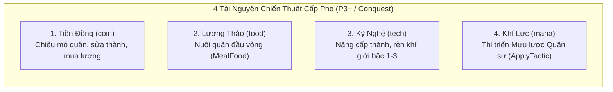

---

### 8.3. Khấu trừ Quân lương & Cơ chế Nạn đói (`Starvation`)

* **Chu trình Đầu Vòng (`OnBeginRound` — Pha 1):**
  * Cộng sản lượng thu hoạch từ toàn bộ công trình đang kiểm soát: Nông điền (`food`), Chợ & Thành (`coin`), Mỏ quặng & Thái Học (`tech`), Đền chùa (`mana`).
  * Khấu trừ tổng định mức quân lương `TotalMealFood` theo quy mô cờ `max_stack` của mọi đạo quân hiện diện trên bản đồ (Bộ binh `10`, Cung nỏ `12`, Thủy quân `15`, Kỵ binh `20`, Công thành/Hỏa khí `20`, Tượng binh `30` Food/cờ/lượt).
* **Khủng hoảng Nạn đói (Khi `food < 0`):**
  * **Giảm `-1 bậc` Sĩ khí toàn quân, chặn sàn tại `MoraleLevel.LOW` (*Dao Động*)**: Hạ `HIGH → NORMAL → LOW`; **tuyệt đối không hạ từ `LOW` xuống `CHAOS`** để ngăn tình trạng toàn quân tê liệt không thể giải cứu (chống soft-lock).
  * **Giảm `25%` sát thương đầu ra** (`M_starvation = 0.75`).
  * **Khóa toàn bộ khả năng hồi phục HP** (`0 HP` từ thành trì, quân y và kỹ năng).
* **Ý nghĩa tái hiện lịch sử Việt Nam:** Cho phép mô phỏng tự nhiên bằng cơ chế hệ thống các kế sách kinh điển như **"Thanh dã" (Vườn không nhà trống)** thời Trần hoặc trận **Vân Đồn (1288)** đốt thuyền lương Trương Văn Hổ làm đại quân Thoát Hoan suy kiệt.

---

### 8.4. Công trình Hậu cần, Cướp lương & Giao thương Khẩn cấp

* **Hệ thống Công trình Chiến lược (`FacilitySettings.json`):**
  * *Thành trì / Đô thành (`Type 1–5`):* Cứ điểm phát `CoC` (`step_cost * 2`), hồi HP đồn trú, thu thuế `coin`/`food`, chiêu mộ quân và bổ nhiệm Tướng chỉ huy.
  * *Nông điền (`Type 33`):* Cung cấp `80–200 Food/lượt` — huyết mạch nuôi đại quân.
  * *Chợ / Thương điếm (`Type 18`):* Sinh `60–150 Coin/lượt` và mở khóa lệnh Giao thương khẩn cấp (`Trade`).
  * *Mỏ quặng (`Type 31–32`) & Quốc Tử Giám (`Type 13`):* Cung cấp điểm `Tech` để nâng cấp thành trì mở binh chủng cao cấp, gia cố công sự và nghiên cứu khí giới bậc 1–3 ngay trong trận.
  * *Chùa cổ / Đền miếu (`Type 14`):* Sinh điểm `Mana` cho Mưu lược Quân sư và ổn định tinh thần khu vực.
  * *Kho lương kiên cố (`Type 20`):* Tăng sức chứa lương thảo và **giảm `50%` lượng tài nguyên bị cướp** khi thành/vùng bị địch đánh chiếm.
* **Cướp bóc Hậu cần (`RobAreaIncome`):** Đánh chiếm công trình kinh tế địch thu giữ ngay chiến lợi phẩm tích lũy tối đa `3` lượt (`min(turns_unrobbed, 3)`), giảm một nửa nếu mục tiêu có Kho lương kiên cố.
* **Giao thương Khẩn cấp (`TradeCommand`):** Khi sở hữu ít nhất 1 ô Chợ (`Type 18`), người chơi có thể dùng lệnh `Trade` đổi `Coin → Food` cứu đói hoặc bán `Food → Coin` lấy ngân sách tuyển quân theo công thức tỷ giá động phụ thuộc cấp Chợ và tình trạng vây hãm/nạn đói.

---

## 3.6. Tiến trình và nguyên tắc cân bằng (Meta-Progression & Balance)


> [!IMPORTANT]
> **Phạm vi áp dụng:** Hệ thống Tiến trình Ngoại trận (Meta-Progression) thuộc phạm vi **P3 Alpha+** (dùng cho chế độ *Domination*, *Conquest* và *Legion*), **ẩn hoàn toàn trong Slice-01 Bạch Đằng 1288**.

> 📖 **Tài liệu đặc tả chi tiết chuyên sâu:**  
> Xem đầy đủ kiến trúc 4 trục tiến trình Tướng, Duyên phận lịch sử, 5 ô Bảo vật Đại Việt và Kinh tế Meta F2P thân thiện tại:  
> 👉 [Hệ thống Tướng & Kinh Tế Meta (generals_and_meta_economy.md)](gdd/progression/generals_and_meta_economy.md)

---

### 9.1. Triết lý Tiến trình & Định hướng F2P Thân thiện (`D-07`)

Hệ thống Meta-Progression của **Đại Việt Chiến Kỳ** (100% Single-player trên Web & Android) được thiết kế để tạo động lực sưu tầm dài hạn mà **không bao giờ phá vỡ tính chiến thuật cốt lõi hay khóa danh tướng dân tộc sau tường phí**:

1. **Mọi Danh tướng (cả Đại Việt lẫn Đối phương Lịch sử) đều có thể sở hữu miễn phí (`F2P-Friendly — D-07`):** Người chơi tích lũy **`Ngọc Bích` (`Jade`)**, **`Lệnh Chiêu Mộ` (`RecruitOrder`)** và **`Huân Chương Quân Công` (`Merit`)** từ vượt ải 3 sao, thành tựu lịch sử, chế độ Chinh phạt và sự kiện để chiêu mộ hoặc quy đổi trực tiếp tại **Shop Quân Công (Quân Cơ Xứ)** cho **mọi bậc phẩm tướng (bao gồm cả bậc Đỏ — Thần Thoại)**. Hệ thống bao gồm đầy đủ cả các **Danh tướng Đối phương** từ bậc Lục đến Tím, Cam và Đỏ (ví dụ: **Mã Viện**, **Hốt Tất Liệt / Bá Nhan**, **Trương Phụ** ở bậc Đỏ; **Ô Mã Nhi**, **Quách Quỳ**, **Cao Biền**, **Tôn Sĩ Nghị** ở bậc Cam): sau khi người chơi đánh bại họ trong Chiến dịch để mở khóa hồ sơ, có thể chiêu mộ và điều động tự do trong *Conquest*, *Legion*, *Domination* và *Chơi lại Tự do (Free Replay)*.
2. **Tầm vóc Tướng lĩnh quyết định thế trận nhưng vẫn tôn trọng chiến thuật:** Bồi dưỡng tướng mở thêm ô kỹ năng phối hợp, kích hoạt Duyên phận lịch sử (`Fetters`), phát huy **Sát thương Sở trường (`CommandProfile` bậc `S` `+25%`)** và **Hào quang Chỉ huy (`CommandAura` `1–2 hex`)**, biến tướng thành trụ cột chiến dịch nhưng vẫn cần đội hình bọc lót trước địa hình và bao vây `CHAOS`.
3. **Hai chốt chặn bảo vệ cân bằng Single-player:**
   * **Historical Scenario (Chiến dịch Lịch sử chuẩn):** **Khóa hồ sơ tướng theo kịch bản (`Fixed Historical Roster`)** để mọi người chơi trải nghiệm đúng bối cảnh và thử thách chiến thuật được thiết kế.
   * **Challenge Mode / Legion (Thử thách Tác chiến):** Áp dụng **Giới hạn Cấp Trần (`Level / Stat Cap`)** công khai theo từng màn, loại bỏ việc cày cấp quá mức để vượt ải bằng sức mạnh thuần số học.
4. **Thương mại hóa văn minh (nếu bật ở P4/P5):** Các gói tùy chọn (Thẻ Tháng, Chiến Lệnh, Gói Ủng Hộ) chỉ hỗ trợ rút ngắn thời gian tích lũy tài nguyên hoặc mở khóa ngoại trang/khung biểu trưng lịch sử, đi kèm cơ chế bảo hiểm (`Pity`) và đổi mảnh minh bạch.

> **Lưu ý tôn trọng lịch sử:** Hệ thống 5 bậc phẩm màu (`Đỏ / Cam / Tím / Lam / Lục`) chỉ phản ánh **độ hiếm sưu tầm và độ phức tạp cơ chế bộ kỹ năng trong gameplay (`QualityTier`)**, **tuyệt đối không phải sự xếp hạng hay phán xét công trạng lịch sử** của các nhân vật.

---

### 9.2. Tóm tắt Khung Tiến trình 4 Trục Danh Tướng

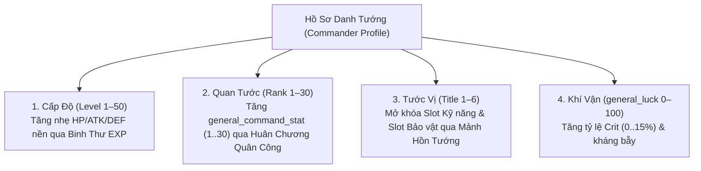

---

### 9.3. Hệ thống Duyên phận Lịch sử & 5 Ô Bảo vật Đại Việt

* **Duyên phận Lịch sử (`FetterSettings.json`):** Kích hoạt hiệu ứng cộng hưởng chiến thuật khi các danh tướng đồng thời kỳ/cùng chí hướng sát cánh trên chiến trường (ví dụ: *Trần Triều Tam Kiệt*, *Vua Tôi Đồng Lòng*, *Hội Thề Lũng Nhai*, *Tây Sơn Tam Kiệt*, *Hào Khí Mê Linh*).
* **Năm Ô Bảo vật Chuẩn Niên đại (`EquipmentSettings.json`):**
  1. **Cận chiến:** *Thuận Thiên Kiếm*, *Gươm Thái A*, *Trường Đao Trần Triều*...
  2. **Tầm xa:** *Nỏ Liên Châu Kim Quy*, *Cung Thần Đại Việt*, *Hỏa Hổ Ống Đồng*...
  3. **Hộ giáp:** *Khôi Giáp Thiết Lĩnh*, *Áo Bào Chiến Trận*, *Hộ Tâm Kính*...
  4. **Thú cưỡi:** *Thớt Voi Chiến Tây Sơn*, *Bạch Mã Phiên Đao*, *Chiến Mã Thiết Giáp*...
  5. **Binh thư:** *Binh Thư Yếu Lược*, *Hịch Tướng Sĩ*, *Quân Trung Từ Mệnh Tập*...
* **Định hướng chỉ số:** Tập trung vào `damage_deepen` (`+%` sát thương đầu ra), `damage_resist` (`-%` sát thương nhận vào, chặn biên tối đa `75%`), `crit_rate_bonus`, `crit_damage_bonus` và hiệu ứng chiến thuật có điều kiện.

---

### 9.4. Bảng Tiền tệ & Nguyên liệu Ngoại trận Đồng bộ (Meta Currencies)

Toàn bộ danh mục tiền tệ Meta được chuẩn hóa tên gọi và mã định danh thống nhất 100% trên toàn dự án:

| Tên Tiền tệ / Nguyên liệu | Mã Định danh | Nguồn tích lũy miễn phí trong Game | Công dụng chính |
| :--- | :---: | :--- | :--- |
| **Tiền Đồng** | `Coin` | Thưởng hoàn thành màn chơi, nhiệm vụ ngày, Chinh phạt | Thăng cấp `Level` tướng, rèn/cường hóa trang bị cơ bản, chiêu mộ Tỳ tướng. |
| **Ngọc Bích** *(kèm `Lệnh Chiêu Mộ`)* | `Jade` / `RecruitOrder` | Thưởng vượt ải 3 sao lần đầu, thành tựu lịch sử, sự kiện mùa, nhiệm vụ tuần | Quay Đài Chiêu Mộ Danh Tướng (kể cả Banner Giới Hạn bậc Đỏ) & đổi Lệnh Chiêu Mộ. |
| **Huân Chương Quân Công** | `Merit` | Đạt 3 sao chiến dịch, mục tiêu phụ, Chinh phạt & Thử thách Legion | Phong `Quan Tước` (`Rank 1–30`), **đổi trực tiếp Danh Tướng & Bảo vật tại Shop Quân Công**. |
| **Binh Thư EXP** | `TomeExp` | Thao diễn võ học, ải thử thách Legion, phân giải mảnh dư | Bồi dưỡng EXP cấp độ tướng và nâng bậc Kỹ năng chiến thuật chủ động/bị động. |
| **Mảnh Hồn Tướng** *(Nguyên liệu)* | `GeneralShard` | Thưởng cột mốc lịch sử, Shop Quân Công, chiêu mộ trùng tướng | Thức tỉnh `Tước Vị` (`Title 1–6`) và ghép mở khóa trực tiếp danh tướng. |

---

### 9.5. Cơ chế Chiêu mộ & Bảo hiểm Minh bạch (`Pity & Exchange`)

1. **Hai kênh sở hữu bổ trợ nhau (Không khóa tường phí):**
   * **Shop Quân Công (`Quân Cơ Xứ`):** Đổi trực tiếp các danh tướng và mảnh hồn tướng (từ bậc Lam đến bậc Cam và mảnh bậc Đỏ theo chu kỳ luân phiên) bằng `Huân Chương Quân Công` (`Merit`).
   * **Đài Chiêu Mộ (`Recruitment Pools`):** Sử dụng `Ngọc Bích` (`Jade`) hoặc `Lệnh Chiêu Mộ` (`RecruitOrder`) tích lũy từ quá trình chơi để rút thẻ ở Bể Tân Thủ, Bể Thường và Bể Sự Kiện Lịch Sử.
2. **Năm Bậc Phẩm Gameplay (`QualityTier`):** **Đỏ** (*Thần Thoại*) → **Cam** (*Sử Thi*) → **Tím** (*Danh Tướng*) → **Lam** (*Dũng Tướng*) → **Lục** (*Tỳ Tướng*).
3. **Bảo hiểm & Đổi trực tiếp (`Hard Pity & Sparking`):**
   * **Bể Tân Thủ:** Giảm `20%` chi phí, tối đa `10` lượt đầu chắc chắn nhận 1 Tướng bậc Cam.
   * **Bể Thường:** Có 1 lượt miễn phí mỗi ngày; bảo hiểm `50` lượt chắc chắn nhận Tướng bậc Cam.
   * **Bể Sự Kiện Lịch Sử (Bậc Đỏ):** Mở cho cả `Ngọc Bích` (`Jade`) và `Lệnh Chiêu Mộ` tích lũy miễn phí; bảo hiểm cứng `80` lượt ra Tướng bậc Đỏ và đạt `120` điểm tích lũy được chọn đổi trực tiếp tướng tâm điểm.

---

# CHƯƠNG IV: ĐẶC TẢ CHI TIẾT CƠ CHẾ CHIẾN THUẬT (TACTICAL MECHANICS DEEP-DIVE)

## 4.1. Đặc Tả Chi Tiết Công Thức Chiến Đấu & Tính Toán Sát Thương


> **Vị trí tài liệu:** `docs/gdd/mechanics/combat_formulas.md`  
> **Nền tảng mục tiêu:** Godot 4.7 — Thuần GDScript 2.0 (Static Typing) cho Web & Android  
> **Trạng thái:** Chuẩn hóa đồng bộ với [battlefield_rules.md](gdd/02_gameplay_systems/battlefield_rules.md), [units_commanders.md](gdd/02_gameplay_systems/units_commanders.md) và [morale_and_status.md](gdd/mechanics/morale_and_status.md).

---

### 1. Hệ thống Chỉ số & Miền Giá trị Chuẩn hóa (Combat Attributes & Domains)

Mọi biến số tham gia tính toán sát thương đều dùng tên thuộc tính chuẩn GDScript/JSON (`snake_case`) với miền giá trị xác định rõ ràng:

| Nhóm | Thuộc tính (`snake_case`) | Kiểu | Miền giá trị | Ý nghĩa & Quy tắc Gameplay |
| :--- | :--- | :---: | :---: | :--- |
| **Sinh lực & Cờ** | `base_hp` | `int` | `100 .. 600` | Sinh lực chuẩn của 1 cờ biên chế. |
| | `max_stack` | `int` | `1, 2, 3` | Quy mô gộp cờ đầu trận (`1x, 2x, 3x`). Cố định `max_hp = base_hp * max_stack` và `M_stack`. |
| | `current_hp` | `int` | `0 .. max_hp` | Sinh lực hiện tại. Tỷ lệ `hp_ratio = float(current_hp) / float(max_hp)` làm giảm lực đánh mượt theo `M_hp`. |
| **Tấn công & RNG** | `base_atk` | `int` | `25 .. 120` | Lực tấn công danh định tối đa của đơn vị. |
| | `damage_roll_min`, `damage_roll_max` | `int` | `[75..85]` – `[95..100]` | Biên độ dao động sát thương (`%`): mặc định **`80% – 100%`**; khinh binh/du kích **`75% – 95%`**; cấm vệ tinh nhuệ **`85% – 100%`**. |
| | `attack_mode` | `int` | `1 .. 6` | Kiểu tấn công đối chiếu ma trận khắc chế (Mục 4). |
| | `min_range`, `max_range` | `int` | `[1, 1]` .. `[2, 3]` | Cự ly Hex tối thiểu và tối đa được phép công kích hoặc phản kích. |
| **Phòng thủ** | `base_def` | `int` | `5 .. 60` | Điểm giáp cơ bản trước khi nhân địa hình và sĩ khí. |
| | `defense_mode` | `int` | `1 .. 5` | Loại giáp của mục tiêu đối chiếu ma trận khắc chế (Mục 4). |
| | `damage_percent` | `int` | `35 .. 150` | Hệ số phần trăm khắc chế (`%`) tra từ bảng `attack_mode × defense_mode`. |
| **Địa hình** | `fond_terrain` | `int` | `-1` hoặc `0 .. 8` | Địa hình sở trường (`TerrainType`). Khi đứng đúng ô sở trường: thưởng **`+15% ATK/DEF`** và **`-1 MP`** di chuyển. |
| | `M_terrain` | `float` | `0.85 .. 1.30` | Hệ số công địa hình của bên công (gồm nội tại ô đứng + `+0.15` nếu khớp `fond_terrain`). |
| | `TerrainDefMult` | `float` | `0.80 .. 1.45` | Hệ số giáp địa hình của mục tiêu (gồm nội tại ô đứng + `+0.15` nếu khớp `fond_terrain`). |
| **Tướng chỉ huy** | `general_command_stat` | `int` | `0` hoặc `1 .. 30` | Chỉ số Thống lĩnh của tướng (`0` nếu không gắn tướng). Cộng `GenBonus = general_command_stat * 1` vào lực công nền. |
| | `M_command` | `float` | `0.90 .. 1.25` | Hệ số thông thạo 5 nhánh binh chủng `CommandProfile`: `S = 1.25` (+25%), `A = 1.15` (+15%), `B = 1.08` (+8%), `C = 1.00` (+0%), `D = 0.90` (-10%). |
| | `general_luck` | `int` | `0 .. 100` | Chỉ số Khí vận của tướng (`0` nếu không có tướng), cộng `int(general_luck * 0.15)` (`0..15%`) vào tỷ lệ Crit. |
| | `aura_radius_hex` | `int` | `0 .. 2` | Bán kính Hào quang Chỉ huy (`CommandAura`): `1 hex` (Lam/Tím) hoặc `2 hex` (Cam/Đỏ), cộng thưởng `damage_deepen` / `damage_resist` cho đồng minh trong vùng. |
| **Bạo kích & Phản kích** | `base_crit` | `int` | `0 .. 25` | Tỷ lệ chí mạng cơ bản (`%`), mặc định bằng `5`. |
| | `crit_rate_bonus` | `int` | `-20 .. 50` | Điểm cộng/trừ tỷ lệ Crit (`%`) từ bảo vật hoặc kỹ năng thụ động (mặc định `0`). |
| | `crit_damage_bonus` | `int` | `0 .. 100` | Phần trăm sát thương chí mạng cộng thêm (`%`, mặc định `0`); chia cho `100.0` khi cộng vào nền `1.50`. |
| | `counter_percent` | `int` | `0 .. 120` | Hiệu suất sát thương phản kích (`%`), **mặc định `75`** (tức `75%` đòn chuẩn; giáo binh thủ trận có thể đạt `100`). |
| **Khuếch đại & Kháng** | `damage_deepen` | `int` | `0 .. 100` | Phần trăm gia tăng sát thương đầu ra (`%`, mặc định `0`). |
| | `damage_resist` | `int` | `-50 .. 75` | Phần trăm giảm sát thương nhận vào (`%`, mặc định `0`), luôn chặn biên `clampi(damage_resist, -50, 75)`. |

---

### 2. Controlled RNG Có Hạt giống Tất định (Seeded Deterministic RNG)

* **Bộ sinh số riêng biệt:** Mỗi phiên trận đánh khởi tạo một thực thể `RandomNumberGenerator` riêng biệt chuyên phục vụ giải quyết giao tranh (`combat_rng`), tách rời khỏi hiệu ứng hạt VFX hoặc âm thanh UI.
* **Lưu trữ trạng thái Replay:** Cấu trúc phiên trận (`BattleSessionState` tại [data_and_save_system.md](gdd/architecture/data_and_save_system.md)) lưu cả `rng_seed: int` lẫn `rng_state: int` sau mỗi `BattleCommand`. Khi phát lại Replay hoặc tải lại Checkpoint giữa trận, chuỗi kết quả `roll_factor` và `crit_roll` khớp tuyệt đối **100% Deterministic** trên cả Web (Wasm) và Android (ARM64).
* **Quy tắc làm tròn chuẩn (`round_half_up`):** Mọi phép quy đổi sát thương sang số nguyên ở bước chốt cuối cùng đều dùng hàm làm tròn nửa lên dương (`int(floor(x + 0.5))` cho số dương `x`), không làm tròn cắt cụt sớm ở các bước trung gian.

---

### 3. Cơ chế Gộp cờ (`TroopStack`: 1x, 2x, 3x) — Xóa bỏ "Vách đá Sát thương"

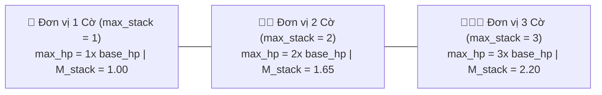

| Biên chế Đầu trận (`max_stack`) | Sinh lực Tối đa (`max_hp`) | Hệ số Quy mô Cố định (`M_stack`) | Định mức Lương (`MealFood`) | Chi phí Chiêu mộ |
| :---: | :---: | :---: | :---: | :---: |
| **1 Cờ (`1x`)** | `base_hp * 1` | **`1.00`** | `1 * MealRate` | `1.0x` |
| **2 Cờ (`2x`)** | `base_hp * 2` | **`1.65`** (+65% lực công) | `2 * MealRate` | `1.8x` |
| **3 Cờ (`3x`)** | `base_hp * 3` | **`2.20`** (+120% lực công) | `3 * MealRate` | `2.5x` |

> [!IMPORTANT]
> **Quy tắc chống phạt kép ("No Damage Cliff"):**
> * `max_stack` được khóa từ lúc xuất quân đầu trận (hoặc lúc chiêu mộ): cả `max_hp` lẫn `M_stack` **giữ nguyên không đổi** trong suốt trận đánh.
> * Khi đơn vị mất máu, lực đánh suy giảm **mượt và liên tục** duy nhất qua thừa số sinh lực:
>   $$M_{\text{hp}} = 0.50 + 0.50 \times \left(\frac{\text{current\_hp}}{\text{max\_hp}}\right)$$
> * Số cờ hiển thị trên đầu mô hình (`active_banners = 3 / 2 / 1` tương ứng ngưỡng máu `> 66%`, `33% – 66%`, `< 33%` `max_hp` đối với đạo 3 cờ; tổng quát `clampi(ceili(hp_ratio * max_stack), 1, max_stack)`) **chỉ là chỉ báo thị giác trực quan**, tuyệt đối không hạ bậc `M_stack` và không cắt giảm `max_hp`.

---

### 4. Ma trận Khắc chế Binh chủng (`6 AttackMode × 5 DefenseMode`)

Giá trị ô tương giao là `damage_percent` (`35` đến `150`, tương ứng `0.35x` đến `1.50x`):

| `attack_mode` \ `defense_mode` | 1. Giáp vải (`LIGHT`) | 2. Giáp da (`MEDIUM`) | 3. Giáp sắt (`HEAVY`) | 4. Voi chiến (`BEAST`) | 5. Thành/Lũy (`FORT`) |
| :--- | :---: | :---: | :---: | :---: | :---: |
| **1. Đao thương cận chiến** | `105%` | **`120%`** | `100%` | `80%` | **`45%`** |
| **2. Xung kích Kỵ / Tượng** | **`135%`** | `110%` | `100%` | `90%` | `85%` |
| **3. Cung tên / Nỏ liên châu** | **`125%`** | `100%` | **`75%`** | `85%` | **`35%`** |
| **4. Thần cơ pháo / Súng lớn** | `80%` | `85%` | **`120%`** | **`110%`** | **`150%`** |
| **5. Chiến thuyền / Thủy công** | `110%` | `100%` | `90%` | **`120%`** | **`130%`** |
| **6. Hỏa tiễn / Hỏa hổ / Bè lửa** | **`125%`** | `115%` | `105%` | `100%` | **`125%`** |

*(Ánh xạ chi tiết giữa 5 nhánh chỉ huy `CommandBranch` và bảng này xem tại [units_commanders.md](gdd/02_gameplay_systems/units_commanders.md)).*

---

### 5. Công thức Tính Sát thương Chuẩn hóa (`FinalDamage`)

### 5.1. Công thức Tổng quát
Khi đơn vị tấn công hợp lệ (`morale != MoraleLevel.CHAOS`):

$$\text{RawDamage} = \text{Atk}_{\text{rolled}} \times \text{DefReduction} \times \left(\frac{\text{damage\_percent}}{100.0}\right) \times M_{\text{command}} \times M_{\text{morale}} \times M_{\text{target\_chaos}} \times M_{\text{flank}} \times M_{\text{terrain}} \times M_{\text{stack}} \times M_{\text{starvation}} \times M_{\text{deepen}} \times M_{\text{resist}}$$

$$\text{FinalDamage} = \max\Big(1, \ \text{round\_half\_up}(\text{RawDamage})\Big)$$

*(Nếu bên công đang ở `MoraleLevel.CHAOS`, đơn vị bị khóa tấn công hoàn toàn và `M_morale = 0.00`).*

### 5.2. Giải trình Chi tiết Từng Thừa số

1. **Lực công sau gieo biên độ & Tướng thống lĩnh ($\text{Atk}_{\text{rolled}}$):**
   $$\text{RollFactor} = \text{combat\_rng.randf\_range}\left(\frac{\text{damage\_roll\_min}}{100.0}, \ \frac{\text{damage\_roll\_max}}{100.0}\right)$$
   $$\text{GenBonus} = \text{general\_command\_stat} \times 1 \quad (\text{miền } 0..30)$$
   $$M_{\text{hp}} = 0.50 + 0.50 \times \left(\frac{\text{current\_hp}}{\text{max\_hp}}\right)$$
   $$\text{Atk}_{\text{rolled}} = \Big(\text{base\_atk} \times \text{RollFactor} + \text{GenBonus}\Big) \times M_{\text{hp}}$$
   * **Hiển thị `CombatPreview`:** Tính dải dự báo `[D_min, D_max]` bằng cách thay lần lượt `RollFactor = damage_roll_min / 100.0` và `RollFactor = damage_roll_max / 100.0` (chưa nhân Crit).

2. **Đường cong Giáp phi tuyến thống nhất ($\text{DefReduction}$):**
   $$\text{EffectiveDef} = \text{base\_def} \times \text{TerrainDefMult} \times \text{MoraleDefMult}$$
   $$\text{DefReduction} = \frac{100.0}{100.0 + \max(0.0, \ \text{EffectiveDef})}$$
   * Trong đó **`MoraleDefMult = 0.80`** nếu mục tiêu đang ở bậc Sĩ khí **`MoraleLevel.LOW`** (*Dao Động*, bị phạt `-20%` Giáp), ngược lại bằng **`1.00`** ở mọi bậc khác.
   * Hàm `max(0.0, EffectiveDef)` chặn biên an toàn, loại bỏ hoàn toàn nguy cơ mẫu số âm hoặc chia cho `0`.

3. **Hệ số Thông thạo Binh chủng của Tướng ($M_{\text{command}}$):**
   * Tra từ `CommandProfile` của tướng bên công ứng với `CommandBranch` của đạo quân ([units_commanders.md](gdd/02_gameplay_systems/units_commanders.md)):
     * `S = 1.25` (`+25%`) | `A = 1.15` (`+15%`) | `B = 1.08` (`+8%`) | `C = 1.00` (`+0%`, hoặc khi không gắn tướng) | `D = 0.90` (`-10%`).
   * Ngoài ra, các đơn vị đồng minh đứng trong bán kính `CommandAura` (`1–2 hex`) của Danh tướng nhận thêm `+5%` đến `+10%` vào `damage_deepen` / `damage_resist` (lấy giá trị hào quang cao nhất, không cộng dồn nhiều hào quang cùng loại).

4. **Hệ số Sĩ khí bên công ($M_{\text{morale}}$) & Phạt Hỗn loạn bên thủ ($M_{\text{target\_chaos}}$):**
   * `M_morale` (bên công): `HIGH = 1.15` | `NORMAL = 1.00` | `LOW = 0.75` | `CHAOS = 0.00`.
   * `M_target_chaos` (bên thủ): **`1.30`** nếu mục tiêu đang ở trạng thái `MoraleLevel.CHAOS` (+30% sát thương nhận vào), ngược lại **`1.00`**.

5. **Hệ số Bọc sườn ($M_{\text{flank}}$) & Địa hình ($M_{\text{terrain}}$):**
   * `M_flank`: **`1.15`** khi có ít nhất 1 đồng minh khác (không bị `CHAOS`) đứng kề mục tiêu tại ô không kề bên công (góc $120^\circ$ hoặc $180^\circ$), ngược lại **`1.00`**.
   * `M_terrain`: Tổng hợp điều chỉnh công nội tại của địa hình ô bên công đang đứng (ví dụ: tầm xa đứng trên `HILLS` `+0.10`, Kỵ/Pháo sa lầy `SWAMP` `-0.15`, lục quân trên thuyền vận tải `-0.20`) cộng thêm **`+0.15`** nếu ô đó trùng `fond_terrain` của đơn vị/tướng.

6. **Hệ số Nạn đói ($M_{\text{starvation}}$ — Phạm vi P3+):**
   * Bằng **`0.75`** (-25% sát thương đầu ra) khi màn chơi bật kinh tế (`enable_economy == true`) và phe tấn công đang bị âm lương (`food < 0`); bằng **`1.00`** trong mọi trường hợp còn lại (bao gồm toàn bộ Slice-01).

7. **Hệ số Khuếch đại ($M_{\text{deepen}}$) & Kháng sát thương chặn biên ($M_{\text{resist}}$):**
   $$M_{\text{deepen}} = 1.0 + \frac{\max(0, \ \text{damage\_deepen})}{100.0}$$
   $$M_{\text{resist}} = 1.0 - \frac{\text{clampi}(\text{damage\_resist}, \ -50, \ 75)}{100.0}$$
   * Kháng sát thương bị khóa trần ở **`75%`** (`M_resist >= 0.25`, không bao giờ bất tử) và sàn ở **`-50%`** (`M_resist <= 1.50`, tối đa tăng 50% sát thương nhận thêm khi dính hiệu ứng phá giáp).

---

### 6. Cơ chế Đòn Bạo kích (`Critical Strike`)

### 6.1. Công thức Tỷ lệ Bạo kích (`crit_rate`)
Nếu bên công ở `MoraleLevel.CHAOS`, `crit_rate = 0`. Ngược lại:

$$\text{crit\_rate} = \text{clampi}\Big(\text{base\_crit} + \text{int}(\text{hp\_ratio} \times 10.0) + \text{int}(\text{general\_luck} \times 0.15) + \text{morale\_crit\_mod} + \text{crit\_rate\_bonus}, \ 0, \ 100\Big)$$

| Thành phần | Giá trị / Công thức | Diễn giải |
| :--- | :---: | :--- |
| `base_crit` | Mặc định `5` (`5%`) | Xác suất bạo kích nền của binh chủng. |
| `int(hp_ratio * 10.0)` | `0 .. 10` (`0% – 10%`) | Quân số sung mãn dễ tạo đột biến hơn quân tàn binh. |
| `int(general_luck * 0.15)` | `0 .. 15` (`0% – 15%`) | Quy đổi từ chỉ số Khí vận của tướng (`general_luck` $\in [0, 100]$). |
| `morale_crit_mod` | `HIGH: +20` · `NORMAL: 0` · `LOW: -5` | Thưởng lớn khi quân sĩ đang *Hưng Phấn*, giảm khi *Dao Động*. |
| `crit_rate_bonus` | `-20 .. +50` | Cộng thêm từ bảo vật hoặc kỹ năng nội tại. |

### 6.2. Sát thương & Hiệu ứng Tâm lý khi Nổ Bạo kích
Khi `combat_rng.randi_range(1, 100) <= crit_rate`:

$$\text{CritDamage} = \max\left(1, \ \text{round\_half\_up}\left(\text{FinalDamage} \times \left(1.50 + \frac{\text{crit\_damage\_bonus}}{100.0}\right)\right)\right)$$

* **Lưu ý chia `100.0`:** Ví dụ `crit_damage_bonus = 20` (+20% sát thương bạo kích từ bảo vật) sẽ cho hệ số nhân `1.50 + 0.20 = 1.70x` `FinalDamage`.
* **Áp chế tinh thần:** Đòn bạo kích lập tức giáng **`-1 bậc` Sĩ khí** lên mục tiêu (trừ khi mục tiêu có `is_morale_locked == true`).

---

### 7. Cơ chế Phản kích (`Retaliation`) & Mã mẫu GDScript 2.0

### 7.1. Quy trình và 6 Điều kiện Phản kích
1. **Thứ tự tuần tự:** Đòn chủ động của bên công giải quyết trước (trừ `current_hp` của bên thủ và áp dụng giảm bậc Sĩ khí do `Flank` / `Crit`). Chỉ khi bên thủ **còn sống (`current_hp > 0`)**, hệ thống mới xét phản kích dựa trên trạng thái sau khi nhận đòn của bên thủ.
2. **Sáu điều kiện bắt buộc để bên thủ phản kích:**
   * `defender.current_hp > 0` (còn sống sau đòn công).
   * `defender.state.can_retaliate() == true` (tức `morale != MoraleLevel.CHAOS`, `chaos_turns == 0`, `attack_disabled_turns == 0`, và **`not has_retaliated_this_round`** — tối đa **1 lần phản kích / vòng đối phương**, đặt lại ở `FactionTurnStart` của bên thủ).
   * Khoảng cách Hex `dist = hex_distance(defender.hex, attacker.hex)` nằm trong `[defender.min_range, defender.max_range]`.
   * **Có đường ngắm hợp lệ (`hex_map.has_line_of_sight(defender.hex, attacker.hex) == true`)** — đơn vị tầm xa bị khuất sau `FOREST`, `HILLS` hoặc `FORT` không được phản kích xuyên vật cản (chi tiết thuật toán LOS tại [hex_grid_pathfinding.md](gdd/mechanics/hex_grid_pathfinding.md)).
   * Đòn đánh chủ động không mang thuộc tính miễn phản kích (`no_retaliation`, ví dụ: phục kích từ `FOREST`, pháo kích tầm xa đặc chủng).
   * Phản kích không bao giờ kích hoạt phản kích ngược lại lần thứ hai.
3. **Công thức Sát thương Phản kích (`CounterDamage`):**
   * Tính `counter_raw_damage` từ bên thủ đánh trả bên công theo công thức `RawDamage` ở Mục 5.1 (không tính `Flank` và không nổ `Crit` trong đòn phản kích tiêu chuẩn), sau đó nhân tỷ lệ `counter_percent` (mặc định `75`) rồi làm tròn:
   $$\text{CounterDamage} = \max\left(1, \ \text{round\_half\_up}\left(\text{counter\_raw\_damage} \times \frac{\text{counter\_percent}}{100.0}\right)\right)$$

### 7.2. Tham chiếu Triển khai GDScript 2.0 (Godot 4.7)

```gdscript
class_name CombatFormulaResolver
extends RefCounted

const STACK_MULTIPLIERS: Dictionary[int, float] = {
	1: 1.00,
	2: 1.65,
	3: 2.20,
}

class CombatInput:
	var attacker_hp: int = 100
	var attacker_max_hp: int = 100
	var base_atk: int = 40
	var general_command_stat: int = 0
	var attacker_morale: UnitCombatState.MoraleLevel = UnitCombatState.MoraleLevel.NORMAL
	var target_base_def: int = 10
	var target_terrain_def_mult: float = 1.00
	var target_morale: UnitCombatState.MoraleLevel = UnitCombatState.MoraleLevel.NORMAL
	var damage_percent: int = 100
	var m_command: float = 1.00
	var is_flanked: bool = false
	var m_terrain: float = 1.00
	var max_stack: int = 1
	var is_starving: bool = false
	var damage_deepen: int = 0
	var damage_resist: int = 0

static func round_half_up(value: float) -> int:
	return int(floor(value + 0.5))

static func compute_effective_def(
	base_def: int,
	terrain_def_mult: float,
	target_morale: UnitCombatState.MoraleLevel
) -> float:
	var morale_def_mult: float = 0.80 if target_morale == UnitCombatState.MoraleLevel.LOW else 1.00
	return float(base_def) * terrain_def_mult * morale_def_mult

static func compute_def_reduction(effective_def: float) -> float:
	return 100.0 / (100.0 + maxf(0.0, effective_def))

static func compute_raw_damage(ctx: CombatInput, roll_factor: float) -> float:
	if ctx.attacker_morale == UnitCombatState.MoraleLevel.CHAOS:
		return 0.0

	var max_hp: int = maxi(1, ctx.attacker_max_hp)
	var hp_ratio: float = clampf(float(ctx.attacker_hp) / float(max_hp), 0.0, 1.0)
	var m_hp: float = 0.50 + 0.50 * hp_ratio

	var gen_cmd: int = clampi(ctx.general_command_stat, 0, 30)
	var atk_rolled: float = (float(ctx.base_atk) * roll_factor + float(gen_cmd)) * m_hp

	var eff_def: float = compute_effective_def(
		ctx.target_base_def,
		ctx.target_terrain_def_mult,
		ctx.target_morale
	)
	var def_reduction: float = compute_def_reduction(eff_def)
	var m_matchup: float = float(ctx.damage_percent) / 100.0

	var m_morale: float = 1.00
	match ctx.attacker_morale:
		UnitCombatState.MoraleLevel.HIGH:
			m_morale = 1.15
		UnitCombatState.MoraleLevel.NORMAL:
			m_morale = 1.00
		UnitCombatState.MoraleLevel.LOW:
			m_morale = 0.75
		_:
			m_morale = 0.00

	var m_target_chaos: float = (
		1.30 if ctx.target_morale == UnitCombatState.MoraleLevel.CHAOS else 1.00
	)
	var m_flank: float = 1.15 if ctx.is_flanked else 1.00
	var clamped_stack: int = clampi(ctx.max_stack, 1, 3)
	var m_stack: float = STACK_MULTIPLIERS.get(clamped_stack, 1.00)
	var m_starvation: float = 0.75 if ctx.is_starving else 1.00

	var deepen: int = maxi(0, ctx.damage_deepen)
	var resist: int = clampi(ctx.damage_resist, -50, 75)
	var m_deepen: float = 1.0 + float(deepen) / 100.0
	var m_resist: float = 1.0 - float(resist) / 100.0

	return (
		atk_rolled
		* def_reduction
		* m_matchup
		* ctx.m_command
		* m_morale
		* m_target_chaos
		* m_flank
		* ctx.m_terrain
		* m_stack
		* m_starvation
		* m_deepen
		* m_resist
	)

static func compute_final_damage(ctx: CombatInput, roll_factor: float) -> int:
	if ctx.attacker_morale == UnitCombatState.MoraleLevel.CHAOS:
		return 0
	return maxi(1, round_half_up(compute_raw_damage(ctx, roll_factor)))

static func compute_crit_rate(
	attacker_morale: UnitCombatState.MoraleLevel,
	hp_ratio: float,
	base_crit: int,
	general_luck: int,
	crit_rate_bonus: int = 0
) -> int:
	if attacker_morale == UnitCombatState.MoraleLevel.CHAOS:
		return 0
	var morale_mod: int = 0
	match attacker_morale:
		UnitCombatState.MoraleLevel.HIGH:
			morale_mod = 20
		UnitCombatState.MoraleLevel.LOW:
			morale_mod = -5
		_:
			morale_mod = 0
	var clamped_luck: int = clampi(general_luck, 0, 100)
	var raw_crit: int = (
		base_crit
		+ int(hp_ratio * 10.0)
		+ int(float(clamped_luck) * 0.15)
		+ morale_mod
		+ crit_rate_bonus
	)
	return clampi(raw_crit, 0, 100)

static func apply_crit_damage(final_damage: int, crit_damage_bonus: int = 0) -> int:
	var crit_mult: float = 1.50 + float(crit_damage_bonus) / 100.0
	return maxi(1, round_half_up(float(final_damage) * crit_mult))

static func compute_retaliation_damage(
	counter_raw_damage: float,
	counter_percent: int = 75
) -> int:
	if counter_percent <= 0 or counter_raw_damage <= 0.0:
		return 0
	return maxi(1, round_half_up(counter_raw_damage * float(counter_percent) / 100.0))
```

---

## 4.2. Đặc Tả Hệ Thống Sĩ Khí, Bao Vây & Hiệu Ứng Trạng Thái


> **Vị trí tài liệu:** `docs/gdd/mechanics/morale_and_status.md`  
> **Nền tảng mục tiêu:** Godot 4.7 — Thuần GDScript 2.0 (Static Typing) cho Web & Android  
> **Trạng thái:** Chuẩn hóa đồng bộ 4 bậc Enum `MoraleLevel`, quy tắc dịch chuyển `±1 bậc`, bao vây `TrappedLevel 0..3` và 7 trạng thái khống chế với [core_loop.md](gdd/02_gameplay_systems/core_loop.md), [battlefield_rules.md](gdd/02_gameplay_systems/battlefield_rules.md) và [combat_formulas.md](gdd/mechanics/combat_formulas.md).

---

### 1. Bốn Bậc Sĩ khí Rời rạc (`MoraleLevel` Enum)

Toàn bộ trò chơi sử dụng **4 bậc Enum rời rạc** thay cho điểm số `0–100`. Mọi tác động tâm lý trên chiến trường đều quy đổi thành bước dịch chuyển **`+1 bậc`** hoặc **`-1 bậc`** (hoặc gán thẳng `CHAOS` khi hợp vây):

```text
[HIGH: Hưng Phấn]  <======>  [NORMAL: Ổn Định]  <======>  [LOW: Dao Động]  <======>  [CHAOS: Hỗn Loạn]
 (+15% ATK, +20% Crit)        (Chuẩn 100% ATK/DEF)         (-25% ATK, -20% DEF,       (Khóa Di chuyển/Công/Kỹ năng/Phản kích,
                                                            -5% Crit)                  Mất ZoC, Nhận +30% sát thương)
```

| Bậc Enum (`MoraleLevel`) | Tên hiển thị | Hệ số Công (`M_morale`) | Hệ số Giáp (`MoraleDefMult`) | Hiệu chỉnh Crit | Khả năng Hành động & Không gian |
| :--- | :---: | :---: | :---: | :---: | :--- |
| **`MoraleLevel.HIGH`** | **Hưng Phấn** | **`1.15`** (+15%) | `1.00` (100%) | **`+20%`** | Di chuyển, tấn công, kỹ năng bình thường; phát `ZoC`. |
| **`MoraleLevel.NORMAL`** | **Ổn Định** *(Mặc định)* | **`1.00`** (100%) | `1.00` (100%) | `0%` | Trạng thái tiêu chuẩn đầu trận của các đơn vị. |
| **`MoraleLevel.LOW`** | **Dao Động** | **`0.75`** (-25%) | **`0.80`** (-20% Giáp) | **`-5%`** | Vẫn điều khiển được nhưng suy giảm mạnh cả công lẫn thủ. |
| **`MoraleLevel.CHAOS`** | **Hỗn Loạn** | **`0.00`** (Khóa đòn) | Nhận **`+30%`** sát thương (`M_target_chaos = 1.30`) | `0%` tuyệt đối | **Tê liệt toàn phần:** Khóa `can_move()`, `can_attack()`, `can_use_skill()`, `can_retaliate()` và **mất vùng `ZoC`**. |

---

### 2. Quy tắc Tăng, Giảm & Hồi phục Sĩ khí

### 2.1. Các nguồn Tăng Sĩ khí (`+1 bậc`, trần tối đa `HIGH`)
* **Kết liễu đơn vị địch:** Đơn vị tung đòn tiêu diệt hoàn toàn 1 đạo quân địch (`current_hp == 0`) được tăng ngay **`+1 bậc`** Sĩ khí.
* **Hạ gục Tướng chỉ huy địch:** Khi một đạo quân mang Tướng địch bị loại khỏi vòng chiến, toàn bộ đơn vị đồng minh của bên hạ gục trong **bán kính `2 hex`** quanh ô đó được tăng **`+1 bậc`** Sĩ khí.
* **Kỹ năng Khích lệ / Trống đồng / Mưu lược:** Kích hoạt kỹ năng tướng (`CastSkill` dạng *Khích Lệ*, *Trống Đồng Đông Sơn*) hoặc mưu lược phe (`ApplyTactic` như *Hịch Tướng Sĩ*) tăng `+1 bậc` Sĩ khí (các chiêu giải cứu chuyên biệt đồng thời xóa trạng thái `CHAOS` đưa đơn vị về `LOW` hoặc `NORMAL`).
* **Chiếm cứ điểm mục tiêu:** Đơn vị chiếm giữ thành công cứ điểm mục tiêu chính/phụ của kịch bản được thưởng `+1 bậc` Sĩ khí.

### 2.2. Các nguồn Giảm Sĩ khí (`-1 bậc`, miễn nhiễm nếu `is_morale_locked == true`)
* **Bị đánh Bọc sườn (`Flank`):** Mục tiêu bị tấn công khi bên công có ít nhất 1 đồng minh khác (còn sống, không bị `CHAOS`) đứng kề mục tiêu tại ô **không kề cạnh** với ô của bên công (hợp lệ ở cả góc kẹp chéo $120^\circ$ và góc đối diện $180^\circ$) → giảm ngay **`-1 bậc`**.
* **Trúng đòn Bạo kích (`Crit`):** Mục tiêu nhận đòn chí mạng → giảm ngay **`-1 bậc`**.
* **Tướng chỉ huy phe mình bị loại (`GeneralDefeatedShock — D-15`):** Khi một đạo quân mang Tướng chỉ huy bị loại khỏi vòng chiến, toàn bộ đơn vị cùng phe trong **bán kính `2 hex`** (hoặc **`3 hex`** nếu là Chủ soái `is_commander_in_chief == true`) lập tức giảm **`-1 bậc`** Sĩ khí.
* **Đồng minh sát cạnh tử trận (`NeighboringDeadMates`):** Khi một đơn vị thường bị tiêu diệt hoàn toàn, mọi đơn vị cùng phe trong **bán kính `1 hex`** quanh vị trí tử trận lập tức giảm **`-1 bậc`** Sĩ khí (`HIGH → NORMAL → LOW → CHAOS`), trừ khi đơn vị đó đang đứng sát cạnh (`1 hex`) một Danh tướng bậc Cam/Đỏ của phe mình còn sống.
* **Bị khóa sườn cuối lượt (`TrappedLevel 1`):** Tại Pha 6 `FactionTurnEnd`, đơn vị đang ở `TrappedLevel 1` bị giảm **`-1 bậc`** Sĩ khí.
* **Nạn đói đầu vòng (`Starvation` — phạm vi P3+):** Tại Pha 1 `OnBeginRound` khi `enable_economy == true` và `food < 0`, toàn bộ đơn vị của phe bị đói giảm **`-1 bậc`**, nhưng **chặn sàn tại `MoraleLevel.LOW`** (`HIGH → NORMAL → LOW`). **Nạn đói tuyệt đối không hạ Sĩ khí xuống `CHAOS`** nhằm tránh khóa cứng toàn bộ quân đội (chống soft-lock).

### 2.3. Chu trình Hồi phục từ `CHAOS`
* Khi rơi vào `CHAOS` (do tụt bậc từ `LOW` hoặc dính `TrappedLevel 2`), đơn vị nhận bộ đếm `chaos_turns = maxi(chaos_turns, 1)`.
* Tại Pha 6 **`FactionTurnEnd`** của chính phe sở hữu đơn vị đó:
  1. Hệ thống giảm `chaos_turns = maxi(0, chaos_turns - 1)`.
  2. Nếu `chaos_turns == 0` **và** đơn vị hiện **không** nằm trong thế vây kín `TrappedLevel 3`, Sĩ khí tự động hồi phục từ **`CHAOS → LOW`** (*Dao Động*), cho phép đơn vị hành động trở lại ở lượt kế tiếp.

---

### 3. Hệ thống 7 Thuộc tính Trạng thái & Khống chế (Status & CC Properties)

Toàn bộ cờ trạng thái sử dụng tên biến chuẩn GDScript/JSON (`snake_case`):

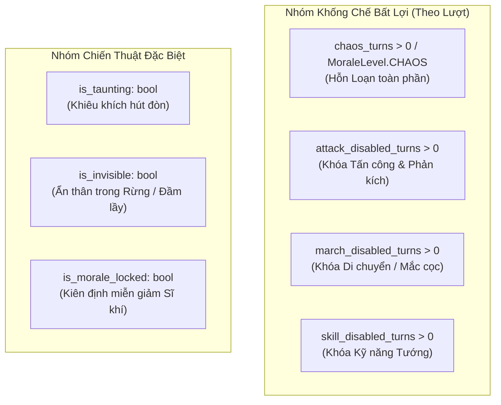

| Thuộc tính (`snake_case`) | Kiểu | Tên tiếng Việt | Tác động Gameplay | Nguồn kích hoạt tiêu biểu |
| :--- | :---: | :--- | :--- | :--- |
| `chaos_turns` | `int` | **Hỗn Loạn** | Đưa `morale = MoraleLevel.CHAOS`: khóa di chuyển, tấn công, kỹ năng, phản kích; mất `ZoC`; nhận `+30%` sát thương. | Hợp vây `TrappedLevel 2/3`, tụt bậc từ `LOW`, hỏa công kịch bản. |
| `attack_disabled_turns` | `int` | **Cấm Tấn Công** | Vẫn di chuyển được nhưng khóa `Attack` và khóa `Retaliation`. | Khói mù nghi binh, trúng tên độc chế áp. |
| `march_disabled_turns` | `int` | **Khóa Di Chuyển** | Bị ghìm chân tại chỗ (`can_move() == false`), nhưng vẫn tấn công và phản kích trong tầm được. | Mắc bãi cọc ngầm `STAKED_WATER` (`2` lượt), sa lầy đầm bùn, bẫy lưới. |
| `skill_disabled_turns` | `int` | **Khóa Kỹ Năng** | Khóa lệnh `CastSkill` của Tướng gắn trên đạo quân trong thời gian hiệu lực. | Đòn đột kích quấy rối của *Thám báo / Nội gián*. |
| `is_taunting` | `bool` | **Khiêu Khích** | Quân địch trong tầm đánh ưu tiên/buộc phải chọn đơn vị này làm mục tiêu công kích. | Kỹ năng chủ động của *Thiết Vệ Tiên Phong* hoặc *Tượng Binh*. |
| `is_invisible` | `bool` | **Ẩn Thân** | Khuất khỏi tầm nhìn xa của địch khi đứng ở `FOREST` / `SWAMP`; chỉ lộ diện khi địch đứng sát cạnh (`distance == 1`) hoặc khi tự phát động tấn công. | Đặc tính của *Tản binh du kích*, *Thám báo / Nội gián*. |
| `is_morale_locked` | `bool` | **Kiên Định** | Miễn nhiễm mọi hiệu ứng trừ bậc Sĩ khí và miễn nhiễm `CHAOS` từ bao vây/lan truyền tâm lý. | Hào quang chủ soái hoặc mưu lược *Hịch Tướng Sĩ*. |

---

### 4. Cơ chế Bao vây Đa cấp (`TrappedLevel 0..3`)

Để loại bỏ triệt để lỗi "tự hoảng loạn khi đứng tựa lưng vào núi/sông" và lỗi giao miền điều kiện, hệ thống `TrappedLevel` bắt buộc phải có **ít nhất 2 đơn vị địch kề cạnh (`adjacent_enemies >= 2`)** (chỉ tính địch còn sống và không ở trạng thái `CHAOS`):

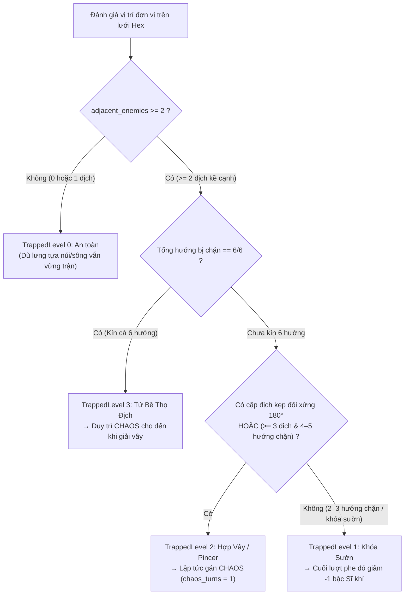

### Quy tắc Phân cấp Chính xác:
* **Định nghĩa hướng bị chặn (`blocked_dirs` $\in [0, 6]$):** Một hướng lân cận `d` (`0..5`) được tính là bị chặn nếu ô Hex ở hướng đó nằm ngoài biên bản đồ, mang địa hình cấm đi đối với đơn vị đang xét, hoặc đang có đơn vị địch chiếm giữ.
* **`TrappedLevel 0` (*An toàn*):** `adjacent_enemies < 2` **hoặc** `blocked_dirs <= 1`.
* **`TrappedLevel 1` (*Khóa sườn*):** `adjacent_enemies >= 2` và tổng hướng bị chặn là **`2–3` hướng** (cũng bao hàm trường hợp chỉ có đúng `2` địch không đối xứng $180^\circ$ ép đơn vị dựa vào vách núi) → tại `FactionTurnEnd` của phe đó, đơn vị giảm **`-1 bậc`** Sĩ khí.
* **`TrappedLevel 2` (*Hợp vây / Pincer*):** Có **`>= 2` địch đứng kẹp đối xứng $180^\circ$** qua tâm đơn vị (tồn tại hướng `d` và `(d + 3) % 6` cùng có địch không bị `CHAOS`), **hoặc** có **`>= 3` địch kề cạnh với tổng `4–5` hướng bị chặn** → lập tức gán `MoraleLevel.CHAOS` (`chaos_turns = 1`) ngay tại Pha 5 `ImmediateResolutionAndVictoryCheck` (trừ khi có `is_morale_locked`).
* **`TrappedLevel 3` (*Tứ bề thọ địch*):** Có **`>= 2` địch kề cạnh** và **kín toàn bộ `6/6` hướng bị chặn** → gán và giữ nguyên `MoraleLevel.CHAOS` qua các lượt cho đến khi đồng minh đánh thủng vòng vây giải phóng ít nhất 1 hướng.

---

### 5. Cấu trúc Quản lý Trạng thái Chuẩn GDScript 2.0 (Godot 4.7)

```gdscript
class_name UnitCombatState
extends RefCounted

enum MoraleLevel {
	HIGH = 3,
	NORMAL = 2,
	LOW = 1,
	CHAOS = 0,
}

var morale: MoraleLevel = MoraleLevel.NORMAL
var is_morale_locked: bool = false

var chaos_turns: int = 0
var attack_disabled_turns: int = 0
var march_disabled_turns: int = 0
var skill_disabled_turns: int = 0

var is_taunting: bool = false
var is_invisible: bool = false
var has_retaliated_this_round: bool = false
var has_acted: bool = false

func can_move() -> bool:
	return morale != MoraleLevel.CHAOS and chaos_turns == 0 and march_disabled_turns == 0

func can_attack() -> bool:
	return morale != MoraleLevel.CHAOS and chaos_turns == 0 and attack_disabled_turns == 0

func can_use_skill() -> bool:
	return morale != MoraleLevel.CHAOS and chaos_turns == 0 and skill_disabled_turns == 0

func can_retaliate() -> bool:
	return can_attack() and not has_retaliated_this_round

func emits_zoc() -> bool:
	return morale != MoraleLevel.CHAOS and chaos_turns == 0

func shift_morale(delta: int, min_floor: MoraleLevel = MoraleLevel.CHAOS) -> void:
	if delta < 0 and is_morale_locked:
		return
	if morale == MoraleLevel.CHAOS and delta > 0:
		# Đang CHAOS chỉ được giải trừ qua clear_chaos() hoặc hết chaos_turns ở FactionTurnEnd
		return
	var next_val: int = clampi(int(morale) + delta, int(min_floor), int(MoraleLevel.HIGH))
	morale = next_val as MoraleLevel
	if morale == MoraleLevel.CHAOS:
		chaos_turns = maxi(chaos_turns, 1)

func apply_starvation_morale_penalty() -> void:
	# Nạn đói chỉ hạ tối đa xuống LOW, tuyệt đối không gây CHAOS để chống soft-lock
	if morale == MoraleLevel.CHAOS:
		return
	shift_morale(-1, MoraleLevel.LOW)

func apply_chaos(turns: int = 1) -> void:
	if is_morale_locked:
		return
	morale = MoraleLevel.CHAOS
	chaos_turns = maxi(chaos_turns, maxi(1, turns))

func clear_chaos(restore_to: MoraleLevel = MoraleLevel.LOW) -> void:
	chaos_turns = 0
	if morale == MoraleLevel.CHAOS:
		morale = restore_to

func on_faction_turn_start() -> void:
	has_acted = false
	has_retaliated_this_round = false

func on_faction_turn_end(current_trapped_level: int) -> void:
	if current_trapped_level == 1:
		shift_morale(-1)
	elif current_trapped_level >= 2:
		apply_chaos(1)

	if chaos_turns > 0 and current_trapped_level < 3:
		chaos_turns -= 1
		if chaos_turns == 0 and morale == MoraleLevel.CHAOS:
			morale = MoraleLevel.LOW

	if attack_disabled_turns > 0:
		attack_disabled_turns -= 1
	if march_disabled_turns > 0:
		march_disabled_turns -= 1
	if skill_disabled_turns > 0:
		skill_disabled_turns -= 1

static func evaluate_trapped_level(
	enemy_at_dir: Array[bool],
	impassable_at_dir: Array[bool]
) -> int:
	assert(enemy_at_dir.size() == 6 and impassable_at_dir.size() == 6)
	var adjacent_enemies: int = 0
	var blocked_dirs: int = 0

	for d: int in range(6):
		if enemy_at_dir[d]:
			adjacent_enemies += 1
			blocked_dirs += 1
		elif impassable_at_dir[d]:
			blocked_dirs += 1

	if adjacent_enemies < 2 or blocked_dirs <= 1:
		return 0

	if blocked_dirs == 6:
		return 3

	var has_pincer_180: bool = false
	for d: int in range(3):
		if enemy_at_dir[d] and enemy_at_dir[d + 3]:
			has_pincer_180 = true
			break

	if has_pincer_180 or (adjacent_enemies >= 3 and blocked_dirs >= 4):
		return 2

	return 1
```

---

## 4.3. Đặc Tả Hệ Thống Lưới Hex, 9 Loại Địa Hình, LOS & Vùng Kiểm Soát (`ZoC` / `CoC`)


> **Vị trí tài liệu:** `docs/gdd/mechanics/hex_grid_pathfinding.md`  
> **Nền tảng mục tiêu:** Godot 4.7 — Thuần GDScript 2.0 (Static Typing, số nguyên `int` cho MP) trên Web & Android  
> **Trạng thái:** Chuẩn hóa đồng bộ hệ tọa độ Pointy-topped Axial `(q, r)`, 9 loại địa hình, thuật toán A* `ZoC`/`CoC` và tầm nhìn `hex_linedraw` với [battlefield_rules.md](gdd/02_gameplay_systems/battlefield_rules.md) và [game_modes.md](gdd/02_gameplay_systems/game_modes.md).

---

### 1. Hệ Tọa độ Lưới Hex (Pointy-topped Axial & Offset `odd-r`)

Toàn bộ logic chiến thuật trong trận tính toán trên hệ trục **Pointy-topped Axial `(q, r)`** (với trục thứ ba ẩn `s = -q - r`), trong khi tệp bản đồ chữ nhật `width × height` và `TileMapLayer` của Godot lưu theo hệ **Offset `odd-r` `(col, row)`**:

* **Khoảng cách Cube / Hex (`hex_distance`) giữa 2 ô $A(q_1, r_1)$ và $B(q_2, r_2)$:**
  $$\text{hex\_distance}(A, B) = \frac{|q_1 - q_2| + |(q_1 + r_1) - (q_2 + r_2)| + |r_1 - r_2|}{2}$$
* **Sáu hướng lân cận chuẩn (theo chiều kim đồng hồ quanh tâm):**
  $$\Delta \text{Axial} = \big[(+1, 0),\ (+1, -1),\ (0, -1),\ (-1, 0),\ (-1, +1),\ (0, +1)\big]$$
  *(Hai hướng đối diện $180^\circ$ luôn có chỉ số `d` và `(d + 3) % 6` — dùng trực tiếp để xét hợp vây Pincer `TrappedLevel 2`).*
* **Công thức chuyển đổi hai chiều Offset `odd-r` `(col, row)` ↔ Axial `(q, r)`:**
  * Từ `odd-r (col, row)` sang `Axial (q, r)`:
    $$q = \text{col} - \left\lfloor \frac{\text{row} - (\text{row} \ \& \ 1)}{2} \right\rfloor, \quad r = \text{row}$$
  * Từ `Axial (q, r)` sang `odd-r (col, row)`:
    $$\text{col} = q + \left\lfloor \frac{r - (r \ \& \ 1)}{2} \right\rfloor, \quad \text{row} = r$$

---

### 2. Chín Loại Địa hình Chuẩn hóa & Cơ chế Địa hình Sở trường (`fond_terrain`)

Toàn bộ điểm di chuyển (`max_mp`, `current_mp`, `terrain_cost`) dùng **số nguyên `int`** để loại bỏ sai số dấu phẩy động. Ví dụ biên độ chuẩn: Bộ binh `6–8 MP`, Cung/Pháo `6 MP`, Kỵ binh `10–12 MP`, Thủy quân `8–10 MP`.

### Phân tách 2 lớp Hiệu ứng Địa hình
1. **Hiệu ứng Nội tại của Địa hình (Intrinsic Terrain Effect):** Tác dụng như nhau lên **mọi đơn vị** thuộc miền di chuyển tương ứng khi đi vào hoặc đứng trên ô đó (`terrain_cost`, `TerrainDefMult`, điều chỉnh công nội tại và quy tắc chặn LOS).
2. **Hiệu ứng Thưởng Địa hình Sở trường (`fond_terrain` Bonus):** Chỉ kích hoạt khi đơn vị hoặc tướng chỉ huy có thuộc tính `fond_terrain == terrain_type`:
   * **Thưởng Tác chiến:** **`+15% ATK/DEF`** (cộng `+0.15` vào `M_terrain` khi tấn công và cộng `+0.15` vào `TerrainDefMult` khi phòng thủ — xem [combat_formulas.md](gdd/mechanics/combat_formulas.md)).
   * **Thưởng Cơ động:** Giảm **`-1 MP`** chi phí địa hình gốc của ô đó, giữ mức sàn tối thiểu **`1 MP`** (`maxi(1, base_cost - 1)`).

### Bảng Thông số Kỹ thuật 9 Loại Địa hình (`TerrainType`)

| Mã Enum | Loại Địa hình | MP Cơ bản (`int`)<br/>*(Bộ-Cung / Kỵ-Pháo / Thủy)* | `TerrainDefMult` Nội tại | Cản LOS? | Hiệu ứng Nội tại & Ghi chú Kịch bản |
| :--- | :--- | :---: | :---: | :---: | :--- |
| `0: PLAINS` | **1. Đồng bằng / Đất trống** | `2` / `2` / Cấm | `1.00` | Không | Mặt bằng chuẩn; thuận lợi dàn trận và xung kích. |
| `1: FOREST` | **2. Rừng rậm / Tre nứa** | `3` / `4` / Cấm | **`1.20`** (+20% DEF) | **Có*** | Che khuất đơn vị `is_invisible`; đơn vị có tag `ambush_forest` đánh từ Rừng không bị phản kích. |
| `2: HILLS` | **3. Đồi núi / Cao điểm** | `4` / `5` / Cấm | **`1.15`** (+15% DEF) | **Có** | Đơn vị tầm xa đứng trên `HILLS` được `+0.10` `M_terrain` (+10% ATK) và nhìn xuyên qua `FOREST`. |
| `3: SWAMP` | **4. Đầm lầy / Bãi bùn** | `4` / `6` / `4` (Thuyền nhẹ) | **`0.90`** (-10% DEF) | Không | Kỵ binh / Pháo đứng trên đầm lầy chịu `-0.15` `M_terrain` (-15% ATK); che khuất `is_invisible`. |
| `4: SHALLOW_RIVER` | **5. Sông cạn / Bờ sông** | `4` / `5` / `2` (Nhẹ) · `3` (Lớn) | `0.90` (Lục) / `1.00` (Thủy) | Không | Bến lội tự nhiên; lục quân đang lội nước giảm 10% Giáp. |
| `5: DEEP_WATER` | **6. Mặt nước sâu** | Cấm** / Cấm** / `2` | `1.00` (`0.80` vận tải) | Không | **Lục quân chỉ đi được khi đã lên thuyền vận tải tại Bến (`3 MP`, chịu `-0.20` `M_terrain`). |
| `6: FORT` | **7. Thành trì / Công sự** | `2` / `3` / Cấm | **`1.30`** (+30% DEF) | **Có*** | Phát vùng **`CoC`** ra 6 ô kề cạnh (`terrain_cost * 2`); đơn vị giữ thành có tầm nhìn cao điểm. |
| `7: ROAD_PORT` | **8. Đường cái / Bến thuyền** | `1` / `1` / `2` (tại Bến) | `1.00` | Không | Trục hành quân thần tốc `1 MP`; ô Bến thuyền cho phép chuyển đổi Lục quân ↔ Thuyền vận tải (`2 MP`). |
| `8: STAKED_WATER` | **9. Bãi cọc ngầm lộ diện** | Cấm / Cấm / `4` (Địch) · `2` (Ta) | **`0.85`** (-15% DEF) | Không | Xuất hiện qua sự kiện `MapPhase` (triều rút): tàu địch trên/bước vào cọc chịu `35% max_hp` sát thương xuyên giáp + `march_disabled_turns = 2`. |

*(\* `FOREST` và `FORT` chặn LOS của các đơn vị đứng ở địa hình thấp, không chặn tầm nhìn của người quan sát đang đứng trên `HILLS` hoặc `FORT`).*

---

### 3. Hệ thống Kiểm soát Không gian: `ZoC`, `CoC` & Quy tắc Rút lui

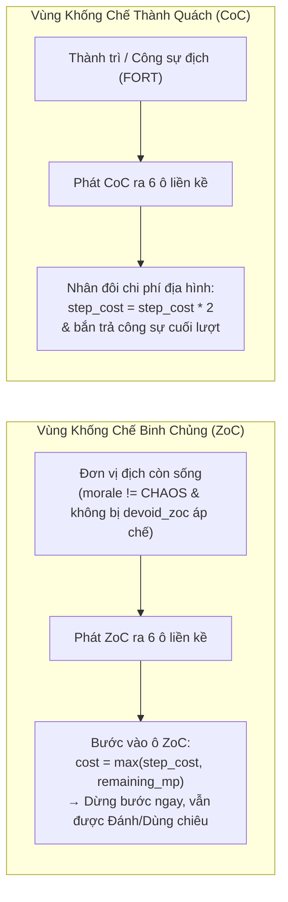

### 3.1. Vùng Khống chế Thành quách (`CoC` — Castle of Control)
* Mọi ô `FORT` thuộc phe địch phát vùng `CoC` ra 6 ô Hex kề cạnh.
* Khi đơn vị không có thuộc tính `ignore_coc` bước vào ô nằm trong `CoC` địch, chi phí MP của bước đó bị **nhân đôi: `step_cost = step_cost * 2`** (áp dụng thống nhất cả trong tài liệu thiết kế lẫn hàm định tuyến A*).
* Đơn vị địch kết thúc lượt đứng trong `CoC` chịu sát thương hỏa lực phòng thủ tự động từ thành lũy (nếu thành còn độ bền / đơn vị đồn trú).

### 3.2. Vùng Khống chế Binh chủng (`ZoC`) & Quy tắc Rút lui Đầu lượt
* **Điều kiện phát `ZoC`:** Một đơn vị địch tại ô `E` phát `ZoC` ra 6 ô kề cạnh khi và chỉ khi:
  1. Đơn vị `E` còn sống và `E.state.morale != MoraleLevel.CHAOS` (`chaos_turns == 0`).
  2. Không có bất kỳ đơn vị đồng minh nào của phe đang di chuyển mang thuộc tính **`devoid_zoc == true`** đứng kề cạnh `E` (`hex_distance <= 1`).
* **Bước vào ô `ZoC` trên đường đi A*:** Khi xét bước chuyển `from_hex → to_hex` mà `to_hex` nằm trong `ZoC` hoạt động của địch (và đơn vị đi không có `ignore_zoc`), chi phí bước đi là:
  $$\text{step\_cost} = \max\big(\text{step\_cost}, \ \text{remaining\_mp}\big)$$
  Trong đó **`remaining_mp = unit.current_mp - g_cost_so_far`** là lượng MP thực tế còn lại tại nút `from_hex` trên cây tìm đường A* (**tuyệt đối không dùng `unit.max_mp` đầu lượt**). Nếu `remaining_mp >= terrain_step_cost`, đơn vị bước vào được `to_hex` và tiêu sạch phần MP còn lại (`new_remaining_mp = 0`), buộc dừng tại đó.
* **Quy tắc Rút lui khi đầu lượt đã đứng sẵn trong `ZoC` (`Start-in-ZoC Withdrawal`):**
  * **Thoát ly ra vùng an toàn:** Nếu đầu lượt đơn vị đang đứng trong `ZoC` địch và bước thẳng sang một ô liền kề **không nằm trong bất kỳ `ZoC` địch nào** (`to_in_zoc == false`), bước đó chỉ tính `step_cost` bình thường — cho phép rút lui chiến thuật và tiếp tục di chuyển nếu còn MP.
  * **Chống trượt vòng quanh lưng địch (`ZoC-to-ZoC Pinning`):** Nếu đơn vị bước trực tiếp từ ô `ZoC` hiện tại sang **một ô `ZoC` khác** của địch (`to_in_zoc == true` và không có `ignore_zoc`), công thức `maxi(step_cost, remaining_mp)` lập tức tiêu hết toàn bộ MP còn lại, ghìm chân đơn vị ngay sau 1 ô dịch chuyển.

### 3.3. Bảng Thuộc tính Không gian Đặc biệt (`snake_case`)

| Thuộc tính JSON / GDScript | Kiểu | Tên tiếng Việt | Tác động Hình học & Định tuyến | Binh chủng / Vai trò tiêu biểu |
| :--- | :---: | :--- | :--- | :--- |
| **`ignore_zoc`** | `bool` | **Xuyên ZoC** | Bỏ qua hoàn toàn hiệu ứng dừng bước của `ZoC` quân địch; tự do luồn lách qua khe hở trận tuyến. | *Thám báo / Nội gián*, *Tản binh du kích*, *Khinh kỵ trinh sát*. |
| **`ignore_coc`** | `bool` | **Xuyên CoC** | Miễn phạt `step_cost * 2` khi áp sát thành trì/cửa quan của địch. | *Công binh phá lũy*, *Đội thang mây tiên phong*. |
| **`devoid_zoc`** | `bool` | **Phá ZoC** | Triệt tiêu khả năng phát `ZoC` của mọi đơn vị địch đứng sát cạnh (`hex_distance <= 1`), mở hành lang đột phá cho quân ta tràn lên. | *Tượng binh xung kích Đại Việt*, *Thiết kỵ phá trận*. |

---

### 4. Thuật toán Tầm nhìn (`LOS`) & Sương mù Chiến tranh (`Fog of War`)

### 4.1. Nội suy Đường ngắm `hex_linedraw`
Để kiểm tra tầm nhìn (phục vụ mở bản đồ, công kích tầm xa và **kiểm tra điều kiện phản kích `Retaliation`** tại [combat_formulas.md](gdd/mechanics/combat_formulas.md)):
1. Chuyển tọa độ `A(q_1, r_1)` và `B(q_2, r_2)` sang không gian Cube thực `(x, y, z) = (q, -q - r, r)` rồi cộng độ lệch vi sai cố định `EPSILON = Vector3(1e-6, 2e-6, -3e-6)` nhằm khử hoàn toàn trường hợp tia ngắm đi trùng cạnh chung giữa 2 ô Hex.
2. Nội suy đều `N = hex_distance(A, B)` điểm dọc đoạn thẳng `A → B` và làm tròn `cube_round` để thu được dãy ô `line_hexes`.
3. Duyệt các ô **trung gian** `H` (bỏ qua 2 đầu mút `A` và `B`):
   * Nếu người quan sát tại `A` đứng ở địa hình thấp (`terrain(A) != HILLS` và `terrain(A) != FORT`): mọi ô trung gian `H` thuộc **`FOREST`, `HILLS` hoặc `FORT`** đều **chặn LOS**.
   * Nếu người quan sát tại `A` đứng trên cao điểm (`HILLS` hoặc `FORT`): nhìn vượt qua `FOREST` và đội hình quân; chỉ bị chặn nếu có một ô **`HILLS`** khác chắn ở giữa (trừ khi cả `A` và `B` cùng ở `HILLS`).

### 4.2. Ba Trạng thái Sương mù Chiến tranh (`FogState`)
* **`UNEXPLORED` (*Chưa khám phá*):** Phủ lớp mây mù sa bàn cổ; chưa thấy địa hình chi tiết và quân địch.
* **`SHROUDED` (*Khuất tầm nhìn hiện tại*):** Đã từng đi qua nên hiển thị rõ địa hình và công trình tĩnh, nhưng ẩn mọi biến động vị trí quân địch.
* **`VISIBLE` (*Đang quan sát trực tiếp*):** Nằm trong `vision_range` của ít nhất 1 đơn vị/công trình đồng minh có `has_line_of_sight == true`. *Lưu ý:* Đơn vị địch đang có `is_invisible == true` trong ô `FOREST` hoặc `SWAMP` vẫn ẩn mình ngay cả trong vùng `VISIBLE`, trừ khi có đơn vị ta áp sát ở cự ly **`hex_distance == 1`** hoặc khi đơn vị đó chủ động tấn công.

---

### 5. Tham chiếu Triển khai Định tuyến A* & LOS bằng GDScript 2.0 (Godot 4.7)

```gdscript
class_name HexGridNavigator
extends RefCounted

enum TerrainType {
	PLAINS = 0,
	FOREST = 1,
	HILLS = 2,
	SWAMP = 3,
	SHALLOW_RIVER = 4,
	DEEP_WATER = 5,
	FORT = 6,
	ROAD_PORT = 7,
	STAKED_WATER = 8,
}

enum FogState {
	UNEXPLORED = 0,
	SHROUDED = 1,
	VISIBLE = 2,
}

const IMPASSABLE_MP: int = 999999
const AXIAL_DIRECTIONS: Array[Vector2i] = [
	Vector2i(1, 0),
	Vector2i(1, -1),
	Vector2i(0, -1),
	Vector2i(-1, 0),
	Vector2i(-1, 1),
	Vector2i(0, 1),
]
const LOS_NUDGE: Vector3 = Vector3(0.000001, 0.000002, -0.000003)

static func odd_r_to_axial(offset: Vector2i) -> Vector2i:
	var parity: int = offset.y & 1
	@warning_ignore("integer_division")
	var q: int = offset.x - ((offset.y - parity) / 2)
	return Vector2i(q, offset.y)

static func axial_to_odd_r(axial: Vector2i) -> Vector2i:
	var parity: int = axial.y & 1
	@warning_ignore("integer_division")
	var col: int = axial.x + ((axial.y - parity) / 2)
	return Vector2i(col, axial.y)

static func hex_distance(a: Vector2i, b: Vector2i) -> int:
	var dq: int = absi(a.x - b.x)
	var dr: int = absi(a.y - b.y)
	var ds: int = absi((a.x + a.y) - (b.x + b.y))
	@warning_ignore("integer_division")
	return (dq + dr + ds) / 2

static func hex_linedraw(a: Vector2i, b: Vector2i) -> Array[Vector2i]:
	var n: int = hex_distance(a, b)
	if n == 0:
		return [a]

	var ac: Vector3 = Vector3(float(a.x), float(-a.x - a.y), float(a.y)) + LOS_NUDGE
	var bc: Vector3 = Vector3(float(b.x), float(-b.x - b.y), float(b.y)) + LOS_NUDGE
	var results: Array[Vector2i] = []

	for i: int in range(n + 1):
		var t: float = float(i) / float(n)
		results.append(_cube_round(ac.lerp(bc, t)))
	return results

static func _cube_round(frac: Vector3) -> Vector2i:
	var rx: float = roundf(frac.x)
	var ry: float = roundf(frac.y)
	var rz: float = roundf(frac.z)

	var x_diff: float = absf(rx - frac.x)
	var y_diff: float = absf(ry - frac.y)
	var z_diff: float = absf(rz - frac.z)

	if x_diff > y_diff and x_diff > z_diff:
		rx = -ry - rz
	elif y_diff > z_diff:
		ry = -rx - rz
	else:
		rz = -rx - ry
	return Vector2i(int(rx), int(rz))

func has_line_of_sight(map_state: BattleMapState, from_hex: Vector2i, to_hex: Vector2i) -> bool:
	var line: Array[Vector2i] = hex_linedraw(from_hex, to_hex)
	if line.size() <= 2:
		return true

	var from_terrain: TerrainType = map_state.get_terrain(from_hex)
	var to_terrain: TerrainType = map_state.get_terrain(to_hex)
	var observer_elevated: bool = (
		from_terrain == TerrainType.HILLS or from_terrain == TerrainType.FORT
	)
	var target_elevated: bool = (to_terrain == TerrainType.HILLS)

	for i: int in range(1, line.size() - 1):
		var mid_terrain: TerrainType = map_state.get_terrain(line[i])
		if observer_elevated:
			if mid_terrain == TerrainType.HILLS and not target_elevated:
				return false
		else:
			if (
				mid_terrain == TerrainType.FOREST
				or mid_terrain == TerrainType.HILLS
				or mid_terrain == TerrainType.FORT
			):
				return false
	return true

func is_in_active_enemy_zoc(
	map_state: BattleMapState,
	hex: Vector2i,
	mover_faction: int
) -> bool:
	for dir: Vector2i in AXIAL_DIRECTIONS:
		var adj: Vector2i = hex + dir
		if not map_state.is_valid_hex(adj):
			continue
		var occupant: BattleUnit = map_state.get_unit_at(adj)
		if occupant == null or not map_state.is_hostile(mover_faction, occupant.faction_id):
			continue
		if not occupant.state.emits_zoc():
			continue
		if _is_enemy_zoc_suppressed_by_devoid(map_state, adj, mover_faction):
			continue
		return true
	return false

func _is_enemy_zoc_suppressed_by_devoid(
	map_state: BattleMapState,
	enemy_hex: Vector2i,
	mover_faction: int
) -> bool:
	for dir: Vector2i in AXIAL_DIRECTIONS:
		var around: Vector2i = enemy_hex + dir
		if not map_state.is_valid_hex(around):
			continue
		var ally: BattleUnit = map_state.get_unit_at(around)
		if ally != null and map_state.is_allied(mover_faction, ally.faction_id):
			if ally.devoid_zoc and ally.state.morale != UnitCombatState.MoraleLevel.CHAOS:
				return true
	return false

func get_hex_step_cost(
	map_state: BattleMapState,
	_from_hex: Vector2i,
	to_hex: Vector2i,
	unit: BattleUnit,
	remaining_mp: int
) -> int:
	if remaining_mp <= 0 or not map_state.is_valid_hex(to_hex):
		return IMPASSABLE_MP

	# Không thể đi xuyên qua ô đang có địch chiếm đóng
	var occupant: BattleUnit = map_state.get_unit_at(to_hex)
	if occupant != null and map_state.is_hostile(unit.faction_id, occupant.faction_id):
		return IMPASSABLE_MP

	var to_terrain: TerrainType = map_state.get_terrain(to_hex)
	var step_cost: int = map_state.get_base_terrain_mp(to_terrain, unit)
	if step_cost >= IMPASSABLE_MP:
		return IMPASSABLE_MP

	# 1. Thưởng Địa hình Sở trường (-1 MP, tối thiểu còn 1 MP)
	if unit.fond_terrain == int(to_terrain):
		step_cost = maxi(1, step_cost - 1)

	# 2. Phạt Vùng Khống chế Thành quách (CoC: nhân 2 chi phí MP)
	if map_state.is_in_enemy_coc(to_hex, unit.faction_id) and not unit.ignore_coc:
		step_cost *= 2

	# 3. Xử lý Vùng Khống chế Binh chủng (ZoC: tính trên remaining_mp tại bước A* hiện tại)
	# Nếu rút từ trong ZoC ra ô ngoài ZoC -> to_in_zoc == false -> chỉ tốn step_cost bình thường.
	# Nếu từ ngoài bước vào ZoC, hoặc trượt từ ô ZoC này sang ô ZoC khác -> tiêu hết remaining_mp.
	if is_in_active_enemy_zoc(map_state, to_hex, unit.faction_id) and not unit.ignore_zoc:
		step_cost = maxi(step_cost, remaining_mp)

	return step_cost
```

---

## 4.4. Kinh Tế Chiến Trường & Hậu Cần Trong Trận (In-Battle Tactical Economy)


> [!IMPORTANT]
> **Phạm vi áp dụng:** Mô-đun Kinh tế Chiến trường này thuộc phạm vi **P3 Alpha / Chế độ Conquest & Chiến dịch lớn (`enable_economy = true`)**, và **ẩn hoàn toàn trong Slice-01 Bạch Đằng 1288 (`enable_economy = false`)** để người chơi tập trung làm chủ địa hình, thủy triều và bao vây cốt lõi trước.

---

### 1. Tầm nhìn Chiến thuật: Hậu Cần Tác Chiến (Combat Logistics)

Kinh tế trong trận của **Đại Việt Chiến Kỳ** không biến trò chơi thành game xây dựng vĩ mô rườm rà, mà đóng vai trò **đòn bẩy hậu cần tác chiến** trực tiếp trên bản đồ Hex:

> *"Binh mã chưa động, lương thảo đi trước."*  
> Mọi cuộc hành quân đường dài, vây thành hay phản công chiến lược đều phụ thuộc vào khả năng bảo vệ tuyến lương Nông điền – Bến thuyền và chặt đứt mạch tiếp tế của đối phương.

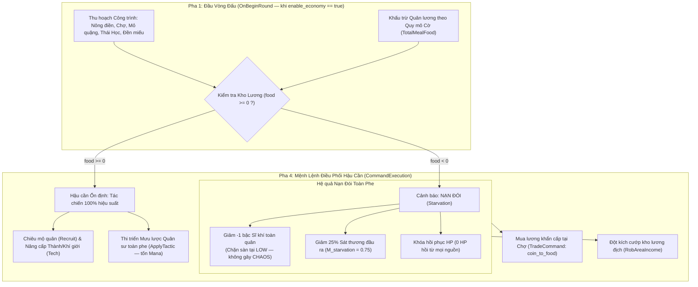

---

### 2. Bốn Nguồn Lực Chiến Thuật Cấp Phe & Công dụng Điểm `Tech`

Mỗi Faction quản lý một ngân quỹ tức thời gồm 4 nguồn lực số nguyên (`int`):

| Tài nguyên | Biến dữ liệu | Công dụng Chiến thuật Trực tiếp | Nguồn thu trong trận | Hệ quả khi cạn kiệt / âm |
| :--- | :---: | :--- | :--- | :--- |
| **Tiền Đồng** | `coin` | Chiêu mộ đạo quân mới (`Recruit`), sửa chữa công sự, mua lương khẩn cấp tại Chợ. | Chợ (`Type 18`), Thành trì (`Type 1–5`), Mỏ (`Type 31–32`). | Không thể tuyển quân bổ sung hoặc mua lương cứu đói. |
| **Lương Thảo** | `food` | Duy trì toàn bộ đạo quân trên bản đồ ở đầu mỗi vòng (`TotalMealFood`). | Nông điền (`Type 33`), Thành trì, cướp bóc (`RobAreaIncome`). | Kích hoạt **Nạn đói (`Starvation`)** khi `food < 0`. |
| **Kỹ Nghệ** | `tech` | Nâng cấp cấp Thành trì mở binh chủng cao cấp, gia cố lũy và nghiên cứu Khí giới Bậc 1–3. | Mỏ khoáng sản (`Type 31–32`), Quốc Tử Giám / Thái Học (`Type 13`). | Bị kẹt ở binh chủng sơ cấp, thiếu hỏa khí công thành. |
| **Khí Lực** | `mana` | Tiêu hao để thi triển **Mưu lược Quân sư toàn phe (`ApplyTactic`)** *(không dùng cho `CastSkill` của Tướng)*. | Chùa cổ / Đền miếu (`Type 14`), Quốc Tử Giám (`Type 13`). | Không thể phát động sách lược diện rộng (*Hịch Tướng Sĩ*, *Hỏa Công*). |

### Đặc tả Công dụng Điểm `Tech` Trong Trận (`In-Battle Tech Actions`)
Để điểm `tech` luôn mang giá trị quyết định rõ ràng trong chế độ Conquest và đại chiến dịch P3+:
1. **Nâng cấp Cấp độ Thành trì / Doanh trại tại chỗ (`UpgradeFacility`):** Tiêu hao `coin + tech` nâng Thành trì từ Cấp 1 → 5 để mở khóa chiêu mộ các đạo quân tinh nhuệ ngay gần tiền tuyến (Cấp 3 mở Thiết kỵ & Nỏ liên châu; Cấp 4 mở Tượng binh & Mông đồng; Cấp 5 mở Thần cơ pháo & Đại lâu thuyền).
2. **Gia cố Công sự Chiến trường (`FortifyHex`):** Tiêu `40 Tech + 60 Coin` khôi phục độ bền ô `FORT` hoặc dựng lũy phòng ngự tại điểm nghẽn chiến lược.
3. **Nghiên cứu Khí giới Tức thời theo Phe (`UnlockBattleTech` 3 Bậc — thực hiện tại Quốc Tử Giám / Xưởng Binh Khí):**
   * **Bậc 1 — Rèn Mũi Tên Đồng & Giáo Dài (`60 Tech`):** Tăng `+10%` `damage_deepen` cho toàn bộ nhánh `INFANTRY` và `ARCHERY` của phe.
   * **Bậc 2 — Đóng Thuyền Bọc Đồng & Giáp Thiết Lĩnh (`120 Tech`):** Tăng `+10%` `damage_resist` cho toàn bộ nhánh `NAVAL` và `CAVALRY`.
   * **Bậc 3 — Chế Tạo Hỏa Hổ & Súng Thần Cơ (`200 Tech`):** Mở khóa chiêu mộ binh chủng hỏa khí nhánh `SIEGE` và cộng `+20%` sát thương khi đánh vào `DefenseMode.FORT`.

---

### 3. Khấu trừ Quân Lương (`MealFood`) & Trừng phạt Nạn Đói (`Starvation`)

### 3.1. Thang Định mức `MealRate` Số nguyên (Cân bằng với Nông điền `80–200 Food/lượt`)
Tại Pha 1 `OnBeginRound`, tổng quân lương tiêu thụ của một phe được tính bằng tổng định mức của từng đạo quân nhân với quy mô cờ biên chế đầu trận (`max_stack` $\in \{1, 2, 3\}$):

$$\text{TotalMealFood} = \sum_{i=1}^{N} \text{MealRate}(\text{unit}_i) \times \text{max\_stack}_i$$

| Nhánh Binh chủng (`CommandBranch`) | Định mức `MealRate` (1 Cờ) | Đạo 2 Cờ (`2x`) | Đạo 3 Cờ (`3x`) | Đối chiếu cân bằng với 1 Nông điền Cấp 1 (`80 Food/lượt`) |
| :--- | :---: | :---: | :---: | :--- |
| **Bộ binh (`INFANTRY`)** | **`10`** Food / lượt | `20` Food | `30` Food | 1 Nông điền nuôi đủ ~2.6 đạo Bộ binh 3 cờ. |
| **Cung / Nỏ (`ARCHERY`)** | **`12`** Food / lượt | `24` Food | `36` Food | 1 Nông điền nuôi đủ ~2.2 đạo Cung nỏ 3 cờ. |
| **Thủy quân (`NAVAL`)** | **`15`** Food / lượt | `30` Food | `45` Food | Đòi hỏi kiểm soát bến cảng và vựa lúa ven sông. |
| **Kỵ binh (`CAVALRY`)** | **`20`** Food / lượt | `40` Food | `60` Food | Tiêu tốn gấp đôi bộ binh do nhu cầu cỏ thóc chiến mã. |
| **Công thành / Hỏa khí (`SIEGE`)** | **`20`** Food / lượt | `40` Food | `60` Food | Chi phí hậu cần đoàn xe pháo và thuốc súng nặng nề. |
| **Tượng binh (`CAVALRY` tag `elephant`)** | **`30`** Food / lượt | `60` Food | `90` Food | 1 đạo Voi chiến 3 cờ tiêu thụ vượt 1 Nông điền Cấp 1! |

### 3.2. Quy tắc Nạn Đói (`Starvation` — Chống Soft-lock)
Sau bước cộng thu nhập và trừ `TotalMealFood` ở `OnBeginRound`, nếu tồn kho `food < 0`:
1. **Hạ `-1 bậc` Sĩ khí toàn quân nhưng chặn sàn ở `MoraleLevel.LOW` (*Dao Động*):**
   * Đơn vị đang `HIGH` → xuống `NORMAL`; đang `NORMAL` → xuống `LOW`; đang `LOW` vẫn giữ ở `LOW` (**không bao giờ hạ xuống `CHAOS`** chỉ vì đói, đảm bảo người chơi hoặc AI vẫn điều khiển được quân đi chiếm Nông điền hoặc mua lương cứu vãn tình thế).
2. **Suy kiệt Lực chiến (`M_starvation = 0.75`):** Toàn bộ đòn tấn công của phe đang đói bị giảm **`25%` sát thương** ([combat_formulas.md](gdd/mechanics/combat_formulas.md)).
3. **Tê liệt Quân y:** Mọi hiệu ứng hồi phục `current_hp` (đồn trú tại Thành trì, kỹ năng hồi máu) trả về `0 HP` cho đến khi `food >= 0` trở lại.

---

### 4. Danh mục Công trình Hậu cần Chiến lược (`FacilitySettings.json`)

| Mã Loại | Tên Công trình | Cấp độ | Sản lượng / Vòng (`int`) | Hiệu ứng Chiến thuật Đặc biệt |
| :--- | :--- | :---: | :--- | :--- |
| `Type 1–5` | **Thành trì / Đô thành** | `1 – 5` | `40–200 Coin`, `20–100 Food` | Ô `FORT` phát `CoC` (`step_cost * 2`); hồi HP đồn trú; chiêu mộ quân & bổ nhiệm Tướng. |
| `Type 18` | **Chợ / Thương điếm** | `1 – 3` | `60 / 100 / 150 Coin` | Mở khóa lệnh Giao thương khẩn cấp (`TradeCommand`); cấp Chợ càng cao tỷ giá càng lợi. |
| `Type 33` | **Nông điền / Bãi bồi** | `1 – 3` | `80 / 140 / 200 Food` | Nguồn cung lương chủ lực; mục tiêu hàng đầu cần bảo vệ hoặc tiêu thổ. |
| `Type 31–32` | **Mỏ Đồng / Mỏ Sắt** | `1 – 2` | `30 Coin`, `25 / 50 Tech` | Cung cấp nguyên liệu nâng cấp thành lũy và rèn khí giới. |
| `Type 13` | **Quốc Tử Giám / Thái Học** | `1 – 2` | `40 Tech`, `15 Mana` | Mở bảng nghiên cứu Khí giới Bậc 1–3 (`UnlockBattleTech`). |
| `Type 14` | **Chùa cổ / Đền miếu** | `1 – 2` | `25 / 40 Mana` | Cung cấp `Mana` cho Mưu lược Quân sư `ApplyTactic`. |
| `Type 20` | **Kho Lương Kiên Cố** | `1 – 2` | Trần chứa `+500 / +1000 Food` | **Bảo vệ hậu cần:** Giảm **`50%`** lượng tài nguyên bị địch cướp (`M_granary = 0.50`). |

---

### 5. Công thức Cướp Lương (`RobAreaIncome`) & Tỷ giá Chợ Khẩn cấp (`TradeCommand`)

### 5.1. Công thức Cướp Bóc Công trình Kinh tế (`RobAreaIncome`)
Khi một đạo quân đánh chiếm thành công một ô Thành trì, Nông điền, Chợ hoặc Mỏ của đối phương, phe tấn công thu giữ ngay lập tức lượng chiến lợi phẩm tính theo số vòng tích lũy chưa bị cướp (tối đa **trần `3` vòng**) và hệ số bảo vệ của Kho Lương kiên cố:

$$\text{Loot}(R) = \text{round\_half\_up}\Big(\text{FacilityIncome}(R) \times \min(\text{turns\_unrobbed}, \ 3) \times \text{plunder\_rate} \times M_{\text{granary}}\Big)$$

* `turns_unrobbed` $\in \mathbb{Z}_{\ge 0}$: Số vòng liên tiếp kể từ đầu trận (hoặc từ lần bị cướp gần nhất) công trình đó chưa bị cướp — **khóa trần tại `min(turns_unrobbed, 3)`** để tránh bùng nổ tài nguyên phi thực tế ở cuối trận. Ngay sau khi cướp, đặt lại `turns_unrobbed = 0`.
* `plunder_rate`: Mặc định **`0.80`** (`80%` sản lượng tích lũy); đạt **`1.00`** (`100%`) nếu đơn vị chiếm đóng là Khinh kỵ hoặc mang thuộc tính đột kích hậu cần (`raider`).
* **`M_granary`:** Bằng **`0.50`** (giảm `50%` tài nguyên bị cướp) nếu khu vực/thành trì đó có công trình **Kho Lương Kiên Cố (`Type 20`)** bảo vệ; ngược lại bằng **`1.00`**.

### 5.2. Công thức Tỷ giá Chợ Khẩn cấp (`TradeCommand`)
Khi phe đang kiểm soát ít nhất 1 ô **Chợ (`Type 18`)**, người chỉ huy có thể phát lệnh `TradeCommand` (không làm mất lượt của đơn vị quân):

* **Hệ số cấp Chợ cao nhất đang sở hữu (`market_bonus`):**
  $$\text{market\_bonus} = 1.0 + 0.10 \times (\text{highest\_market\_level} - 1) \quad (\text{Cấp } 1: 1.0, \text{ Cấp } 2: 1.1, \text{ Cấp } 3: 1.2)$$
* **Hệ số Khủng hoảng thời chiến (`crisis_mult`):**
  $$\text{crisis\_mult} = \begin{cases} 2.0 & \text{nếu phe đang bị } \text{Starvation } (\text{food} < 0) \text{ hoặc mọi Thành trì đang bị vây } (\text{TrappedLevel} \ge 1) \\ 1.0 & \text{trong điều kiện bình thường} \end{cases}$$
* **Chiều 1 — Mua Lương Cứu Đói (`trade_coin_to_food`):** Với lượng tiền chi ra `coin_spent` (bội số của `100 Coin`):
  $$\text{FoodReceived} = \text{round\_half\_up}\left(\text{coin\_spent} \times \frac{0.75 \times \text{market\_bonus}}{\text{crisis\_mult}}\right)$$
  *(Ở Chợ Cấp 1 bình thường: `100 Coin → 75 Food`; khi rơi vào Nạn đói `crisis_mult = 2.0`: phải chi `200 Coin → 75 Food`, tức `100 Coin → 38 Food`).*
* **Chiều 2 — Bán Lương Đổi Ngân Sách (`trade_food_to_coin`, chỉ hợp lệ khi `food >= TotalMealFood`):** Với lượng lương bán ra `food_sold` (bội số của `100 Food`):
  $$\text{CoinReceived} = \text{round\_half\_up}\Big(\text{food\_sold} \times 0.60 \times \text{market\_bonus}\Big)$$
  *(Ở Chợ Cấp 1: `100 Food → 60 Coin`; Chợ Cấp 3: `100 Food → 72 Coin`).*

---

### 6. Mã Mẫu Giải Quyết Hậu Cần GDScript 2.0 (Godot 4.7)

```gdscript
class_name BattleEconomyResolver
extends RefCounted

const MEAL_RATE_BY_BRANCH: Dictionary[CommanderData.CommandBranch, int] = {
	CommanderData.CommandBranch.INFANTRY: 10,
	CommanderData.CommandBranch.ARCHERY: 12,
	CommanderData.CommandBranch.NAVAL: 15,
	CommanderData.CommandBranch.CAVALRY: 20,
	CommanderData.CommandBranch.SIEGE: 20,
}
const ELEPHANT_MEAL_RATE: int = 30

static func compute_unit_meal_food(
	branch: CommanderData.CommandBranch,
	max_stack: int,
	is_elephant: bool = false
) -> int:
	var rate: int = ELEPHANT_MEAL_RATE if is_elephant else MEAL_RATE_BY_BRANCH.get(branch, 10)
	return rate * clampi(max_stack, 1, 3)

static func compute_rob_area_loot(
	facility_income: int,
	turns_unrobbed: int,
	plunder_rate: float = 0.80,
	has_fortified_granary: bool = false
) -> int:
	var capped_turns: int = clampi(turns_unrobbed, 0, 3)
	var granary_mult: float = 0.50 if has_fortified_granary else 1.00
	var raw_loot: float = float(facility_income * capped_turns) * plunder_rate * granary_mult
	return CombatFormulaResolver.round_half_up(raw_loot)

static func compute_coin_to_food(
	coin_spent: int,
	highest_market_level: int,
	in_crisis: bool
) -> int:
	if coin_spent <= 0 or highest_market_level <= 0:
		return 0
	var market_bonus: float = 1.0 + 0.10 * float(clampi(highest_market_level, 1, 3) - 1)
	var crisis_mult: float = 2.0 if in_crisis else 1.0
	var raw_food: float = float(coin_spent) * (0.75 * market_bonus) / crisis_mult
	return CombatFormulaResolver.round_half_up(raw_food)

static func compute_food_to_coin(food_sold: int, highest_market_level: int) -> int:
	if food_sold <= 0 or highest_market_level <= 0:
		return 0
	var market_bonus: float = 1.0 + 0.10 * float(clampi(highest_market_level, 1, 3) - 1)
	var raw_coin: float = float(food_sold) * 0.60 * market_bonus
	return CombatFormulaResolver.round_half_up(raw_coin)
```

---

# CHƯƠNG V: TIẾN TRÌNH META, DANH TƯỚNG & KINH TẾ NGOẠI TRẬN

## 5.1. Hệ Thống Tướng & Kinh Tế Meta (Generals & Meta-Progression)


> **Vị trí tài liệu:** `docs/gdd/progression/generals_and_meta_economy.md`  
> **Phạm vi áp dụng:** **P3 Alpha+** (dành cho chế độ *Domination*, *Conquest* và *Legion*), **ẩn trong Slice-01 Bạch Đằng 1288**.  
> **Trạng thái:** Chuẩn hóa theo quyết định thiết kế **`D-07` (F2P Thân thiện)** và đồng bộ 100% với [meta_progression.md](gdd/02_gameplay_systems/meta_progression.md), [units_commanders.md](gdd/02_gameplay_systems/units_commanders.md) và [combat_formulas.md](gdd/mechanics/combat_formulas.md).

---

### 1. Tầm nhìn & Triết lý Thiết kế F2P Thân thiện (`D-07`)

> [!IMPORTANT]
> **Quy chuẩn Định hướng Thiết kế (`LOCKED — D-07`):**
> 1. **Thân thiện tuyệt đối với Người chơi Miễn phí (Fair F2P):** Mọi danh tướng ở tất cả các bậc phẩm (bao gồm cả bậc cao nhất **Đỏ — Thần Thoại**) đều có thể sở hữu hoàn toàn miễn phí thông qua việc tích lũy **`Ngọc Bích` (`Jade`)**, **`Lệnh Chiêu Mộ` (`RecruitOrder`)** và **`Huân Chương Quân Công` (`Merit`)** từ vượt ải 3 sao, thành tựu lịch sử, sự kiện theo mùa và **Shop Quân Công (Quân Cơ Xứ)**. Tuyệt đối không khóa bất kỳ danh tướng dân tộc nào sau tường phí tiền thật.
> 2. **Tôn trọng Lịch sử (`QualityTier` ≠ Phán xét Lịch sử):** Hệ thống 5 bậc màu (`Đỏ / Cam / Tím / Lam / Lục`) chỉ biểu thị **độ hiếm sưu tầm và độ phức tạp cơ chế bộ kỹ năng trong gameplay**, không phải sự so sánh hay phán xét công trạng lịch sử của các nhân vật. Danh sách tướng mẫu và tên bảo vật trong tài liệu là khung thiết kế để rà soát hồ sơ chứng cứ (`source_ref`) trước khi đưa vào bản chính thức.
> 3. **Bảo toàn Thử thách Chiến thuật Single-player:** Trò chơi là 100% Single-player; chế độ *Historical Scenario* khóa hồ sơ tướng lịch sử cố định, còn *Challenge Mode (Legion)* áp dụng trần cấp độ (`Level / Stat Cap`) để chiến thắng luôn đến từ tư duy điều binh.

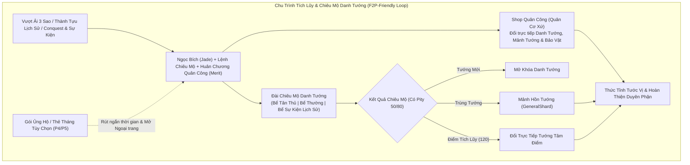

---

### 2. Bảng Tiền tệ & Nguyên liệu Ngoại trận Chuẩn hóa

Khớp 100% với [meta_progression.md](gdd/02_gameplay_systems/meta_progression.md):

| Tên Tiền tệ / Nguyên liệu | Mã Định danh | Nguồn thu thập chính trong Game | Công dụng cốt lõi |
| :--- | :---: | :--- | :--- |
| **Tiền Đồng** | `Coin` | Thưởng qua màn, nhiệm vụ hằng ngày, chế độ Conquest | Tăng `Level` tướng, rèn/cường hóa trang bị cơ bản, chiêu mộ Tỳ tướng. |
| **Ngọc Bích** *(kèm `Lệnh Chiêu Mộ`)* | `Jade` / `RecruitOrder` | Vượt ải 3 sao lần đầu, thành tựu lịch sử, sự kiện, nhiệm vụ tuần/tháng | Chiêu mộ tại mọi bể Đài Chiêu Mộ (kể cả Bể Sự Kiện bậc Đỏ) và đổi Lệnh Chiêu Mộ. |
| **Huân Chương Quân Công** | `Merit` | Đạt 3 sao chiến dịch, mục tiêu phụ, Conquest & Thử thách Legion | Phong `Quan Tước` (`Rank 1–30`), đổi trực tiếp Danh Tướng & Bảo vật tại **Shop Quân Công**. |
| **Binh Thư EXP** | `TomeExp` | Thao diễn võ học, thử thách Legion, phân giải mảnh dư | Cấp EXP lên cấp tướng và nâng bậc Kỹ năng chiến thuật chủ động/bị động. |
| **Mảnh Hồn Tướng** | `GeneralShard` | Thưởng mốc chiến dịch, Shop Quân Công, chiêu mộ trùng tướng | Ghép mở khóa danh tướng và thức tỉnh `Tước Vị` (`Title 1–6`). |

---

### 3. Bốn Trục Tiến Trình Danh Tướng (Four Progression Axes)

Mỗi danh tướng phát triển trên 4 trục độc lập, kết nối trực tiếp vào công thức sát thương tại [combat_formulas.md](gdd/mechanics/combat_formulas.md):

| Trục Tiến trình | Miền Giá trị | Tài nguyên Tiêu hao | Tác động Cơ chế Chiến đấu | Cơ chế Cân bằng Single-player |
| :--- | :---: | :--- | :--- | :--- |
| **1. Cấp Độ (`level`)** | `1 .. 50` | EXP trận đánh hoặc `Binh Thư EXP` (`TomeExp`) | Tăng nhẹ chỉ số nền HP/ATK/DEF của đạo quân chỉ huy (`+1.0%` đến `+1.5%` mỗi cấp). | Bị giới hạn bởi trần cấp độ chương hiện tại và `Level Cap` trong *Challenge Mode*. |
| **2. Quan Tước (`rank`)** | `1 .. 30` | `Huân Chương Quân Công` (`Merit`) | Quyết định trực tiếp **`general_command_stat` (`1..30`)**, cộng `GenBonus = general_command_stat * 1` vào lực công nền. | Mở khóa tuần tự theo tiến độ chiến dịch; không vượt quá ngưỡng `30`. |
| **3. Tước Vị (`title`)** | `1 .. 6` *(Dũng Tướng → Vương)* | `Mảnh Hồn Tướng` (`GeneralShard`) & Ải Danh Tướng | Mở khóa các ô Kỹ năng bị động (tối đa 5 ô) và mở khóa ô Bảo vật thứ 5 (Binh thư). | Yêu cầu vượt qua bài kiểm tra chiến thuật lịch sử riêng của tướng đó. |
| **4. Khí Vận (`general_luck`)** | `0 .. 100` | Lễ vật Đền Miếu / Thành tựu Lịch sử | Cộng **`int(general_luck * 0.15)`** (`0%..15%`) vào `crit_rate` và giảm `30%` sát thương từ bẫy/công sự. | Khóa trần cứng tại `100` (tối đa `+15%` Crit). |

*(Song song với 4 trục trên, mỗi tướng sở hữu hồ sơ thông thạo 5 nhánh binh chủng `CommandProfile` bậc `S/A/B/C/D` nhân hệ số `M_command` từ `0.90` đến `1.25` — trong đó bậc `S` cộng `+25%`, bậc `A` cộng `+15%`, bậc `B` cộng `+8%` — cùng **Hào quang Chỉ huy (`CommandAura` `1–2 hex`)** giúp gia tăng sát thương/kháng sát thương và ổn định Sĩ khí cho đồng minh xung quanh. Xem [units_commanders.md](gdd/02_gameplay_systems/units_commanders.md)).*

---

### 4. Hệ Thống Duyên Phận Lịch Sử (`FetterSystem`)

Hệ thống Duyên phận kích hoạt hiệu ứng cộng hưởng khi các danh tướng gắn bó trong lịch sử cùng xuất trận (sử dụng chuẩn Sĩ khí 4 bậc Enum `MoraleLevel` tại [morale_and_status.md](gdd/mechanics/morale_and_status.md)):

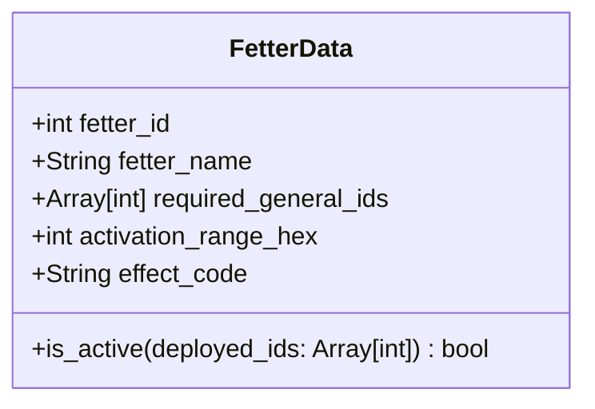

### Bảng Duyên Phận Tiêu Biểu Đại Việt (Khung Thiết Kế Mẫu)

| Tên Duyên Phận | Danh Tướng Yêu Cầu | Phạm Vi Kích Hoạt | Hiệu Ứng Cơ Chế Chuẩn Hóa | Ý Nghĩa Bối Cảnh Lịch Sử |
| :--- | :--- | :---: | :--- | :--- |
| **Trần Triều Tam Kiệt** | Trần Quốc Tuấn, Trần Khánh Dư, Trần Quang Khải | Toàn bản đồ (khi cùng ra trận) | `+15%` `damage_deepen` cho nhánh `NAVAL`; các đạo quân thuộc duyên phận khởi đầu trận ở bậc **Hưng Phấn (`MoraleLevel.HIGH`)**. | Ba trụ cột quân sự lãnh đạo đại thắng chống Nguyên Mông thế kỷ XIII. |
| **Vua Tôi Đồng Lòng** | Trần Thánh Tông, Trần Nhân Tông, Trần Quốc Tuấn | Bán kính `<= 3 hex` | Giảm `-1` lượt thời hạn khống chế bất lợi (tối thiểu `0`); miễn nhiễm giảm Sĩ khí từ `TrappedLevel 1`. | Hào khí Hội nghị Bình Than và Hội nghị Diên Hồng. |
| **Hội Thề Lũng Nhai** | Lê Lợi, Nguyễn Trãi, Lê Lai, Trần Nguyên Hãn | Bán kính `<= 2 hex` | Giảm `20%` định mức `MealFood` tiêu thụ; đơn vị trong `FOREST` nhận hiệu ứng `is_invisible` đầu lượt. | Mười tám anh hào dựng cờ khởi nghĩa Lam Sơn gian khổ. |
| **Tây Sơn Tam Kiệt** | Nguyễn Nhạc, Nguyễn Huệ, Nguyễn Lữ | Toàn bản đồ | `+2 MP` (`max_mp`) cho toàn quân trong vòng đầu tiên; Kỵ binh & Tượng binh tăng `+15%` sát thương xung kích. | Nhịp hành quân thần tốc của nghĩa quân Tây Sơn thế kỷ XVIII. |
| **Hào Khí Mê Linh** | Trưng Trắc, Trưng Nhị, Lê Chân | Bán kính `<= 2 hex` | `+15%` `damage_resist` trước đòn tầm xa (`ARCHERY`); hồi `8% max_hp` đầu lượt khi không bị `Starvation`. | Cuộc khởi nghĩa Hai Bà Trưng thu phục 65 thành trì Lĩnh Nam. |
| **Kình Ngạc Bạch Đằng** *(Phe Đối phương)* | Thoát Hoan, Ô Mã Nhi, Trương Văn Hổ | Toàn bản đồ (khi cùng ra trận) | `+12%` `damage_deepen` cho nhánh `NAVAL` & `CAVALRY`; giảm `15%` sát thương nhận vào từ hỏa công ở vòng đầu. | Đại quân thủy – bộ Đại Nguyên trong chiến dịch năm 1287–1288. |
| **Phục Ba Thiết Kỵ** *(Phe Đối phương)* | Mã Viện, Lưu Long, Đoàn Chí | Bán kính `<= 2 hex` | `+15%` `damage_deepen` cho nhánh `CAVALRY` & `INFANTRY`; miễn phạt giảm tốc độ `MP` khi tiến qua `SWAMP` trong `2` vòng đầu. | Đạo quân viễn chinh Đông Hán do Phục Ba Tướng Quân Mã Viện thống lĩnh (năm 42–43). |

---

### 5. Năm Ô Trang Bị & Bảo Vật Chuẩn Niên Đại Đại Việt (`EquipmentSystem`)

Toàn bộ danh mục trang bị tuân thủ niên đại lịch sử – huyền sử Việt Nam từ thời dựng nước đến thế kỷ XVIII (loại bỏ hoàn toàn các cổ vật lệch niên đại thế kỷ XX):

```text
[Slot 1: Vũ Khí Cận Chiến] --- Thuận Thiên Kiếm, Gươm Thái A, Trường Đao Trần Triều
[Slot 2: Vũ Khí Tầm Xa]    --- Nỏ Liên Châu Kim Quy, Cung Thần Đại Việt, Hỏa Hổ Ống Đồng
[Slot 3: Hộ Giáp]          --- Khôi Giáp Thiết Lĩnh, Áo Bào Chiến Trận, Hộ Tâm Kính
[Slot 4: Thú Cưỡi]         --- Thớt Voi Chiến Tây Sơn, Bạch Mã Phiên Đao, Chiến Mã Thiết Giáp
[Slot 5: Binh Thư]         --- Binh Thư Yếu Lược, Hịch Tướng Sĩ, Quân Trung Từ Mệnh Tập
```

### Bảng Cơ Chế Thuộc Tính Bảo Vật Mẫu

| Ô Trang Bị | Tên Bảo Vật Mẫu | Bậc Phẩm | Chỉ Số Cộng Thêm (`snake_case`) | Hiệu Ứng Chiến Thuật Đặc Biệt |
| :--- | :--- | :---: | :--- | :--- |
| **1. Cận Chiến** | *Thuận Thiên Kiếm* | Sử Thi (Cam) | `base_atk +15`, `damage_deepen +12`, `crit_damage_bonus +20` | Khi mục tiêu có `hp_ratio >= 0.80`, tăng thêm `+15` `crit_rate_bonus`. |
| **2. Tầm Xa** | *Nỏ Liên Châu Kim Quy* | Sử Thi (Cam) | `base_atk +12`, `crit_rate_bonus +10` | Khi đứng trên `HILLS` hoặc `FORT`, tăng `+15%` sát thương phản kích tầm xa. |
| **3. Hộ Giáp** | *Khôi Giáp Thiết Lĩnh* | Danh Tướng (Tím) | `base_def +12`, `damage_resist +12` | Giảm thêm `15%` sát thương nhận vào từ `AttackMode` xung kích Kỵ/Tượng. |
| **4. Thú Cưỡi** | *Thớt Voi Chiến Tây Sơn* | Danh Tướng (Tím) | `base_hp +80`, `max_mp +1` | Ban thuộc tính `ignore_coc` khi tiếp cận công sự địch. |
| **5. Binh Thư** | *Binh Thư Yếu Lược* | Thần Thoại (Đỏ) | `general_command_stat +5`, `crit_rate_bonus +10` | Kích hoạt `is_morale_locked` trong `2` vòng đầu và miễn nhiễm rơi vào **`MoraleLevel.CHAOS`** từ `TrappedLevel 2` (giữ tối thiểu ở `MoraleLevel.LOW`). |

---

### 6. Hệ Thống Chiêu Mộ & Kênh Sở Hữu Minh Bạch (`Recruitment & Merit Shop`)

### 6.1. Năm Bậc Phẩm Gameplay (`QualityTier`) & Nguồn Sở Hữu F2P

| Bậc Phẩm (`QualityTier`) | Màu Nhận Diện | Kênh Sở Hữu Miễn Phí (F2P) & Đài Chiêu Mộ | Tỷ Lệ Rơi Bể Chuẩn | Tác Dụng Khi Trùng (`GeneralShard`) |
| :--- | :---: | :--- | :---: | :--- |
| **1. ĐỎ — THẦN THOẠI (`MYTHIC`)** | **Đỏ son** | Quay Bể Sự Kiện bằng **`Ngọc Bích` (`Jade`) / `Lệnh Chiêu Mộ`** tích lũy miễn phí + Ghép mảnh từ **Shop Quân Công** & Thành tựu Lịch sử | `1.5%` *(Bảo hiểm cứng 80 lượt)* | Quy đổi `50 GeneralShard`; thức tỉnh `Title` bậc 5–6 & mở khóa kỹ năng đặc trưng. |
| **2. CAM — SỬ THI (`LEGENDARY`)** | **Cam kim** | Đổi trực tiếp bằng **`Huân Chương Quân Công` (`Merit`)** tại Shop Quân Công + Bể Thường / Bể Tân Thủ | `4.0%` *(Bảo hiểm 50 lượt; Tân thủ 10 lượt)* | Quy đổi `30 GeneralShard`; nâng bậc kỹ năng chủ động. |
| **3. TÍM — DANH TƯỚNG (`EPIC`)** | **Tím đậm** | Đổi bằng `Merit` mức trung + Thưởng hoàn thành chương Chiến dịch + Đài Chiêu Mộ | `12.5%` | Quy đổi `20 GeneralShard`; mở ô bảo vật. |
| **4. LAM — DŨNG TƯỚNG (`RARE`)** | **Xanh lam** | Thưởng vượt ải cốt truyện + Đổi bằng `Merit` cơ bản + Đài Chiêu Mộ | `32.0%` | Quy đổi `10 GeneralShard`; kích hoạt Duyên phận phụ. |
| **5. LỤC — TỲ TƯỚNG (`COMMON`)** | **Xanh lục** | Tặng sẵn tân thủ + Chiêu mộ bằng **`Tiền Đồng` (`Coin`)** | `50.0%` | Quy đổi `5 GeneralShard` hoặc phân giải thành `Binh Thư EXP` (`TomeExp`). |

### 6.2. Ba Bể Chiêu Mộ & Cơ Chế Bảo Hiểm (`Pity & Sparking`)
1. **Bể Sự Kiện Lịch Sử (`pool_event` — Rate-Up Bậc Đỏ & Cam):**
   * Luân phiên theo chủ đề thời kỳ (ví dụ: *Hào Khí Đông A*, *Bình Ngô Đại Cáo*, *Thần Tốc Đống Đa*).
   * Chấp nhận hoàn toàn **`Ngọc Bích` (`Jade`)** và **`Lệnh Chiêu Mộ` (`RecruitOrder`)** kiếm được miễn phí từ quá trình chơi (vượt ải 3 sao, thành tựu, Conquest).
   * **Bảo hiểm cứng (`Hard Pity`):** Tối đa `80` lượt rút chắc chắn nhận Tướng bậc Đỏ của sự kiện; tích lũy đủ `120` điểm chiêu mộ được chọn đổi trực tiếp (`Spark`) tướng tâm điểm.
2. **Bể Chiêu Mộ Thường (`pool_standard`):**
   * Tặng **1 lượt rút miễn phí mỗi 24 giờ**; sử dụng `Lệnh Chiêu Mộ` hoặc `Ngọc Bích`. Bảo hiểm tối đa `50` lượt chắc chắn nhận Tướng bậc Cam.
3. **Bể Tân Thủ (`pool_beginner`):**
   * Giảm `20%` chi phí cho `10` lượt đầu tiên và đảm bảo chắc chắn nhận ít nhất **1 Danh Tướng bậc Cam** để người chơi khởi đầu thuận lợi.

### 6.3. Hệ Thống Danh Tướng Đối Phương Lịch Sử & Cơ Chế Chiêu Mộ (`Adversary Generals System`)

Để các trận đánh lịch sử thực sự kịch tính và mở rộng chiều sâu sưu tầm ở các chế độ tự do, toàn bộ **Tướng lĩnh Đối phương trong lịch sử** cũng được thiết kế đầy đủ **5 bậc phẩm (`Lục / Lam / Tím / Cam / Đỏ`)** với `CommandProfile`, `CommandAura`, `UniqueSkill` và `Fetters` hoàn chỉnh:

| Bậc Phẩm (`QualityTier`) | Vai Trò Trên Chiến Trường (Khi Là Địch) | Danh Tướng Đối Phương Tiêu Biểu (Qua Các *Era Pack*) | Điều Kiện Mở Khóa & Kênh Chiêu Mộ F2P |
| :--- | :--- | :--- | :--- |
| **1. ĐỎ — THẦN THOẠI (`MYTHIC`)** | **Đại Thống Soái / Boss Cuối Thời Kỳ:** Sở hữu `CommandProfile` bậc `S` (+25%), `CommandAura` `2 hex` (+10%) và kỹ năng độc quyền xoay chuyển cục diện. | • **Mã Viện** (*Phục Ba Tướng Quân* — Đông Hán, Era Hai Bà Trưng)<br/>• **Hốt Tất Liệt / Bá Nhan / Ngột Lương Hợp Thai** (Mông – Nguyên, Era Thời Trần)<br/>• **Trương Phụ** (*Anh Quốc Công* — Đại Minh, Era Hồ – Lam Sơn) | Vượt qua màn Boss lịch sử tương ứng để **mở khóa hồ sơ** (tặng mảnh khởi đầu) $\to$ Chiêu mộ qua **Bể Sự Kiện (`Ngọc Bích` / `Lệnh Chiêu Mộ`)** hoặc ghép mảnh tại **Shop Quân Công (`Merit`)**. |
| **2. CAM — SỬ THI (`LEGENDARY`)** | **Chủ Tướng Chiến Dịch Lớn:** Dẫn đầu các mũi tiến công chiến lược, có `CommandAura` `2 hex` (+8%) và kỹ năng chủ động nguy hiểm. | • **Cao Biền** (Nhà Đường)<br/>• **Lưu Hoằng Tháo** (Nam Hán — Bạch Đằng 938)<br/>• **Quách Quỳ** (Nhà Tống — Như Nguyệt 1077)<br/>• **Thoát Hoan, Ô Mã Nhi (Omar), Trương Văn Hổ** (Đại Nguyên — 1288)<br/>• **Vương Thông, Liễu Thăng** (Đại Minh — 1427)<br/>• **Tôn Sĩ Nghị** (Nhà Thanh — 1789) | Đánh bại trong Chiến dịch để mở khóa $\to$ Đổi trực tiếp bằng **`Huân Chương Quân Công` (`Merit`)** tại Shop Quân Công hoặc rút tại Đài Chiêu Mộ. |
| **3. TÍM — DANH TƯỚNG (`EPIC`)**<br/>& **4. LAM (`RARE`)** | **Phó Tướng / Đô Đốc Cánh Quân:** Trấn giữ cứ điểm, chỉ huy cánh quân tiên phong hoặc hậu cần. | • **Lưu Long, Đoàn Chí** (Đông Hán)<br/>• **Triệu Tiết** (Nhà Tống)<br/>• **Phàn Tiếp, Tích Lệ Cơ Ngọc, Lưu Lưu** (Đại Nguyên)<br/>• **Mộc Thạnh, Hoàng Phúc, Phương Chính** (Đại Minh)<br/>• **Sầm Nghi Đống, Hứa Thế Hanh** (Nhà Thanh) | Thưởng mảnh khi đạt 3 sao màn chơi tương ứng + Đổi bằng `Merit` tại Shop Quân Công + Đài Chiêu Mộ. |

### 6.4. Định hướng Gói Ủng Hộ Tùy Chọn (Optional IAP — Phạm vi P4/P5)
Nếu triển khai thương mại hóa ở giai đoạn phát hành mở rộng (P4/P5), cửa hàng chỉ bao gồm các gói tiện ích minh bạch:
* **Thẻ Nguyệt Bổng (`Monthly Pass`) & Chiến Lệnh Đại Việt (`Season Pass`):** Cung cấp thêm `Ngọc Bích` (`Jade`), `Binh Thư EXP` (`TomeExp`) mỗi ngày và **Trang phục / Khung cờ hiệu lịch sử thuần thẩm mỹ (Cosmetics)**, không cộng chỉ số độc quyền.
* **Shop Quân Công (`Quân Cơ Xứ` — 100% In-game `Merit`):** Luôn mở miễn phí để người chơi dùng `Huân Chương Quân Công` (`Merit`) đổi thẳng Danh Tướng (cả Đại Việt lẫn Đối phương đã mở khóa), Mảnh Hồn Tướng bậc Cam/Đỏ và Bảo vật chuẩn niên đại.

---

### 7. Nguyên Tắc Bảo Vệ Cân Bằng Chiến Thuật & Phân Tách Chế Độ (Single-Player Safeguards)

1. **Historical Scenario — Khóa Hồ Sơ Chuẩn Lịch Sử Ở Lần Vượt Ải Chính Sử (`Fixed Historical Roster — D-02`):**
   * Toàn bộ các màn chiến dịch lịch sử chính tuyến (như Slice-01 Bạch Đằng 1288) cấp sẵn lực lượng và danh tướng đúng biên chế kịch bản với chỉ số cố định đã kiểm thử cân bằng. Người chơi không mang chỉ số cày cuốc bên ngoài hay dùng Tướng đối phương vào làm sai lệch mạch lịch sử chính tuyến.
2. **Mở Rộng Tự Do Ở Conquest, Legion, Domination & Chơi Lại Tự Do (`Free Replay / What-If Mode`):**
   * Sau khi đã hoàn thành màn chơi ở chế độ Lịch sử chuẩn, hoặc khi tham gia các chế độ **Conquest (Chinh phạt)**, **Legion (Thử thách)** và **Domination (Tổng hành dinh)**, người chơi được **toàn quyền điều động mọi Danh tướng Đại Việt và Danh tướng Đối phương (Tím / Cam / Đỏ như Mã Viện, Bá Nhan, Ô Mã Nhi...)** đã chiêu mộ vào đội hình để xây dựng thế trận tự do.
3. **Challenge Mode / Legion — Giới Hạn Cấp Trần (`Stage Stat / Level Cap`):**
   * Trong các ải thử thách cho phép tự chọn đội hình tướng từ Tổng hành dinh (*Domination*), mỗi ải quy định rõ trần `max_allowed_level` và `max_allowed_rank`. Mọi tướng vượt trần được tự động điều chỉnh tạm thời về đúng ngưỡng trần của ải trong suốt trận đấu, đảm bảo chiến thắng luôn thuộc về người đọc địa hình, tận dụng `ZoC`/`Flank` và quản lý Sĩ khí xuất sắc nhất.

---

# CHƯƠNG VI: THIẾT KẾ MÀN CHƠI & DỰNG KỊCH BẢN (LEVEL DESIGN & SCRIPTING)

## 6.1. ĐẶC TẢ THIẾT KẾ MÀN CHƠI, HỆ THỐNG SỰ KIỆN & BỘ QUY CHUẨN KỊCH BẢN
*(Chuẩn hóa cho Godot 4.7 — Thuần Typed GDScript 2.0 & Đồng bộ Slice-01 Bạch Đằng 1288)*

> **Vị trí tài liệu:** `docs/gdd/level_design/scenario_scripting_and_events.md`  
> **Trạng thái:** Chuẩn hóa kiến trúc hướng dữ liệu **Event – Condition (`AND`/`OR`) – Action** bằng **Typed GDScript 2.0**, đồng bộ tuyệt đối thông số **Slice-01 Đại Chiến Bạch Đằng 1288 (`stage_id: 10101`)**: sa bàn chiến thuật `12 × 10` hex Pointy-topped Axial, tối đa `10` vòng, thủy triều rút ở **đầu Vòng 4 (`current_round == 4`)** kèm sát thương vùng bãi cọc `ApplyAreaEffect` và cơ chế tiếp viện an toàn `find_nearest_free_hex`.

---

### 1. Kiến trúc Hệ thống Sự kiện Kịch bản (Scripting & Trigger Engine)

Hệ thống kịch bản màn chơi vận hành theo mô hình hướng dữ liệu tách thành 3 khối độc lập, đồng bộ danh sách `triggered_event_ids` với `BattleSaveManager` để đảm bảo tính tất định khi Save/Resume:

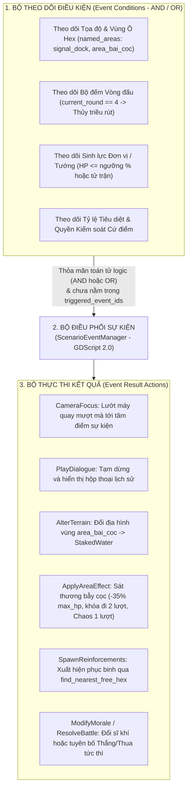

---

### 2. Chuẩn Schema Kịch bản JSON Toàn diện (`res://data/battles/battle_10101.json`)

Mỗi màn chơi chiến dịch được lưu thành một tệp JSON chữ thường tại `res://data/battles/battle_{stage_id}.json`. Dưới đây là đặc tả chuẩn đã chốt của **Slice-01 Bạch Đằng 1288 (`stage_id: 10101`)**:

```json
{
  "stage_id": 10101,
  "code": "bach_dang_1288",
  "name": "Đại Chiến Bạch Đằng 1288",
  "historical_era": "Tran_Nguyen",
  "modeling_type": "fixture",
  "grid_orientation": "pointy_top_axial",
  "map_width": 12,
  "map_height": 10,
  "max_rounds": 10,
  "enable_economy": false,
  "player_faction_id": 1,
  "ai_profile": "normal",
  "factions": [
    { "id": 1, "name": "Đại Việt", "color": "#1E88E5", "is_player": true },
    { "id": 2, "name": "Đại Nguyên (Quân Nguyên)", "color": "#E53935", "is_player": false }
  ],
  "named_areas": {
    "signal_dock": [
      { "q": 2, "r": 8 }
    ],
    "area_bai_coc": [
      { "q": 5, "r": 4 },
      { "q": 6, "r": 4 },
      { "q": 6, "r": 5 },
      { "q": 7, "r": 5 }
    ]
  },
  "terrain_cells": [
    { "q": 2, "r": 8, "terrain": "SignalDock", "owner_faction_id": 1 },
    { "q": 5, "r": 4, "terrain": "Water", "owner_faction_id": 0 },
    { "q": 6, "r": 4, "terrain": "Water", "owner_faction_id": 0 },
    { "q": 6, "r": 5, "terrain": "Water", "owner_faction_id": 0 },
    { "q": 7, "r": 5, "terrain": "Water", "owner_faction_id": 0 },
    { "q": 4, "r": 5, "terrain": "Forest", "owner_faction_id": 1 },
    { "q": 8, "r": 3, "terrain": "Hill", "owner_faction_id": 1 }
  ],
  "victory_conditions": [
    {
      "type": "DefeatGeneralWhileHoldingArea",
      "target_general_id": 9001,
      "required_area_id": "signal_dock",
      "instant": true,
      "description": "Hạ gục Ô Mã Nhi trong khi SignalDock (2, 8) thuộc Đại Việt -> Thắng ngay lập tức"
    },
    {
      "type": "HoldAreaAndEnemyCasualtyAtMaxRound",
      "required_area_id": "signal_dock",
      "min_enemy_defeated_percent": 75,
      "at_round": 10,
      "description": "Giữ vững SignalDock (2, 8) khi hết Vòng 10 và tiêu diệt >= 75% quân địch"
    }
  ],
  "defeat_conditions": [
    { "type": "LoseKeyArea", "area_id": "signal_dock", "description": "Mất Bến Hiệu Lệnh (2, 8) vào tay quân Đại Nguyên" },
    { "type": "GeneralDefeated", "target_general_id": 1001, "description": "Chủ tướng Trần Quốc Tuấn tử trận" },
    { "type": "AllUnitsEliminated", "faction_id": 1, "description": "Mất toàn bộ đạo quân Đại Việt" },
    { "type": "MaxRoundsUnfulfilled", "max_rounds": 10, "description": "Hết Vòng 10 mà chưa đạt điều kiện chiến thắng" }
  ],
  "star_conditions": [
    { "star": 1, "type": "Victory", "description": "Giành chiến thắng trận đánh" },
    { "star": 2, "type": "MaxRoundLimit", "max_rounds": 8, "description": "Chiến thắng trong vòng <= 8 lượt" },
    { "star": 3, "type": "CasualtyHpPercentLimit", "max_loss_percent": 20, "description": "Tổng HP tổn thất toàn quân ta <= 20%" }
  ],
  "placements": [
    {
      "unit_id": 101,
      "faction_id": 1,
      "troop_id": 40501,
      "general_id": 1001,
      "modeling_type": "historical_claim",
      "troop_stack": 3,
      "hex": { "q": 2, "r": 8 },
      "current_hp": 480,
      "initial_morale": 80,
      "facing": 1
    },
    {
      "unit_id": 102,
      "faction_id": 1,
      "troop_id": 40502,
      "general_id": 1002,
      "modeling_type": "abstraction",
      "troop_stack": 2,
      "hex": { "q": 4, "r": 6 },
      "current_hp": 320,
      "initial_morale": 80,
      "facing": 1
    },
    {
      "unit_id": 201,
      "faction_id": 2,
      "troop_id": 40601,
      "general_id": 9001,
      "modeling_type": "historical_claim",
      "troop_stack": 3,
      "hex": { "q": 9, "r": 2 },
      "current_hp": 520,
      "initial_morale": 80,
      "facing": 4
    }
  ],
  "scripted_events": [
    {
      "event_id": "evt_10101_tide_fall",
      "name": "MapPhase_TideFall",
      "trigger_type": "OnRoundStart",
      "logic_operator": "AND",
      "once": true,
      "conditions": [
        { "field": "current_round", "op": "==", "value": 4 }
      ],
      "results": [
        { "action": "CameraFocus", "target_hex": { "q": 6, "r": 5 }, "duration": 1.0 },
        { "action": "PlayDialogue", "dialogue_id": "talk_trieu_rut" },
        { "action": "AlterTerrain", "area_id": "area_bai_coc", "new_terrain": "StakedWater" },
        {
          "action": "ApplyAreaEffect",
          "area_id": "area_bai_coc",
          "target_faction_id": 2,
          "hp_loss_max_ratio": 0.35,
          "march_disabled_turns": 2,
          "chaos_turns": 1
        },
        {
          "action": "SpawnReinforcements",
          "spawn_policy": "find_nearest_free_hex",
          "placements": [
            {
              "unit_id": 105,
              "faction_id": 1,
              "troop_id": 40502,
              "general_id": 0,
              "troop_stack": 2,
              "hex": { "q": 8, "r": 3 },
              "current_hp": 300,
              "initial_morale": 90
            }
          ]
        }
      ]
    }
  ],
  "dialogues": [
    {
      "id": "talk_trieu_rut",
      "lines": [
        {
          "speaker": "Trần Quốc Tuấn",
          "avatar": "avatar_tran_quoc_tuan",
          "text": "Thủy triều đã rút mạnh! Trận địa cọc ngầm đã lộ diện! Toàn quân quay thuyền tổng phản công!"
        },
        {
          "speaker": "Ô Mã Nhi",
          "avatar": "avatar_o_ma_nhi",
          "text": "Nguy rồi! Chiến thuyền vướng cọc gỗ vỡ toác đáy thuyền, hàng ngũ đại loạn rồi!"
        }
      ]
    }
  ]
}
```

---

### 3. BỘ QUY CHUẨN THIẾT KẾ KỊCH BẢN 5 BƯỚC (Scenario Authoring Framework)

> **Dành cho Level Designer:** Khi biên soạn bất kỳ màn chơi chiến dịch lịch sử nào (Bạch Đằng, Như Nguyệt, Chi Lăng, Đống Đa,...), **bắt buộc tuân thủ tuần tự 5 bước chuẩn hóa dưới đây**:

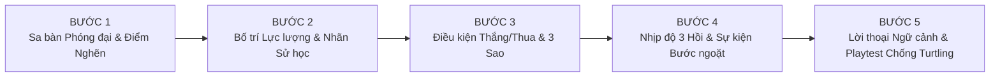

### Bước 1: Thiết kế Sa bàn Phóng đại Chiến thuật (`Tactical Zoom-in Map`) & Điểm Nghẽn

#### 1. Quy chuẩn Kích thước Lưới Hex (`Pointy-topped Axial`):
| Cấp Quy mô | Kích thước Lưới (Cột $\times$ Hàng) | Tổng số Hex | Số Vòng chuẩn | Quân số Hai phe | Mục đích Thiết kế |
| :--- | :---: | :---: | :---: | :---: | :--- |
| **Nhỏ / Mở màn (Skirmish / Slice)** | **$12 \times 10$** đến **$14 \times 12$** | **120 – 168 hex** | **8 – 10 lượt** | Ta: 4–6 đạo<br/>Địch: 7–10 đạo | Kiểm chứng cơ chế cốt lõi, nhập môn hoặc Vertical Slice (**Slice-01 Bạch Đằng 1288: `12 × 10` hex, `10` lượt**). |
| **Tiêu chuẩn (Standard)** | **$16 \times 14$** đến **$18 \times 15$** | **224 – 270 hex** | **12 – 16 lượt** | Ta: 6–10 đạo<br/>Địch: 12–18 đạo | Các trận đánh then chốt trong chương chiến dịch (phá ải, vây thành, giữ đồn). |
| **Đại Chiến dịch (Major Decisive)** | **$24 \times 20$** đến **$32 \times 26$** | **480 – 832 hex** | **16 – 22 lượt** | Ta: 10–16 đạo<br/>Địch: 20–32 đạo | Đại quyết chiến bước ngoặt lịch sử có bật kinh tế chiến trường (`enable_economy: true`). |

#### 2. Kiến trúc Sa bàn Phóng đại Chiến thuật (`Tactical Zoom-in Map`):
> [!IMPORTANT] **Phân tách rõ Tỷ lệ Chiến thuật (Scenario) và Tỷ lệ Chiến lược (Conquest):**  
> Trên bản đồ chiến lược toàn quốc (chế độ Conquest ở P3+), toàn bộ khu vực cửa sông Bạch Đằng chỉ tương ứng với 1–2 ô lục giác vĩ mô, nên **tuyệt đối không thể cắt thô cửa sổ `12 × 10` ô trực tiếp từ bản đồ toàn quốc để làm màn chơi chiến dịch**.  
> Thay vào đó, mỗi màn Scenario như `battle_10101.json` là một **Sa bàn Phóng đại Chiến thuật (`Tactical Zoom-in Map`)** được bố cục chuyên biệt theo địa thế cục bộ (lòng sông chính, lạch triều bãi cọc, bãi rừng phục kích hai bên bờ và Bến Hiệu Lệnh), nhưng **tái sử dụng chung 100% Thư viện `TileSet` địa hình và Prefab công trình** của dự án để tiết kiệm chi phí sản xuất mỹ thuật.

#### 3. Phân bố Địa hình & Điểm Nghẽn (`Choke Points`):
* Mỗi bản đồ phải có ít nhất **1–2 điểm nghẽn tự nhiên** (khúc sông hẹp có cọc ngầm `area_bai_coc`, hẻm núi Chi Lăng, đầm lầy Dạ Trạch) buộc đội hình đông đảo của địch bị bó hẹp, mở cơ hội cho người chơi khóa ZOC, đánh bọc sườn Flank hoặc kích hoạt bẫy địa hình.

### Bước 2: Bố trí Lực lượng, Quốc hiệu & Minh bạch Nhãn Sử học (`modeling_type`)
1. **Tương quan lấy ít địch nhiều:** Giữ tỷ lệ lực lượng **Đại Việt (1) vs. Đối phương (1.5 – 2.2)**, bù đắp bằng lợi thế địa hình sở trường (`fond_terrain`), Sĩ khí và cơ chế kịch bản.
2. **Thẩm định danh xưng & gắn nhãn `modeling_type`:** Tuân thủ nghiêm quy định tại [historical_framework.md](gdd/03_content_presentation/historical_framework.md). Mọi sự điều chuyển tướng hoặc cô đọng không gian – thời gian phục vụ gameplay phải ghi rõ `"modeling_type": "abstraction"` hoặc `"fixture"` trong dữ liệu JSON và mục từ Codex.

### Bước 3: Định nghĩa Điều kiện Thắng / Thua & Thách thức 3 Sao
1. **Điều kiện Thắng / Thua hai chiều rõ ràng:** Kết hợp mục tiêu tấn công quyết định (hạ Chủ tướng giặc) với mục tiêu bảo vệ cứ điểm then chốt (như `SignalDock`), ngăn người chơi bỏ mặc căn cứ hoặc co cụm tiêu cực.
2. **Bộ tiêu chuẩn 3 Sao thống nhất:**
   * ⭐ **1 Sao:** Giành chiến thắng màn chơi.
   * ⭐⭐ **2 Sao:** Hoàn thành trong giới hạn lượt thần tốc (ví dụ **`<= 8` lượt** trên tổng `10` lượt ở Slice-01).
   * ⭐⭐⭐ **3 Sao:** Bảo toàn lực lượng — tổng lượng HP tổn thất của toàn quân ta **`<= 20%`** (hoặc đạt điều kiện phụ lịch sử của màn chơi).

### Bước 4: Xây dựng Nhịp điệu 3 Hồi & Sự kiện Bước ngoặt (`Battle Beats`)
* **Hồi 1 — Mở màn & Nhử địch (Vòng 1 – 3):** Tiền quân giặc ồ ạt tiến vào tuyến luồng; quân ta giữ thế phòng ngự linh hoạt, bảo vệ cứ điểm và dụ thuyền địch lọt vào khu vực hiểm địa.
* **Hồi 2 — Bước ngoặt Bùng nổ (Vòng 4 – 6):** Kích hoạt sự kiện môi trường ở **đầu Vòng 4 (`current_round == 4`)** kết hợp `AlterTerrain` + `ApplyAreaEffect` và tung phục binh tạt sườn (`SpawnReinforcements` với `find_nearest_free_hex`).
* **Hồi 3 — Tổng phản công & Quyết định (Vòng 7 – 10):** Khép chặt vòng vây hạ Chủ tướng địch để thắng tức thì, hoặc quét sạch tối thiểu `75%` quân địch trong khi giữ vững cứ điểm tới hết Vòng 10.

### Bước 5: Biên tập Lời thoại Ngắn gọn & Kiểm thử Chống Co cụm (`Anti-Turtling Playtest`)
* Lời thoại súc tích (tối đa 2–3 câu mỗi sự kiện) tại thời khắc khai trận, chạm trán tướng và khi triều rút.
* Kiểm thử với AI: Nếu người chơi chỉ co cụm quanh `SignalDock (2, 8)` suốt 10 lượt mà vẫn thắng dễ dàng $\implies$ yêu cầu tiêu diệt `>= 75%` quân địch ở điều kiện thắng cuối vòng buộc người chơi phải chủ động xuất kích khai thác thời cơ bãi cọc ở Vòng 4!

---

### 4. Kịch bản Chi tiết Chuẩn hóa: SLICE-01 ĐẠI CHIẾN BẠCH ĐẰNG 1288 (`stage_id: 10101`)

> [!NOTE] **Ghi chú Thẩm định Sử học cho Slice-01 (`[S12]`–`[S16]`):**  
> - **Quốc hiệu đối phương (`historical_claim` — Grade A):** Định danh chính xác là **Đại Nguyên (Quân Nguyên)** (`historical_era: "Tran_Nguyen"`).  
> - **Vai trò Phó tướng Trần Khánh Dư (`modeling_type: "abstraction"` / `"fixture"`):** Trong chính sử (`[S12]` *Đại Việt Sử Ký Toàn Thư*, `[S13]` *An Nam Chí Lược*, `[S14]` *Nguyên Sử*), Nhân Huệ Vương Trần Khánh Dư lập đại công đánh tan đoàn thuyền lương Trương Văn Hổ tại **trận Vân Đồn (cuối năm 1287)**; còn tại đại chiến sông Bạch Đằng (9/4/1288) có Quốc công Tiết chế Trần Quốc Tuấn, hai vua Trần, Nguyễn Khoái, Phạm Ngũ Lão, Trần Nhật Duật... Trong phạm vi Vertical Slice MVP, Trần Khánh Dư được đưa vào làm phó tướng thủy quân để kiểm thử cơ chế phối hợp 2 tướng có kỹ năng riêng. Bố cục dải cọc `area_bai_coc` tham chiếu khảo cổ Yên Giang – Cao Quỳ (`[S15]`, `[S16]`) và được mô hình hóa dưới nhãn `"fixture"`.

| Hồi | Vòng đấu | Sự kiện / Trigger | Diễn biến Gameplay & Tác động Hệ thống | Lời thoại Kịch bản |
| :---: | :---: | :--- | :--- | :--- |
| **Hồi 1** | **Vòng 1** | `OnRoundStart`<br/>(`current_round == 1`) | Hạm đội **Đại Nguyên (Quân Nguyên)** do Ô Mã Nhi dẫn đầu tiến vào cửa sông. Quân Đại Việt giữ `SignalDock (2, 8)` và đánh nhử trên mặt nước sâu. | **Trần Quốc Tuấn:** *"Trận này không phá tan giặc Nguyên, thề không về bến sông này!"* |
| | **Vòng 3** | `OnAfterCommand`<br/>(`GeneralClash`) | Thuyền nhẹ phó tướng Trần Khánh Dư (`abstraction`) giao chiến cản mũi tiên phong, kéo đội hình Ô Mã Nhi tiến sâu vào vùng `area_bai_coc` (lúc này vẫn là `Water` bình thường). | **Ô Mã Nhi:** *"Chiến thuyền nhỏ bé của các ngươi cản sao nổi đại quân thủy chiến Đại Nguyên?"* |
| **Hồi 2** | **Đầu Vòng 4** | `OnRoundStart`<br/>(`current_round == 4`)<br/>**`MapPhase_TideFall`** | **Bước ngoặt Thủy triều rút!**<br/>1. `AlterTerrain`: Toàn bộ ô trong `area_bai_coc` chuyển thành **`StakedWater`**.<br/>2. `ApplyAreaEffect`: Mọi thuyền địch đang nằm trong `area_bai_coc` lập tức mất **`35% max_hp`**, dính **`march_disabled_turns = 2`** và **`chaos_turns = 1`**.<br/>3. `SpawnReinforcements`: Phục binh Đại Việt xuất hiện tại ô trống hợp lệ gần nhất (`find_nearest_free_hex`) đánh bọc sườn. | **Trần Quốc Tuấn:** *"Thủy triều đã rút mạnh! Trận địa cọc ngầm đã lộ diện! Toàn quân quay thuyền tổng phản công!"* |
| **Hồi 3** | **Vòng 5–10** | `OnAfterCommand` / `OnRoundEnd` | Quân Đại Việt tận dụng 2 lượt giặc mắc cọc và hỗn loạn để kẹp gọng kìm Pincer.<br/>• **Thắng tức thì:** Hạ gục Ô Mã Nhi khi `SignalDock (2, 8)` thuộc Đại Việt.<br/>• **Thắng cuối Vòng 10:** Giữ vững `SignalDock (2, 8)` và diệt `>= 75%` quân địch.<br/>• **2★:** Thắng `<= 8` lượt; **3★:** Tổn thất HP toàn quân ta `<= 20%`. | **Ô Mã Nhi:** *"Trời hại ta rồi!"* $\rightarrow$ Chuyển ngay sang **Màn hình Chiến Thắng**. |

---

### 5. Mã Nguồn Triển khai Mẫu — `ScenarioEventManager` (Typed GDScript 2.0)

Hỗ trợ đầy đủ toán tử điều kiện **`AND` / `OR`**, đồng bộ `triggered_event_ids: Array[String]` chống nổ lặp sự kiện sau khi Load game, thực thi sát thương vùng bãi cọc `ApplyAreaEffect` và thuật toán BFS vòng lục giác `find_nearest_free_hex` chống đè quân khi gọi tiếp viện:

```gdscript
class_name ScenarioEventManager
extends RefCounted

const AXIAL_DIRECTIONS: Array[Vector2i] = [
	Vector2i(1, 0), Vector2i(1, -1), Vector2i(0, -1),
	Vector2i(-1, 0), Vector2i(-1, 1), Vector2i(0, 1)
]

var scripted_events: Array[Dictionary] = []
var triggered_event_ids: Array[String] = []

func setup(events_data: Array[Dictionary], restored_triggered_ids: Array[String] = []) -> void:
	scripted_events = events_data.duplicate(true)
	triggered_event_ids = restored_triggered_ids.duplicate()

func check_and_execute(trigger_type: String, ctx: BattleContext) -> void:
	for evt: Dictionary in scripted_events:
		var evt_id: String = String(evt.get("event_id", ""))
		var is_once: bool = bool(evt.get("once", true))
		if is_once and triggered_event_ids.has(evt_id):
			continue
		if String(evt.get("trigger_type", "")) != trigger_type:
			continue

		var conditions: Array[Dictionary] = []
		conditions.assign(evt.get("conditions", []))
		var logic_op: String = String(evt.get("logic_operator", "AND")).to_upper()

		if _evaluate_conditions(conditions, logic_op, ctx):
			if is_once and not evt_id.is_empty():
				triggered_event_ids.append(evt_id)
			var results: Array[Dictionary] = []
			results.assign(evt.get("results", []))
			_execute_results(results, ctx)

## Hỗ trợ đầy đủ cả hai cổng logic AND và OR.
func _evaluate_conditions(
	conditions: Array[Dictionary],
	logic_op: String,
	ctx: BattleContext
) -> bool:
	if conditions.is_empty():
		return true

	if logic_op == "OR":
		for cond: Dictionary in conditions:
			if ctx.evaluate_single_condition(cond):
				return true
		return false

	# Mặc định: AND — toàn bộ điều kiện con phải thỏa mãn
	for cond: Dictionary in conditions:
		if not ctx.evaluate_single_condition(cond):
			return false
	return true

func _execute_results(results: Array[Dictionary], ctx: BattleContext) -> void:
	for action_data: Dictionary in results:
		var action_type: String = String(action_data.get("action", ""))
		match action_type:
			"CameraFocus":
				var hex_dict: Dictionary = action_data.get("target_hex", {})
				var duration: float = float(action_data.get("duration", 1.0))
				ctx.focus_camera_on_hex(Vector2i(int(hex_dict.get("q", 0)), int(hex_dict.get("r", 0))), duration)
			"PlayDialogue":
				ctx.queue_dialogue(String(action_data.get("dialogue_id", "")))
			"AlterTerrain":
				var area_id: String = String(action_data.get("area_id", ""))
				var new_terrain: StringName = StringName(String(action_data.get("new_terrain", "Plain")))
				for cell_hex: Vector2i in ctx.get_named_area_hexes(area_id):
					ctx.set_cell_terrain(cell_hex, new_terrain)
			"ApplyAreaEffect":
				_apply_area_effect(action_data, ctx)
			"SpawnReinforcements":
				_spawn_reinforcements(action_data, ctx)
			_:
				push_warning("ScenarioEventManager: Action chưa hỗ trợ '%s'" % action_type)

## Áp dụng hiệu ứng sát thương & khống chế vùng (VD: Bãi cọc Bạch Đằng lộ diện ở Vòng 4).
func _apply_area_effect(action_data: Dictionary, ctx: BattleContext) -> void:
	var area_id: String = String(action_data.get("area_id", ""))
	var target_faction_id: int = int(action_data.get("target_faction_id", -1))
	var hp_loss_ratio: float = float(action_data.get("hp_loss_max_ratio", 0.35))
	var march_lock: int = int(action_data.get("march_disabled_turns", 2))
	var chaos_lock: int = int(action_data.get("chaos_turns", 1))

	for cell_hex: Vector2i in ctx.get_named_area_hexes(area_id):
		var unit: UnitEntity = ctx.get_unit_at_hex(cell_hex)
		if unit == null:
			continue
		if target_faction_id != -1 and unit.faction_id != target_faction_id:
			continue

		var stake_damage: int = maxi(1, roundi(float(unit.max_hp) * hp_loss_ratio))
		unit.apply_direct_damage(stake_damage)
		if unit.current_hp > 0:
			unit.march_disabled_turns = maxi(unit.march_disabled_turns, march_lock)
			unit.chaos_turns = maxi(unit.chaos_turns, chaos_lock)
		ctx.emit_area_trap_feedback(cell_hex, unit, stake_damage)

## Xuất hiện quân tiếp viện an toàn: tự động tìm ô hợp lệ trống gần nhất nếu tâm điểm đã có quân đứng.
func _spawn_reinforcements(action_data: Dictionary, ctx: BattleContext) -> void:
	var placements: Array = action_data.get("placements", [])
	for raw_item: Variant in placements:
		if not (raw_item is Dictionary):
			continue
		var p: Dictionary = raw_item as Dictionary
		var hex_dict: Dictionary = p.get("hex", {})
		var desired_hex := Vector2i(int(hex_dict.get("q", 0)), int(hex_dict.get("r", 0)))
		var troop_id: int = int(p.get("troop_id", 0))
		var domain: StringName = ctx.get_troop_domain(troop_id)

		var spawn_hex: Vector2i = find_nearest_free_hex(desired_hex, domain, ctx)
		if spawn_hex.x < 0:
			push_warning("ScenarioEventManager: Không còn ô trống hợp lệ gần %s để sinh tiếp viện." % desired_hex)
			continue
		ctx.spawn_unit_from_placement(p, spawn_hex)

## Duyệt BFS theo vòng lục giác đồng tâm để tìm ô hợp lệ chưa có đơn vị chiếm chỗ.
func find_nearest_free_hex(origin_hex: Vector2i, domain: StringName, ctx: BattleContext) -> Vector2i:
	if ctx.is_hex_free_and_passable(origin_hex, domain):
		return origin_hex

	var visited: Dictionary = {origin_hex: true}
	var queue: Array[Vector2i] = [origin_hex]

	while not queue.is_empty():
		var current: Vector2i = queue.pop_front()
		for dir: Vector2i in AXIAL_DIRECTIONS:
			var neighbor: Vector2i = current + dir
			if visited.has(neighbor) or not ctx.is_inside_map(neighbor):
				continue
			visited[neighbor] = true
			if ctx.is_hex_free_and_passable(neighbor, domain):
				return neighbor
			queue.append(neighbor)

	return Vector2i(-1, -1)
```

---

# CHƯƠNG VII: HỆ THỐNG TRÍ TUỆ NHÂN TẠO (AI SYSTEM & DECISION MATRIX)

## 7.1. AI và độ khó


### 12.1. Triết lý thiết kế AI chiến thuật

AI máy trong **Đại Việt Chiến Kỳ** vận hành trên cùng bộ luật chiến trường và chịu cùng giới hạn thông tin sương mù chiến tranh (`Fog of War`) như người chơi:
- **Không gian thông tin trung thực (Zero Map-Hack):** Hàm lập kế hoạch của AI chỉ được đọc dữ liệu từ khung nhìn hợp lệ của phe mình (`AIVisibleMapView`). AI **tuyệt đối không nhìn xuyên Fog of War** và **không được biết trước các bẫy ẩn chưa kích hoạt** (ví dụ tại Slice-01 Bạch Đằng 1288: trước Vòng 4 khi thủy triều chưa rút, vùng `area_bai_coc` vẫn là mặt nước thông thường nên AI không né tránh trước; AI chỉ nhận diện và né ô `StakedWater` sau khi sự kiện `MapPhase_TideFall` đã lộ diện bãi cọc!).
- **Kiến trúc Utility AI 3 giai đoạn & 5 Bộ Chấm Điểm (Evaluators):** Tạo sinh ứng viên hợp lệ (`Generators`) $\rightarrow$ Chấm điểm qua **5 Evaluators** (`ReachableAreaEvaluator`, `AttackTargetEvaluator`, `ObjectiveEvaluator`, `StatusEffectEvaluator`, `ManaEfficiencyEvaluator`) $\rightarrow$ Cộng nhiễu ngẫu nhiên có kiểm soát từ `RandomNumberGenerator` có seed của trận đấu để giữ tính tất định khi Replay/Resume.
- **Kết nối chặt với `ScenarioDirector` qua `ObjectiveEvaluator`:** AI không chỉ lao vào đánh gần nhất mà biết cân nhắc chiếm giữ/phòng thủ cứ điểm kịch bản (như `SignalDock (2, 8)`) và săn tìm hoặc hộ vệ Tướng mục tiêu (như Ô Mã Nhi / Trần Quốc Tuấn).
- **Conquest AI (Chiến lược vĩ mô):** Nằm ngoài phạm vi Slice-01, sẽ được đặc tả riêng khi mở chế độ Conquest ở các cột mốc sau (P3+).

> 📖 **Đặc tả toán học & mã nguồn GDScript 2.0 chi tiết:** xem [ai_decision_matrix.md](gdd/ai/ai_decision_matrix.md).

---

### 12.2. Bốn cấp độ khó chuẩn (`AIDifficultyProfile`)

Thay vì gian lận chỉ số ngầm hay nhìn xuyên bản đồ, 4 cấp độ khó được cấu hình hướng dữ liệu qua Resource `AIDifficultyProfile` với bộ 4 trọng số vĩ mô `(w_atk, w_pos, w_obj, w_skill)` và biên độ nhiễu cộng tính `noise_amp` ($\eta_{\text{RNG}} \in [-\text{noise\_amp}, +\text{noise\_amp}]$):

| Cấp độ khó | Trọng số `(w_atk, w_pos, w_obj, w_skill)` | Nhiễu cộng tính `noise_amp` | Đặc trưng hành vi & Quy tắc kịch bản |
| :--- | :---: | :---: | :--- |
| **Easy (Dễ)** | `(0.50, 0.15, 0.20, 0.15)` | **`±18.0` điểm** | Hỗ trợ người chơi mới làm quen luật: AI thiên về tấn công trực diện đơn giản, ít kẹp sườn, đôi khi bỏ lỡ nước đi tối ưu do biên độ nhiễu cao; không gian lận tài nguyên. |
| **Normal (Thường)** | `(0.35, 0.25, 0.25, 0.15)` | **`±6.0` điểm** | Cấp độ chuẩn cân bằng: AI biết đọc khắc chế binh chủng, giữ cự ly cung nỏ, phối hợp dồn sát thương kết liễu và bám sát cứ điểm mục tiêu (`ObjectiveEvaluator`), tạo biến số tự nhiên giữa các lần chơi. |
| **Hard (Khó)** | `(0.30, 0.25, 0.25, 0.20)` | **`±1.5` điểm** | Bậc thầy chiến thuật: AI tính toán sắc bén gần như tối ưu, tích cực lập thế bao vây Pincer, tận dụng địa hình phòng thủ, tung kỹ năng khống chế đúng nhịp và gây sức ép liên tục lên cứ điểm then chốt nhưng **vẫn tuân thủ nghiêm ngặt Fog of War**. |
| **Challenge (Thử thách)** | `(0.28, 0.27, 0.25, 0.20)` | **`±0.5` điểm** | Chế độ thử thách danh tướng: Kết hợp bộ não chiến thuật chuẩn xác nhất với **các biến số kịch bản khắc nghiệt được công bố minh bạch ngay tại Briefing** (ví dụ: giới hạn vòng ngắn hơn, tiếp viện địch đến sớm hơn 1 vòng hoặc sĩ khí khởi đầu của giặc cao hơn), tuyệt đối không tăng lén HP/ATK ảo sau lưng người chơi. |

---

## 7.2. ĐẶC TẢ KIẾN TRÚC RA QUYẾT ĐỊNH CỦA AI MÁY (AI DECISION MATRIX)
*(Chuẩn hóa cho Godot 4.7 — Thuần Typed GDScript 2.0, Tuân thủ Fog of War & Seeded RNG)*

> **Vị trí tài liệu:** `docs/gdd/ai/ai_decision_matrix.md`  
> **Trạng thái:** Chuẩn hóa kiến trúc Utility AI 3 giai đoạn: **Generators $\rightarrow$ 5 Evaluators (có `ObjectiveEvaluator`) $\rightarrow$ Additive Stochastic Scoring**, đọc cấu hình động từ `AIDifficultyProfile` cho đủ 4 cấp độ khó (`Easy`, `Normal`, `Hard`, `Challenge`), tuân thủ tuyệt đối Fog of War (Zero Map-Hack) và bảo toàn tính tất định Replay nhờ `RandomNumberGenerator` có seed của trận đấu.

---

### 1. Kiến trúc Tổng quát 3 Giai đoạn (AI Pipeline)

AI máy vận hành trên cùng tập luật chiến trường và giới hạn tầm nhìn sương mù chiến tranh (`AIVisibleMapView`) như người chơi, kết nối trực tiếp với `ScenarioDirector` để bám sát mục tiêu kịch bản:

```mermaid
flowchart TD
    Start["🤖 Lượt AI Khởi Động\n(Nhận AIVisibleMapView & Seeded RNG)"] --> P1["GIAI ĐOẠN 1: GENERATORS\n(Tạo lập ứng viên hợp lệ trong vùng nhìn thấy)"]

    subgraph Generators["Bộ Tạo Sinh Ứng Viên (Generators)"]
        G1["ReachableHexGenerator\n(Các ô Hex hợp lệ trong tầm MP & ZoC)"]
        G2["AttackTargetGenerator\n(Mục tiêu địch lộ diện trong tầm & LOS)"]
        G3["SkillTargetGenerator\n(Mục tiêu thi triển Kỹ năng / Mưu lược)"]
    end
    P1 --> Generators

    Generators --> P2["GIAI ĐOẠN 2: 5 EVALUATORS\n(Chấm điểm Heuristic đa tiêu chí)"]

    subgraph Evaluators["5 Bộ Chấm Điểm Chiến Thuật (Evaluators)"]
        E1["1. ReachableAreaEvaluator (S_pos)\n(Vị trí, FondTerrain, Thế thủ & Né bẫy ĐÃ LỘ)"]
        E2["2. AttackTargetEvaluator (S_atk)\n(Sát thương khắc chế, KillSecuring & Flank)"]
        E3["3. ObjectiveEvaluator (S_obj)\n(Chiếm/Giữ cứ điểm SignalDock & Săn/Bảo vệ Tướng)"]
        E4["4. StatusEffectEvaluator (S_status)\n(Gây hiệu ứng CC: InChaos, Cấm đi, Cấm đánh)"]
        E5["5. ManaEfficiencyEvaluator (S_mana)\n(Hiệu suất tiêu thụ Mana cho Kỹ năng/Mưu lược)"]
    end
    P2 --> Evaluators

    Evaluators --> P3["GIAI ĐOẠN 3: TỔNG HỢP & NHIỄU CỘNG TÍNH\n(Weighted Sum + Additive Noise η_RNG)"]
    P3 --> Decision["Chọn Ứng Viên có TotalUtilityScore cao nhất"]
    Decision --> Execution["Đóng gói BattleCommand & Thực thi trên Chiến trường"]
```

---

### 2. Chi tiết Giai đoạn 1: Các Bộ Tạo Sinh & Kỷ luật Fog of War (Zero Map-Hack)

| Bộ Tạo Sinh (GDScript Class) | Nhiệm vụ | Ràng buộc Không gian & Giới hạn Thông tin |
| :--- | :--- | :--- |
| **`ReachableHexGenerator`** | Quét toàn bộ ô hex trong tầm `current_mp` hợp lệ, dừng bước khi chạm vùng ZOC của đơn vị địch **đang nhìn thấy** hoặc địa hình cấm theo `domain` (`Land` / `Naval`). | Chỉ đọc địa hình hiện hành trên `visible_map_view`; không được biết đơn vị địch đang nấp trong sương mù hay rừng rậm chưa bị phát hiện. |
| **`AttackTargetGenerator`** | Từ mỗi ô đứng ứng viên, quét các đơn vị đối phương đã lộ diện nằm trong `[min_range, max_range]` và thỏa đường ngắm LOS. | Bị cản tầm nhìn bởi Rừng rậm / Cao điểm theo đúng quy tắc chiến trường. |
| **`SkillTargetGenerator`** | Quét mục tiêu hợp lệ để thi triển Kỹ năng / Mưu kế chủ động của Tướng (`res://data/settings/tactic_settings.json`). | Kiểm tra `cooldown == 0` và `current_mana >= mana_cost`. |

> [!IMPORTANT] **Quy tắc Cấm Tuyệt Đối AI "Map-Hack" Bãi Cọc Ngầm & Sương Mù:**  
> Mọi hàm của AI chỉ nhận đối tượng khung nhìn đã lọc **`visible_map_view: AIVisibleMapView`**, tuyệt đối không truy cập trực tiếp `BattleMap` gốc chứa dữ liệu ẩn.  
> Cụ thể tại **Slice-01 Đại Chiến Bạch Đằng 1288 (`stage_id: 10101`)**: Từ Vòng 1 đến hết Vòng 3 (trước khi sự kiện `MapPhase_TideFall` kích hoạt ở đầu Vòng 4), các ô thuộc vùng `area_bai_coc` có địa hình là mặt nước bình thường (`Water`). AI của phe Đại Nguyên **hoàn toàn không được biết trước đó là bãi cọc ngầm để trừ điểm né tránh**! Chỉ từ đầu Vòng 4 trở đi, khi bãi cọc đã lộ diện thành địa hình `StakedWater` trên bản đồ công khai, AI mới nhận biết và tính điểm phạt địa hình nguy hiểm.

---

### 3. Chi tiết Giai đoạn 2: 5 Bộ Chấm Điểm Chiến Thuật (Evaluators)

### 3.1. `ReachableAreaEvaluator` — Điểm Vị trí Đứng ($S_{\text{pos}}$)
* **Thưởng (+):**
  * Tận dụng Địa hình Sở trường (`fond_terrain`): **`+25.0`** điểm.
  * Đứng trên Cao điểm (`Hill`) hoặc ẩn mình trong Rừng (`Forest` tăng giáp): **`+20.0`** điểm.
  * Thiết lập thế gọng kìm bao vây Pincer (`TrappedLevel >= 2`) lên kẻ địch đã lộ diện: **`+45.0`** điểm.
  * Phát ZOC che chắn sườn cho Chủ tướng phe mình: **`+35.0`** điểm.
* **Phạt (-):**
  * Bước vào vùng giao thoa ZOC nguy hiểm của nhiều đạo quân địch đang nhìn thấy: **`-30.0`** điểm.
  * Đi vào Đầm lầy (`Swamp`) hoặc ô **Bãi cọc đã lộ diện (`StakedWater`)**: **`-50.0`** điểm *(chỉ áp dụng khi ô đó thực sự đang có trạng thái `StakedWater` trên `visible_map_view`)*.
  * Đứng cô lập hở sườn dễ bị địch kẹp Flank ở lượt kế tiếp: **`-25.0`** điểm.

### 3.2. `AttackTargetEvaluator` — Điểm Đòn Tấn công ($S_{\text{atk}}$)
* **Thưởng (+):**
  * Sát thương kỳ vọng theo ma trận khắc chế: **`+0.6`** điểm cho mỗi `1%` HP tối đa của mục tiêu dự kiến bị trừ.
  * **Đòn kết liễu dứt điểm mục tiêu (`KillSecuring`, `target.current_hp <= min_expected_damage`):** **`+80.0`** điểm *(chấm duy nhất một lần tại đây; không cộng lặp ở bước tổng hợp bên ngoài)*.
  * Đánh mục tiêu đang **Dao Động** để đẩy xuống **Hỗn Loạn (`InChaos`)**: **`+40.0`** điểm.
  * Tập trung hỏa lực vào đạo quân chủ lực nhiều cờ (`troop_stack == 3`): **`+25.0`** điểm.
* **Phạt (-):**
  * Tổn thất do bị mục tiêu phản kích hợp lệ: **`-0.4`** điểm cho mỗi `1%` HP tối đa của bản thân dự kiến mất.

### 3.3. `ObjectiveEvaluator` — Điểm Mục tiêu Kịch bản ($S_{\text{obj}}$) *(Bắt buộc — Kết nối `ScenarioDirector`)*
Đọc danh sách mục tiêu công khai từ `ScenarioDirector` để dẫn dắt thế trận vĩ mô thay vì chỉ đánh giáp lá cà vô định:
* **Chiếm giữ / Tranh chấp Cứ điểm Sống còn (như `SignalDock (2, 8)`):**
  * Bước trực tiếp lên ô cứ điểm mục tiêu đang thuộc phe đối phương hoặc chưa có quân giữ: **`+90.0`** điểm.
  * Đứng chốt giữ hoặc chắn mặt tiền (bán kính `1 hex`) bảo vệ cứ điểm phe mình khi có địch áp sát trong bán kính `3 hex`: **`+65.0`** điểm.
  * Rút ngắn khoảng cách lưới Hex tới cứ điểm mục tiêu chính (khi ngoài tầm giao chiến trực tiếp): **`+8.0`** điểm cho mỗi ô tiến gần hơn so với vị trí hiện tại.
* **Săn tìm / Hộ vệ Tướng Mục tiêu Kịch bản (như Ô Mã Nhi `9001` hoặc Trần Quốc Tuấn `1001`):**
  * Chọn mục tiêu tấn công chính là Tướng chỉ huy thuộc điều kiện Thắng/Thua của kịch bản: **`+50.0`** điểm.
  * Di chuyển về sát cạnh để hộ vệ Chủ tướng phe mình khi Chủ tướng còn dưới `50%` HP hoặc bị `>= 2` đạo quân địch uy hiếp: **`+55.0`** điểm.

### 3.4. `StatusEffectEvaluator` — Điểm Khống chế Trạng thái ($S_{\text{status}}$)
* Gây **Hỗn Loạn (`InChaos`)**: **`+60.0`** điểm (vô hiệu hóa hoàn toàn khả năng đánh và phát ZOC của địch).
* Gây **Cấm Tấn Công (`AttackDisabled`)**: **`+40.0`** điểm.
* Gây **Khóa Di Chuyển (`MarchDisabled`)**: **`+30.0`** điểm (cầm chân mũi đột kích hoặc thuyền giặc).

### 3.5. `ManaEfficiencyEvaluator` — Điểm Hiệu suất Mưu lược ($S_{\text{mana}}$)
* Đánh giá chi phí cơ hội khi dùng Kỹ năng / Mưu kế tiêu tốn Mana của Tướng (trả về `0.0` nếu ứng viên không dùng kỹ năng tốn Mana):
  $$S_{\text{mana}} = \frac{\text{TacticalGain}}{\max(\text{ManaCost}, 1)} \times 20.0$$

---

### 4. Công thức Tổng hợp Điểm & Nhiễu Cộng Tính Tất Định ($\eta_{\text{RNG}}$)

Hệ thống gom nhóm 5 bộ Evaluator vào **4 trọng số điều phối vĩ mô** `(w_atk, w_pos, w_obj, w_skill)` đọc từ `AIDifficultyProfile`, trong đó nhánh kỹ năng chiến thuật $S_{\text{skill}} = S_{\text{status}} + S_{\text{mana}}$:

$$\text{DeterministicBaseScore}(A) = w_{\text{atk}} \cdot S_{\text{atk}} + w_{\text{pos}} \cdot S_{\text{pos}} + w_{\text{obj}} \cdot S_{\text{obj}} + w_{\text{skill}} \cdot \left(S_{\text{status}} + S_{\text{mana}}\right)$$

$$\text{TotalUtilityScore}(A) = \text{DeterministicBaseScore}(A) + \eta_{\text{RNG}}, \quad \eta_{\text{RNG}} \sim \mathcal{U}(-\text{noise\_amp}, +\text{noise\_amp})$$

> [!WARNING] **Lý do toán học bắt buộc dùng Nhiễu Cộng Tính (Additive Noise) thay vì Nhiễu Nhân:**  
> Nếu dùng công thức nhân `base_score * (1.0 + noise)`, khi mọi phương án rút lui phòng ngự đều mang điểm âm (ví dụ phương án ít tệ hơn `A = -20.0` và phương án rất tệ `B = -30.0`), hệ số nhiễu âm sẽ **đảo ngược dấu bất đẳng thức** (khiến điểm âm nặng bớt âm hơn và được chọn nhầm!). Sử dụng **nhiễu cộng tính có biên độ tuyệt đối `[-noise_amp, +noise_amp]`** sinh từ `RandomNumberGenerator` có seed của trận đấu vừa bảo toàn đúng thứ tự ưu tiên trên cả miền điểm âm lẫn điểm dương, vừa đảm bảo Replay/Resume khớp 100%.

---

### 5. Bảng Cấu hình Trọng số 4 Cấp Độ Khó (`AIDifficultyProfile`)

| Cấp độ (`difficulty_id`) | `w_atk` | `w_pos` | `w_obj` | `w_skill` | Biên độ nhiễu `noise_amp` | Hành vi Chiến thuật Đặc trưng |
| :--- | :---: | :---: | :---: | :---: | :---: | :--- |
| **`easy` (Dễ)** | `0.50` | `0.15` | `0.20` | `0.15` | **`±18.0` đ** | Thiên về lao lên đánh trực diện, ít bọc sườn, đôi khi bỏ qua thế thủ tối ưu do biên độ nhiễu rộng; hỗ trợ người mới học luật. |
| **`normal` (Thường)** | `0.35` | `0.25` | `0.25` | `0.15` | **`±6.0` đ** | Cân bằng chuẩn mực giữa công kích, chọn địa hình có lợi và tiến chiếm cứ điểm kịch bản (`SignalDock`); biến hóa tự nhiên qua mỗi lần chơi. |
| **`hard` (Khó)** | `0.30` | `0.25` | `0.25` | `0.20` | **`±1.5` đ** | Tính toán sắc sảo, ưu tiên kẹp sườn Pincer, khóa kỹ năng chủ lực người chơi và gây áp lực dồn dập lên mục tiêu chính mà vẫn tuân thủ Fog of War. |
| **`challenge` (Thử thách)** | `0.28` | `0.27` | `0.25` | `0.20` | **`±0.5` đ** | Gần như tất định tối ưu tuyệt đối về mặt vị trí – mục tiêu – mưu lược, đi kèm điều kiện thử thách kịch bản công bố trước tại Briefing. |

---

### 6. Mã Nguồn Triển khai Mẫu — Godot 4.7 Typed GDScript 2.0

### 6.1. Cấu hình Độ khó (`res://scripts/ai/ai_difficulty_profile.gd`)
```gdscript
class_name AIDifficultyProfile
extends Resource

@export var difficulty_id: StringName = &"normal"
@export_range(0.0, 1.0, 0.01) var w_atk: float = 0.35
@export_range(0.0, 1.0, 0.01) var w_pos: float = 0.25
@export_range(0.0, 1.0, 0.01) var w_obj: float = 0.25
@export_range(0.0, 1.0, 0.01) var w_skill: float = 0.15
@export_range(0.0, 50.0, 0.5) var noise_amp: float = 6.0

static func create_preset(preset_id: StringName) -> AIDifficultyProfile:
	var p := AIDifficultyProfile.new()
	p.difficulty_id = preset_id
	match preset_id:
		&"easy":
			p.w_atk = 0.50
			p.w_pos = 0.15
			p.w_obj = 0.20
			p.w_skill = 0.15
			p.noise_amp = 18.0
		&"normal":
			p.w_atk = 0.35
			p.w_pos = 0.25
			p.w_obj = 0.25
			p.w_skill = 0.15
			p.noise_amp = 6.0
		&"hard":
			p.w_atk = 0.30
			p.w_pos = 0.25
			p.w_obj = 0.25
			p.w_skill = 0.20
			p.noise_amp = 1.5
		&"challenge":
			p.w_atk = 0.28
			p.w_pos = 0.27
			p.w_obj = 0.25
			p.w_skill = 0.20
			p.noise_amp = 0.5
		_:
			push_warning("AIDifficultyProfile: Unknown preset '%s', using normal." % preset_id)
	return p
```

### 6.2. Bộ Điều Phối Quyết Định AI (`res://scripts/ai/ai_decision_matrix.gd`)
```gdscript
class_name AIDecisionMatrix
extends RefCounted

var profile: AIDifficultyProfile

func _init(difficulty_profile: AIDifficultyProfile = null) -> void:
	profile = difficulty_profile if difficulty_profile != null else AIDifficultyProfile.create_preset(&"normal")

## Lập kế hoạch lượt đi cho 1 đơn vị AI.
## - `visible_map_view`: Khung nhìn đã lọc Fog of War của phe AI (Zero Map-Hack;
##   trước Vòng 4 Bạch Đằng, vùng cọc ngầm vẫn hiển thị là mặt nước bình thường).
## - `scenario_director`: Cung cấp tọa độ cứ điểm (như SignalDock) & Tướng mục tiêu.
## - `rng`: Bộ sinh số ngẫu nhiên có seed của phiên trận đấu (bảo đảm Replay tất định).
func plan_turn(
	unit: UnitEntity,
	visible_map_view: AIVisibleMapView,
	scenario_director: ScenarioDirector,
	rng: RandomNumberGenerator
) -> Array[BattleCommand]:
	var reachable_hexes: Array[Vector2i] = AIGenerators.get_reachable_hexes(unit, visible_map_view)
	var candidates: Array[AIActionCandidate] = AIGenerators.generate_candidates(
		unit, reachable_hexes, visible_map_view
	)

	if candidates.is_empty():
		return [WaitCommand.new(unit.faction_id, unit.unit_id)]

	var best_candidate: AIActionCandidate = null
	var highest_score: float = -INF

	for candidate: AIActionCandidate in candidates:
		# Chấm điểm qua đủ 5 bộ Evaluators trên không gian thông tin hợp lệ
		var atk_score: float = AIEvaluators.evaluate_attack(candidate, unit, visible_map_view)
		var pos_score: float = AIEvaluators.evaluate_position(candidate.dest_hex, unit, visible_map_view)
		var obj_score: float = AIEvaluators.evaluate_objective(
			candidate, unit, visible_map_view, scenario_director
		)
		var status_score: float = AIEvaluators.evaluate_status(candidate, unit, visible_map_view)
		var mana_score: float = AIEvaluators.evaluate_mana(candidate.skill_id, candidate, unit)
		var skill_score: float = status_score + mana_score

		var base_score: float = (
			profile.w_atk * atk_score
			+ profile.w_pos * pos_score
			+ profile.w_obj * obj_score
			+ profile.w_skill * skill_score
		)

		# Nhiễu cộng tính tất định (không đảo dấu khi base_score < 0; KillSecuring +80.0
		# đã được tính duy nhất trong evaluate_attack, không cộng trùng ở đây)
		var noise: float = rng.randf_range(-profile.noise_amp, profile.noise_amp)
		var total_score: float = base_score + noise

		if total_score > highest_score:
			highest_score = total_score
			best_candidate = candidate

	if best_candidate == null:
		return [WaitCommand.new(unit.faction_id, unit.unit_id)]

	return best_candidate.to_commands(unit)
```

---

# CHƯƠNG VIII: KIẾN TRÚC KỸ THUẬT, DỮ LIỆU & SAVE/LOAD

## 8.1. ĐẶC TẢ KIẾN TRÚC DỮ LIỆU, VÒNG LẶP 7 PHA & HỆ THỐNG SAVE/LOAD
*(Chuẩn hóa cho Godot 4.7 — Thuần Typed GDScript 2.0, `gl_compatibility`, Web & Android 60 FPS)*

> **Vị trí tài liệu:** `docs/gdd/architecture/data_and_save_system.md`  
> **Trạng thái:** Thiết kế thuần **Typed GDScript 2.0** cho Godot 4.7, chuẩn hóa đường dẫn JSON chữ thường tương thích tuyệt đối với hệ thống tệp phân biệt hoa-thường trên Web/Android, đồng bộ **Vòng lặp Chiến trường 7 Pha**, **Command Pattern (chỉ `MarchCommand` hỗ trợ Undo 5 điều kiện)** và **Save 2 tầng chống Crash / chống Desync RNG & Event**.

---

### 1. Tổng quan Kiến trúc Dữ liệu 3 Tầng (Three-Tier Data Architecture)

Hệ thống quản trị dữ liệu tách biệt rành mạch giữa dữ liệu cấu hình tĩnh (`res://data/` — chỉ đọc), phiên trận đánh đang diễn ra (`user://saves/battle_session.json`), và hồ sơ tiến trình của người chơi (`user://saves/player_profile.json`):

```mermaid
graph TD
    subgraph Tier1["TẦNG 1: DỮ LIỆU CẤU HÌNH TĨNH (READ-ONLY STATIC DATA)"]
        A["res://data/settings/*.json & res://data/battles/*.json\n(troop_settings, stage_settings, tactic_settings, battle_10101)"]
        -->|DataCenter.load_all()| B["Static Data Cache\n(Autoload Read-Only Dictionaries)"]
    end

    subgraph Tier2["TẦNG 2: PHIÊN TRẬN ĐÁNH (BATTLE SESSION STATE)"]
        C["user://saves/battle_session.json\n(HexMap, Units, Round, rng_seed, rng_state, triggered_event_ids)"]
        <-->|Turn Boundary / Pause Auto-Save\nWeb IndexedDB Safe| D["BattleGameController & ScenarioEventManager\n(7-Phase Live Battle Loop)"]
    end

    subgraph Tier3["TẦNG 3: HỒ SƠ NGƯỜI CHƠI (META-PROGRESSION PROFILE)"]
        E["user://saves/player_profile.json & player_profile.bak\n(Chiến dịch đã mở, Sao đạt được, Tướng, Cài đặt)"]
        <-->|BattleSaveManager.save_player_profile()| F["PlayerProfileCache\n(Dual-Backup Persistent Storage)"]
    end
```

> [!NOTE] **Quy ước Đường dẫn Hệ thống Tệp (Web & Android Case-Sensitivity):**
> - Toàn bộ tệp dữ liệu thiết kế mới của dự án đặt trong **`res://data/`** và bắt buộc viết **chữ thường `snake_case` 100%** (`res://data/settings/troop_settings.json`, `res://data/battles/battle_10101.json`,...).
> - Các thư mục tài nguyên đồ họa/âm thanh placeholder sẵn có trên ổ đĩa giữ nguyên đúng phân biệt hoa-thường thực tế là **`res://Assets/...`**.
> - Dữ liệu lưu của người chơi luôn ghi vào **`user://saves/`** (tuyệt đối không ghi vào `res://` vì `res://` bị khóa chỉ-đọc sau khi xuất bản Web/APK).

---

### 2. Đặc tả Schema Dữ liệu Cấu hình Tĩnh (Static JSON Schemas)

### 2.1. Binh chủng (`res://data/settings/troop_settings.json`)
Bổ sung đầy đủ phân nhánh chỉ huy (`command_branch`), miền di chuyển (`domain`), kiểu công/thủ (`attack_mode`, `defense_mode`), tầm nhìn (`vision_range`), giới hạn gộp cờ (`max_stack`), khẩu phần lương (`meal_food`) và điểm cơ động chuẩn chiến thuật (`3–5 MP`):

```json
[
  {
    "id": 40101,
    "code": "dai_viet_spear_infantry",
    "name": "Bộ Binh Trường Giáo",
    "command_branch": "Infantry",
    "domain": "Land",
    "attack_mode": "Piercing",
    "defense_mode": "MediumArmor",
    "min_attack": 30,
    "max_attack": 40,
    "defence": 12,
    "strength": 160,
    "max_stack": 3,
    "mobility": 4,
    "vision_range": 3,
    "min_range": 1,
    "max_range": 1,
    "critical_percent": 5,
    "counter_percent": 100,
    "fond_terrain": "Forest",
    "damage_deepen": 0,
    "damage_resist": 0,
    "features": ["anti_cavalry_brace", "forest_ambush"],
    "cost_coin": 40,
    "cost_food": 50,
    "meal_food": 10,
    "unit_scene": "res://scenes/units/dai_viet_spear_infantry.tscn",
    "attack_sound": "res://Assets/Audio/sfx_pierce.wav"
  }
]
```

### 2.2. Danh mục Màn chơi Chiến dịch (`res://data/settings/stage_settings.json`)
Đồng bộ đầy đủ thông số chuẩn của **Slice-01 Đại Chiến Bạch Đằng 1288 (`stage_id: 10101`)**: `max_rounds = 10`, `enable_economy = false`, phe đối phương `"Đại Nguyên (Quân Nguyên)"` (`"Tran_Nguyen"`), điều kiện Thắng/Thua và thử thách 3 Sao:

```json
[
  {
    "id": 10101,
    "code": "bach_dang_1288",
    "name": "Đại Chiến Bạch Đằng 1288",
    "chapter_id": 1,
    "historical_era": "Tran_Nguyen",
    "modeling_type": "fixture",
    "difficulty_default": "normal",
    "ai_profile": "normal",
    "general_seat": 2,
    "map_width": 12,
    "map_height": 10,
    "max_rounds": 10,
    "enable_economy": false,
    "battle_file": "res://data/battles/battle_10101.json",
    "banned_troop_ids": [],
    "victory_conditions": [
      {
        "type": "DefeatGeneralWhileHoldingArea",
        "target_general_id": 9001,
        "required_area_id": "signal_dock",
        "instant": true,
        "description": "Hạ gục Ô Mã Nhi trong khi giữ vững Bến Hiệu Lệnh (2, 8) -> Thắng ngay lập tức"
      },
      {
        "type": "HoldAreaAndEnemyCasualtyAtMaxRound",
        "required_area_id": "signal_dock",
        "min_enemy_defeated_percent": 75,
        "at_round": 10,
        "description": "Giữ vững Bến Hiệu Lệnh (2, 8) khi hết Vòng 10 và tiêu diệt >= 75% quân địch"
      }
    ],
    "defeat_conditions": [
      { "type": "LoseKeyArea", "area_id": "signal_dock", "description": "Mất Bến Hiệu Lệnh (2, 8) vào tay quân Đại Nguyên" },
      { "type": "GeneralDefeated", "target_general_id": 1001, "description": "Chủ tướng Trần Quốc Tuấn tử trận" },
      { "type": "AllUnitsEliminated", "faction_id": 1, "description": "Toàn bộ lực lượng Đại Việt bị loại khỏi vòng chiến" },
      { "type": "MaxRoundsUnfulfilled", "max_rounds": 10, "description": "Hết Vòng 10 mà chưa đạt điều kiện chiến thắng" }
    ],
    "star_conditions": [
      { "star": 1, "type": "Victory", "description": "Giành chiến thắng màn chơi" },
      { "star": 2, "type": "MaxRoundLimit", "max_rounds": 8, "description": "Giành chiến thắng trong vòng <= 8 lượt" },
      { "star": 3, "type": "CasualtyHpPercentLimit", "max_loss_percent": 20, "description": "Tổng HP tổn thất toàn quân ta <= 20%" }
    ],
    "reward_coins": 500,
    "reward_medals": 10
  }
]
```

### 2.3. Mưu lược & Kỹ năng Tướng (`res://data/settings/tactic_settings.json`)
Bổ sung bắt buộc trường thời gian hồi chiêu **`cooldown`** (tính theo số vòng):

```json
[
  {
    "id": 10001,
    "code": "hich_tuong_si",
    "name": "Hịch Tướng Sĩ",
    "mana_cost": 80,
    "cooldown": 3,
    "buff_ids": [90001],
    "range": 2,
    "target_type": "AllyArea",
    "effect_type": "ClearChaosAndBoostMorale",
    "icon": "res://Assets/UI/Battle/anno_capital.png"
  }
]
```

---

### 3. Kiến trúc Vòng lặp Chiến trường 7 Pha (7-Phase Battle Loop)

Đồng bộ tuyệt đối với [core_loop.md](gdd/02_gameplay_systems/core_loop.md) và [scenario_scripting_and_events.md](gdd/level_design/scenario_scripting_and_events.md):

```mermaid
sequenceDiagram
    autonumber
    actor Actor as Người Chơi / AI
    participant BC as BattleGameController
    participant Evt as ScenarioEventManager
    participant Map as BattleMapState
    participant Sav as BattleSaveManager

    Note over BC,Map: PHA 1: KHỞI TẠO VÒNG ĐẤU (OnBeginRound)
    BC->>Map: Tăng current_round (+1), giảm Cooldown kỹ năng (-1)
    BC->>Map: Nếu enable_economy == true -> Thu hoạch Coin/Food/Tech & trừ meal_food
    BC->>Evt: check_and_execute("OnRoundStart") (VD: Đầu Vòng 4 kích hoạt MapPhase_TideFall)

    loop Qua từng Phe (Player -> Ally -> Enemy -> Neutral)
        Note over BC,Map: PHA 2: KHỞI TẠO LƯỢT PHE (FactionPhaseStart)
        BC->>Map: Hồi phục current_mp = max_mobility, reset has_acted = false, has_used_undo_this_turn = false
        BC->>Evt: check_and_execute("OnFactionTurnStart")
        BC->>Sav: Auto-Save đầu lượt Người chơi (an toàn cho Web IndexedDB)

        loop Chu trình Ra Lệnh Đơn Vị
            Note over Actor,Map: PHA 3: QUAN SÁT & DỰ BÁO (Observation & Preview)
            BC->>Map: Cập nhật Fog of War (AIVisibleMapView) của phe đang đi
            Actor->>BC: Xem tầm đi, ZOC, LOS & Combat Preview 2 bước (hoặc AI gọi plan_turn)

            Note over Actor,Map: PHA 4: GỬI LỆNH (CommandExecution)
            Actor->>BC: Gửi BattleCommand (March / Attack / CastSkill / ApplyTactic / Wait)

            Note over BC,Evt: PHA 5: GIẢI QUYẾT, SỰ KIỆN TỨC THÌ & XÉT THẮNG/THUA NGAY
            BC->>Map: Thực thi lệnh, giải quyết phản kích & cập nhật Fog of War
            BC->>Evt: check_and_execute("OnAfterCommand") (OnEnterCell / GeneralClash / OnUnitDefeated)
            BC->>BC: check_immediate_victory_or_defeat() (Hạ Ô Mã Nhi khi giữ SignalDock -> Thắng ngay!)
        end

        Note over BC,Sav: PHA 6: KẾT THÚC LƯỢT PHE (OnFactionTurnEnd)
        Actor->>BC: Gửi EndTurnCommand
        BC->>Map: Giảm bộ đếm CC & Buff/Debuff (-1 turn: chaos_turns, march_disabled_turns, attack_disabled_turns) của phe vừa kết thúc lượt
        BC->>Sav: Ghi Checkpoint Auto-Save cuối lượt phe
    end

    Note over BC,Map: PHA 7: KẾT THÚC VÒNG & XÉT MỤC TIÊU CUỐI VÒNG (OnEndRound & VictoryCheck)
    BC->>Evt: check_and_execute("OnRoundEnd")
    BC->>BC: check_round_end_victory_or_defeat() (VD: Hết Vòng 10 giữ SignalDock + diệt >= 75% địch)
```

> **Lưu ý thiết kế quan trọng tại Pha 5 & Pha 6:**
> 1. **Xét Thắng / Thua tức thì ở Pha 5:** Ngay khi một lệnh thực thi xong làm thỏa mãn điều kiện kết thúc tức thời (chẳng hạn tiêu diệt Ô Mã Nhi khi `SignalDock (2, 8)` đang thuộc Đại Việt, hoặc để mất `SignalDock (2, 8)` vào tay giặc, hoặc Trần Quốc Tuấn tử trận), `BattleGameController` lập tức dừng vòng lặp và chuyển sang màn hình tổng kết mà không bắt người chơi chờ hết vòng.
> 2. **Giảm thời hạn Khống chế (CC) ở Pha 6 (`OnFactionTurnEnd`):** Hiệu ứng như `march_disabled_turns = 2` hoặc `chaos_turns = 1` gắn lên thuyền địch ở đầu Vòng 4 sẽ khóa trọn vẹn lượt đi của phe địch trong Vòng 4, rồi mới giảm `-1` khi phe địch kết thúc lượt ở Pha 6 (tránh lỗi giảm CC ở đầu vòng làm hiệu ứng 1 lượt bị mất trắng trước khi địch kịp bị khóa!).

---

### 4. Kiến trúc Mẫu Thiết kế Lệnh & Quy tắc Undo (Command Pattern)

Mọi thao tác chiến thuật được đóng gói thành lớp kế thừa `BattleCommand` phục vụ ghi nhật ký trận đánh (Replay tất định) và kiểm soát chặt quyền hoàn tác:
- **Tuyệt đối XÓA `AttackCommand.undo()`:** Các lệnh `AttackCommand`, `CastSkillCommand`, `ApplyTacticCommand`, `WaitCommand`, `EndTurnCommand` tiêu thụ số ngẫu nhiên chiến đấu hoặc chốt trạng thái lượt nên **không thể hoàn tác (`can_undo() == false`)**.
- **Chỉ duy nhất `MarchCommand` hỗ trợ `can_undo()` & `undo()`**, và bắt buộc lưu đủ các cờ trạng thái phát sinh trong bước đi để kiểm định **5 điều kiện cho phép Undo** (khớp GDD §11.4):
  1. Đơn vị chưa thực hiện hành động chính (`not unit.has_acted`).
  2. Chưa làm lộ thêm bất kỳ ô sương mù hay đơn vị địch ẩn nào (`revealed_fog_cells.is_empty()`).
  3. Chưa bước vào vùng kiểm soát ZOC của địch (`not entered_enemy_zoc`).
  4. Chưa kích hoạt bẫy hoặc sự kiện ô bản đồ (`not triggered_cell_event`).
  5. Đơn vị chưa dùng quyền Undo trong lượt hiện tại (`not unit.has_used_undo_this_turn`).

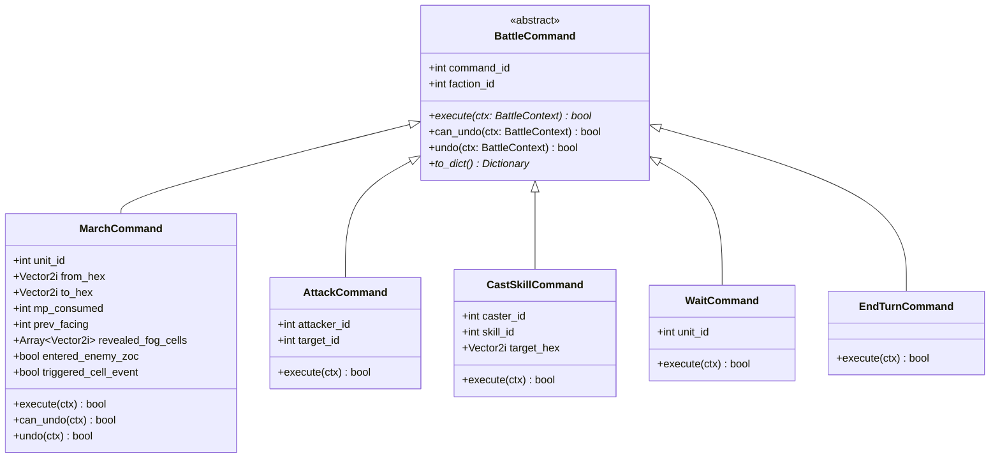

### Đoạn mã GDScript 2.0 cho `BattleCommand` & `MarchCommand`:
```gdscript
class_name BattleCommand
extends RefCounted

var command_id: int = 0
var faction_id: int = 0

func execute(_ctx: BattleContext) -> bool:
	return false

func can_undo(_ctx: BattleContext) -> bool:
	return false

func undo(_ctx: BattleContext) -> bool:
	return false

func to_dict() -> Dictionary:
	return {"command_id": command_id, "faction_id": faction_id}
```

```gdscript
class_name MarchCommand
extends BattleCommand

var unit_id: int
var from_hex: Vector2i
var to_hex: Vector2i
var mp_consumed: int = 0
var prev_facing: int = 0

# 4 nhóm dữ liệu kiểm tra điều kiện cấm Undo (kết hợp cờ trên UnitEntity)
var revealed_fog_cells: Array[Vector2i] = []
var entered_enemy_zoc: bool = false
var triggered_cell_event: bool = false

func _init(p_faction_id: int, p_unit_id: int, p_from: Vector2i, p_to: Vector2i) -> void:
	faction_id = p_faction_id
	unit_id = p_unit_id
	from_hex = p_from
	to_hex = p_to

func execute(ctx: BattleContext) -> bool:
	var unit: UnitEntity = ctx.get_unit(unit_id)
	if unit == null or unit.has_acted:
		return false

	prev_facing = unit.facing
	var move_report: Dictionary = ctx.move_unit_along_valid_path(unit, from_hex, to_hex)
	if not move_report.get("ok", false):
		return false

	mp_consumed = int(move_report.get("mp_cost", 0))
	revealed_fog_cells.assign(move_report.get("revealed_fog_cells", []))
	entered_enemy_zoc = bool(move_report.get("entered_enemy_zoc", false))
	triggered_cell_event = bool(move_report.get("triggered_cell_event", false))
	return true

func can_undo(ctx: BattleContext) -> bool:
	var unit: UnitEntity = ctx.get_unit(unit_id)
	if unit == null:
		return false
	if unit.has_acted:
		return false
	if unit.has_used_undo_this_turn:
		return false
	if not revealed_fog_cells.is_empty():
		return false
	if entered_enemy_zoc:
		return false
	if triggered_cell_event:
		return false
	return true

func undo(ctx: BattleContext) -> bool:
	if not can_undo(ctx):
		return false
	var unit: UnitEntity = ctx.get_unit(unit_id)
	ctx.teleport_unit_without_triggers(unit, from_hex)
	unit.current_mp += mp_consumed
	unit.facing = prev_facing
	unit.has_used_undo_this_turn = true
	return true
```

---

### 5. Hệ thống Lưu trữ 2 Tầng, Chống Desync & Tối ưu Web IndexedDB

### 5.1. Hồ sơ Tiến trình Người chơi (`user://saves/player_profile.json` & `.bak`)
* Lưu trữ danh sách màn chơi đã vượt qua, số sao kỷ lục mỗi màn, danh tướng, bảo vật và cài đặt trợ năng.
* **Cơ chế Sao lưu Kép (`Dual-Backup`):** Trước khi ghi đè `player_profile.json`, hệ thống sao chép bản hợp lệ hiện có sang `player_profile.bak`. Khi khởi động game, nếu file chính bị hỏng dữ liệu (mất nguồn đột ngột), hệ thống tự động khôi phục từ `.bak`.

### 5.2. Phiên Trận đánh Dở dang (`user://saves/battle_session.json`)
Để Resume trận đánh khớp tuyệt đối 100% mà không bị nổ lặp sự kiện hoặc lệch kết quả ngẫu nhiên, `BattleSessionState` bắt buộc tuần tự hóa đầy đủ:
* `version`: Số nguyên phiên bản schema (mặc định `1`) phục vụ nâng cấp tương thích ngược.
* `stage_id`, `current_round`, `current_faction_id`.
* **`rng_seed: int` và `rng_state: int`:** Khôi phục chính xác trạng thái tức thời của `RandomNumberGenerator` đang dùng cho Combat & AI.
* **`triggered_event_ids: Array[String]`:** Danh sách ID các sự kiện kịch bản `once: true` đã kích hoạt (ví dụ `["evt_10101_battle_start", "evt_10101_tide_fall"]`) — nạp lại cho `ScenarioEventManager` khi Resume để sự kiện một lần không bao giờ bị chạy lặp lại!
* `hex_cell_states`: Địa hình hiện tại của từng ô (bảo toàn các ô đã chuyển sang `StakedWater`), phe kiểm soát cứ điểm (`SignalDock`), trạng thái Fog of War đã mở của từng phe.
* `unit_states`: Tọa độ `(q, r)`, `current_hp`, `morale`, `current_mp`, `has_acted`, `has_used_undo_this_turn`, cùng các bộ đếm CC (`chaos_turns`, `march_disabled_turns`, `attack_disabled_turns`).

> [!IMPORTANT] **Quy tắc Nhịp Lưu Tự Động trên Web (IndexedDB) & Android:**  
> Trên bản xuất HTML5/Web của Godot 4.7, mỗi thao tác đóng tệp `user://` kích hoạt đồng bộ hóa hệ thống tệp ảo lên **IndexedDB** của trình duyệt. Nếu ghi file sau từng bước đi lẻ của từng lính sẽ gây khựng khung hình (frame hitch).  
> Vì vậy, `BattleSaveManager.save_battle_session()` **chỉ được gọi tại ranh giới đầu/cuối lượt phe (`FactionPhaseStart` / `OnFactionTurnEnd`) hoặc khi người chơi bấm nút `Pause / Thoát ra Menu`**.

---

### 6. Mã Nguồn Triển khai Mẫu — `BattleSaveManager` (Typed GDScript 2.0)

```gdscript
class_name BattleSaveManager
extends Node

const SAVE_SCHEMA_VERSION: int = 1
const SAVE_DIR: String = "user://saves"
const SESSION_SAVE_PATH: String = "user://saves/battle_session.json"
const PROFILE_SAVE_PATH: String = "user://saves/player_profile.json"
const PROFILE_BACKUP_PATH: String = "user://saves/player_profile.bak"

static func _ensure_save_dir() -> Error:
	# Bắt buộc tạo thư mục trước khi mở FileAccess.WRITE để tránh crash trên máy cài mới
	var abs_dir: String = ProjectSettings.globalize_path(SAVE_DIR)
	var err: Error = DirAccess.make_dir_recursive_absolute(abs_dir)
	if err != OK:
		push_error("BattleSaveManager: Không thể tạo thư mục lưu '%s' (err=%d)" % [abs_dir, err])
	return err

## Lưu phiên trận đánh tại đầu/cuối lượt phe hoặc khi Pause/Thoát (không gọi sau từng bước lẻ).
static func save_battle_session(
	state_dict: Dictionary,
	rng: RandomNumberGenerator,
	triggered_event_ids: Array[String]
) -> bool:
	if _ensure_save_dir() != OK:
		return false

	var payload: Dictionary = state_dict.duplicate(true)
	payload["version"] = SAVE_SCHEMA_VERSION
	payload["rng_seed"] = str(rng.seed)     # Lưu chuỗi để không mất độ chính xác uint64 trong JSON
	payload["rng_state"] = str(rng.state)
	payload["triggered_event_ids"] = triggered_event_ids.duplicate()

	var json_text: String = JSON.stringify(payload, "\t")
	var file := FileAccess.open(SESSION_SAVE_PATH, FileAccess.WRITE)
	if file == null:
		push_error("BattleSaveManager: Mở file '%s' thất bại (err=%d)" % [
			SESSION_SAVE_PATH, FileAccess.get_open_error()
		])
		return false

	file.store_string(json_text)
	file.close()
	return true

## Khôi phục phiên trận đánh kèm đúng trạng thái RNG tất định và danh sách sự kiện đã chạy.
static func load_battle_session(
	out_rng: RandomNumberGenerator,
	out_triggered_event_ids: Array[String]
) -> Dictionary:
	if not FileAccess.file_exists(SESSION_SAVE_PATH):
		return {}

	var file := FileAccess.open(SESSION_SAVE_PATH, FileAccess.READ)
	if file == null:
		push_error("BattleSaveManager: Không thể đọc '%s'" % SESSION_SAVE_PATH)
		return {}

	var parsed: Variant = JSON.parse_string(file.get_as_text())
	file.close()
	if not (parsed is Dictionary):
		push_error("BattleSaveManager: Dữ liệu JSON phiên trận đánh không hợp lệ.")
		return {}

	var data: Dictionary = parsed as Dictionary
	out_rng.seed = int(String(data.get("rng_seed", "1")))
	out_rng.state = int(String(data.get("rng_state", "1")))

	out_triggered_event_ids.clear()
	var raw_events: Array = data.get("triggered_event_ids", [])
	for evt_id: Variant in raw_events:
		out_triggered_event_ids.append(String(evt_id))

	return data

## Lưu hồ sơ người chơi với cơ chế Dual-Backup an toàn.
static func save_player_profile(profile_data: Dictionary) -> bool:
	if _ensure_save_dir() != OK:
		return false

	var payload: Dictionary = profile_data.duplicate(true)
	payload["version"] = SAVE_SCHEMA_VERSION
	var json_text: String = JSON.stringify(payload, "\t")

	if FileAccess.file_exists(PROFILE_SAVE_PATH):
		var src_abs: String = ProjectSettings.globalize_path(PROFILE_SAVE_PATH)
		var bak_abs: String = ProjectSettings.globalize_path(PROFILE_BACKUP_PATH)
		DirAccess.copy_absolute(src_abs, bak_abs)

	var file := FileAccess.open(PROFILE_SAVE_PATH, FileAccess.WRITE)
	if file == null:
		push_error("BattleSaveManager: Ghi hồ sơ thất bại (err=%d)" % FileAccess.get_open_error())
		return false

	file.store_string(json_text)
	file.close()
	return true

## Đọc hồ sơ người chơi, tự động chuyển sang bản sao lưu .bak nếu bản chính lỗi.
static func load_player_profile() -> Dictionary:
	for path: String in [PROFILE_SAVE_PATH, PROFILE_BACKUP_PATH]:
		if not FileAccess.file_exists(path):
			continue
		var file := FileAccess.open(path, FileAccess.READ)
		if file == null:
			continue
		var parsed: Variant = JSON.parse_string(file.get_as_text())
		file.close()
		if parsed is Dictionary:
			return parsed as Dictionary
		push_warning("BattleSaveManager: File '%s' bị lỗi cú pháp JSON, thử bản dự phòng..." % path)
	return {}
```

---

# CHƯƠNG IX: GIAO DIỆN, KẾT XUẤT ĐỒ HỌA & PHẢN HỒI VA CHẠM (UI/UX, RENDERING & JUICE)

## 9.1. UI/UX và khả năng tiếp cận


### 11.1. Nguyên tắc giao diện

- **Map-first:** Bản đồ chiến trường là trung tâm (chiếm tối thiểu 80% diện tích hiển thị); HUD gọn sạch, không che khuất vùng tác chiến.
- **Explainable:** Mọi modifier chiến đấu, LOS, ZOC, hiệu ứng địa hình và tiến độ mục tiêu đều được giải thích minh bạch.
- **Progressive disclosure:** Thông tin cốt lõi đọc lướt được ngay; chi tiết công thức mở rộng theo yêu cầu người chơi.
- **Consistent controls:** Thao tác chạm (Android) và chuột/phím (Web/PC) tuân thủ chung một máy trạng thái đầu vào (`BattleInputFSM`).
- **Accessible:** Không phụ thuộc duy nhất vào màu sắc; luôn đi kèm biểu tượng hình học, độ tương phản cao, thanh trượt giảm rung camera (0–100%) và chế độ giảm chớp sáng.

---

### 11.2. Camera và điều hướng (`Godot 4.7 Camera2D`)

Camera ưu tiên trải nghiệm **map-first**, vận hành mượt ở **60 FPS** trên cả Web (`gl_compatibility`) và Android:
- Hỗ trợ pan bằng `WASD` hoặc kéo chuột giữa trên Web/PC; vuốt kéo 1 ngón và chụm mở 2 ngón (Pinch-to-zoom) trên màn hình cảm ứng Android.
- Nội suy lướt camera độc lập tốc độ khung hình theo công thức hàm mũ `1.0 - exp(-smooth_speed * delta)` kết hợp kẹp biên bản đồ (`Viewport Bounds Clamping`) tính theo tỷ lệ Zoom thực tế.
- **3 nấc Zoom chuẩn & Ngưỡng cắt LOD tự động:**
  - *Tactical Zoom (`1.2x`):* Quan sát cận cảnh mô hình tiểu đội 2D hoạt họa và hiệu ứng giao chiến.
  - *Default Zoom (`1.0x`):* Khung nhìn chiến thuật chuẩn bao quát 10–12 ô hex xung quanh tâm điểm.
  - *Strategic Zoom (`0.5x`):* Toàn cảnh sa bàn chiến dịch.
  - **Ngưỡng chuyển đổi tự động (`zoom < 0.65`):** Ngay khi tỷ lệ phóng đại thu nhỏ xuống dưới `0.65`, hệ thống tự động ẩn lớp mô hình lính (`UnitModelLayer`) và bật lớp huy hiệu quân sự tối giản (**`StrategicTokenLayer` — Military Token**) để giảm tải Draw Calls, giữ vững 60 FPS trên Web & Android.
- Focus nhanh tới đơn vị đang còn lượt bằng double-click hoặc phím `Tab`; camera tự động lướt mượt tới đơn vị chủ đạo khi mở đầu lượt.
- **Game Feel & Rung Chấn (`Trauma-based Shake`):** Biên độ rung phi tuyến theo bình phương độ chấn thương (`trauma * trauma`) ghi vào `Camera2D.offset`, sử dụng bộ sinh số ngẫu nhiên riêng của giao diện (`_fx_rng`) để tuyệt đối không làm lệch trạng thái RNG tất định của mô phỏng chiến đấu.
- Khóa thao tác pan thủ công (`camera_locked = true`) trong lúc AI đang đi quân hoặc khi chạy hộp thoại sự kiện lịch sử.
- Chi tiết kỹ thuật và mã nguồn GDScript 2.0: xem [battle_ui_and_rendering.md](gdd/ui_ux/battle_ui_and_rendering.md).

---

### 11.3. Battle UI và phản hồi

Giao diện chiến trường kế thừa bố cục `form_battle_game` và tinh giản theo phạm vi từng màn chơi:
- **Top Status Bar (Thanh Trạng thái Động):**
  - Luôn hiển thị: Nút Tạm dừng (`[PAUSE]`), Bộ đếm vòng đấu (ví dụ Slice-01: `VÒNG: 03/10`), Phe đang hành động, Điểm Mưu lược (`Mana`) và Tóm tắt mục tiêu chính.
  - **Ẩn/Hiện Kinh tế theo cờ kịch bản (`enable_economy`):** Ở các màn chiến thuật thuần túy như **Slice-01 Bạch Đằng 1288 (`enable_economy == false`)**, cụm tài nguyên `Coin / Food / Tech` được ẩn hoàn toàn để giữ HUD gọn sạch đúng phạm vi MVP; chỉ tự động hiển thị ở các màn P3+ có bật kinh tế chiến trường (`enable_economy == true`).
- **Overhead Unit Badges:** Nổi trực tiếp phía trên từng đạo quân (Thanh máu chia nấc theo số cờ gộp `TroopStack`, Icon 4 bậc Sĩ khí, Badges hiệu ứng khống chế CC).
- **Bottom Command Dock:** Khung Avatar Tướng, thông tin binh chủng/địa hình và cụm nút lệnh chuẩn hóa cho thao tác ngón cái: `[ĐI]`, `[ĐÁNH]`, `[MƯU LƯỢC]`, `[HOÀN TÁC]`, `[ĐỢI]` (chốt vị trí sau khi di chuyển) và `[KẾT THÚC LƯỢT]`.
- **Combat Preview Box (Xác nhận Đòn đánh 2 Bước):**
  - *Bước 1 (Nhắm mục tiêu):* Chạm lần 1 vào quân địch trong tầm để mở hộp dự báo sát thương (`Min~Max`, tỷ lệ Chí mạng `%`, dự báo Phản kích, hệ số Khắc chế/Địa hình/Flank) kèm hiệu ứng nhấp nháy phần máu dự kiến mất.
  - *Bước 2 (Thực thi):* Chạm lần 2 vào mục tiêu hoặc bấm nút `[ĐÁNH]` trên Command Dock để tung đòn — triệt tiêu hoàn toàn lỗi chạm nhầm trên màn hình cảm ứng.
- Sát thương nảy số động trên đầu quân (`WorldSpaceUnitHudAndTextLayer` — Floating Combat Text).
- Kiến trúc **16 lớp kết xuất phân tầng** (bao gồm `MapEffectLayer`, `StrategicTokenLayer`, `FogOfWarLayer` và `ScreenHudCanvasLayer`) cùng luồng **Input FSM 8 trạng thái** (`Idle -> UnitSelected -> Moving -> PostMoveAction -> ...`): xem [battle_ui_and_rendering.md](gdd/ui_ux/battle_ui_and_rendering.md).

---

### 11.4. Undo và trợ giúp người chơi

### Quy tắc Undo 1 bước (`MarchCommand.can_undo()`)
Chỉ duy nhất lệnh di chuyển (`MarchCommand`) hỗ trợ hoàn tác khi đơn vị đang ở trạng thái `PostMoveAction` và thỏa mãn đồng thời **cả 5 điều kiện**:
1. Đơn vị chưa thực hiện hành động chính trong lượt (`!unit.has_acted`: chưa tấn công, chưa thi triển kỹ năng/mưu lược, chưa bấm `[ĐỢI]` chốt vị trí).
2. Chưa mở thêm ô sương mù hay phát hiện đơn vị địch mới trên bản đồ (`revealed_fog_cells.is_empty()`).
3. Chưa kích hoạt bất kỳ bẫy hay sự kiện ô bản đồ nào (`!triggered_cell_event`).
4. Chưa bước vào vùng kiểm soát ZOC của địch (`!entered_enemy_zoc`).
5. Đơn vị chưa sử dụng quyền Undo trong lượt hiện tại (`!unit.has_used_undo_this_turn`).

> **Giới hạn thiết kế:** Tối đa **01 lần Undo mỗi lượt cho mỗi đơn vị**, và các lệnh gây hệ quả vĩnh viễn/tiêu thụ RNG (`AttackCommand`, `CastSkillCommand`, `ApplyTacticCommand`) tuyệt đối không có hàm `undo()`. Quy tắc này cho phép sửa thao tác chạm nhầm mà ngăn chặn triệt để lối chơi *move–undo–move* trinh sát sương mù miễn phí. Đặc tả kỹ thuật lớp lệnh: xem [data_and_save_system.md](gdd/architecture/data_and_save_system.md).

### Hướng dẫn & Codex
- **Codex:** Từ điển tra cứu nhanh về Sĩ khí (`Morale`), Vùng kiểm soát (`ZOC`), Gọng kìm (`Flank`), Thủy triều – Bãi cọc (`StakedWater`), phân kỳ vũ khí và hồ sơ nhân vật/sự kiện lịch sử (gắn rõ nhãn `historical_claim` vs. `abstraction`).
- **Tutorial ngữ cảnh:** Hiển thị gợi ý ngắn gọn ngay tại thời điểm cơ chế xuất hiện lần đầu (ví dụ: cảnh báo thủy triều rút và hiệu ứng bãi cọc ở Vòng 4 Slice-01), không ngắt mạch chơi bằng các trang hướng dẫn dài.

---

## 9.2. ĐẶC TẢ GIAO DIỆN CHIẾN TRƯỜNG, ĐỒ HỌA & KẾT XUẤT (UI/UX & RENDERING)
*(Chuẩn hóa cho Godot 4.7 — Thuần Typed GDScript 2.0, `gl_compatibility`, Web & Android 60 FPS)*

> **Vị trí tài liệu:** `docs/gdd/ui_ux/battle_ui_and_rendering.md`  
> **Trạng thái:** Thiết kế thuần **Typed GDScript 2.0** cho Godot 4.7 (`gl_compatibility`), tối ưu hóa 60 FPS trên nền tảng Web và Android, đồng bộ **16 Lớp Kết Xuất** (có `StrategicTokenLayer`, `MapEffectLayer`, `FogOfWarLayer`), **Input FSM 8 trạng thái** (khép kín luồng `PostMoveAction`), HUD thích ứng cờ `enable_economy`, và `BattleCameraController` dùng nội suy độc lập FPS kèm `Trauma Shake` tách biệt RNG.

---

### 1. Kiến trúc Kết xuất Bản đồ Phân lớp (16-Layer Rendering Pipeline)

Để quản lý hàng trăm ô lục giác, công sự, hiệu ứng hạt, sương mù chiến tranh và các tiểu đội binh sĩ mà không xảy ra xung đột thứ tự vẽ (`Z-fighting`), chiến trường phân tách thành **16 lớp kết xuất chuẩn** (15 lớp không gian bản đồ `Node2D` theo `z_index` cố định và 1 lớp giao diện màn hình `CanvasLayer`):

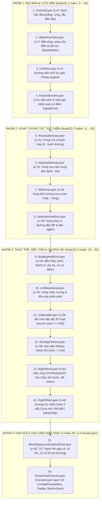

### Ba Nấc Zoom & Ngưỡng Cắt Tự Động `StrategicTokenLayer` (60 FPS trên Web & Android):
* **3 nấc phóng đại chuẩn:**
  * `1.2x` — *Tactical Zoom* (Cận cảnh chi tiết tiểu đội giao chiến).
  * `1.0x` — *Default Zoom* (Khung nhìn tác chiến chuẩn 10–12 hex).
  * `0.5x` — *Strategic Zoom* (Toàn cảnh sa bàn chiến dịch).
* **Ngưỡng chuyển đổi LOD tự động (`zoom < 0.65`):**
  * Khi `zoom >= 0.65`: Bật `UnitModelLayer.visible = true` và ẩn `StrategicTokenLayer.visible = false`.
  * Khi `zoom < 0.65`: Tự động ẩn `UnitModelLayer.visible = false` và bật **`StrategicTokenLayer.visible = true`** (hiển thị huy hiệu quân sự tối giản kèm màu phe & nhánh binh chủng). Cơ chế này cắt giảm hơn 80% Draw Calls trên `gl_compatibility`, giữ vững 60 FPS ổn định.

---

### 2. Máy Trạng thái Tương tác Đầu vào (`BattleInputFSM` — 8 Trạng thái Khép kín)

Quản lý toàn bộ thao tác chuột và cảm ứng qua **8 trạng thái rõ ràng**, trong đó trạng thái trung gian **`PostMoveAction`** giải quyết trọn vẹn cả 4 nhánh hành động sau khi di chuyển (đánh, dùng mưu lược, hoàn tác Undo hoặc chốt đứng đợi), không để xảy ra trạng thái cụt:

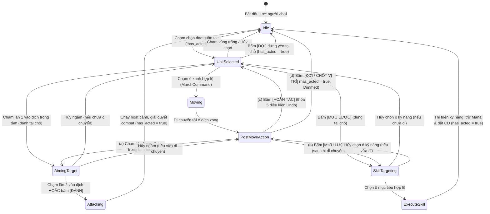

### Quy trình 4 lựa chọn tại `PostMoveAction` & Xác nhận Đòn đánh 2 Bước:
1. **Nhánh (a) — Tấn công 2 bước (`PostMoveAction -> AimingTarget -> Attacking -> Idle`):**
   * *Chạm lần 1 vào địch:* Chuyển sang `AimingTarget`, mở **Combat Preview Box** (`Min~Max` sát thương, `%` Chí mạng, dự báo Phản kích, hệ số Khắc chế/Địa hình/Flank) và nhấp nháy phần máu dự kiến mất.
   * *Chạm lần 2 vào địch hoặc bấm `[ĐÁNH]`:* Chuyển sang `Attacking`, thực thi `AttackCommand`, đặt `unit.has_acted = true` rồi về `Idle`.
2. **Nhánh (b) — Thi triển Kỹ năng/Mưu lược (`PostMoveAction -> SkillTargeting -> ExecuteSkill -> Idle`):**
   * Bấm `[MƯU LƯỢC]` để chọn ô tác động, thực thi `CastSkillCommand`, đặt `unit.has_acted = true` rồi về `Idle`.
3. **Nhánh (c) — Hoàn tác Di chuyển (`PostMoveAction -> UnitSelected`):**
   * Bấm `[HOÀN TÁC]` (chỉ sáng nút khi `march_cmd.can_undo(ctx) == true` thỏa đủ 5 điều kiện tại GDD §11.4): trả quân về `from_hex`, hoàn lại MP, đánh dấu `unit.has_used_undo_this_turn = true` và quay về `UnitSelected`.
4. **Nhánh (d) — Chốt vị trí / Đợi (`PostMoveAction -> Idle`):**
   * Bấm nút `[ĐỢI]` (hoặc chạm xác nhận lần nữa lên chính ô đang đứng): gửi `WaitCommand`, đánh dấu `unit.has_acted = true`, chuyển màu quân sang trạng thái nghỉ (`Dimmed`) và trở về `Idle`.

---

### 3. Bố cục Giao diện Trận đánh (`form_battle_game`) & Quy tắc Ẩn Kinh tế MVP

Tuân thủ triết lý **Map-First** (dành trọn $\ge 80\%$ diện tích màn hình cho sa bàn chiến thuật). Ở **Slice-01 Bạch Đằng 1288 (`stage_id: 10101`, `max_rounds = 10`, `enable_economy = false`)**, cụm tài nguyên `Coin / Food / Tech` trên thanh Top Bar tự động ẩn đi để giao diện gọn sạch đúng phạm vi MVP:

```text
┌──────────────────────────────────────────────────────────────────────────────┐
│ [PAUSE]  VÒNG: 03/10  │ PHE: ĐẠI VIỆT │ 🔮 120 │ MỤC TIÊU: Giữ Bến (2,8) & Hạ Ô Mã Nhi │
├──────────────────────────────────────────────────────────────────────────────┤
│                                                                              │
│                         [ SA BÀN CHIẾN TRƯỜNG 12×10 HEX ]                    │
│                                                                              │
│                         ⚔️ [MỤC TIÊU ĐỊCH: Ô MÃ NHI]                         │
│                      ┌───────────────────────────────┐                       │
│                      │ HP: 310/520 (-52 ~ -68)       │                       │
│                      │ Sát thương dự kiến: 52 ~ 68   │                       │
│                      │ Chí mạng: 15% (~95)           │                       │
│                      │ Phản kích dự kiến: 18 ~ 24    │                       │
│                      │ Địa hình & Flank: +25%        │                       │
│                      └───────────────────────────────┘                       │
│                                                                              │
├──────────────────────────────────────────────────────────────────────────────┤
│ [AVATAR] TƯỚNG: Trần Khánh Dư   [ĐI]  [ĐÁNH]  [MƯU LƯỢC]  [HOÀN TÁC]  [ĐỢI]  │
│ [HÌNH QUÂN] Thủy Quân Đại Việt  (MP)  (Range)   (Mana)    (Undo 1x)  (Wait)  │
│ HP: 320/320 | Sĩ khí: Hưng phấn ──────────────────────────────────────────── │
│ Địa hình: Mặt nước (+15% Công)        [ KẾT THÚC LƯỢT / END TURN 🔔 ]        │
└──────────────────────────────────────────────────────────────────────────────┘
```

### Quy tắc Hiển thị Thích ứng các Thành phần HUD:
1. **Top Status Bar:**
   * Khi `enable_economy == false` (như Slice-01): Chỉ hiển thị `[PAUSE]`, `VÒNG: 03/10`, Phe hiện tại, Điểm Mưu lược (`🔮 Mana`) và Mục tiêu chính.
   * Khi `enable_economy == true` (các màn chiến dịch lớn ở P3+): Tự động bật thêm HBox hiển thị `🪙 Tiền (Coin)`, `🌾 Lương thảo (Food)` và `⚙️ Kỹ nghệ (Tech)`.
2. **Bottom Command Dock:**
   * Bên trái: Thẻ thông tin đạo quân đang chọn (Avatar Tướng, tên binh chủng, thanh HP, bậc Sĩ khí, hệ số địa hình ô hiện tại).
   * Bên phải: Cụm nút thao tác chuẩn cảm ứng gồm `[ĐI]`, `[ĐÁNH]`, `[MƯU LƯỢC]`, `[HOÀN TÁC]` (chỉ bật khi `can_undo() == true`), `[ĐỢI]` (chốt vị trí từ `PostMoveAction` hoặc `UnitSelected`) và `[KẾT THÚC LƯỢT]`.
3. **Overhead Unit HUD (`WorldSpaceUnitHudAndTextLayer`):**
   * Thanh máu chia vạch theo số cờ gộp (`troop_stack`: 1, 2, 3 cờ), biểu tượng 4 bậc Sĩ khí và huy hiệu khống chế (`InChaos`, `MarchDisabled`, `AttackDisabled`).

---

### 4. Hệ thống Điều hướng Camera & Rung Chấn (`BattleCameraController`)

1. **Nội suy Mượt Độc lập FPS (`Exponential Smoothing`):**
   * Thay vì dùng `lerp(pos, target, delta * speed)` bị phụ thuộc tốc độ khung hình (lệch tốc độ giữa màn hình 30Hz, 60Hz và 120Hz), camera bắt buộc dùng hệ số hàm mũ chuẩn `alpha = 1.0 - exp(-smooth_speed * delta)`.
2. **Kẹp Biên Bản Đồ theo Zoom (`Zoom-Aware Viewport Clamping`):**
   * Tâm camera `_focus_position` được giới hạn trong khung `[map_rect.position + half_view, map_rect.end - half_view]` với `half_view = viewport_size * 0.5 / zoom_level` (trường hợp bản đồ nhỏ hơn khung nhìn trên một trục thì tự động căn giữa trục đó) để không bao giờ lộ khoảng đen ngoài rìa bản đồ.
3. **Rung Chấn Phi Tuyến (`Trauma-based Shake`) Tách Biệt RNG:**
   * Độ rung tính bằng bình phương chấn thương `shake = trauma * trauma * shake_user_scale` và ghi riêng vào thuộc tính `Camera2D.offset` (không ghi đè vào `global_position` để tránh xung đột với thuật toán pan mượt).
   * Bắt buộc dùng bộ sinh số ngẫu nhiên cục bộ **`_fx_rng: RandomNumberGenerator`** của riêng Camera — **tuyệt đối không gọi vào `rng` của Simulation**, đảm bảo người chơi bật/tắt rung màn hình cũng không làm sai lệch bất kỳ kết quả chiến đấu hay Replay nào!

---

### 5. Mã Nguồn Triển khai Mẫu — `BattleCameraController` (Typed GDScript 2.0)

```gdscript
class_name BattleCameraController
extends Camera2D

signal strategic_lod_changed(use_strategic_tokens: bool)

const ZOOM_TACTICAL: float = 1.2
const ZOOM_DEFAULT: float = 1.0
const ZOOM_STRATEGIC: float = 0.5
const STRATEGIC_TOKEN_THRESHOLD: float = 0.65

@export_group("Navigation & Bounds")
@export var smooth_speed: float = 10.0
@export var zoom_smooth_speed: float = 12.0
@export var map_world_bounds: Rect2 = Rect2(0.0, 0.0, 1920.0, 1400.0)

@export_group("Trauma Screen Shake")
@export var trauma_decay: float = 1.2
@export var max_shake_offset: Vector2 = Vector2(14.0, 10.0)
@export_range(0.0, 1.0, 0.05) var shake_user_scale: float = 1.0

var camera_locked: bool = false

var _focus_position: Vector2 = Vector2.ZERO
var _target_position: Vector2 = Vector2.ZERO
var _target_zoom: float = ZOOM_DEFAULT
var _current_zoom: float = ZOOM_DEFAULT
var _is_strategic_mode: bool = false
var _trauma: float = 0.0

# RNG riêng cho hiệu ứng hình ảnh UI — tuyệt đối tách rời khỏi RNG mô phỏng trận đánh!
var _fx_rng := RandomNumberGenerator.new()

func _ready() -> void:
	_fx_rng.randomize()
	_focus_position = global_position
	_target_position = global_position
	zoom = Vector2(_current_zoom, _current_zoom)

func _process(delta: float) -> void:
	# 1. Nội suy Zoom độc lập FPS & phát tín hiệu chuyển đổi StrategicTokenLayer (< 0.65)
	var zoom_t: float = 1.0 - exp(-zoom_smooth_speed * delta)
	_current_zoom = lerpf(_current_zoom, _target_zoom, zoom_t)
	zoom = Vector2(_current_zoom, _current_zoom)

	var should_use_tokens: bool = _current_zoom < STRATEGIC_TOKEN_THRESHOLD
	if should_use_tokens != _is_strategic_mode:
		_is_strategic_mode = should_use_tokens
		strategic_lod_changed.emit(_is_strategic_mode)

	# 2. Nội suy vị trí tâm nhìn độc lập FPS & kẹp biên bản đồ theo tỷ lệ Zoom
	_target_position = _clamp_to_map_bounds(_target_position)
	var move_t: float = 1.0 - exp(-smooth_speed * delta)
	_focus_position = _focus_position.lerp(_target_position, move_t)
	global_position = _clamp_to_map_bounds(_focus_position)

	# 3. Trauma-based Screen Shake phi tuyến (trauma^2) theo thời gian thực
	if _trauma > 0.0:
		var real_dt: float = delta / maxf(Engine.time_scale, 0.0001)
		_trauma = maxf(_trauma - trauma_decay * real_dt, 0.0)
		var shake: float = _trauma * _trauma * shake_user_scale
		offset = Vector2(
			_fx_rng.randf_range(-1.0, 1.0) * max_shake_offset.x * shake,
			_fx_rng.randf_range(-1.0, 1.0) * max_shake_offset.y * shake
		)
	elif offset != Vector2.ZERO:
		offset = Vector2.ZERO

## Cộng dồn chấn thương va chạm (Small: 0.15, Medium: 0.40, Large/Crit: 0.80).
func add_trauma(amount: float) -> void:
	_trauma = clampf(_trauma + amount, 0.0, 1.0)

## Lia camera mượt tới tâm ô Hex mục tiêu.
func pan_to_world_pos(world_pos: Vector2, instant: bool = false) -> void:
	_target_position = _clamp_to_map_bounds(world_pos)
	if instant:
		_focus_position = _target_position
		global_position = _focus_position

## Đặt mức phóng đại trong giới hạn [0.5x, 1.2x].
func set_zoom_level(new_zoom: float) -> void:
	_target_zoom = clampf(new_zoom, ZOOM_STRATEGIC, ZOOM_TACTICAL)

func _clamp_to_map_bounds(pos: Vector2) -> Vector2:
	var half_view: Vector2 = (get_viewport_rect().size * 0.5) / maxf(_current_zoom, 0.1)
	var clamped := pos

	if map_world_bounds.size.x <= half_view.x * 2.0:
		clamped.x = map_world_bounds.get_center().x
	else:
		clamped.x = clampf(
			pos.x,
			map_world_bounds.position.x + half_view.x,
			map_world_bounds.end.x - half_view.x
		)

	if map_world_bounds.size.y <= half_view.y * 2.0:
		clamped.y = map_world_bounds.get_center().y
	else:
		clamped.y = clampf(
			pos.y,
			map_world_bounds.position.y + half_view.y,
			map_world_bounds.end.y - half_view.y
		)

	return clamped
```

---

## 9.3. Mỹ thuật, âm thanh và tường thuật (Audio/Visual & Narrative)


> 📖 **Tài liệu đặc tả chi tiết chuyên sâu:**  
> Xem toàn bộ kiến trúc phản hồi va chạm (Trauma Shake, Local Hit-Stop, Squash & Stretch, Hit Flash `canvas_item`), hệ thống hạt `CPUParticles2D` kết hợp Object Pooling (tối ưu `gl_compatibility` cho Web & Android 60 FPS) và Audio Bus 4 luồng tại:  
> 👉 [Hệ Thống VFX, SFX & Đánh Bóng Phản Hồi (vfx_sfx_and_polish.md)](gdd/vfx_sfx/vfx_sfx_and_polish.md)

---

### 13.1. Art Direction (Định hướng mỹ thuật)

- **Phong cách:** 2D Stylized Historical Map (Bản đồ quân sự cổ cách điệu hóa), tối ưu hiển thị sắc nét trên renderer **Godot 4.7 `gl_compatibility`** (Web & Android).
- **Yêu cầu hiển thị:** Bản đồ dễ đọc địa hình, silhouette binh chủng tách biệt rõ ràng ở cả tầm nhìn gần (`UnitModelLayer`) lẫn khi thu nhỏ sang huy hiệu quân sự (`StrategicTokenLayer` ở `zoom < 0.65`), màu sắc phân phe sắc nét và không lấn át thông tin chiến thuật.
- **Chân dung tướng:** Là tranh minh họa tái dựng nghệ thuật theo tư liệu trang phục thời đại; khi không có di ảnh lịch sử đương thời xác thực, tuyệt đối không gắn nhãn như chân dung lịch sử nguyên bản.
- **Tính đồng bộ & Quản trị Placeholder:** Map tiles, icon, chân dung, VFX và thanh trạng thái đơn vị tuân thủ chung hệ thống tỷ lệ và độ tương phản. Mọi tài nguyên placeholder dùng thử nghiệm nội bộ phải được kiểm kê minh bạch và thay thế 100% trước bản phát hành chính thức theo lộ trình tại [ASSET_CATALOG.md](assets/ASSET_CATALOG.md).

---

### 13.2. Âm thanh & Nhạc Nền Thích Ứng (SFX & Dynamic BGM)

- **UI Audio:** Ngắn gọn, dứt khoát, nhất quán trên `UI Bus` và không gây mỏi tai khi thao tác qua hàng trăm lượt.
- **Chiến trường (SFX) & Phân kỳ thời đại (`Era-gating`):**
  - Cấp phát qua **Audio Pooling 24 kênh** (`AudioStreamPlayer2D` / `AudioStreamPlayer`) để triệt tiêu độ trễ cấp phát bộ nhớ trên Web & Android.
  - **Quy tắc `Era-gating` bắt buộc:** Hệ thống âm thanh vũ khí phải khóa chặt theo thời kỳ lịch sử của kịch bản. Cụ thể, tiếng nổ hỏa khí (**Súng Thần Cơ, Hỏa pháo, Hỏa mai**) chỉ được kích hoạt ở các chiến dịch từ **thời Hồ – Lê Sơ (thế kỷ XV) đến Tây Sơn (thế kỷ XVIII)**; **tuyệt đối không xuất hiện trong Slice-01 Bạch Đằng 1288** (thời Trần thế kỷ XIII chỉ sử dụng âm thanh đao kiếm, trường giáo, cung nỏ, hỏa thuyền bốc cháy, chiến thuyền va cọc gỗ, trống đồng và tù và).
- **Âm nhạc (Dynamic BGM):**
  - *Player Turn:* Nhạc cụ truyền thống (đàn tranh, đàn bầu, sáo trúc, tiêu) trầm tĩnh, tạo không gian suy tính nước đi.
  - *Combat / AI Turn:* Trống trận dồn dập, tiết tấu dâng cao thúc đẩy nhịp độ giao tranh.
  - *Nguy cấp / Hậu cần đứt gãy (ở các màn P3+ có kinh tế):* Giai điệu trầm uất cảnh báo áp lực chiến trường.

---

### 13.3. Phản Hồi Va Chạm (Game Feel / Juice)

- **Trauma-based Screen Shake:** Rung lắc `Camera2D.offset` phi tuyến tính theo công thức $\text{Shake} = \text{Trauma}^2 \times \text{Strength}$, sử dụng RNG riêng của tầng hiệu ứng (`_fx_rng`) tách biệt hoàn toàn khỏi RNG mô phỏng trận đánh.
- **Local Hit-Stop (Micro-freeze 40–150ms cục bộ):** Chỉ tạm dừng hoạt cảnh của **2 đơn vị đang trực tiếp giao chiến** kèm bộ đếm thời gian thực (`ignore_time_scale = true`), **tuyệt đối không đặt `Engine.time_scale = 0.0` toàn cục** để giữ mượt camera, HUD và âm thanh.
- **Squash & Stretch & Hit Flash tối ưu Batching:** Đơn vị trúng đòn biến dạng đàn hồi qua `Tween` và chớp sáng 50ms bằng shader `canvas_item` gắn tạm thời (hoặc `self_modulate` overbright trên cấu hình thấp) để không làm gãy chuỗi **2D Batching** trên `gl_compatibility`.
- **Trợ năng (Accessibility):** Cung cấp thanh trượt cường độ rung màn hình (`0%–100%`) và tùy chọn giảm chớp sáng (`Reduce Flashing`) tuân thủ ngưỡng an toàn thị giác WCAG 2.3.1.

---

### 13.4. Tường thuật (Narrative)

- **Briefing trước trận:** Ngắn gọn, súc tích, nêu bật bối cảnh lịch sử, tương quan thế trận, điều kiện Thắng/Thua và các quy tắc đặc biệt của màn chơi.
- **Codex:** Lưu trữ bài viết bối cảnh chuyên sâu, nguồn trích dẫn (`[S6]`, `[S7]`, `[S12]`–`[S16]`), phân biệt rõ phần sự thật lịch sử (`historical_claim`) với phần cô đọng gameplay (`abstraction` / `fixture`).
- **Nhịp độ:** Không ngắt quãng giao tranh bằng các đoạn văn bản dài (*wall of text*); lời thoại trong trận chỉ xuất hiện ngắn gọn tại các bước ngoặt chiến thuật (như thời khắc thủy triều rút ở đầu Vòng 4 Bạch Đằng 1288).

---

## 9.4. Hệ Thống VFX, SFX & Đánh Bóng Phản Hồi (Audio/Visual FX & Polish)


### 1. Tầm Nhìn & Triết Lý "Game Feel" (Juice & Polish Philosophy)

Một tựa game chiến thuật theo lượt (turn-based wargame) dễ rơi vào cảm giác khô cứng nếu thiếu lớp **Phản hồi xúc giác (Juice / Game Feel)**. Được chuẩn hóa cho **Godot 4.7 (`gl_compatibility`, Thuần Typed GDScript 2.0)** hướng tới mục tiêu **60 FPS trên Web & Android**, hệ thống VFX/SFX của **Đại Việt Chiến Kỳ** tuân thủ nguyên tắc cốt lõi:

> **"Mọi quyết định chiến thuật đều phải đem lại cảm giác va chạm đầm tay, trung thực với thời đại lịch sử và tuyệt đối không xâm phạm tính tất định của mô phỏng."**  
> Khi một đạo quân ra đòn, người chơi cảm nhận rõ sức nặng của trường giáo, đao khiên, cung nỏ, tiếng chiến thuyền vướng cọc gỗ hay tiếng gầm của voi chiến tùy theo đúng niên đại kịch bản.

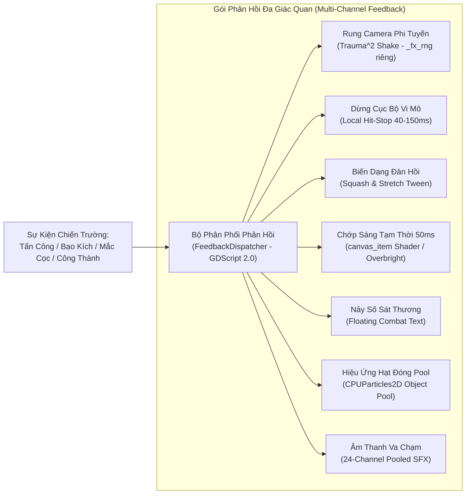

---

### 2. Hệ Thống Phản Hồi Va Chạm (Game Feel & Impact Mechanics)

### 2.1. Rung Màn Hình Dựa Trên Độ Chấn Thương (`Trauma-based Screen Shake`)
Chuẩn hóa theo mô hình chấn thương phi tuyến tích hợp trong `BattleCameraController` ([battle_ui_and_rendering.md](gdd/ui_ux/battle_ui_and_rendering.md)):
- **Độ chấn thương ($\text{Trauma} \in [0.0, 1.0]$):** Các va chạm cộng dồn vào `_trauma` và kẹp trần ở `1.0`.
- **Suy hao theo thời gian thực (`Real-time Decay`):**
  $$\text{Trauma}_{t} = \max\left(0.0,\; \text{Trauma}_{t-1} - \text{DecayRate} \times \Delta t_{\text{real}}\right)$$
  *(với $\text{DecayRate} = 1.2\text{ s}^{-1}$).*
- **Biên độ rung phi tuyến ($\text{Trauma}^2$) tách biệt RNG:**
  $$\text{Shake} = \text{Trauma}^2 \times \text{UserShakeScale}$$
  Sử dụng bình phương $\text{Trauma}^2$ giúp đòn nhẹ chỉ nhích rất êm, trong khi đòn bạo kích hoặc chiến thuyền va bãi cọc tạo chấn động mạnh mẽ; mọi dao động lấy từ `_fx_rng` riêng của giao diện để không chạm vào `rng` của trận đánh.

| Cấp Độ Va Chạm (Tier) | Giá Trị Trauma | Thời Gian Local Hit-Stop | Hiệu Ứng Đi Kèm | Ví Dụ Sự Kiện Áp Dụng |
| :--- | :---: | :---: | :--- | :--- |
| **Nhẹ (Small)** | $0.10 - 0.20$ | Không (`0 ms`) | `2 - 4` hạt bụi/nước | Chọn đạo quân, bước chân hành quân, thao tác nút lệnh. |
| **Trung bình (Medium)** | $0.30 - 0.50$ | `40 - 60 ms` | `8 - 15` hạt tia lửa/bọt nước, Hit Flash trắng `50 ms` | Giáo đâm, đao khiên chạm giáp, loạt tên nỏ bắn trúng đích, phản kích. |
| **Nặng (Large / Heavy)** | $0.70 - 1.00$ | `100 - 150 ms` | `25 - 45` hạt khói lửa/mảnh gỗ, Flash đậm, Số sát thương phóng đại | Bạo kích (`Critical`), Thuyền giặc sập bẫy cọc `StakedWater` ở Vòng 4, Voi chiến xung kích, Sập công sự. |

### 2.2. Dừng Khung Hình Vi Mô Cục Bộ (`Local Hit-Stop`), `Squash & Stretch` & `Hit Flash`

- **Quy tắc Bắt Buộc — `Local Hit-Stop` (Không đóng băng `Engine.time_scale` toàn cục):**
  - Khi đòn đánh chạm đích, hệ thống **chỉ tạm dừng hoạt cảnh cục bộ (`speed_scale = 0.0` trên `AnimatedSprite2D` / `AnimationPlayer`) của đúng 2 đơn vị đang trực tiếp giao chiến** trong khoảng `0.04 – 0.15s`, kết hợp chờ bằng bộ đếm thời gian thực của SceneTree:
    `await get_tree().create_timer(hit_stop_sec, true, false, true).timeout`
  - **Tuyệt đối KHÔNG đặt `Engine.time_scale = 0.0` toàn cục**, nhờ đó thao tác cuộn camera, hiệu ứng suy hao rung màn hình, tween giao diện HUD và luồng âm thanh vẫn mượt mà 60 FPS, không bao giờ xảy ra lỗi kẹt đóng băng vĩnh viễn khi hai hiệu ứng gối lên nhau.

- **Biến dạng Đàn hồi (`Squash & Stretch`):**
  - Ngay khoảnh khắc trúng đòn, node hiển thị của mục tiêu nén theo phương chịu lực `scale = Vector2(1.18, 0.84)`, sau đó đàn hồi về `Vector2.ONE` qua `Tween` (`Tween.TRANS_BACK` + `Tween.EASE_OUT` trong `0.16s`). Luôn hủy tween cũ trên cùng đơn vị trước khi tạo tween mới để tránh lệch tỷ lệ gốc.

- **Chớp Sáng Va Chạm (`Hit Flash Shader`) & Tối ưu 2D Batching trên `gl_compatibility`:**
  ```glsl
  shader_type canvas_item;

  uniform vec4 flash_color : source_color = vec4(1.0, 1.0, 1.0, 0.85);
  uniform float flash_modifier : hint_range(0.0, 1.0) = 0.0;

  void fragment() {
      vec4 tex_color = texture(TEXTURE, UV);
      COLOR = vec4(mix(tex_color.rgb, flash_color.rgb, flash_modifier), tex_color.a);
  }
  ```
  > [!TIP] **Kỹ thuật Bảo toàn 2D Batching trên `gl_compatibility` (Web & Android):**  
  > Trên renderer `gl_compatibility`, nếu mỗi đơn vị trên bản đồ giữ thường trực một bản sao `ShaderMaterial` riêng với uniform khác nhau sẽ làm đứt chuỗi gộp lệnh vẽ (**2D Batching**). Do đó:
  > 1. Bình thường toàn bộ đơn vị để `material = null` để gom chung 1 batch vẽ siêu nhẹ.
  > 2. Chỉ khi trúng đòn mới gán tạm `ShaderMaterial` dùng chung trong đúng **`50 ms`** rồi trả lại `material = null` (hoặc ở chế độ Đồ họa Thấp / *Reduce Flashing*, đổi trực tiếp `self_modulate = Color(1.8, 1.8, 1.8, 1.0)` / sắc đỏ dịu rồi hoàn nguyên `Color.WHITE` mà không cần đổi shader!).

### Đoạn mã GDScript 2.0 chuẩn cho `Local Hit-Stop` + `Hit Flash`:
```gdscript
class_name CombatJuiceHelper
extends RefCounted

static func play_local_impact(
	tree: SceneTree,
	attacker_anim: AnimatedSprite2D,
	defender_visual: CanvasItem,
	defender_anim: AnimatedSprite2D,
	hit_stop_sec: float = 0.06,
	flash_mat: ShaderMaterial = null,
	reduce_flashing: bool = false
) -> void:
	# 1. Kích hoạt Hit Flash 50ms (hoặc tint dịu khi bật Reduce Flashing)
	if is_instance_valid(defender_visual):
		if reduce_flashing or flash_mat == null:
			defender_visual.self_modulate = Color(1.45, 0.75, 0.75, 1.0)
		else:
			defender_visual.material = flash_mat

	# 2. Local Hit-Stop: Chỉ dừng cục bộ 2 đơn vị giao chiến, KHÔNG sửa Engine.time_scale!
	var prev_atk_speed: float = attacker_anim.speed_scale if is_instance_valid(attacker_anim) else 1.0
	var prev_def_speed: float = defender_anim.speed_scale if is_instance_valid(defender_anim) else 1.0
	if is_instance_valid(attacker_anim):
		attacker_anim.speed_scale = 0.0
	if is_instance_valid(defender_anim):
		defender_anim.speed_scale = 0.0

	var flash_duration: float = 0.05
	await tree.create_timer(flash_duration, true, false, true).timeout

	if is_instance_valid(defender_visual):
		defender_visual.material = null
		defender_visual.self_modulate = Color.WHITE

	var remaining_stop: float = maxf(0.0, hit_stop_sec - flash_duration)
	if remaining_stop > 0.0:
		await tree.create_timer(remaining_stop, true, false, true).timeout

	# Kiểm tra an toàn sau await trước khi khôi phục tốc độ hoạt cảnh
	if is_instance_valid(attacker_anim):
		attacker_anim.speed_scale = prev_atk_speed
	if is_instance_valid(defender_anim):
		defender_anim.speed_scale = prev_def_speed
```

### 2.3. Hiển Thị Số Sát Thương Động (`Damage Number Popups`)
- Xuất hiện trên lớp `WorldSpaceUnitHudAndTextLayer` ngay phía trên đầu đơn vị chịu tác động: nảy vọt lên `36 px`, khựng `0.08 s` rồi mờ dần trong `0.55 s`.
- **Bảng mã màu & ký hiệu trực quan (không phụ thuộc duy nhất vào màu):**
  - **Trắng (`-58`):** Sát thương vật lý thông thường.
  - **Vàng cam cỡ lớn (`💥 -96!`):** Đòn bạo kích (`Critical Hit`).
  - **Đỏ tươi (`⚔️ -74`):** Đòn kẹp sườn (`Flank`) hoặc sập bẫy cọc ngầm (`StakedWater`).
  - **Xanh lục (`+45`):** Hồi phục quân số / trị thương.
  - **Xám bạc (`🛡️ 0`):** Sát thương bị hấp thụ tối đa bởi công sự/giáp.

---

### 3. Hệ Thống Hiệu Ứng Hạt Chiến Trường (`CPUParticles2D` + Object Pooling)

> [!IMPORTANT] **Quyết định Kỹ thuật cho `gl_compatibility` (Web & Android 60 FPS):**  
> Trên trình duyệt Web (WebGL2) và nhiều GPU di động tầm trung chạy `gl_compatibility`, `GPUParticles2D` dễ phát sinh khựng khung hình lúc biên dịch shader hạt lần đầu hoặc hạn chế phần cứng transform feedback. Vì các vụ nổ và va chạm trong game có số lượng hạt rất gọn (**`8 – 50` hạt/hiệu ứng**), dự án **ưu tiên sử dụng `CPUParticles2D` kết hợp Object Pooling** (hoặc fallback tự động từ `GPUParticles2D` về `CPUParticles2D` khi chạy Web/Mobile) đặt trên lớp `MapEffectLayer` (`z_index = 42`).

### Danh Mục Các Hiệu Ứng Hạt & Phân Kỳ Thời Đại (`Era-gating`)

| Loại Hiệu Ứng | Tên Prefab Pool | Số Hạt (`amount`) | Thời Gian Sống | Phân Kỳ Thời Đại (`Era-gating`) & Mô Tả |
| :--- | :--- | :---: | :---: | :--- |
| **Bụi Hành Quân / Kỵ Binh** | `DustTrailCPU2D` | `8 – 15` | `0.40 s` | **Mọi thời kỳ:** Cụm bụi đất mờ bốc lên dưới chân bộ binh, kỵ binh, tượng binh trên cạn. |
| **Tia Lửa Kim Khí** | `MetalSparksCPU2D` | `12 – 20` | `0.25 s` | **Mọi thời kỳ:** Tia lửa lóe tóe hình nón khi trường giáo, đao kiếm va chạm giáp khiên. |
| **Bọt Nước & Vỡ Mạn Thuyền** | `WaterSplashCPU2D` | `15 – 28` | `0.50 s` | **Thủy chiến (Slice-01 Bạch Đằng 1288):** Bọt sóng trắng xóa kèm dăm gỗ văng tung khi thuyền giặc đâm phải bãi cọc `StakedWater`. |
| **Hỏa Công & Bè Lửa** | `FireEmbersCPU2D` | `25 – 50` | `1.10 s` | **Mọi thời kỳ:** Ngọn lửa đỏ cam và tàn tro bay lên khi dùng tên lửa, hỏa thuyền hoặc đốt rừng. |
| **Hào Quang Sĩ Khí** | `MoraleAuraCPU2D` | `10 – 15` | `1.40 s` | **Mọi thời kỳ:** Hạt sáng vàng kim khi Hưng phấn; khói xám sẫm khi rơi vào Hỗn Loạn (`InChaos`). |
| **Khói Nổ Súng Thần Cơ** | `GunpowderSmokeCPU2D` | `20 – 35` | `0.80 s` | ⚠️ **`Era-gating` (Thế kỷ XV+):** Chỉ mở khóa từ thời **Hồ – Lê Sơ đến Tây Sơn**; **tuyệt đối khóa trong Slice-01 Bạch Đằng 1288**! |

---

### 4. Kiến Trúc Âm Thanh (Sound Design & Audio Bus Architecture)

Hệ thống âm thanh Godot 4.7 định tuyến qua 4 Audio Bus độc lập (quản lý âm lượng bằng `linear_to_db()` / `db_to_linear()` và lưu cấu hình qua `ConfigFile`):

```text
[Master Bus] (kèm HardLimiter chống vỡ tiếng)
 ├── [BGM Bus]        (Nhạc nền thích ứng theo pha lượt đi)
 ├── [SFX Bus]        (Âm thanh va chạm binh khí, sông nước, bẫy cọc, hỏa khí)
 ├── [Voice/Horn Bus] (Tiếng trống trận, tù và hiệu lệnh, tiếng voi chiến)
 └── [UI Bus]         (Thao tác chọn ô hex, mở bảng lệnh, kết thúc lượt)
```

### 4.1. Bộ Quản Lý Cấp Phát Âm Thanh (`AudioStreamPlayer2D` Pooling)
- Khởi tạo sẵn một Pool cố định gồm **24 Node `AudioStreamPlayer2D`** (cho âm thanh định vị trên sa bàn) và **6 Node `AudioStreamPlayer`** (cho âm thanh UI toàn cục) ngay từ đầu trận.
- Mọi yêu cầu phát SFX mượn node đang rảnh trong Pool để gọi `play()`, ngăn chặn hoàn toàn chi phí khởi tạo/hủy node liên tục gây giật khung hình trên Android và Web.

### 4.2. Thư Viện Âm Thanh Tham Chiếu & Quy Tắc `Era-gating`

> **Lưu ý kiểm kê & bản quyền:** Các tệp trong `res://Assets/Audio/` dưới đây đều là tệp **thực sự tồn tại trên ổ đĩa** dùng làm Placeholder thử nghiệm nội bộ ở giai đoạn MVP và bắt buộc thay mới 100% ở bản 1.0 (xem [ASSET_CATALOG.md](assets/ASSET_CATALOG.md)).

| Danh Mục | File Placeholder Hiện Có (`res://Assets/Audio/`) | Quy Tắc Phân Kỳ Thời Đại (`Era-gating`) | Hoàn Cảnh Kích Hoạt |
| :--- | :--- | :---: | :--- |
| **Đao Kiếm & Khiên** | `sfx_knifestrike1.wav`, `sfx_StrikeIron.wav`, `sfx_block1.wav` | Mở mọi thời kỳ | Bộ binh cận chiến chém giáp, đỡ khiên phản kích. |
| **Trường Giáo** | `sfx_pierce.wav`, `sfx_lancer1.wav` | Mở mọi thời kỳ | Bộ binh trường giáo Đại Việt đâm chặn kỵ binh/đổ bộ. |
| **Cung & Nỏ** | `sfx_crossbow.wav`, `sfx_archery.wav`, `sfx_archery4.wav` | Mở mọi thời kỳ | Loạt tên nỏ bắn từ chiến thuyền hoặc bờ sông Bạch Đằng. |
| **Thủy Chiến & Cọc Ngầm** | `sfx_naval.wav`, `sfx_wave.wav`, `sfx_shiphit.wav`, `sfx_burn.wav` | **Trọng tâm Slice-01 (1288)** | Thủy triều rút ở Vòng 4, chiến thuyền Đại Nguyên đâm cọc gỗ vỡ đáy, hỏa thuyền bốc cháy. |
| **Chiến Tượng & Kỵ Binh** | `sfx_elephant_move.wav`, `sfx_leg_heavy.wav`, `sfx_cavalrymove.wav` | Mở theo roster màn chơi | Voi chiến dẫm đất xung kích, vó ngựa kỵ binh cơ động. |
| **Quân Hiệu & Hỗn Loạn** | `sfx_horn.wav`, `sfx_Bugle.wav`, `sfx_chaos.wav` | Mở mọi thời kỳ | Tù và khai trận, báo hiệu đạo quân địch rơi vào `InChaos`. |
| **Hỏa Khí (Súng / Pháo)** | `sfx_naval_gun.wav`, `sfx_gunfire.wav` | ⚠️ **Khóa trước TK XV** *(Cấm dùng ở Bạch Đằng 1288)* | Chỉ kích hoạt từ các màn thời **Hồ – Lê Sơ (TK XV) đến Tây Sơn (TK XVIII)** (Súng Thần Cơ, Hỏa pháo, Hỏa hổ). |

### 4.3. Nhạc Nền Thích Ứng (`Dynamic Adaptive BGM`)
- **Pha Người Chơi Suy Tính (`Player Turn`):** Âm hưởng nhạc cụ truyền thống (đàn tranh, đàn bầu, sáo trúc, tiêu) khoan thai, hỗ trợ tập trung đọc thế trận.
- **Pha Giao Chiến & Lượt AI (`AI Turn / Climax`):** Chuyển mượt (`Crossfade` hoặc `AudioStreamInteractive`) sang nhịp trống trận dồn dập khi bước vào Hồi 2 (Thủy triều rút ở Vòng 4 Slice-01).
- **Pha Khủng Hoảng Hậu Cần (các màn P3+ có `enable_economy == true`):** Hạ âm sắc trầm căng thẳng khi lương thảo cạn kiệt.

---

### 5. Tùy Chọn Trợ Năng & Đảm Bảo Hiệu Năng 60 FPS

1. **Thanh Trượt Rung Màn Hình (`Screen Shake Scale: 0% – 100%`):** Cho phép người chơi giảm nhẹ hoặc tắt hẳn rung camera (`shake_user_scale = 0.0`).
2. **Chế Độ Giảm Chớp Sáng (`Reduce Flashing Mode` — Chuẩn WCAG 2.3.1):** Tắt hoàn toàn chớp trắng cường độ cao của Hit Flash shader, thay bằng sắc đỏ dịu trên `self_modulate` và giới hạn tần suất chớp dưới 3 lần/giây.
3. **Ba Mức Chất Lượng Hiệu Ứng (`Low / Medium / High`):**
   - *Low (Tối ưu Web di động / Máy yếu):* Điều chỉnh `amount_ratio = 0.4` trên Pool `CPUParticles2D`, dùng `self_modulate` thay cho shader rời, khóa vững 60 FPS.
   - *Medium / High:* Bật đầy đủ `amount_ratio = 1.0`, bọt sóng cửa sông và hiệu ứng khói lửa chiến trường.

---

# CHƯƠNG X: KHUNG NGHIÊN CỨU & THẨM ĐỊNH LỊCH SỬ

## 10.1. Nội dung lịch sử và quy trình thẩm định


### 10.1. Phạm vi Lịch sử & Tính toàn vẹn sử liệu (Historical Scope & Integrity)

### Phạm vi thời đại toàn dự án
**Đại Việt Chiến Kỳ** bao quát tiến trình lịch sử quân sự Việt Nam **từ thời dựng nước & Bắc thuộc đến thế kỷ XVIII (Triều Tây Sơn)** — trải dài từ các cuộc khởi nghĩa giành tự chủ thời Bắc thuộc (Hai Bà Trưng, Bà Triệu, Lý Bí – Đầm Dạ Trạch, Mai Thúc Loan, Phùng Hưng), bước ngoặt độc lập Ngô Quyền (938), Tiền Lê (981), Lý, Trần, Hồ, Khởi nghĩa Lam Sơn – Lê Sơ (thế kỷ XV), cho tới các chiến dịch thần tốc thời Tây Sơn cuối thế kỷ XVIII. Việc mở rộng nội dung được thực hiện cuốn chiếu theo từng chương chiến dịch sau khi hoàn tất kiểm chứng cơ chế tại Vertical Slice (Slice-01).

### Hệ thống phân hạng chứng cứ (Evidence Grade) & Nhãn mô hình hóa (`modeling_type`)
Mỗi dữ kiện lịch sử (`claim`) quan trọng đưa vào game phải gắn `source_ref` (đối chiếu danh mục tại [appendix_b_sources.md](gdd/appendices/appendix_b_sources.md)) và phân hạng chứng cứ **A / B / C / D**, đồng thời ghi người rà soát cùng trạng thái duyệt trong hồ sơ màn chơi (dossier). **Evidence grade áp dụng cho từng claim cụ thể, không gán chung cho toàn bộ một cuốn sử:**
- **Grade A:** Bằng chứng mạnh, được đối chiếu chéo từ nhiều nguồn sơ cấp và/hoặc tư liệu khảo cổ học độc lập (`[S12]`, `[S13]`, `[S14]`, `[S15]`, `[S16]`).
- **Grade B:** Bằng chứng đáng tin cậy từ chính sử hoặc khảo cứu học thuật nhưng còn giới hạn về chi tiết chiến thuật cục bộ.
- **Grade C:** Bằng chứng gián tiếp, truyền thuyết địa phương hoặc còn mâu thuẫn đáng kể giữa các nguồn sử liệu.
- **Grade D:** Chưa xác minh hoặc không đủ căn cứ học thuật; tuyệt đối không trình bày như sự thật lịch sử (`fact`) trong Historical Mode.

Trường **`modeling_type`** được tách bạch hoàn toàn khỏi Evidence Grade và bắt buộc khai báo trong dữ liệu kịch bản:
- `historical_claim`: Phản ánh trực tiếp dữ kiện lịch sử đã được thẩm định.
- `abstraction` (Gameplay Abstraction): Đơn giản hóa, gộp lực lượng hoặc co giãn không gian – thời gian để tạo quyết định chiến thuật theo lượt rõ ràng.
- `fixture`: Cấu hình thử nghiệm cơ chế (như bố cục ô hex, chỉ số máu, lượt rút triều cố định của Slice-01).
- `what_if` / `fictional`: Nhánh giả định lịch sử hoặc hư cấu bổ trợ; phải gắn nhãn minh bạch trên UI/Codex và tách biệt khỏi chính sử.

> **Nguyên tắc bất di bất dịch:** Tuyệt đối không nâng khống Evidence Grade để hợp thức hóa thiết kế gameplay. Mọi chi tiết chưa hoàn tất đối chiếu sử liệu phải ghi rõ `[CẦN THẨM ĐỊNH]`.

---

### 10.2. Quy trình biên soạn & thẩm định nội dung

```
Nguồn sử liệu sơ cấp & Khảo cổ ([S6], [S7], [S12]–[S16])
  ➔ Lập Dossier trận đánh & tách từng claim gắn source_ref
  ➔ Chấm Evidence Grade (A/B/C/D) cho từng claim
  ➔ Khai báo modeling_type riêng (historical_claim / abstraction / fixture / what_if)
  ➔ Chuyển hóa thành cơ chế bản đồ, binh chủng & sự kiện kịch bản
  ➔ Kiểm duyệt Briefing, Lời thoại & mục từ Codex (Era-gating vũ khí/danh xưng)
  ➔ Phê duyệt phát hành & lưu vết thay đổi
```

Mỗi hồ sơ trận đánh (Scenario Dossier) phải xác định rõ: niên đại, quốc hiệu hai phe đương thời, địa danh cổ – kim, danh sách chỉ huy chính thống, mục tiêu chiến lược, diễn biến chính, đặc điểm thủy văn – địa hình, nguồn tham chiếu (`[S6]`, `[S7]`, `[S12]`–`[S16]`) và các điểm còn tranh luận học thuật. Thiết kế màn chơi **không được gộp chung các trận đánh khác thời đại dù diễn ra trên cùng một địa danh**; đồng thời phải kiểm soát chặt **Phân kỳ thời đại (`Era-gating`)** đối với vũ khí (ví dụ: Súng Thần Cơ / Hỏa pháo chỉ xuất hiện từ thời Hồ – Lê Sơ thế kỷ XV trở đi, tuyệt đối không xuất hiện ở các trận thế kỷ X–XIII).

---

### 10.3. Phân biệt Bạch Đằng 938, 981, 1288 & Chuẩn hóa Thẩm định Slice-01

Sông Bạch Đằng gắn liền với ba trận đại thủy chiến ở ba triều đại khác nhau (**Ngô Quyền đánh quân Nam Hán năm 938** `[S7], [S12]`; **Lê Hoàn phá quân Tống năm 981** `[S6], [S12]`; và **Nhà Trần đại phá quân Đại Nguyên năm 1288** `[S6], [S12], [S13], [S14], [S15], [S16]`). Mỗi trận bắt buộc có dossier, biên chế binh chủng, thế trận và điều kiện thắng riêng biệt.

### Hồ sơ thẩm định chuẩn cho Slice-01: Đại Chiến Bạch Đằng 1288 (`stage_id: 10101`)

1. **Chuẩn hóa Quốc hiệu & Mã thời kỳ (`historical_claim` — Grade A, `[S12], [S13], [S14]`):**
   - Năm 1271, Hốt Tất Liệt đã chính thức đặt quốc hiệu là **Đại Nguyên**. Vì vậy, trong cuộc kháng chiến lần thứ ba (1287–1288), phe đối phương bắt buộc định danh chuẩn là **`"Đại Nguyên (Quân Nguyên)"`** và mã thời kỳ trong dữ liệu JSON là **`"Tran_Nguyen"`** (không gộp chung danh xưng với giai đoạn đế quốc Mông Cổ năm 1258).

2. **Chỉ huy lịch sử vs. Trừu tượng hóa Phó tướng trong Slice-01 (`abstraction` / `fixture`):**
   - **Dữ kiện chính sử (`[S12]` *Đại Việt Sử Ký Toàn Thư*, `[S13]` *An Nam Chí Lược*, `[S14]` *Nguyên Sử*):** Tại đại chiến sông Bạch Đằng ngày 8 tháng 3 năm Mậu Tý (9/4/1288), lực lượng Đại Việt do **Quốc công Tiết chế Hưng Đạo Vương Trần Quốc Tuấn** tổng chỉ huy cùng **Thượng hoàng Trần Thánh Tông**, **Vua Trần Nhân Tông** và các tướng lĩnh như **Nguyễn Khoái** (chỉ huy quân Thánh Dực), **Phạm Ngũ Lão**, **Trần Nhật Duật**... chặn đánh hạm đội rút lui của **Ô Mã Nhi (Omar)**, **Phàn Tiếp**, **Tích Lệ Cơ Ngọc**. Trong khi đó, **Nhân Huệ Vương Trần Khánh Dư** nổi danh với chiến thắng quyết định tiêu diệt đoàn thuyền lương của Trương Văn Hổ tại **Vân Đồn (cuối năm 1287 – đầu 1288)** tạo tiền đề buộc quân Nguyên phải rút lui đường thủy qua Bạch Đằng.
   - **Nhãn thiết kế trong Slice-01 (`modeling_type: "abstraction"` / `"fixture"`):** Việc đưa **Trần Khánh Dư** vào vị trí phó tướng thủy quân sát cánh cùng Trần Quốc Tuấn ngay trong màn `battle_10101` được gắn nhãn minh bạch là **`abstraction` / `fixture`** (cô đọng hai mắt xích thủy chiến Vân Đồn – Bạch Đằng vào một sa bàn Vertical Slice duy nhất để kiểm thử cơ chế phối hợp 2 tướng chỉ huy có kỹ năng riêng). Khi mở rộng chiến dịch thời Trần ở giai đoạn Alpha/Beta (P3+), trận **Vân Đồn** sẽ được tách thành màn kịch bản độc lập cho Trần Khánh Dư, và đội hình Bạch Đằng 1288 sẽ trả về đúng các tướng Nguyễn Khoái, Phạm Ngũ Lão theo chính sử.

3. **Bãi cọc ngầm, Thủy triều & Sa bàn `12 × 10` hex (`fixture` / `abstraction`, `[S12], [S15], [S16]`):**
   - Các phát hiện khảo cổ học tại bãi cọc **Yên Giang – Đồng Vạn Muối – Đồng Má Ngựa (Quảng Yên, Quảng Ninh)** `[S15]` và **Cao Quỳ – Đầm Thượng (Thủy Nguyên, Hải Phòng)** `[S16]` cho thấy hệ thống trận địa cọc phân bố thành nhiều dải khóa các lạch triều và cửa nhánh sông, không phải một hàng cọc chắn ngang giữa dòng sông sâu duy nhất.
   - Trong Slice-01, lưới bản đồ **`12 × 10` hex (Pointy-topped Axial)** là một **sa bàn phóng đại chiến thuật (`Tactical Zoom-in Map`)**, trong đó vùng cọc `area_bai_coc`, cứ điểm Bến Hiệu Lệnh `SignalDock (2, 8)` và nhịp rút triều cố định ở **đầu Vòng 4 (`MapPhase_TideFall`)** đều được gắn nhãn **`modeling_type: "fixture"`** nhằm phục vụ nhịp độ chiến thuật 10 lượt rõ ràng, có thể đọc hiểu và phản ứng được.

> 📖 **Liên kết đặc tả dữ liệu & nguồn sử liệu:**
> - Chi tiết cấu trúc JSON kịch bản `res://data/battles/battle_10101.json`, điều kiện Thắng/Thua, 3 Sao và hệ thống sự kiện: xem [scenario_scripting_and_events.md](gdd/level_design/scenario_scripting_and_events.md).
> - Danh mục nguồn tham khảo lịch sử, khảo cổ học và benchmark (`[S1]`–`[S16]`): xem [appendix_b_sources.md](gdd/appendices/appendix_b_sources.md).

---

# CHƯƠNG XI: KẾ HOẠCH SẢN XUẤT, ROADMAP & QUẢN TRỊ RỦI RO

## 11.1. Phạm vi sản xuất, Slice-01, Release MVP và tiêu chí nghiệm thu


### 14.1. Nguyên tắc quản trị phạm vi sản xuất

- **Lộ trình lịch sử cuốn chiếu theo *Era Pack*:** Tầm nhìn tổng thể của sản phẩm trải dài **từ thời dựng nước & Bắc thuộc đến thế kỷ XVIII (Triều Tây Sơn)**, nhưng tuyệt đối không sản xuất dàn trải nhiều thời kỳ cùng lúc. Đội ngũ bắt buộc hoàn thành và kiểm chứng **Slice-01: Đại Chiến Bạch Đằng 1288 (Mốc P2)** trước khi mở rộng thành **Gói Chiến dịch Thời Trần hoàn chỉnh (Release MVP — Mốc P5)**, sau đó mới phát triển cuốn chiếu các *Era Pack* tiếp theo.
- **Đồng nhất nền tảng công nghệ ngay từ đầu (`D-06`, `D-09`, `D-10`):** Phát triển bằng **Thuần GDScript 2.0 (Typed GDScript)** trên **Godot 4.7** với renderer **`gl_compatibility`**, duy trì chuẩn **60 FPS** xuyên suốt từ môi trường kiểm thử **Windows Desktop** sang hai nền tảng phân phối trọng tâm là **Web (HTML5/Wasm) và Android**.
- **Thứ tự ưu tiên sản xuất bất biến:**  
  `Cảm giác điều quân đầm tay` ➔ `Độ rõ luật & Combat Preview` ➔ `Ổn định 60 FPS đa nền tảng` ➔ `Khả năng mở rộng kịch bản bằng dữ liệu JSON`.

---

### 14.2. Milestone thiết kế & sản xuất (`P0–P5`)

| Milestone | Checkpoint Kỹ thuật tương ứng | Trọng tâm thiết kế & Nội dung | Tiêu chí vượt cổng (Exit Criteria) |
|---|---|---|---|
| **P0 — Paper / Greybox Prototype** | `CP1` | Lưới Hex `Pointy-topped Axial`, địa hình cơ bản, camera 60 FPS và mô phỏng bàn cờ cốt lõi. | Kiểm chứng tỷ lệ bản đồ `12 × 10`, độ dễ đọc của 6 hướng tiếp cận và thao tác chạm/click cơ bản. |
| **P1 — Core Tactical Prototype** | `CP2` | Vòng lặp 7 pha, Combat `Seeded RNG`, giáp `100/(100+EffectiveDef)`, 4 bậc Sĩ khí Enum, ZoC & Phản kích. | Đánh trọn vẹn 1 trận thử nghiệm từ đầu đến kết thúc; Undo 1 bước và Deterministic Replay chạy chính xác 100%. |
| **P2 — Vertical Slice (Slice-01)** | `CP3` + `CP4` | Hoàn chỉnh 1 màn **Bạch Đằng 1288 (`stage_id: 10101`)** với AI Utility, `MapPhase_TideFall` Vòng 4, UI/Audio Polish và nhãn lịch sử chuẩn. | Đạt cả `CP4` kỹ thuật lẫn nghiệm thu Playtest độc lập `[D-17]` (`>= 4/5` người chơi ngoài dev hiểu rõ luật & nguyên nhân thắng/thua). |
| **P3 — Alpha (Systems Expansion)** | Nền tảng mở rộng sau `CP4` | Bật hệ thống **Kinh tế Chiến trường & Lương thảo** (`enable_economy = true`: `Coin, Food, Tech, Mana`, `MealFood`, `Starvation`), `CommandProfile` và 3–4 màn thử nghiệm chuỗi chiến dịch. | Vòng lặp hậu cần tạo quyết định cắt lương/giữ kho rõ nét mà không làm chậm nhịp trận đánh quá 25 phút. |
| **P4 — Beta (Content & Platform Complete)** | Tiến tới `CP5` | Hoàn thiện toàn bộ nội dung Gói Thời Trần, Tutorial, Codex; vượt **Asset IP Gate** (thay sạch 100% placeholder); tối ưu bộ nhớ WebAssembly & cảm ứng Android; chuẩn bị khung meta F2P thân thiện (`D-07`) cho lộ trình mở rộng. | Toàn bộ kịch bản Thời Trần có `Dossier` được duyệt; đạt chuẩn 60 FPS ổn định trên trình duyệt Web và thiết bị Android mục tiêu. |
| **P5 — Release MVP (1.0 Launch)** | Hoàn tất `CP5` | Phát hành chính thức **Gói Chiến dịch Thời Trần** hoàn chỉnh trên **Web + Android + Windows Desktop** (không chứa Gacha). | Không còn lỗi nghiêm trọng (Crash/Soft-lock/Desync), vượt qua Release QA, kiểm duyệt lịch sử và sẵn sàng vận hành thực tế. |

---

### 14.3. Phạm vi Slice-01 (Mốc P2 — Vertical Slice Bạch Đằng 1288)

Slice-01 tập trung toàn lực vào **duy nhất 01 màn chơi hoàn chỉnh** để chứng minh chất lượng cốt lõi của trò chơi (xem cấu trúc kịch bản JSON tại [scenario_scripting_and_events.md](gdd/level_design/scenario_scripting_and_events.md) và [data_and_save_system.md](gdd/architecture/data_and_save_system.md)):

- **Định danh kịch bản:** `stage_id: 10101` — **Đại Chiến Bạch Đằng 1288**.
- **Không gian & Thời lượng:** Bản đồ **`12 × 10` hex** (`Pointy-topped Axial`), giới hạn tối đa **10 lượt** (`MaxRounds = 10`).
- **Phe phái đối chiến:**
  - Phe người chơi: **Đại Việt** (Quân dân nhà Trần — giữ thế chủ động giăng bẫy thủy triều và bảo vệ cứ điểm).
  - Phe AI đối phương: **Đại Nguyên (Quân Nguyên)** (Hạm đội rút lui đường thủy do Ô Mã Nhi thống lĩnh).
- **Biên chế & Tướng lĩnh (`Preset Loadout` — `D-02`):** 4–5 archetype binh chủng đặc trưng (Chiến thuyền chủ lực, Thuyền nhẹ/Mông đồng hỏa công, Bộ binh giữ bến, Cung/Nỏ yểm trợ bờ sông), 1–2 danh tướng gắn `UniqueSkill` (Trần Quốc Tuấn, Ô Mã Nhi), sử dụng cơ chế gộp cờ `TroopStack` (`1x–3x`).
- **Hệ thống Chiến đấu & Sĩ khí chuẩn:**
  - **Controlled RNG có Seed tất định (`Seeded RNG`):** Biên độ sát thương `80%–100%` + Bạo kích (`Crit`), công thức giáp chuẩn `100 / (100 + EffectiveDef)`, làm tròn `RoundHalfUp`, lưu `seed/state` bảo đảm **100% Deterministic Replay**, hiển thị minh bạch `[Min, Max]` & `% Crit` trên Combat Preview (không có đánh trượt ngẫu nhiên).
  - **Sĩ khí 4 bậc Enum rời rạc:** `HIGH` (Hưng Phấn), `NORMAL` (Ổn Định), `LOW` (Dao Động), `CHAOS` (Hỗn Loạn — khóa di chuyển, tấn công, phản kích và mất ZoC tạm thời theo lượt rồi tự hồi về `LOW`).
- **Trạng thái Kinh tế / Lương thảo:** **Ẩn hoàn toàn trong Slice-01 (`enable_economy = false`)** — toàn bộ 4 tài nguyên trong trận (`Coin, Food, Tech, Mana`), tiêu hao `MealFood` và `Starvation` được khóa lại cho **Mốc P3 Alpha** ([battlefield_economy.md](gdd/mechanics/battlefield_economy.md)) để người chơi tập trung tuyệt đối vào vị trí, nhịp con nước và bao vây.
- **Nhãn toàn vẹn lịch sử:** Các thông số tọa độ ô Hex, số lượng đơn vị, chỉ số chiến đấu và lời thoại sự kiện trong Slice-01 hiện được gắn nhãn rõ ràng là **`fixture / gameplay abstraction`** cho đến khi hội đồng cố vấn duyệt xong `Dossier` chính thức theo nguồn `[S12]–[S16]`.

### Nhịp sự kiện 3 hồi & Bước ngoặt Thủy triều rút (`MapPhase_TideFall`)
1. **Hồi 1 (Vòng 1–3 — Nhử địch vào thế trận):** Đại quân **Đại Nguyên** ồ ạt tiến dọc luồng sông uy hiếp hạ lưu; người chơi điều thuyền nhẹ đánh nhử, kìm nhịp tiến của địch để gom các chiến thuyền chủ lực của giặc vào khu vực bãi cọc ngầm, đồng thời bảo toàn tuyến phòng thủ quanh `SignalDock (2, 8)`.
2. **Hồi 2 (Đầu Vòng 4 đến Vòng 6 — Thủy triều rút & Phục binh xuất kích):**
   - Ngay **đầu Vòng 4 (`OnRoundStart: Round == 4`)**, sự kiện **`MapPhase_TideFall`** kích hoạt: nước triều rút mạnh làm lộ diện toàn bộ các ô **Bãi cọc ngầm (`StakedWater`)**.
   - Mọi chiến thuyền quân Đại Nguyên đang đứng trên ô bãi cọc lập tức bị cọc nhọn đâm thủng: chịu sát thương trực tiếp **`-35% MaxHP`**, dính hiệu ứng khóa di chuyển **`MarchDisabled` trong 2 lượt** và sụp đổ Sĩ khí xuống bậc **`CHAOS` trong 1 lượt** (sau đó tự hồi về `LOW`).
   - Cùng lúc đó, **Phục binh Đại Việt xuất kích** từ hai bên bờ sông/nhánh sông, tạo thế gọng kìm bọc sườn (`Flank`) và bao vây (`TrappedLevel`) hạm đội giặc đang rối loạn.
3. **Hồi 3 (Vòng 7–10 — Khép vây tiêu diệt chủ tướng):** Quân Nguyên nỗ lực phá vây tuyệt vọng nhắm vào Bến Hiệu Lệnh; người chơi quyết định dồn lực dứt điểm soái hạm **Ô Mã Nhi** để kết thúc sớm trận đánh hoặc quét sạch tàn quân giữ vững trận địa.

### Điều kiện Thắng / Thua & Thách thức 3 Sao của Slice-01
- **Điều kiện Thắng chính (Primary Victory) — Thỏa mãn 1 trong 2 điều kiện:**
  1. **Chiến thắng quyết định (Instant Victory):** Hạ gục chủ tướng **Ô Mã Nhi** trong khi Đại Việt vẫn đang kiểm soát **Bến Hiệu Lệnh (`SignalDock` tại tọa độ `(2, 8)`)** $\rightarrow$ **Thắng ngay lập tức** tại thời điểm hạ tướng *(thiết kế đồng bộ hoàn hảo để người chơi chinh phục mốc 2 Sao `<= 8` lượt!)*.
  2. **Chiến thắng giữ trận & tiêu hao (Hold & Attrition Victory):** Bảo vệ vững chắc quyền kiểm soát `SignalDock (2, 8)` đến hết lượt 10 **và** tiêu diệt được **`>= 75%`** tổng số đơn vị quân Đại Nguyên (trong khi Đại Việt còn ít nhất 1 đơn vị có khả năng chiến đấu).
- **Điều kiện Thua (Defeat):** Để mất quyền kiểm soát `SignalDock (2, 8)` theo điều kiện thất thủ của kịch bản / khi kết thúc lượt 10, hoặc toàn bộ đơn vị chiến đấu của Đại Việt bị tiêu diệt.
- **Tiêu chuẩn Đánh giá 3 Sao (3-Star Challenges):**
  - ⭐ **1 Sao:** Đạt Điều kiện Thắng chính.
  - ⭐⭐ **2 Sao:** Giành chiến thắng trong vòng **`<= 8` lượt** (đòi hỏi tận dụng triệt để bẫy cọc Vòng 4 để kết liễu nhanh Ô Mã Nhi).
  - ⭐⭐⭐ **3 Sao:** Tổng lượng HP tổn thất cộng dồn của toàn quân Đại Việt khi kết thúc trận **`<= 20%`**.

> **Out of scope tuyệt đối cho Slice-01 (Mốc P2):** Chế độ Conquest, Domination, Legion; Kinh tế chiến trường (`enable_economy = false`); `CommandProfile`, Trang bị bảo vật, Duyên phận `Fetters`, Cây công nghệ và hệ thống Chiêu mộ Gacha.

---

### 14.4. Phạm vi Release MVP (Mốc P5 — Gói Chiến dịch Thời Trần)

Khác với Slice-01 chỉ gồm 1 màn kiểm chứng ở mốc `P2`, sản phẩm phát hành chính thức lần đầu (**Release MVP 1.0** tại mốc `P5`) là một gói trải nghiệm lịch sử trọn vẹn, sạch bản quyền và hoàn thiện đa nền tảng:

| Hạng mục MVP (Mốc P5) | Quy mô & Tiêu chuẩn bàn giao |
|---|---|
| **Chiến dịch Lịch sử (Historical Campaign)** | Hoàn chỉnh **Gói Chiến dịch Thời Trần (Ba lần kháng chiến chống Mông – Nguyên thế kỷ XIII)** gồm **6–8 màn chơi lịch sử** liên hoàn có kịch bản sự kiện độc lập (các ứng viên tiêu biểu qua thẩm định `Dossier`: *Bình Lệ Nguyên – Đông Bộ Đầu, Chương Dương – Hàm Tử, Vân Đồn cắt lương, Tây Kết, Đại Chiến Bạch Đằng 1288*,...). |
| **Hệ thống Binh chủng (Unit Roster)** | **10–12 binh chủng** hoàn chỉnh mỹ thuật gốc 2D & âm thanh riêng, bao phủ đầy đủ Thủy quân (Đại chiến thuyền, Mông đồng, Hỏa thuyền,...) và 4 nhánh Lục quân (Bộ binh đao khiên/giáo câu liêm, Cung/Nỏ thủ, Kỵ binh/Tượng binh, Công thành/Hỏa khí sơ kỳ). |
| **Đội ngũ Danh tướng (Commanders)** | **8–10 danh tướng** hai phe Đại Việt – Đại Nguyên có chân dung gốc, `UniqueSkill` và `CommandProfile` riêng biệt (áp dụng `Preset Loadout` cân bằng chặt chẽ trong từng màn Historical Scenario). |
| **Cơ chế Gameplay tích hợp** | Đầy đủ hệ thống chiến trường cốt lõi của P2 **cộng thêm** lớp Hậu cần & Kinh tế chiến trường (`enable_economy = true` cho các màn chiến dịch dài ngày như chặn đoàn thuyền lương Vân Đồn), hệ thống lưu game 2 tầng (`Session Auto-Save` & `Profile Save`) và 4 mức độ khó AI. |
| **Hướng dẫn & Tri thức Lịch sử** | **Tutorial theo tình huống (Contextual Tutorial)** lồng ghép mượt trong 2–3 màn đầu tiên (không ép đọc tường chữ dài) và **Codex Lịch sử hoàn chỉnh** tích hợp `sourceRef`, `Evidence grade`, phân tách rõ sự thật sử liệu và mô hình hóa gameplay. |
| **Nền tảng, Hiệu năng & Thương mại hóa** | Xuất bản chính thức đạt **60 FPS** trên **Web (HTML5/Wasm) + Android** (cùng bản Windows Desktop); 100% tài nguyên đồ họa/âm thanh sạch bản quyền; **không tích hợp Gacha trong MVP** (các chế độ tự do Conquest/Domination và chiêu mộ F2P thân thiện thuộc lộ trình cập nhật hậu MVP). |

---

### 14.5. Definition of Done (DoD) & Tiêu chí Nghiệm thu Playtest (`D-17`)

Một mốc bàn giao (đặc biệt là Gate `P2` cho Slice-01 và Gate `P5` cho Release MVP) chỉ được công nhận hoàn thành khi thỏa mãn đồng thời toàn bộ các tiêu chí có bằng chứng kiểm chứng sau:

1. **Hoàn chỉnh vòng lặp độc lập:** Người chơi khởi động game, đọc Briefing, điều quân qua đủ các hồi kịch bản và nhận kết quả Thắng (1–3 Sao) hoặc Thua mà không cần bất kỳ sự can thiệp hay giải thích miệng nào từ lập trình viên.
2. **Minh bạch toán học & Replay tất định:** Hộp **Combat Preview** và **Combat Log** hiển thị khớp 100% với công thức trong `scripts/core/` (khoảng `[Min, Max]`, `% Crit`, phản kích, giáp, sĩ khí); phát lại cùng chuỗi lệnh với cùng `seed` cho kết quả trùng khớp tuyệt đối (kiểm chứng qua headless test).
3. **Ổn định AI & Hiệu năng 60 FPS:** AI hoàn tất mọi lượt đi dưới 3 giây mà không xảy ra vòng lặp vô tận hay soft-lock; tốc độ khung hình duy trì `>= 60 FPS` kèm bằng chứng chụp màn hình (screenshot verification) và log đo đạc.
4. **Chuẩn mực nhãn lịch sử:** 100% văn bản Briefing, thoại sự kiện và Codex đều có `sourceRef` + `Evidence grade` hợp lệ hoặc được gắn nhãn `fixture / gameplay abstraction` minh bạch.
5. **Nghiệm thu Playtest độc lập (`[D-17]`):** Thực hiện tối thiểu một đợt kiểm thử với **ít nhất 5 người chơi độc lập ngoài đội ngũ phát triển** (có biên bản ghi chép): đạt tỷ lệ **`>= 4/5` người chơi** tự nêu đúng điều kiện thắng/thua, nhận biết được cơ chế thủy triều rút lộ bãi cọc ở Vòng 4 và tự giải thích hợp lý nguyên nhân dẫn đến chiến thắng hoặc thất bại của mình.

---

## 11.2. Rủi ro, giả định và quản trị quyết định thiết kế


### 15.1. Danh mục rủi ro cốt lõi và giải pháp giảm thiểu (Risk & Mitigation Matrix)

| Nhóm rủi ro | Mô tả rủi ro cụ thể | Giải pháp giảm thiểu (Design & Technical Mitigation) |
|---|---|---|
| **1. Bản quyền tài nguyên tham chiếu (IP Risk — Mức độ: Nghiêm trọng)** | Kho tài nguyên hiện tại (`2,464 files` trong thư mục `Assets/` và 85 tệp JSON tham chiếu trong `Data/`, xem [ASSET_CATALOG.md](assets/ASSET_CATALOG.md)) được bóc tách từ game thương mại chỉ để phục vụ nghiên cứu cấu trúc và dựng nguyên mẫu nội bộ; nếu lọt vào bản phát hành công khai sẽ vi phạm nghiêm trọng quyền sở hữu trí tuệ. | Khoanh vùng tuyệt đối tài nguyên tham chiếu trong phạm vi R&D/prototype nội bộ; thiết lập cổng kiểm duyệt bắt buộc **Asset IP Gate** trước mốc `P4/P5`, thay thế **100%** hình ảnh, hoạt ảnh, icon UI, âm thanh và shader thương mại bằng mỹ thuật 2D cách điệu tự sản xuất mang bản sắc Đại Việt hoặc tài nguyên có giấy phép thương mại sạch, lưu hồ sơ nguồn gốc đầy đủ. |
| **2. Hiệu năng WebAssembly & Mobile 60 FPS (Tech Risk — Mức độ: Cao)** | Trình duyệt Web (HTML5/Wasm) bị giới hạn bộ nhớ heap, băng thông tải ban đầu và chi phí draw calls WebGL2; thiết bị Android tầm trung dễ tụt FPS hoặc khựng hình khi hiển thị cùng lúc nhiều đơn vị hoạt ảnh 2D, hiệu ứng sóng nước sông Bạch Đằng và hạt VFX. | Chốt chuyển sang **Thuần GDScript 2.0 trên Godot 4.7** với renderer **`gl_compatibility`** (`D-09`, `D-10`); đóng gói Texture Atlas giảm draw calls; áp dụng Object Pooling cho SFX/Particles; tự động ẩn mô hình chi tiết sang Military Token khi thu phóng xa nhờ **`StrategicZoom` (`Zoom < 0.7x`)**; đo kiểm FPS thực tế trên trình duyệt và máy Android ngay từ `CP4/CP5`. |
| **3. Quá tải phạm vi lịch sử đa thời kỳ (Scope Creep)** | Phạm vi sản phẩm mở rộng **từ thời dựng nước & Bắc thuộc đến thế kỷ XVIII (Triều Tây Sơn)** rất đồ sộ; nếu làm nhiều thời kỳ song song sẽ gây đứt gãy nguồn lực mỹ thuật và thẩm định sử liệu. | Áp dụng nghiêm ngặt lộ trình cuốn chiếu (`D-03`): khóa chặt `P2` cho duy nhất 1 màn **Slice-01 Bạch Đằng 1288**, khóa `P5` cho **Gói Chiến dịch Thời Trần (6–8 màn)**, sau đó mới sản xuất từng *Era Pack* độc lập. |
| **4. Tư liệu lịch sử khuyết thiếu hoặc còn tranh luận học thuật** | Biên chế chi tiết, vị trí chính xác từng bãi cọc hay quân số cụ thể trong các trận cổ – trung đại còn nhiều cách diễn giải khác nhau giữa các nguồn sử liệu. | Không đưa suy diễn chưa duyệt vào Historical Mode như sự thật tuyệt đối; áp dụng bắt buộc hệ thống `sourceRef` (`[S6]–[S7]`, `[S12]–[S16]`), `Evidence grade` (`A–D`) và tách riêng trường `ModelingType` (`historical claim` vs `gameplay abstraction`). |
| **5. Lối chơi đơn điệu (Spam 1 loại quân hoặc Co cụm chờ hết giờ)** | Người chơi có thể chỉ dồn một loại thuyền mạnh nhất hoặc rút toàn quân co cụm quanh `SignalDock` chờ hết 10 lượt. | Khắc chế bằng ma trận 6 Kiểu công × 5 Loại giáp, địa hình sở trường `FondTerrain`, mốc 2 Sao yêu cầu thắng nhanh `<= 8` lượt (hạ Ô Mã Nhi khi triều rút Vòng 4) và ngưỡng tiêu diệt `>= 75%` quân địch nếu đánh hết 10 lượt. |
| **6. Người chơi hiểu nhầm `Seeded RNG` hoặc nghi ngờ AI gian lận** | Dao động sát thương nếu không minh bạch dễ tạo cảm giác bị xử ép; AI quá mạnh dễ bị nghi nhìn xuyên bản đồ hoặc cộng ngầm chỉ số. | Loại bỏ hoàn toàn cơ chế đánh trượt (`miss`); công khai dải `[Min, Max]` & `% Crit` trên Combat Preview; AI dùng chung 100% luật tầm nhìn, MP và công thức với người chơi (xem [ai_difficulty.md](gdd/03_content_presentation/ai_difficulty.md)). |

---

### 15.2. Các giả định nền tảng và tác động nếu sai

| Giả định thiết kế & sản xuất | Tác động & Kế hoạch ứng phó nếu giả định sai |
|---|---|
| **Single-player là phạm vi cốt lõi xuyên suốt MVP (`P0–P5`); không có PvP thời gian thực.** | Nếu bổ sung đối kháng người – người trong tương lai, cần thiết kế lại luật sương mù chiến tranh đối xứng, đồng hồ giới hạn lượt và cân bằng phe phái; tuy nhiên kiến trúc Command Pattern + `Seeded RNG` hiện tại đã tương thích sẵn cho đồng bộ lượt. |
| **Giao diện chạm/click 2 bước (`<= 2 chạm/lệnh`) phục vụ tốt đồng thời cả Web PC lẫn màn hình cảm ứng Android.** | Nếu playtest trên điện thoại màn hình nhỏ cho thấy khó chạm chính xác ô Hex hoặc chữ Combat Preview bị nhỏ, cần bổ sung chế độ phóng đại vùng chọn và cấu hình tỷ lệ DPI động cho Mobile trước `P4`. |
| **Bản đồ `12 × 10` hex và trần 10 lượt đủ truyền tải kịch tính trận Bạch Đằng 1288 trong 8–15 phút.** | Nếu vòng Playtest `[D-17]` cho thấy không gian quá chật khiến thủy đội khó cơ động nhử giặc trước Vòng 4, Level Designer được phép nới biên bản đồ lên `14 × 12` hex bằng dữ liệu JSON mà không cần sửa code core. |
| **Mọi con số chỉ số và bố cục quân trong Slice-01 hiện tại là `fixture` thử nghiệm.** | Nếu đội ngũ giữ nguyên số liệu `fixture` không qua hiệu chỉnh playtest để đưa thẳng lên MVP `P5`, độ khó chiến dịch Thời Trần sẽ mất cân bằng nghiêm trọng. |

---

### 15.3. Tổng hợp các Quyết định Thiết kế & Kỹ thuật Đã Khóa (`LOCKED Decisions`)

Các quyết định dưới đây đã được phê duyệt chính thức (chi tiết lịch sử tiến hóa xem tại [CHANGELOG_3.3_to_3.4.md](gdd/00_overview/CHANGELOG_3.3_to_3.4.md)) và là quy chuẩn bắt buộc cho toàn bộ các nhóm phát triển:

| Mã ID | Nội dung quyết định đã khóa | Quy chuẩn áp dụng bắt buộc |
| :---: |---|---|
| **`D-01`** | **Thể loại cốt lõi** | **Turn-Based Hex Wargame** trên lưới lục giác cạnh nhọn (`Pointy-topped Axial`), không làm RTS. |
| **`D-02`** | **Phân tách Chế độ chơi** | **Historical Scenario** khóa cứng hồ sơ tướng & biên chế (`Preset Loadout`) để bảo toàn tính lịch sử và thử thách chiến thuật; tách biệt hoàn toàn với tiến trình tự do ở Conquest/Domination. |
| **`D-03`** | **Chiến lược sản xuất cuốn chiếu** | Hoàn thiện **Vertical Slice Bạch Đằng 1288 (`Slice-01`)** ở `P2` $\to$ **Gói Chiến dịch Thời Trần** ở `P5` $\to$ mở rộng cuốn chiếu các *Era Pack* từ thời dựng nước & Bắc thuộc đến thế kỷ XVIII (Tây Sơn). |
| **`D-06`** | **Nền tảng mục tiêu ưu tiên** | Chốt ưu tiên phát hành trên **Web (HTML5/Wasm) + Android** ngay sau bản dựng phát triển/kiểm thử trên **Windows Desktop**, cam kết mục tiêu **60 FPS**. |
| **`D-09`** | **Engine, Ngôn ngữ & Kiến trúc mã nguồn** | Chuyển hoàn toàn từ định hướng C# .NET cũ sang **Thuần GDScript 2.0 (Typed GDScript) trên Godot 4.7** để xuất bản liền mạch Web + Android; tổ chức mã nguồn phân lớp sạch giữa `scripts/core/` (độc lập `SceneTree`) và `scripts/presentation/`. |
| **`D-10`** | **Pipeline Kết xuất Đồ họa** | Chốt sử dụng **`gl_compatibility` Renderer** trên Godot 4.7 kết hợp kiến trúc 15 Render Layers và cơ chế `StrategicZoom` (`Zoom < 0.7x`) để bảo đảm tương thích WebGL2 và duy trì 60 FPS trên thiết bị di động. |
| **`D-11`** | **Combat `Seeded RNG`, Giáp & Phản kích** | Áp dụng **Controlled RNG có Seed tất định** (`80%–100%` + Crit, lưu `seed/state` bảo đảm 100% Deterministic Replay, không có `miss`), công thức giáp `100 / (100 + EffectiveDef)`; **Công giải quyết trước – Thủ phản kích sau** (nếu còn sống, hợp lệ tầm & LOS, không bị `CHAOS`), tối đa **1 lần phản kích / lượt đối phương**. |
| **`D-12`** | **Luật Vùng kiểm soát (`ZOC`) & Bọc sườn (`Flank`)** | Bước vào ô `ZOC` của địch buộc **dừng di chuyển ngay (`RemainingMP = 0`)** nhưng vẫn giữ quyền thực hiện Action chính; **Flank** kích hoạt khi có ít nhất 1 đồng minh khác áp sát mục tiêu ở ô không liền kề với đơn vị tấn công. |
| **`D-13`** | **Hệ thống Sĩ khí 4 bậc rời rạc** | Chốt **4 bậc Enum rời rạc**: `HIGH` (Hưng Phấn), `NORMAL` (Ổn Định), `LOW` (Dao Động), `CHAOS` (Hỗn Loạn — khóa toàn bộ di chuyển, tấn công, phản kích và mất `ZOC` tạm thời theo lượt rồi tự hồi về `LOW`, không dùng thang điểm phần trăm liên tục hay xóa đơn vị đột ngột). |
| **`D-14`** | **Cơ chế Bãi cọc Bạch Đằng (`StakedWater`)** | Thuộc thế trận mai phục của Đại Việt trong `stage_id: 10101`: đầu **Vòng 4 (`MapPhase_TideFall`)**, nước triều rút làm lộ bãi cọc đâm thủng thuyền quân Đại Nguyên đang đứng trên bãi cọc (`-35% MaxHP`, `MarchDisabled` 2 lượt, `CHAOS` 1 lượt) đồng thời kích hoạt phục binh Đại Việt xuất kích. |

---

### 15.4. Bảng theo dõi các Quyết định Còn Mở (`OPEN Decisions`)

Mọi quyết định chưa khóa hoàn toàn đều được gán **Owner**, **Phương án mặc định (Default)** để lập trình/thiết kế không bị nghẽn tiến độ, cùng **Deadline** chốt rõ ràng theo cổng Milestone:

| ID | Nội dung quyết định cần chốt | Owner | Phương án mặc định (Default) | Deadline chốt | Trạng thái |
| :---: |---|---|---|---|---|
| **`D-04`** | Kiến trúc bản đồ chiến lược cho chế độ **Conquest** (Tile Hex lớn liên thông hay mạng lưới Node/Tỉnh thành)? | Lead Game Designer | Dùng **Bản đồ Node/Tỉnh thành** ở lớp chiến lược kết hợp vào trận đánh bản đồ Hex chiến thuật (giúp nhẹ RAM trên Web/Android và tập trung chất lượng từng trận). | Trước Gate `P3` (Alpha) | **OPEN** |
| **`D-05`** | Độ sâu mô phỏng kinh tế vĩ mô và ngoại giao trong chế độ Conquest? | Lead Game Designer | **Mô hình tối giản:** Chỉ gồm Tiền, Lương, Tuyển quân và trạng thái Liên minh / Tuyên chiến rõ ràng; không thêm thuế suất hay nội chính phức tạp. | Trước Gate `P3` (Alpha) | **OPEN** |
| **`D-07`** | Cấu hình chi tiết gói nội dung thương mại hóa & thông số bảo hiểm Pity giai đoạn mở rộng? *(Nguyên tắc cốt lõi F2P thân thiện không khóa tướng lịch sử sau paywall đã LOCKED)* | Product Owner / Producer | **MVP (`P2–P5`) không có Gacha.** Từ `P4+` khi mở chế độ tự do: cho phép chiêu mộ mọi bậc tướng (kể cả bậc Đỏ) bằng **Ngọc Bích & Lệnh Chiêu Mộ tích lũy F2P** kèm mốc bảo hiểm Pity cố định; doanh thu đến từ gói mở rộng *Era Pack*, trang phục lịch sử và gói tiện ích tiết kiệm thời gian. | Trước Gate `P4` (Beta) | **PARTIALLY LOCKED** *(Khung F2P đã khóa; thông số mở tới P4)* |
| **`D-08`** | Quy trình hội đồng cố vấn sử học và bộ nguồn chuẩn cho từng *Era Pack*? | Historical Content Lead | Áp dụng bắt buộc khung `Evidence grade` (`A–D`) + `ModelingType` tại [historical_framework.md](gdd/03_content_presentation/historical_framework.md); mọi chi tiết chưa qua cố vấn ký duyệt phải giữ nhãn `fixture / gameplay abstraction`. | Dossier Slice-01 trước Gate `P2`; từng Era trước `P4` | **OPEN** |
| **`D-15`** | Hệ quả phụ trên chiến trường khi đơn vị Tướng chỉ huy bị loại khỏi vòng chiến (ngoài việc mất `UniqueSkill`)? | Combat Systems Designer | Mất `UniqueSkill` và `CommandAura` của tướng đó trong phần còn lại của trận, **kèm phạt `-1` bậc Sĩ khí cục bộ** cho đồng minh trong bán kính `2 hex` (`3 hex` nếu là Chủ soái) và thưởng `+1` bậc Sĩ khí cho quân tiêu diệt trong bán kính `2 hex`. | Đã thống nhất phương án chuẩn; kiểm chứng số liệu tại Gate `P2` | **LOCKED IN PRINCIPLE** *(Kiểm chứng playtest P2)* |
| **`D-16`** | Tinh chỉnh bố trí quân khởi đầu và nhịp áp lực của AI lên `SignalDock (2, 8)` để triệt tiêu hoàn toàn chiến thuật co cụm (`Anti-Turtling`)? | Level Designer | Đại Việt nắm giữ `SignalDock (2, 8)` từ đầu trận nhưng buộc phải dâng đội hình nhử quân Nguyên vào vùng cọc trước Vòng 4 để kịp hạ Ô Mã Nhi đạt 2 Sao (`<= 8` lượt) hoặc tiêu diệt `>= 75%` quân địch trước hết lượt 10. | Trước Gate `P2` (sau Playtest Slice-01) | **OPEN** *(Đang cân bằng số liệu)* |
| **`D-17`** | Nghiệm thu kết quả vòng Playtest độc lập cho Vertical Slice-01 Bạch Đằng 1288? | UX / QA Lead | Tổ chức playtest với **tối thiểu 5 người chơi ngoài đội phát triển**; chỉ đạt Gate `P2` khi **`>= 4/5` người chơi** nêu đúng điều kiện thắng/thua, hiểu vai trò thủy triều Vòng 4 và tự giải thích được nguyên nhân kết quả trận đấu. | Gate `P2` (ngay sau khi hoàn tất `CP4`) | **OPEN** *(Chờ bản dựng CP4)* |

---

## 11.3. Kế hoạch triển khai kỹ thuật, lộ trình thực thi và cổng kiểm duyệt


Tài liệu này quy định lộ trình triển khai thực chất kết nối trực tiếp giữa các mốc thiết kế **`P0–P5`** ([production_scope_mvp.md](gdd/04_production_roadmap/production_scope_mvp.md#142-milestone-thiết-kế--sản-xuất-p0p5)), năm **Checkpoints kỹ thuật (`CP1–CP5`)**, kế hoạch thực thi **12 tuần (`W1–W12`)**, hệ thống **Design & Tech Gates (`P1–P5`)** và quy trình kiểm thử tự động bắt buộc trên nền tảng **Godot 4.7**.

---

### 16.1. Kiến trúc Triển khai Mã nguồn (Godot 4.7 — Pure GDScript 2.0)

Theo quyết định công nghệ đã khóa (`D-06`, `D-09`, `D-10`), toàn bộ dự án được phát triển bằng **100% Thuần GDScript 2.0 (Static Typing)** trên **Godot 4.7** sử dụng **`gl_compatibility` Renderer** để xuất bản liền mạch ra **Web (HTML5/Wasm) + Android** (phát triển và gỡ lỗi hàng ngày trên **Windows Desktop**) với mục tiêu hiệu năng cứng **60 FPS**.

Để bảo đảm tính tất định tuyệt đối và khả năng kiểm thử tự động không cần giao diện đồ họa, mã nguồn được phân tách nghiêm ngặt thành **2 phân lớp độc lập** (chi tiết cấu trúc lưu trữ xem tại [data_and_save_system.md](gdd/architecture/data_and_save_system.md)):

1. **Tầng Lõi Mô phỏng (`res://scripts/core/` — SceneTree-Independent):**
   - Chỉ sử dụng các lớp dữ liệu thuần túy (`RefCounted`, `Resource`), **tuyệt đối không `extends Node`, không gọi trực tiếp `SceneTree`, `Tween` hay `RenderingServer`**.
   - Đảm nhiệm: Toán học lưới Hex `Pointy-topped Axial`, định tuyến A* + `ZOC`/`CoC` ([hex_grid_pathfinding.md](gdd/mechanics/hex_grid_pathfinding.md)), `CombatResolver` tích hợp bộ sinh số `RandomNumberGenerator` riêng có lưu `seed/state` (`Seeded RNG`, giáp `100/(100+EffectiveDef)`, `RoundHalfUp` — [combat_formulas.md](gdd/mechanics/combat_formulas.md)), `MoraleEngine` 4 bậc Enum (`HIGH/NORMAL/LOW/CHAOS` — [morale_and_status.md](gdd/mechanics/morale_and_status.md)), `CommandQueue` hỗ trợ Undo 1 bước & **100% Deterministic Replay**, bộ giải mã sự kiện kịch bản JSON và bộ chấm điểm Utility AI ([ai_decision_matrix.md](gdd/ai/ai_decision_matrix.md)).
2. **Tầng Trình diễn & Tương tác (`res://scripts/presentation/` — SceneTree-Bound):**
   - Quản lý cây cảnh Godot: 15 Render Layers, điều khiển Camera 2D + `StrategicZoom` (`Zoom < 0.7x`), máy trạng thái đầu vào 5 bước (`Two-Step Combat Confirmation`), HUD Map-First, hộp `Combat Preview` ([battle_ui_and_rendering.md](gdd/ui_ux/battle_ui_and_rendering.md)), cùng hiệu ứng rung chấn camera, Hit-stop, `GPUParticles2D` và Audio Pooling ([vfx_sfx_and_polish.md](gdd/vfx_sfx/vfx_sfx_and_polish.md)).

---

### 16.2. Bảng Checkpoints Kỹ thuật (`CP1–CP5`) ánh xạ sang Milestones (`P0–P5`)

> **Nguyên tắc quản trị:** Hoàn thành một Checkpoint kỹ thuật (`CP`) chứng minh hệ thống chạy đúng và đủ hiệu năng, nhưng **không tự động thay thế** cổng duyệt thiết kế (`Design Gate P1–P5`). Đặc biệt, bản dựng `CP4` phải vượt qua vòng Playtest độc lập `[D-17]` và rà soát nhãn lịch sử mới được công nhận hoàn tất mốc `P2`.

| Checkpoint Kỹ thuật | Ánh xạ Milestone | Hạng mục bàn giao kỹ thuật cốt lõi (Deliverables) | Tiêu chí nghiệm thu kỹ thuật (Tech DoD) |
|---|---|---|---|
| **`CP1: Hex Grid & Camera 60FPS`** | `P0` $\to$ Khởi đầu `P1` | Hệ tọa độ Hex `Pointy-topped Axial` (`12 × 10` cho Slice-01, stress-test tới `30 × 30`); định tuyến A* có chi phí địa hình, `FondTerrain`, `ZOC`/`CoC`, `IgnoreZoc`/`DevoidZoc`; Camera kéo/phóng mượt + chuyển đổi tự động `StrategicZoom` trên 15 Render Layers (`gl_compatibility`). | Đạt cứng **60 FPS** (`<= 16.67ms/frame`) khi hiển thị đồng thời 40+ đơn vị thử nghiệm; chọn ô, hiển thị vùng đi xanh / vùng bắn đỏ chính xác 100% trong headless test. |
| **`CP2: Turn Loop & Combat/Morale Core`** | **`P1` (Core Prototype)** | Vòng lặp 7 pha Turn/Phase; kiến trúc `Command` + Undo 1 bước/lượt + lưu/phát lại Replay; `CombatResolver` với `Seeded RNG` (`80%–100%` + Crit), giáp `100/(100+EffectiveDef)`, `TroopStack` (1x–3x), Phản kích tối đa 1 lần/lượt; `MoraleEngine` 4 bậc Enum (`HIGH/NORMAL/LOW/CHAOS`), bao vây `TrappedLevel` & lan truyền tâm lý. | 100% unit test `scripts/core/` vượt qua ở chế độ `--headless`; chạy lại cùng file replay `seed` qua 50 lượt không lệch 1 điểm HP hay trạng thái nào. |
| **`CP3: AI & Scenario Event Scripting`** | Nền tảng chức năng của **`P2`** | Bộ não AI 3 pha bằng GDScript (Generators $\to$ Evaluators $\to$ Utility Scoring); trình đọc kịch bản JSON (`stage_id: 10101`); hệ thống Trigger-Condition-Action chạy trọn vẹn sự kiện **`MapPhase_TideFall` đầu Vòng 4** (`StakedWater`: `-35% MaxHP`, `MarchDisabled` 2 lượt, `CHAOS` 1 lượt + Spawn phục binh Đại Việt); kiểm tra thắng tức thì khi hạ Ô Mã Nhi lúc giữ `SignalDock (2, 8)`. | Mô phỏng tự động AI-vs-AI 100 trận liên tiếp không crash, không treo lượt (soft-lock); thời gian tính toán mỗi lượt AI `< 1.5s`; kiểm chứng đủ cả 2 nhánh Thắng và 3 mốc Sao. |
| **`CP4: Playable Slice-01 Complete + UI/Audio Polish`** | **`P2` (Vertical Slice)** | Hoàn thiện HUD Map-First (`>= 80%` diện tích bản đồ), `Combat Preview` xác nhận 2 bước (hiển thị `[Min, Max]`, `% Crit`, phản kích & các thẻ modifier), Briefing, Hội thoại kịch bản, Tổng kết 3 Sao, Combat Log; tích hợp Trauma Shake, Hit-Stop, hiệu ứng sóng nước/cọc ngầm & Audio Pooling; khóa ẩn kinh tế (`enable_economy = false`). | Trọn vẹn Slice-01 chơi mượt từ màn hình tiêu đề đến kết thúc trận ở **60 FPS** trên Windows Desktop & bản xuất thử Web/Android; sẵn sàng bàn giao cho vòng Playtest độc lập `[D-17]`. |
| **`CP5: Web & Android Export Optimization + Release QA`** | `P3` $\to$ `P4` $\to$ **`P5` (Release MVP)** | Bổ sung module Kinh tế chiến trường (`P3`); nạp trọn vẹn Gói Chiến dịch Thời Trần (6–8 màn, 10–12 binh chủng, 8–10 tướng), Tutorial ngữ cảnh & Codex lịch sử; thay thế sạch 100% tài nguyên qua **Asset IP Gate** (`P4`); tối ưu đóng gói WebAssembly (nén Wasm/PCK, chống khựng shader) và APK/AAB Android cảm ứng đa điểm (`P5`). | Bản Web tải nhanh, không tràn bộ nhớ trình duyệt; bản Android và Web duy trì ổn định **60 FPS**; 0 lỗi P0/P1 tồn đọng; vượt qua toàn bộ bộ test hồi quy tự động và kiểm duyệt phát hành. |

---

### 16.3. Lộ trình Thực thi 12 Tuần (`W1–W12`) cho Giai đoạn Nền tảng & Vertical Slice-01

Lộ trình 12 tuần đầu tập trung đưa dự án từ khởi tạo kiến trúc Godot 4.7 GDScript sạch đến hoàn thành nghiệm thu **Gate `P2` (Vertical Slice Bạch Đằng 1288)**, tạo bàn đạp vững chắc để nhân rộng nội dung ở `P3–P5`:

| Tuần | Chặng công việc trọng tâm | Đầu ra kiểm chứng cụ thể | Cột mốc |
| :---: |---|---| :---: |
| **W1** | Khởi tạo cấu trúc dự án Godot 4.7 (`gl_compatibility`), thiết lập `scripts/core/` & `scripts/presentation/`, hệ tọa độ Hex Axial `(q, r)` và trình nạp JSON tĩnh cơ sở. | Chạy được bộ test toán học khoảng cách Hex, lân cận 6 hướng và nạp dữ liệu mẫu ở chế độ `--headless`. | — |
| **W2** | Triển khai định tuyến A* tích hợp địa hình, `FondTerrain`, `ZOC`/`CoC`, `IgnoreZoc`/`DevoidZoc`; dựng 15 Render Layers, điều khiển Camera 2D và `StrategicZoom`. | Bản đồ `12 × 10` hiển thị mượt ở **60 FPS**, chọn đơn vị vẽ đúng vùng xanh/đỏ, thu phóng chuyển sang Military Token mượt mà. | **Đạt `CP1`** |
| **W3** | Xây dựng vòng lặp trận đánh 7 pha, kiến trúc `Command Pattern`, cơ chế Undo 1 lần/lượt và bộ lưu trạng thái `Seeded RNG` (`RandomNumberGenerator`). | Thực thi được lệnh Di chuyển, Đứng thủ, Kết thúc lượt và hoàn tác hợp lệ không rò rỉ trạng thái. | — |
| **W4** | Cài đặt đầy đủ `CombatResolver` (`80%–100%` + Crit, giáp `100/(100+EffectiveDef)`, `TroopStack` 1x–3x, `Flank`, Phản kích 1 lần) và `MoraleEngine` 4 bậc Enum (`HIGH/NORMAL/LOW/CHAOS`, `TrappedLevel`). | Đánh thắng/thua được một trận giao tranh cơ bản; phát lại Replay khớp 100% từng con số sát thương. | **Đạt `CP2` & Gate `P1`** |
| **W5** | Phát triển hệ thống AI 3 pha bằng GDScript (sinh nước đi hợp lệ, chấm điểm vị trí/mục tiêu/bảo vệ cứ điểm, thực thi tuần tự có nhịp dừng camera). | Phe AI Đại Nguyên tự hành quân tiến công và phối hợp đánh mục tiêu hợp lý không gây đơ khung hình. | — |
| **W6** | Xây dựng Scripting Engine hướng dữ liệu (`Trigger – Condition – Action`): theo dõi số lượt, vùng tọa độ, máu tướng; thực thi đổi địa hình, gọi viện binh, bật hội thoại. | Hệ thống sự kiện đọc trực tiếp từ file kịch bản JSON mà không cần sửa cứng mã nguồn theo từng màn. | — |
| **W7** | Biên tập trọn vẹn dữ liệu **Slice-01 Bạch Đằng 1288 (`stage_id: 10101`)**: bố trí hai phe, sự kiện `MapPhase_TideFall` đầu Vòng 4 lộ bãi cọc `StakedWater`, phục binh xuất kích và 2 nhánh điều kiện Thắng + 3 Sao. | Chơi thông suốt kịch bản 10 lượt từ Hồi 1 đến Hồi 3; hạ Ô Mã Nhi khi giữ `SignalDock (2, 8)` kích hoạt thắng ngay lập tức. | **Đạt `CP3`** |
| **W8** | Hoàn thiện giao diện chiến trường Map-First: Input FSM 5 trạng thái, hộp `Combat Preview` xác nhận 2 bước (Min–Max, `% Crit`, phản kích), thanh Top Bar, màn Briefing & Battle Result 3 Sao. | Mọi thao tác điều quân & tấn công đạt chuẩn `<= 2 chạm`; ẩn sạch các nút/chỉ số kinh tế (`enable_economy = false`). | — |
| **W9** | Đánh bóng cảm giác va chạm (Game Feel / Juice): Hit-flash trắng, Trauma Camera Shake, Hit-stop khi nổ Crit/vỡ cọc, hiệu ứng dòng chảy sông Bạch Đằng và Audio SFX Pooling. | Phản hồi thị giác – thính giác đầm tay khi thuyền giặc đâm phải bãi cọc nhọn Vòng 4 và khi Sĩ khí rớt xuống `CHAOS`. | — |
| **W10** | Đóng băng tính năng Slice-01; chạy kiểm thử xuất bản sớm ra **HTML5/Wasm (Web)** và **APK (Android)** để đo đạc FPS, tốc độ tải và độ nhạy cảm ứng. | Bản dựng Slice-01 chạy ổn định **60 FPS** trên cả Windows Desktop, trình duyệt Web và thiết bị Android thử nghiệm. | **Đạt `CP4`** |
| **W11** | Tổ chức vòng **Playtest độc lập `[D-17]`** (tối thiểu 5 người chơi ngoài dev); song song rà soát hồ sơ `Dossier` lịch sử Bạch Đằng 1288 (`[S12]–[S16]`) và kiểm tra nhãn `fixture / gameplay abstraction`. | Biên bản thu thập đầy đủ thời lượng trận, tỷ lệ hiểu luật (`>= 4/5`), điểm nghẽn UI và chiến thuật co cụm (nếu có). | — |
| **W12** | Hiệu chỉnh cân bằng chỉ số `fixture`, tinh chỉnh `D-15` & `D-16` dựa trên dữ liệu Playtest; đóng băng Baseline GDD và chốt kế hoạch sản xuất chi tiết cho `P3–P5` (Gói Thời Trần). | Vượt qua kỳ nghiệm thu tổng thể Vertical Slice; sẵn sàng mở khóa phát triển Kinh tế chiến trường (`P3`) và sản xuất hàng loạt màn chơi Thời Trần (`P4–P5`). | **Đạt Gate `P2` (Freeze Baseline)** |

> **Khung mở rộng sau Tuần 12 (`P3 → P5` / Tiến tới `CP5`):**
> - **Giai đoạn P3 Alpha (4–6 tuần):** Kích hoạt module Kinh tế chiến trường (`battlefield_economy.md`), `CommandProfile`, sản xuất 3 màn tiếp theo của Thời Trần và chốt `D-04, D-05`.
> - **Giai đoạn P4 Beta (6–8 tuần):** Hoàn thiện đủ 6–8 màn Gói Thời Trần, 10–12 binh chủng, 8–10 danh tướng, Tutorial & Codex; thực thi **Asset IP Gate** thay thế 100% tài nguyên gốc Đại Việt; chốt `D-07, D-08`.
> - **Giai đoạn P5 Release MVP (3–4 tuần):** Hoàn tất `CP5` tối ưu hóa sâu WebAssembly & Android, kiểm thử tương thích thiết bị diện rộng, khóa cân bằng cuối và phát hành chính thức bản 1.0.

---

### 16.4. Hệ thống Cổng Kiểm duyệt Thiết kế & Kỹ thuật (`Design & Tech Gates P1–P5`)

Không được phép chuyển giai đoạn sản xuất nếu chưa vượt qua đồng thời cả **Tiêu chí Thiết kế (Design Gate)** và **Tiêu chí Kỹ thuật (Tech Gate)** tại mỗi cổng dưới đây:

| Cổng duyệt | Tiêu chí Design Gate (Do Design & Content Lead ký duyệt) | Tiêu chí Tech & QA Gate (Do Tech Lead ký duyệt) |
| :---: |---|---|
| **Gate `P1`** *(Trước khi làm Slice-01)* | Luật cốt lõi (`D-11, D-12, D-13`) cho cảm giác đánh đổi vị trí rõ ràng; khoảng sát thương `Seeded RNG` (`80%–100%` + Crit) dễ đọc và không gây ức chế. | Đạt `CP1` + `CP2`; `scripts/core/` tách biệt 100% khỏi `SceneTree`; bộ headless unit tests cho Combat, Morale, ZoC và Deterministic Replay đạt 100% pass. |
| **Gate `P2`** *(Trước khi nhân rộng nội dung)* | Hoàn thành Playtest `[D-17]` đạt **`>= 4/5` người chơi ngoài dev** hiểu đúng điều kiện thắng/thua & bước ngoặt Vòng 4; chốt xong `D-15, D-16`; mọi chi tiết lịch sử có `sourceRef` hoặc gắn nhãn `fixture / gameplay abstraction` chuẩn. | Đạt `CP3` + `CP4`; chơi trọn vẹn `stage_id: 10101` không lỗi soft-lock; xác nhận **60 FPS** kèm ảnh chụp kiểm chứng giao diện trên cả Desktop, bản thử Web và Android. |
| **Gate `P3`** *(Trước khi sản xuất hàng loạt Beta)* | Kinh tế chiến trường (`MealFood`, `Starvation`, cướp lương) hòa quyện tự nhiên với nhịp đánh theo lượt, không biến trận đánh thành quản lý bảng tính; chốt dứt điểm `D-04, D-05`. | Hệ thống Save/Load 2 tầng (`Session` & `Profile`) tương thích ngược ổn định; thời gian lượt AI khi có thêm biến kinh tế vẫn giữ dưới `3.0 giây`. |
| **Gate `P4`** *(Trước khi đóng gói Release Candidate)* | Đủ 6–8 màn Gói Thời Trần có `Dossier` lịch sử được duyệt (`D-08`); Tutorial theo ngữ cảnh và Codex hoàn chỉnh; chốt thông số mô hình F2P thân thiện dài hạn (`D-07`). | **Vượt qua Asset IP Gate:** 0% tệp đồ họa/âm thanh/dữ liệu placeholder thương mại còn sót lại trong gói build; dung lượng tải WebAssembly và RAM sử dụng nằm trong ngưỡng an toàn của trình duyệt di động. |
| **Gate `P5`** *(Release Readiness Sign-off)* | Trải nghiệm tổng thể từ màn đầu tiên đến màn kết thúc Gói Thời Trần liền mạch, cân bằng đủ 4 mức độ khó, đạt toàn bộ chỉ số định lượng UX tại [Phụ lục A](gdd/appendices/appendix_a_benchmark_matrix.md). | Hoàn tất `CP5`; đạt **60 FPS** ổn định trên danh mục trình duyệt Web (Chrome/Edge/Safari/Firefox) và các dòng máy Android mục tiêu; 0 lỗi Crash/Blocker. |

---

### 16.5. Quy chuẩn Kiểm thử Tự động (`Headless Test`) & Xác minh Hình ảnh (`Screenshot Verification`)

Tuân thủ quy tắc kỹ thuật cốt lõi của dự án, mọi tính năng gameplay hoặc giao diện khi bổ sung/chỉnh sửa **bắt buộc phải đi kèm hai lớp bằng chứng thực tế** trước khi báo cáo hoàn thành:

1. **Kiểm thử Logic Tự động Không Giao diện (`Headless Verification`):**
   - Thực thi trực tiếp bằng dòng lệnh Godot (`godot --headless --script res://tests/run_all_tests.gd`) trên tầng `scripts/core/`.
   - Phạm vi kiểm tra bắt buộc:
     - Độ chính xác toán học của công thức sát thương, đường cong giáp `100 / (100 + EffectiveDef)` và quy tắc làm tròn `RoundHalfUp`.
     - Tính tất định 100% của `Seeded RNG`: hai phiên mô phỏng độc lập nạp cùng `seed` và chuỗi `Command` phải sinh ra kết quả `CurrentHP`, `TroopStack` và bậc `Morale` giống hệt nhau tuyệt đối.
     - Chu trình chuyển trạng thái Sĩ khí 4 bậc (đặc biệt là cơ chế `CHAOS` khóa hành động đúng số lượt rồi tự hồi về `LOW`) và kích hoạt chính xác sự kiện `MapPhase_TideFall` ở đầu Vòng 4 (`stage_id: 10101`).
     - Chạy mô phỏng hàng loạt trận AI tự đấu để phát hiện sớm lỗi kẹt đường đi, chia cho 0 hoặc treo vòng lặp lượt.
2. **Kiểm chứng Thị giác Thực tế (`Screenshot & Visual Verification`):**
   - Khởi chạy cảnh thực tế trên `gl_compatibility` và trích xuất ảnh chụp màn hình (screenshot) tại các thời điểm trọng yếu:
     - Toàn cảnh bản đồ Hex ở cả mức zoom cận cảnh lẫn mức thu phóng xa kích hoạt `StrategicZoom` (`Zoom < 0.7x`).
     - Trạng thái mở hộp **Combat Preview 2 bước**, kiểm tra rõ sự hiển thị không tràn lề của khoảng sát thương `[Min, Max]`, `% Crit`, phản kích và các huy hiệu địa hình/sĩ khí.
     - Khoảnh khắc đầu Vòng 4 khi bãi cọc ngầm Bạch Đằng nhô lên đâm thủng thuyền địch kèm hiệu ứng `CHAOS` / `MarchDisabled`, và màn hình Tổng kết 3 Sao.
   - Kiểm tra chéo trên cả khung hình ngang tiêu chuẩn Desktop/Web (`16:9`) và tỷ lệ màn hình dài phổ biến trên điện thoại Android (`19.5:9` / `20:9`) để đảm bảo không che khuất vùng thao tác.

---

# CHƯƠNG XII: PHỤ LỤC & SỔ TAY QUẢN LÝ TÀI NGUYÊN

## 12.1. Phụ lục A. Feature Reference Matrix & Checklist Đo lường Định lượng


### A.1. Bảng đối chiếu học hỏi từ 7 Game Benchmark (Feature Reference Matrix)

Các tựa game tham chiếu dưới đây cung cấp bài học về cấu trúc chế độ chơi, ngôn ngữ không gian chiến trường và trải nghiệm người dùng dựa trên thông tin công khai (đồng bộ 100% với phân vai tại [vision_pillars.md](gdd/01_vision_player/vision_pillars.md#22-định-vị-và-phân-vai-benchmark); danh mục nguồn tại [Phụ lục B](gdd/appendices/appendix_b_sources.md)). Bảng này định rõ ranh giới giữa nguyên tắc thiết kế được kế thừa có chọn lọc và những yếu tố chủ động loại bỏ.

| Game Benchmark | Bài học đáng nghiên cứu | Ứng dụng trong Đại Việt Chiến Kỳ | Tuyệt đối không sao chép |
|---|---|---|---|
| **Great Conqueror 2: Shogun** `[S1]`, `[S8]` | Tổ chức chương chiến dịch, thế lực, gộp cờ `TroopStack`, 4 bậc Sĩ khí và kiến trúc phân lớp 2D. | Tham chiếu khung vận hành trận đánh, nhịp gộp cờ 1x–3x và cách trình bày chiến dịch Á Đông. | Tên gọi, mỹ thuật, UI gốc, dữ liệu JSON thương mại, cốt truyện Nhật Bản và thông số cân bằng nguyên bản. |
| **European War 7: Medieval** `[S11]`, `[S8]` | Bản sắc chiến tranh cổ – trung đại, kỹ năng chủ động của danh tướng, hệ thống duyên phận (`Fetters`) và công thành phong kiến. | Tham chiếu cách khắc họa vai trò danh tướng chỉ huy, liên kết lịch sử giữa các hào kiệt và nhịp công phá thành lũy. | Chính sách khóa cứng danh tướng lịch sử bậc cao nhất sau paywall nạp tiền thật (`D-07`) hoặc để trang bị đè bẹp chiến thuật. |
| **European War 6: 1914** `[S9]`, `[S8]` | Cấu trúc chương hồi theo giai đoạn, thử thách 3 sao và hệ thống công trình kinh tế trong trận. | Tham chiếu cách đặt mục tiêu phụ có thời hạn lượt (như mốc 2 Sao `<= 8` lượt) và cơ sở hậu cần ở `P3`. | Vòng lặp cày cuốc lặp lại nhàm chán hoặc ép nâng cấp chỉ số ngoại trận để vượt ải lịch sử. |
| **Panzer Corps 2** `[S3]`, `[S10]` | Hình học lưới Hex chuẩn mực, phân vai khắc chế binh chủng, vùng kiểm soát (`ZOC`), bao vây và giá trị bảo toàn quân lực. | Tham chiếu kỷ luật vị trí trên lưới Hex, cơ chế bao vây `TrappedLevel` và tiêu chí 3 Sao giữ tổn thất `<= 20%`. | Tổ chức biên chế sư đoàn cơ giới Thế chiến II, mật độ thông số phức tạp và thời lượng màn chơi quá dài. |
| **Unity of Command II** `[S4]` | Chuyển hóa tuyến hậu cần, trinh sát và sương mù chiến tranh thành bài toán không gian dễ đọc trên bản đồ. | Học cách thể hiện nguy cơ đứt lương thảo (`Starvation` ở `P3`) trực quan trên bản đồ thay vì bảng tính khô khan. | Mô phỏng mạng lưới vận tải cấp chiến dịch quá nặng so với nhịp chơi 10–25 phút trên Web/Mobile. |
| **Hearts of Iron IV** `[S5]` | Khái niệm nguồn phát sinh hậu cần, kho dự trữ và điểm nghẽn giao thông chiến lược. | Tham khảo tư duy đánh cắt kho lương/thuyền lương (như trận Vân Đồn hay kế *Vườn không nhà trống* ở `P3+`). | Hệ thống công nghiệp quốc phòng, cây sản xuất vũ khí và quản trị chính trị vĩ mô cấp quốc gia. |
| **World Conqueror 4** `[S2]`, `[S8]` | Hệ sinh thái 4 chế độ chơi bổ trợ nhau (*Scenario, Conquest, Legion, Domination*). | Khung tham chiếu mở rộng vòng đời sản phẩm hậu MVP trên cùng một bộ luật chiến trường cốt lõi. | Bối cảnh hiện đại, biểu tượng quân sự thế kỷ XX và cấu trúc thương mại hóa cũ. |

---

### A.2. Checklist Đo lường Định lượng UX, Chiến thuật & Hiệu năng

Để tránh đánh giá cảm tính, mọi bản dựng từ mốc **`CP4` / Gate `P2` (Slice-01)** đến **`CP5` / Gate `P5` (Release MVP)** đều phải được đo kiểm trực tiếp trên trình duyệt Web (`gl_compatibility` / Wasm) và thiết bị Android tầm trung theo bảng chỉ số định lượng sau:

| Hạng mục đo lường | Chỉ số mục tiêu chuẩn (Target Metric) | Phương pháp kiểm chứng thực tế |
|---|---|---|
| **1. Chi phí thao tác mỗi hành động (Input Efficiency)** | **`<= 2 chạm / click`** sau khi đã chọn đơn vị để hoàn tất di chuyển hoặc xác nhận tấn công (`Two-Step Combat Confirmation`). | Đếm trực tiếp số thao tác trên cả chuột (Web/Desktop) và màn hình cảm ứng (Android); không phát sinh menu phụ chồng chéo. |
| **2. Độ rõ & Minh bạch của Combat Preview** | Hiển thị đầy đủ **100%** các thông tin quyết định trước khi ra đòn: khoảng sát thương `[Min, Max]` (`Seeded RNG` `80%–100%`), tỷ lệ `% Crit`, dự báo sát thương phản kích (`Retaliation`) và các thẻ modifier chính (Địa hình, Sĩ khí, Khắc chế, `Flank`, `TroopStack`). | Screenshot verification hộp Combat Preview + khảo sát người chơi thử xem có hiểu vì sao sát thương tăng/giảm hay không. |
| **3. Hiệu năng khung hình đa nền tảng (Frame Rate)** | Duy trì ổn định **`>= 60 FPS`** (thời gian vẽ khung hình `<= 16.67 ms`), không tụt quá ngưỡng khi thu phóng toàn cảnh nhờ `StrategicZoom` (`Zoom < 0.7x`). | Đo bằng bộ đếm profiler của Godot 4.7 trên trình duyệt Web và máy Android tầm trung trong kịch bản 20–50 đơn vị hoạt động. |
| **4. Tốc độ phản hồi lượt máy (AI Turn Pacing)** | Toàn bộ lượt đi của phe AI hoàn tất trong **`1.5 – 3.0 giây`** (tính toán ngầm `< 1.5s`, kết hợp lia camera mượt tới điểm giao tranh chính). | Đo log thời gian thực thi AI trong headless simulation 100 trận và ghi hình thực tế trong Slice-01. |
| **5. Tỷ lệ không gian bản đồ (Map-First Screen Ratio)** | Vùng bản đồ chiến trường chiếm **`>= 80%`** diện tích hiển thị màn hình ở trạng thái bình thường; nhận diện tức thì 4 bậc Sĩ khí (`HIGH/NORMAL/LOW/CHAOS`) và ô bãi cọc `StakedWater`. | Kiểm tra bố cục trên cả tỷ lệ `16:9` (Web/PC) và `19.5:9` – `20:9` (Android) qua ảnh chụp màn hình thực tế. |
| **6. Mức độ thấu hiểu luật tự nhiên (`[D-17]`)** | **`>= 4/5` (80%)** người chơi độc lập ngoài nhóm phát triển nêu đúng điều kiện thắng/thua và tự giải thích được nguyên nhân kết quả trận mà không cần dev hướng dẫn miệng. | Biên bản phỏng vấn ngắn ngay sau phiên chơi thử đầu tiên tại Gate `P2`. |

---

### A.3. Bộ câu hỏi sàng lọc tính năng mới (Feature Admission Gate)

Trước khi đề xuất đưa bất kỳ cơ chế mới nào từ các game benchmark vào backlog sản xuất, người thiết kế bắt buộc trả lời đủ 4 câu hỏi:
1. **Quyết định:** Tính năng này tạo ra sự đánh đổi chiến thuật mới nào cho người chơi trong lượt đi?
2. **Bản sắc:** Tính năng này làm nổi bật đặc trưng quân sự / địa hình Việt Nam ở thời kỳ nào?
3. **Độ rõ UX:** Người chơi nhận biết nó trên bản đồ và trong Combat Preview chỉ trong `<= 2 chạm` bằng cách nào?
4. **Kiểm chứng:** Tính năng này có thể kiểm thử tự động bằng headless test và đánh giá qua playtest trong vòng 15 phút hay không?

> *Nếu không trả lời thuyết phục được cả 4 câu hỏi trên, tính năng đó bắt buộc phải hoãn khỏi phạm vi sản xuất hiện tại.*

---

## 12.2. Phụ lục B. Danh mục Nguồn Sử liệu, Khảo cổ học và Benchmark


Danh mục này chuẩn hóa toàn bộ các mã tham chiếu `[S1]`–`[S16]` được trích dẫn xuyên suốt hệ thống tài liệu GDD (cập nhật đồng bộ ngày 18/11/2026).

> **Quy tắc áp dụng bằng chứng:**
> - Các nguồn game tham chiếu (`[S1]–[S5]`, `[S8]–[S11]`) chỉ phục vụ phân tích cơ chế thiết kế và UX tại [vision_pillars.md](gdd/01_vision_player/vision_pillars.md) và [Phụ lục A](gdd/appendices/appendix_a_benchmark_matrix.md); **tuyệt đối không gán `Evidence grade` lịch sử** cho nguồn game hay tài liệu kỹ thuật.
> - Các nguồn sử liệu chính sử, chuyên khảo và khảo cổ học (`[S6]–[S7]`, `[S12]–[S16]`) là cơ sở biên soạn hồ sơ `Dossier` và Codex lịch sử theo quy trình tại [historical_framework.md](gdd/03_content_presentation/historical_framework.md). Lưu ý: `Evidence grade` (`A/B/C/D`) được chấm **cho từng tuyên bố lịch sử cụ thể (`claim`)**, không gán chung cho cả bộ sách, và phải đi kèm trường `ModelingType` riêng biệt.

---

### B.1. Nhóm nguồn Benchmark Thiết kế Game (`[S1]–[S5]`, `[S8]–[S11]`)

| Mã Ref | Tên nguồn tham chiếu | Phạm vi sử dụng trong GDD | Ghi chú thẩm định |
| :---: |---|---|---|
| **`[S1]`** | *Great Conqueror 2: Shogun* — Tài liệu mô tả chính thức của EasyTech | Benchmark cấu trúc chiến dịch, thế lực, gộp cờ `TroopStack`, 4 bậc Sĩ khí và phân lớp hiển thị 2D. | Nguồn benchmark thiết kế; không áp dụng grade lịch sử. |
| **`[S2]`** | *World Conqueror 4* — Tài liệu mô tả chính thức của EasyTech | Tham chiếu cấu trúc mở rộng 4 chế độ chơi (*Scenario, Conquest, Legion, Domination*). | Nguồn benchmark thiết kế; không áp dụng grade lịch sử. |
| **`[S3]`** | *Panzer Corps 2* — Trang thông tin sản phẩm chính thức trên Steam (Slitherine / Matrix Games) | Benchmark hình học lưới Hex, phân vai binh chủng, trinh sát, bao vây và chiến dịch liên hoàn. | Nguồn benchmark thiết kế; không áp dụng grade lịch sử. |
| **`[S4]`** | *Unity of Command II* — Press Kit & tài liệu thiết kế công khai của 2x2 Games / Croteam | Benchmark cách trực quan hóa tuyến tiếp tế (Supply) và sương mù chiến tranh trên bản đồ. | Nguồn benchmark thiết kế; không áp dụng grade lịch sử. |
| **`[S5]`** | *Hearts of Iron IV* — Chuỗi Developer Diary về hệ thống đường sắt, kho dự trữ và hậu cần (Paradox Interactive) | Tham khảo khái niệm nguồn cung ứng và điểm nghẽn hậu cần cho các kịch bản cắt lương ở `P3+`. | Nguồn benchmark thiết kế; không áp dụng grade lịch sử. |
| **`[S8]`** | EasyTech — *Official Game Catalogue & Developer Portfolio* | Danh mục tổng thể đối chiếu sự tiến hóa cơ chế chiến trường, tiến trình tướng và mô hình thương mại F2P qua các thế hệ game của EasyTech (`[S1]`, `[S2]`, `[S9]`, `[S11]`) trong [Phụ lục A](gdd/appendices/appendix_a_benchmark_matrix.md). | Chỉ mục đối chiếu dòng sản phẩm; không dùng làm bằng chứng lịch sử. |
| **`[S9]`** | *European War 6: 1914* — Tài liệu mô tả chính thức của EasyTech | Benchmark thiết kế nhiệm vụ theo giai đoạn, thử thách 3 sao và công trình kinh tế trong trận. | Nguồn benchmark thiết kế; không áp dụng grade lịch sử. |
| **`[S10]`** | *Panzer Corps 2 Official Game Manual* — Matrix Games / Slitherine | Benchmark chi tiết về luật vùng kiểm soát (`ZOC`), áp chế bao vây, rút lui và bảo toàn lực lượng. | Nguồn benchmark thiết kế; không áp dụng grade lịch sử. |
| **`[S11]`** | *European War 7: Medieval* — Tài liệu mô tả chính thức của EasyTech | Benchmark khắc họa bối cảnh chiến tranh trung đại, kỹ năng chủ động của danh tướng, duyên phận lịch sử (`Fetters`) và công thành phong kiến. | Nguồn benchmark thiết kế; không áp dụng grade lịch sử. |

---

### B.2. Nhóm nguồn Chính sử, Chuyên khảo Quân sự & Khảo cổ học (`[S6]–[S7]`, `[S12]–[S16]`)

| Mã Ref | Nguồn sử liệu / Khảo cổ học | Phạm vi áp dụng chuẩn trong GDD & Dossier | Lưu ý phân định & Trạng thái thẩm định |
| :---: |---|---|---|
| **`[S6]`** | Bảo tàng Lịch sử Quân sự Việt Nam — Chuyên đề *“Bạch Đằng Giang: Nơi khí thiêng sông núi hội tụ”* | Nguồn khái quát ban đầu về vị trí địa chiến lược của sông Bạch Đằng qua ba cuộc kháng chiến (938, 981, 1288); không thay thế hồ sơ chuyên sâu từng trận. | Chấm `Evidence grade` theo từng claim cụ thể trong `Dossier`. |
| **`[S7]`** | Trung tâm Lưu trữ Quốc gia IV — Chuyên đề *“Ngô Quyền và trận thủy chiến trên sông Bạch Đằng qua tài liệu Mộc bản triều Nguyễn”* | **Dành riêng cho hồ sơ trận Bạch Đằng năm 938** (Ngô Quyền đánh bại quân Nam Hán trong *Era Pack* thời tự chủ). | **Tuyệt đối không dùng `[S7]` để suy diễn hay chứng minh chi tiết cho trận Bạch Đằng 1288.** |
| **`[S12]`** | Ngô Sĩ Liên và các sử thần triều Lê — ***Đại Việt Sử Ký Toàn Thư*, Bản kỷ, Quyển V (Kỷ nhà Trần: Nhân Tông Hoàng Đế)** | **Nguồn chính sử Việt Nam trụ cột cho Slice-01 (`stage_id: 10101` — Bạch Đằng 1288)** và Gói Chiến dịch Thời Trần: ghi chép niên biểu tháng 3 âm lịch năm Mậu Tý (tháng 4/1288), kế cắm cọc đợi triều rút của Trần Quốc Tuấn, trận vây bắt Ô Mã Nhi, Phàn Tiếp, Tích Lệ Cơ. | Nguồn chính sử gốc trọng yếu; các chi tiết chuyển thể sang lưới Hex `12 × 10` vẫn phải gắn rõ `ModelingType`. |
| **`[S13]`** | Lê Tắc (thế kỷ XIV) — ***An Nam Chí Lược*** | Nguồn tư liệu đương đại quý giá do học giả người Việt biên soạn dưới thời Nguyên, dùng để đối chiếu chéo niên biểu, danh xưng chức tước, tên gọi tướng lĩnh và diễn biến các chiến dịch thế kỷ XIII. | Cần đối chiếu phản biện chéo với `[S12]` và `[S14]` do góc nhìn chính trị của tác giả đương thời. |
| **`[S14]`** | Tống Liêm (chủ biên, triều Minh) — ***Nguyên Sử* (*Yuanshi*), Quyển 209 (Ngoại di nhị – An Nam truyện) & Liệt truyện Ô Mã Nhi / Phàn Tiếp** | Nguồn chính sử phương Bắc xác thực độc lập về lộ trình rút quân đường thủy của đạo quân **Đại Nguyên** do Ô Mã Nhi dẫn đầu do thiếu lương thảo (sau sự kiện thuyền lương Trương Văn Hổ thất bại), việc sa vào bẫy trên sông và tổn thất tướng lĩnh năm 1288. | Đối chiếu chéo rất mạnh cùng `[S12]` để xác lập các claim đạt `Evidence grade A/B` trong `Dossier` Bạch Đằng 1288. |
| **`[S15]`** | GS. Hà Văn Tấn & PGS. Phạm Thị Tâm — ***Cuộc kháng chiến chống xâm lược Nguyên Mông thế kỷ XIII*** (NXB Khoa học Xã hội / NXB Quân đội Nhân dân) | Công trình chuyên khảo lịch sử quân sự hiện đại chuẩn mực nhất tại Việt Nam phục dựng toàn cảnh thế trận thủy – bộ nhà Trần, trận Vân Đồn, quy luật thủy triều nhật triều sông Bạch Đằng và nghệ thuật hợp vây tiêu diệt năm 1288. | Tài liệu tham chiếu học thuật nòng cốt cho thiết kế nhịp sự kiện 3 hồi và Codex lịch sử Gói Thời Trần. |
| **`[S16]`** | Viện Khảo cổ học Việt Nam, Bảo tàng Quảng Ninh & Bảo tàng Hải Phòng — ***Các báo cáo khai quật và nghiên cứu khảo cổ học quần thể bãi cọc Bạch Đằng tại Yên Giang, Đồng Vạn Muối, Đồng Má Ngựa (Quảng Yên, Quảng Ninh) và bãi cọc Cao Quỳ, Đầm Thượng (Thủy Nguyên, Hải Phòng)*** | Bằng chứng khảo cổ học thực địa giúp nhận diện cấu trúc trận địa cọc gỗ đóng theo dải ngăn luồng lạch, địa mạo lòng sông cổ và thế trận khép vây nhiều hướng để mô hình hóa hợp lý địa hình `StakedWater` và các mũi phục kích trong Slice-01. | Cung cấp cơ sở vật chất thực chứng; khi thu gọn về bản đồ `12 × 10` hex của game bắt buộc ghi `ModelingType: gameplay abstraction`. |

---

> Xem lịch sử chuẩn hóa mã nguồn tham chiếu và bảng ánh xạ phiên bản tại [CHANGELOG_3.3_to_3.4.md](gdd/00_overview/CHANGELOG_3.3_to_3.4.md).

---

## 12.3. Phụ lục C. Bảng giải nghĩa thuật ngữ chuyên sâu mở rộng (Extended Glossary)


Phụ lục này định nghĩa đầy đủ các thuật ngữ chuyên sâu thuộc tầng công thức chiến đấu, khống chế không gian, hậu cần, tiến trình tướng, tối ưu đồ họa và quy trình thẩm định lịch sử. Các khái niệm đọc hiểu nền tảng (`Action`, `Controlled RNG`, `Core Loop`, `Era Pack`, `Fixture`, `Hex Axial`, `LOS`, `Morale`, `MP`, `Scenario`, `Slice-01`, `Supply`, `ZOC`) đã được định nghĩa riêng (không lặp lại tại đây) ở [00. Quy ước đọc & Thuật ngữ nền tảng](gdd/00_overview/conventions_glossary.md).

---

| Thuật ngữ | Định nghĩa chuẩn & Tệp đặc tả chi tiết |
|---|---|
| **`CHAOS` (`InChaos` — Hỗn Loạn)** | Bậc thấp nhất trong **4 bậc Enum Sĩ khí rời rạc** (`HIGH`, `NORMAL`, `LOW`, `CHAOS`); đơn vị bị khóa hoàn toàn di chuyển, tấn công và phản kích, mất vùng `ZOC` và chịu thêm `+30%` sát thương tạm thời theo số lượt quy định, sau đó tự động hồi phục về bậc `LOW` mà không bị xóa đột ngột khỏi bản đồ (xem [morale_and_status.md](gdd/mechanics/morale_and_status.md)). |
| **`CoC` (`Castle / City of Control`)** | Vùng khống chế công sự phát ra quanh các Thành trì, Pháo đài và Cửa quan (bán kính 1–2 ô Hex), buộc đơn vị địch tiếp cận chịu phạt nhân đôi chi phí MP (trừ khi có `IgnoreCoc`) và chịu hỏa lực phòng thủ cuối lượt (xem [hex_grid_pathfinding.md](gdd/mechanics/hex_grid_pathfinding.md)). |
| **`CommandAura` (Hào quang Chỉ huy)** | Vùng ảnh hưởng chiến thuật (`1 hex` với tướng Lam/Tím, `2 hex` với tướng Cam/Đỏ) phát ra quanh đạo quân gắn Danh tướng, cộng thưởng `damage_deepen` / `damage_resist` (`+5%` đến `+10%`) và ổn định Sĩ khí cho đồng minh xung quanh (xem [units_commanders.md](gdd/02_gameplay_systems/units_commanders.md)). |
| **`CommandProfile`** | Hồ sơ năng lực chỉ huy chuyên biệt của tướng theo 5 nhánh binh chủng (`INFANTRY`, `ARCHERY`, `CAVALRY`, `SIEGE`, `NAVAL` với bậc `S = +25%`, `A = +15%`, `B = +8%`, `C = +0%`, `D = -10%`), áp dụng cho cả Danh tướng Đại Việt lẫn Danh tướng Đối phương (xem [units_commanders.md](gdd/02_gameplay_systems/units_commanders.md)). |
| **`DevoidZoc`** | Thuộc tính xung kích hạng nặng (như của Tượng binh xung kích hoặc Thiết kỵ) cho phép xóa sạch hiệu lực `ZOC` của mọi đơn vị địch trong bán kính 1 ô Hex xung quanh vị trí đứng, mở hành lang tiến quân cho đồng minh (xem [hex_grid_pathfinding.md](gdd/mechanics/hex_grid_pathfinding.md)). |
| **`Dossier`** | Hồ sơ tư liệu lịch sử chuẩn hóa của từng chiến dịch hoặc trận đánh, tổng hợp niên đại, địa điểm, thế lực, nhân vật, các tuyên bố lịch sử kèm `sourceRef`, `Evidence grade`, `ModelingType` và chữ ký phê duyệt trước khi đưa vào Historical Mode (xem [historical_framework.md](gdd/03_content_presentation/historical_framework.md)). |
| **`Evidence grade`** | Thang đánh giá độ vững của bằng chứng sử học gồm 4 mức **`A / B / C / D`** áp dụng riêng cho từng tuyên bố lịch sử (`claim`), không gán chung cho cả đầu sách và không gộp chung với `ModelingType` (xem [historical_framework.md](gdd/03_content_presentation/historical_framework.md)). |
| **`Fetters` (Duyên phận lịch sử)** | Cơ chế liên kết cộng hưởng giữa các danh tướng có gắn kết lịch sử (như *Trần Triều Tam Kiệt*, *Vua Tôi Đồng Lòng*, *Hội Thề Lũng Nhai*, *Tây Sơn Tam Kiệt*), kích hoạt hiệu ứng hỗ trợ chiến thuật khi cùng ra trận hoặc đứng trong bán kính quy định *(thuộc phạm vi P3/P4+ — xem [generals_and_meta_economy.md](gdd/progression/generals_and_meta_economy.md))*. |
| **`Fixture balance`** | Bộ con số chỉ số mồi (`HP, ATK, DEF, MP`, trọng số AI) dùng để kiểm thử cảm giác điều quân ở giai đoạn nguyên mẫu trước khi khóa cân bằng qua dữ liệu playtest (xem [document_control.md](gdd/00_overview/document_control.md)). |
| **`Flank` (Bọc sườn)** | Thế đánh gọng kìm kích hoạt khi đơn vị tấn công có ít nhất một đồng minh khác đang áp sát mục tiêu ở ô Hex không liền kề với đơn vị tấn công, cộng thưởng hệ số sát thương (`1.15x`) và gây sức ép làm sụt Sĩ khí đối phương `[D-12]` (xem [battlefield_rules.md](gdd/02_gameplay_systems/battlefield_rules.md)). |
| **`FondTerrain` (Địa hình sở trường)** | Loại địa hình mà một binh chủng hoặc danh tướng phát huy sở trường tác chiến (ví dụ: Rừng rậm với Tản binh du kích, Mặt nước với Thủy quân Đại Việt), giúp nhận thưởng hiệu suất chiến đấu và giảm chi phí MP di chuyển (xem [hex_grid_pathfinding.md](gdd/mechanics/hex_grid_pathfinding.md)). |
| **`IgnoreZoc`** | Thuộc tính cơ động đặc biệt (của Tản binh du kích, Thám mã trinh sát) cho phép đi xuyên qua các ô nằm trong vùng `ZOC` của kẻ địch mà không bị buộc dừng bước (xem [hex_grid_pathfinding.md](gdd/mechanics/hex_grid_pathfinding.md)). |
| **`MapPhase`** | Sự kiện chuyển pha trạng thái toàn chiến trường theo số lượt hoặc điều kiện kịch bản — tiêu biểu là **`MapPhase_TideFall`** ở đầu Vòng 4 của Slice-01 làm nước triều rút lộ diện bãi cọc ngầm (xem [scenario_scripting_and_events.md](gdd/level_design/scenario_scripting_and_events.md)). |
| **`MealFood`** | Định mức Lương thảo (`Food`) tiêu thụ tự động vào đầu mỗi hiệp đấu (`OnBeginRound`), tính theo hệ số từng loại binh chủng nhân với số cờ `TroopStack` *(thuộc phạm vi P3 Alpha; ẩn ở Slice-01 với `enable_economy = false` — xem [battlefield_economy.md](gdd/mechanics/battlefield_economy.md))*. |
| **`ModelingType`** | Trường phân loại cách mô hình hóa một yếu tố trong game, tách biệt hoàn toàn với `Evidence grade`, gồm 4 nhãn: `historical claim` (dữ kiện lịch sử), `gameplay abstraction` (trừu tượng hóa phục vụ lối chơi), `What-if` (nhánh giả định) và `fictional` (hư cấu) (xem [historical_framework.md](gdd/03_content_presentation/historical_framework.md)). |
| **`Preset Loadout`** | Quy tắc khóa sẵn hồ sơ danh tướng, cấp độ và biên chế quân đội theo đúng kịch bản trong chế độ **Historical Scenario** (`D-02`), đảm bảo người chơi chiến thắng bằng chiến thuật thay vì sức mạnh cày cuốc ngoại trận (xem [game_modes.md](gdd/02_gameplay_systems/game_modes.md)). |
| **`Retaliation` (Phản kích)** | Đòn đánh trả tự động diễn ra ngay sau đòn tấn công chủ động nếu mục tiêu còn sống, không ở trạng thái `CHAOS`, kẻ tấn công nằm trong tầm `[MinRange, MaxRange]` và hợp lệ `LOS`; mỗi đơn vị chỉ phản kích tối đa **1 lần trong mỗi lượt đối phương** `[D-11]` (xem [battlefield_rules.md](gdd/02_gameplay_systems/battlefield_rules.md)). |
| **`RoundHalfUp`** | Quy tắc làm tròn số nguyên xác định (`.5` làm tròn lên) áp dụng trong toàn bộ chuỗi tính toán sát thương của `scripts/core/`, loại bỏ sai số dấu phẩy động giữa các nền tảng để bảo đảm **100% Deterministic Replay** (xem [combat_formulas.md](gdd/mechanics/combat_formulas.md)). |
| **`Scenario Director`** | Lớp kịch bản điều phối sự kiện, hội thoại lịch sử, thay đổi địa hình (`MapPhase`) và đợt xuất kích tiếp viện dựa trên hệ thống `Trigger – Condition – Action` (xem [ai_difficulty.md](gdd/03_content_presentation/ai_difficulty.md) & [scenario_scripting_and_events.md](gdd/level_design/scenario_scripting_and_events.md)). |
| **`SignalDock` (Bến Hiệu Lệnh)** | Cứ điểm chiến lược trọng yếu tại tọa độ `(2, 8)` trong màn Slice-01 Bạch Đằng 1288 (`stage_id: 10101`): Đại Việt phải giữ quyền kiểm soát cứ điểm này để kích hoạt **Thắng ngay lập tức** khi hạ gục Ô Mã Nhi hoặc bảo vệ đến hết lượt 10 (xem [production_scope_mvp.md](gdd/04_production_roadmap/production_scope_mvp.md)). |
| **`sourceRef`** | Mã định danh nguồn tham chiếu gắn trực tiếp vào từng tuyên bố lịch sử trong `Dossier` và Codex, đối chiếu về danh mục nguồn chính sử & khảo cổ tại [Phụ lục B](gdd/appendices/appendix_b_sources.md) (ví dụ: `[S12]`, `[S15]`, `[S16]`). |
| **`StakedWater` (Bãi cọc ngầm)** | Ô địa hình mặt nước cấy cọc gỗ ngầm đặc trưng của trận Bạch Đằng: khi sự kiện `MapPhase_TideFall` kích hoạt ở đầu Vòng 4, cọc nhọn nhô lên gây **`-35% MaxHP`**, khóa di chuyển **`MarchDisabled` (2 lượt)** và đẩy chiến thuyền quân Đại Nguyên đang đứng trên đó rơi vào **`CHAOS` (1 lượt)** `[D-14]` (xem [hex_grid_pathfinding.md](gdd/mechanics/hex_grid_pathfinding.md) & [production_scope_mvp.md](gdd/04_production_roadmap/production_scope_mvp.md)). |
| **`Starvation` (Nạn đói)** | Trạng thái khủng hoảng hậu cần toàn phe kích hoạt đầu hiệp đấu khi tồn kho Lương thảo âm (`Food < 0`), gây tụt 1 bậc Sĩ khí toàn quân, giảm `25%` sát thương xuất kích và vô hiệu hóa hồi máu *(thuộc phạm vi P3 Alpha — xem [battlefield_economy.md](gdd/mechanics/battlefield_economy.md))*. |
| **`StrategicZoom`** | Kỹ thuật tối ưu hóa hiệu năng 60 FPS trên Web & Android: khi camera thu phóng ra toàn cảnh (`Zoom < 0.7x`), hệ thống tự động ẩn mô hình lính hoạt ảnh chi tiết và chuyển sang hiển thị **Biểu tượng Quân sự Tối giản (Military Token)**, giảm trên 80% draw calls (xem [battle_ui_and_rendering.md](gdd/ui_ux/battle_ui_and_rendering.md)). |
| **`TrappedLevel`** | Chỉ số đo mức độ bị bao vây hình học trên lưới Hex (`0` An toàn $\to$ `1` Khóa sườn tụt 1 bậc Sĩ khí cuối lượt $\to$ `2` Kẹp đối xứng Pincer kích hoạt `CHAOS` 1 lượt $\to$ `MAX` Vây kín 6 hướng) (xem [morale_and_status.md](gdd/mechanics/morale_and_status.md)). |
| **`TroopStack` (Gộp cờ hàng ngũ)** | Quy mô biên chế của một đơn vị trên một ô Hex gồm 3 cấp **`1x, 2x, 3x` cờ**, nhân máu tối đa (`1.0x / 2.0x / 3.0x`) và hệ số sát thương (`1.00 / 1.65 / 2.20`); đơn vị tự động rớt số cờ hiển thị khi máu tụt xuống dưới ngưỡng `66%` và `33%` (xem [combat_formulas.md](gdd/mechanics/combat_formulas.md)). |
| **`UniqueSkill`** | Kỹ năng độc quyền gắn liền với danh tướng chỉ huy trên chiến trường; nếu đơn vị chỉ huy của tướng bị loại khỏi trận, `UniqueSkill` đó không còn khả dụng trong phần còn lại của màn chơi (xem [units_commanders.md](gdd/02_gameplay_systems/units_commanders.md)). |
| **`What-if`** | Nhánh kịch bản hoặc kết quả lịch sử giả định thay thế, bắt buộc gắn nhãn `ModelingType: What-if` rõ ràng và tách biệt khỏi mạch lịch sử chuẩn đã duyệt (xem [historical_framework.md](gdd/03_content_presentation/historical_framework.md)). |

---

## 12.4. SỔ TAY QUẢN LÝ TÀI NGUYÊN (ASSET CATALOG & TECHNICAL AUDIT)
**Trạng thái:** Kiểm kê thực tế ổ đĩa (**2,464 files gốc / ~273 MB** trong `Assets/` — Placeholder nội bộ R&D)  
**Vị trí:** `docs/assets/ASSET_CATALOG.md`  

---

### 1. TỔNG QUAN KIỂM KÊ THỰC TẾ TRÊN Ổ ĐĨA (VERIFIED DIRECTORY MAP)

Theo kết quả kiểm toán trực tiếp thư mục dự án, toàn bộ kho tài nguyên tham chiếu hiện nằm trong `res://Assets/` với tổng cộng **2,464 tệp gốc (~273 MB)** *(chưa tính các tệp `.import` / `.uid` do Godot sinh tự động)*. Thư mục `Data/` của bản giải mã cũ **hiện không có trên ổ đĩa**; toàn bộ dữ liệu thiết kế của **Đại Việt Chiến Kỳ** được biên soạn mới hoàn toàn bằng chữ thường chuẩn tại **`res://data/`**:

```text
d:\code\VietNamHistoryStrategy\
│
├── Assets/                                    # 2,464 FILES GỐC (~273 MB) — PLACEHOLDER THỬ NGHIỆM NỘI BỘ
│   ├── Audio/                                 # 120 files (.wav, .mp3: SFX binh khí, thủy chiến, UI, BGM)
│   ├── Buildings/                             # 108 files (.png: cầu gỗ, thành trì, doanh trại, công sự)
│   ├── Shaders/                               # 159 files (.fsh, .vsh, .tcsh, .tesh — GLSL Cocos2d-x tham chiếu)
│   ├── Soldiers/                              # 661 files (.png, .atlas, .bin Spine & thư mục nháp debug_parts/ cần dọn)
│   ├── SpineEffects/                          # 427 files (.bin Spine 4.1.21, .atlas, .ktx, .png)
│   └── UI/                                    # 989 files đồ họa giao diện chia làm 7 thư mục con:
│       ├── Avatars/                           # 740 files (chân dung tướng tên Pinyin định dạng .png & .ktx)
│       ├── Battle/                            # 141 files (.png: icon bản đồ anno_*, cờ hiệu, thành phần HUD trận đánh)
│       ├── BattleAtlas/                       # 2 files (battlegen_hd.png, battleres_hd.png)
│       ├── Chapters/                          # 71 files (.png: chapter_*.png tranh nền chương hồi)
│       ├── Treasures/                         # 17 files (.png: equip_team_101.png .. bảo vật/trang bị đội quân)
│       ├── Gacha/                             # 9 files (.png: luck_draw_*.png, arena_back.png, rogue_stage_back_*.png)
│       └── Store/                             # 9 files (.webp, .png: purchase_*.webp/.png)
│
├── data/                                      # [BIÊN SOẠN MỚI — CHỮ THƯỜNG 100% CHO WEB & ANDROID]
│   ├── settings/                              # troop_settings.json, stage_settings.json, tactic_settings.json
│   └── battles/                               # battle_10101.json (Slice-01 Đại Chiến Bạch Đằng 1288), ...
│
└── shaders/                                   # [VIẾT MỚI THUẦN GODOT 4.7 SHADING LANGUAGE]
    └── *.gdshader                             # hit_flash.gdshader, water_flow.gdshader, fog_of_war.gdshader, ...
```

> [!IMPORTANT] **Ghi chú Kỹ thuật Trung thực về Khả năng Tương thích với Godot 4.7 (`gl_compatibility`):**
> 1. **Không nạp trực tiếp `.fsh / .vsh / .tcsh / .tesh`:** 159 tệp trong `Assets/Shaders/` là mã nguồn shader **Cocos2d-x OpenGL ES** (dùng biến nội bộ `CC_Texture0`, `CC_Time`,...). Godot 4.7 **không biên dịch được các tệp này**; chúng chỉ dùng làm tài liệu đọc hiểu thuật toán để viết mới tệp **`.gdshader`** (`shader_type canvas_item;`) đặt tại `res://shaders/`.
> 2. **Không nạp trực tiếp `.bin` (Spine 4.1.21) & `.ktx`:** Dự án chốt kiến trúc **Godot 4.7 Thuần GDScript 2.0 + `gl_compatibility` (Web & Android)** không phụ thuộc GDExtension C++ bên thứ ba. Do đó, các tệp xương nhị phân `.bin` và nén `.ktx` trong `Soldiers/`, `SpineEffects/`, `UI/Avatars/` chỉ đóng vai trò **tư liệu tham chiếu chuyển động/hình ảnh**; bản chạy thực tế trong Godot chỉ đọc các tệp `.png` hợp lệ và chuyển đổi/vẽ mới sang **`SpriteFrames` (`AnimatedSprite2D`), `AtlasTexture` và `CPUParticles2D` thuần Godot 4.7**. Tương tự, thư mục con `Assets/Soldiers/debug_parts/` là tệp cắt thử nghiệm cần được loại bỏ khi dọn dẹp kho tài nguyên.

---

### 2. BẢNG TRA CỨU ÂM THANH THỰC TẾ (`res://Assets/Audio/` — 120 Files)

Mọi tên tệp dưới đây đã được đối chiếu xác thực **tồn tại 100% trên ổ đĩa** trong `Assets/Audio/`:

### 2.1. Âm Thanh Giao Chiến Binh Chủng (Combat SFX)

| Định Danh Hằng Số (`AssetPaths`) | Tên File Âm Thanh Thực Tế | Loại Binh Khí / Đơn Vị | Hoàn Cảnh Kích Hoạt & Phân Kỳ Thời Đại |
| :--- | :--- | :--- | :--- |
| `SFX_SWORD_STRIKE` | `sfx_StrikeIron.wav`, `sfx_strike1.wav` | Đao kiếm cận chiến | Bộ binh đao khiên chém va chạm giáp sắt. |
| `SFX_KNIFE_HIT` | `sfx_knifestrike1.wav`, `sfx_knifestrike2.wav` | Đoản đao, kích ngắn | Khinh binh phục kích đánh lén, phản kích nhanh. |
| `SFX_SHIELD_BLOCK` | `sfx_block1.wav`, `sfx_metal_impact.wav` | Khiên mộc, hộ giáp | Đỡ đòn giảm sát thương cận chiến. |
| `SFX_SPEAR_PIERCE` | `sfx_pierce.wav`, `sfx_lancer1.wav` | Trường giáo, câu liêm | **Bộ Binh Trường Giáo** Đại Việt đâm chặn địch. |
| `SFX_CROSSBOW_SHOOT` | `sfx_crossbow.wav`, `sfx_crossbow2.wav` | Nỏ cứng, Nỏ Liên Châu | Cung nỏ thủ bắn loạt tên chế áp từ thuyền/bờ sông. |
| `SFX_BOW_SHOOT` | `sfx_archery.wav`, `sfx_archery2.wav` | Cung tên | Cung thủ bắn vòng cầu qua vật cản. |
| `SFX_ARROW_HIT` | `sfx_archery4.wav` | Mũi tên trúng đích | Tên găm vào mạn thuyền gỗ hoặc khiên. |
| `SFX_CANNON_FIRE` | `sfx_naval_gun.wav`, `sfx_gunfire.wav` | Súng Thần Cơ, Hỏa pháo | ⚠️ **`Era-gating` (TK XV+):** Chỉ dùng cho màn thời Hồ – Lê Sơ – Tây Sơn; **cấm dùng ở Bạch Đằng 1288**. |
| `SFX_SIEGE_ROCK` | `sfx_trebuchet.wav`, `sfx_rockhit.wav` | Máy bắn đá | Phá công sự, bắn đá uy hiếp chiến thuyền. |
| `SFX_ELEPHANT_STOMP` | `sfx_elephant_move.wav`, `sfx_leg_heavy.wav` | Tượng binh xung kích | Voi chiến dẫm chân rung chuyển mặt đất. |
| `SFX_HORSE_CHARGE` | `sfx_cavalrymove.wav` | Kỵ binh | Tiếng vó ngựa cơ động trên đồng bằng. |

### 2.2. Âm Thanh Thủy Chiến Bạch Đằng (Naval Warfare SFX)

| Định Danh Hằng Số | Tên File Âm Thanh Thực Tế | Hoàn Cảnh Tác Chiến Bạch Đằng 1288 (`stage_id: 10101`) |
| :--- | :--- | :--- |
| `SFX_NAVAL_AMBIENCE` | `sfx_naval.wav` | Âm thanh nền sóng nước cửa sông Bạch Đằng. |
| `SFX_SHIP_CRASH` | `sfx_shiphit.wav`, `sfx_destroy.wav` | Chiến thuyền Đại Nguyên vướng bãi cọc `StakedWater` vỡ đáy ở đầu Vòng 4 (`ApplyAreaEffect`). |
| `SFX_WATER_WAVE` | `sfx_wave.wav` | Tiếng nước thủy triều rút nhanh khi kích hoạt `MapPhase_TideFall`. |
| `SFX_FIRE_BURN` | `sfx_burn.wav`, `sfx_dfire.wav` | Hỏa thuyền và tên lửa thiêu cháy chiến thuyền địch. |

### 2.3. Âm Thanh Sĩ Khí, Quân Hiệu & Giao Diện (Morale & UI SFX)

| Định Danh Hằng Số | Tên File Âm Thanh Thực Tế | Hoàn Cảnh Kích Hoạt |
| :--- | :--- | :--- |
| `SFX_CHAOS_STATE` | `sfx_chaos.wav` | Phát khi đơn vị tụt sĩ khí xuống trạng thái **Hỗn Loạn (`InChaos`)**. |
| `SFX_WAR_HORN` | `sfx_horn.wav`, `sfx_Bugle.wav` | Tiếng tù và hiệu lệnh khai trận hoặc tung tổng phản công. |
| `SFX_TEMPLE_BELL` | `sfx_bell.wav` | Âm thanh điểm nhấn sự kiện lịch sử / đền đài. |
| `SFX_UI_CLICK` | `sfx_click.wav`, `sfx_select.wav`, `sfx_cancel.wav` | Bấm nút lệnh HUD, chọn đạo quân, hủy chọn mục tiêu hoặc bấm `[HOÀN TÁC]`. |
| `SFX_GOLD_DROP` | `sfx_golddrop.wav`, `sfx_rankup.wav`, `sfx_lvup.wav` | Nhận thưởng tổng kết màn chơi, thăng cấp tướng (P3+). |
| `SFX_VICTORY` / `SFX_DEFEAT` | `victory.wav`, `defeat.wav` | Âm hiệu kết thúc trận đánh Thắng / Thua. |
| `BGM_BATTLE_PLACEHOLDER` | `bgm.mp3`, `begin.mp3` | Nhạc nền placeholder phục vụ kiểm thử Audio Bus. |

---

### 3. KIỂM KÊ THƯ MỤC SHADERS THAM CHIẾU (`Assets/Shaders/` — 159 Files)

> [!WARNING] **Đính chính Kỹ thuật Quan trọng:**  
> Các tệp `.fsh` / `.vsh` dưới đây thuộc engine gốc Cocos2d-x, **không thể gán trực tiếp vào `ShaderMaterial` của Godot 4.7**. Đặc biệt, tệp **`base_white.fsh` thực chất chứa hàm nhiễu FBM phủ tuyết trắng địa hình mùa đông (`ToWhite` / `VaryNf`), KHÔNG phải shader Hit Flash!** Khi lập trình trên Godot 4.7, đội ngũ sử dụng các tệp `.gdshader` viết mới hoàn toàn tại `res://shaders/`:

| Tệp Tham Chiếu Trong `Assets/Shaders/` | Bản Chất Thực Tế Trong Mã Gốc | Hướng Triển Khai Chuẩn Trên Godot 4.7 (`gl_compatibility`) |
| :--- | :--- | :--- |
| `river.fsh` / `river.vsh` | Cuộn UV dòng chảy sông ngòi. | Viết mới `res://shaders/water_river.gdshader` (`shader_type canvas_item;`). |
| `sea_foam.fsh` | Tạo viền bọt sóng ven bờ và ghềnh nước. | Viết mới `res://shaders/water_foam.gdshader` cho ô cửa biển & bãi cọc `StakedWater`. |
| `base_rainripples.fsh` | Vòng gợn nước mưa trên bề mặt ẩm. | Tham chiếu công thức vòng sóng thời tiết mưa (nếu bật ở cấu hình High). |
| **`base_white.fsh`** | **Hàm phủ tuyết trắng địa hình mùa đông** *(không phải Hit Flash!)*. | **Không sử dụng cho Hit Flash.** Hiệu ứng chớp trắng 50ms khi trúng đòn dùng `res://shaders/hit_flash.gdshader` gắn tạm thời hoặc `self_modulate` overbright. |
| `dissolveEffect.fsh` / `.vsh` | Tan biến alpha theo ngưỡng noise khi đơn vị bị tiêu diệt. | Viết mới `res://shaders/unit_dissolve.gdshader` gắn tạm lúc chạy hoạt cảnh tan rã. |
| `burningPaper.fsh` / `.vsh` | Cháy sém mép giấy cuộn khi chuyển cảnh. | Viết mới `res://shaders/paper_transition.gdshader` cho màn hình Briefing. |
| `effect_sepia.fsh` | Chỉnh màu nâu cổ điển toàn khung hình. | Dùng `CanvasModulate` hoặc bảng màu gốc của TileSet để tiết kiệm 1 pass đọc `hint_screen_texture` trên Web/Mobile. |

---

### 4. KIỂM KÊ HIỆU ỨNG & MÔ HÌNH BINH SĨ (`SpineEffects/` 427 Files & `Soldiers/` 661 Files)

* **`Assets/SpineEffects/` (427 files):** Gồm các bộ `.bin` (định dạng nhị phân Spine 4.1.21), `.atlas`, `.ktx` và một số `.png` (ví dụ `effect_attackable_area.*`, `effect_buff32.png`, `effect_buff33.png`, `effect_15000.bin`,...). Vì `.bin` và `.ktx` không nạp trực tiếp vào Godot 4.7 thuần GDScript, các hiệu ứng vòng chọn Hex, Sĩ khí, Khống chế và va chạm được dựng mới bằng **`Sprite2D` / `AnimatedSprite2D` (`SpriteFrames`)** và **`CPUParticles2D` Object Pool**.
* **`Assets/Soldiers/` (661 files):** Chứa các tệp `soldier_40101.png/.atlas/.bin` cùng ảnh ghép thử nghiệm (`ashigaru_composite_v2.png`, `composite_spearman_test.png`) và thư mục con `debug_parts/`. Trong giai đoạn prototype nội bộ, chỉ trích cắt từ các sheet `.png` sang `SpriteFrames` 2D của Godot; thư mục `debug_parts/` phải được dọn sạch trước khi đóng bản thử nghiệm.

---

### 5. KIỂM KÊ ĐỒ HỌA GIAO DIỆN (`Assets/UI/` — 989 Files)

Cấu trúc thực tế trên ổ đĩa gồm đúng **7 thư mục con** (không có thư mục `UI/Atlas/*.xml` như mô tả cũ):
* **`UI/Avatars/` (740 files):** Ảnh chân dung đặt tên theo phiên âm Pinyin gồm cả bản `.png` và `.ktx` (ví dụ `AMin.png`, `AnGuoSiHuiQiong.png`). Chỉ sử dụng các tệp `.png` nếu cần gán tạm làm avatar placeholder trong lúc chờ tranh vẽ tướng Đại Việt.
* **`UI/Battle/` (141 files `.png`):** Các biểu tượng chỉ dẫn chiến trường cắt sẵn (`anno_arrow.png`, `anno_capital.png`, `anno_city.png`, khung máu, cờ hiệu, nút điều khiển trận đánh).
* **`UI/BattleAtlas/` (2 files `.png`):** Hai tấm spritesheet tổng hợp `battlegen_hd.png` và `battleres_hd.png` (dùng `AtlasTexture` của Godot để cắt vùng hiển thị nếu cần).
* **`UI/Chapters/` (71 files `.png`):** Các tấm nền minh họa chương chiến dịch (`chapter_1.png`, `chapter_10.png`,...).
* **`UI/Treasures/` (17 files `.png`):** Biểu tượng trang bị/ấn tín cấp đội quân (`equip_team_101.png` $\to$ `equip_team_117.png`).
* **`UI/Gacha/` (9 files `.png`) & `UI/Store/` (9 files `.webp`, `.png`):** Các khung nền giao diện tham chiếu (`luck_draw_*.png`, `purchase_*.webp`) — nằm ngoài phạm vi Slice-01 MVP.

---

### 6. MÃ NGUỒN HELPER ĐƯỜNG DẪN CHUẨN (`res://scripts/core/asset_paths.gd`)

Mọi hằng số dưới đây tuân thủ nghiêm ngặt quy tắc:
1. Nhóm `res://Assets/...` **chỉ trỏ tới các tệp thực sự tồn tại trên ổ đĩa** (ví dụ dùng `sfx_knifestrike1.wav` và `sfx_StrikeIron.wav` cho đao kiếm cận chiến).
2. Nhóm Shader trỏ tới tệp **`.gdshader`** viết mới cho Godot 4.7 tại `res://shaders/`.
3. Nhóm Dữ liệu cấu hình trỏ tới tệp **JSON chữ thường** tại `res://data/`.

```gdscript
# res://scripts/core/asset_paths.gd
class_name AssetPaths
extends RefCounted

# --- AUDIO SFX PLACEHOLDERS (Xác thực tồn tại 100% trong res://Assets/Audio/) ---
const SFX_SWORD_STRIKE: String   = "res://Assets/Audio/sfx_StrikeIron.wav"
const SFX_KNIFE_STRIKE: String   = "res://Assets/Audio/sfx_knifestrike1.wav"
const SFX_SHIELD_BLOCK: String   = "res://Assets/Audio/sfx_block1.wav"
const SFX_SPEAR_PIERCE: String   = "res://Assets/Audio/sfx_pierce.wav"
const SFX_CROSSBOW: String       = "res://Assets/Audio/sfx_crossbow.wav"
const SFX_ARCHERY_SHOOT: String  = "res://Assets/Audio/sfx_archery.wav"
const SFX_ARROW_HIT: String      = "res://Assets/Audio/sfx_archery4.wav"
const SFX_NAVAL_AMBIENCE: String = "res://Assets/Audio/sfx_naval.wav"
const SFX_WATER_WAVE: String     = "res://Assets/Audio/sfx_wave.wav"
const SFX_SHIP_CRASH: String     = "res://Assets/Audio/sfx_shiphit.wav"
const SFX_FIRE_BURN: String      = "res://Assets/Audio/sfx_burn.wav"
const SFX_ELEPHANT_MOVE: String  = "res://Assets/Audio/sfx_elephant_move.wav"
const SFX_CAVALRY_MOVE: String   = "res://Assets/Audio/sfx_cavalrymove.wav"
const SFX_CHAOS: String          = "res://Assets/Audio/sfx_chaos.wav"
const SFX_WAR_HORN: String       = "res://Assets/Audio/sfx_horn.wav"
const SFX_UI_CLICK: String       = "res://Assets/Audio/sfx_click.wav"
const SFX_UI_SELECT: String      = "res://Assets/Audio/sfx_select.wav"
const SFX_VICTORY: String        = "res://Assets/Audio/victory.wav"
const SFX_DEFEAT: String         = "res://Assets/Audio/defeat.wav"

# --- SFX HỎA KHÍ (ERA-GATED: Chỉ nạp cho màn chơi Thế kỷ XV+, khóa ở Bạch Đằng 1288) ---
const SFX_ERA15_NAVAL_GUN: String = "res://Assets/Audio/sfx_naval_gun.wav"
const SFX_ERA15_GUNFIRE: String   = "res://Assets/Audio/sfx_gunfire.wav"

# --- UI PLACEHOLDERS (Xác thực tồn tại trong res://Assets/UI/) ---
const TEX_BATTLE_RES_ATLAS: String = "res://Assets/UI/BattleAtlas/battleres_hd.png"
const TEX_BATTLE_GEN_ATLAS: String = "res://Assets/UI/BattleAtlas/battlegen_hd.png"
const TEX_ANNO_CAPITAL: String     = "res://Assets/UI/Battle/anno_capital.png"

# --- GODOT 4.7 NATIVE SHADERS (.gdshader viết mới, KHÔNG dùng .fsh của Cocos2d-x) ---
const SHADER_HIT_FLASH: String   = "res://shaders/hit_flash.gdshader"
const SHADER_WATER_RIVER: String = "res://shaders/water_river.gdshader"
const SHADER_WATER_FOAM: String  = "res://shaders/water_foam.gdshader"
const SHADER_DISSOLVE: String    = "res://shaders/unit_dissolve.gdshader"

# --- STATIC GAME DATA SCHEMAS (Chữ thường 100% chuẩn Web & Android) ---
const DATA_TROOP_SETTINGS: String  = "res://data/settings/troop_settings.json"
const DATA_STAGE_SETTINGS: String  = "res://data/settings/stage_settings.json"
const DATA_TACTIC_SETTINGS: String = "res://data/settings/tactic_settings.json"
const DATA_BATTLE_10101: String    = "res://data/battles/battle_10101.json"
```

---

### 7. CẢNH BÁO PHÁP LÝ BẢN QUYỀN (IP COMPLIANCE) & LỘ TRÌNH THAY THẾ 100% TÀI SẢN

> [!CAUTION] **Cảnh báo Pháp lý Sở hữu Trí tuệ Bắt buộc (Strict IP & Copyright Policy):**  
> Toàn bộ 2,464 tệp trong thư mục `Assets/` trích xuất từ *Great Conqueror 2: Shogun* là tài sản có bản quyền của bên thứ ba, **chỉ được phép lưu giữ cục bộ trên máy cá nhân của nhà phát triển làm Placeholder tạm thời để nghiên cứu kỹ thuật và kiểm chứng vòng lặp gameplay (Internal R&D / Prototyping)**.  
> - **TUYỆT ĐỐI KHÔNG** đẩy (`git push`) thư mục `Assets/` gốc của Shogun lên bất kỳ kho mã nguồn công khai (Public Repository) nào.  
> - **TUYỆT ĐỐI KHÔNG** sử dụng lại bất kỳ tệp hình ảnh, biểu tượng UI, bản nhạc BGM, hiệu ứng âm thanh SFX hay mã nguồn shader gốc nào của Shogun trong các bản phát hành thử nghiệm công khai (Public Demo) hoặc bản thương mại chính thức (**1.0 Release**).

| Giai đoạn Sản xuất | Trạng thái Tài sản & Giới hạn Sử dụng | Mục tiêu Chuyển đổi & Thay thế Tài sản |
| :--- | :--- | :--- |
| **Giai đoạn Nội bộ MVP (P1 – P2 / Slice-01)** | Chỉ chạy thử nghiệm nội bộ trên máy cá nhân với Placeholder `Assets/` kết hợp `.gdshader` và `res://data/*.json` biên soạn mới. | Kiểm chứng hoàn chỉnh lưới Hex `12×10`, thủy chiến Bạch Đằng 1288, Sĩ khí, AI 5 Evaluators và hiệu năng 60 FPS; dọn sạch thư mục nháp `Assets/Soldiers/debug_parts/`. |
| **Giai đoạn Alpha (P3)** | Thay thế toàn bộ tài sản nhận diện mặt trận chính trước khi playtest diện rộng. | Vẽ mới hoàn toàn TileSet sông núi Việt Nam, bãi cọc gỗ Bạch Đằng, chiến thuyền Đại Việt – Đại Nguyên, tiểu đội `SpriteFrames` 2D và chân dung các danh tướng thời Trần. |
| **Giai đoạn Beta (P4)** | Thay thế toàn bộ Giao diện (UI), Nhạc nền (BGM) & Hiệu ứng hạt. | Thiết kế bộ khung UI mang họa tiết mỹ thuật thời Lý – Trần – Lê; sản xuất nhạc nền nhạc cụ dân tộc độc quyền (đàn tranh, đàn bầu, sáo trúc, trống trận). |
| **Giai đoạn Hoàn Thiện Chính Thức (P5 / 1.0)** | **100% tài sản độc quyền hoặc có giấy phép thương mại hợp pháp của dự án; XÓA SẠCH 100% thư mục `Assets/` của Shogun.** | **Thay thế triệt để 100% toàn bộ Art, Sprites, UI, BGM, SFX và Shaders** sang tài sản hợp pháp mang bản sắc lịch sử Việt Nam — không giữ lại bất kỳ tệp SFX hay shader nào từ Shogun. |
