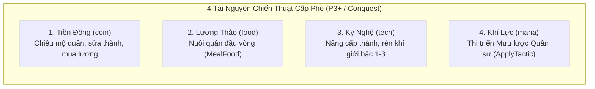

# 08. Thế lực và kinh tế chiến lược (Factions & Strategic Economy)

[← Quay lại Mục lục GDD](../README.md)

---

> [!IMPORTANT]
> **Phạm vi áp dụng:** Hệ thống Kinh tế Chiến trường & Hậu cần dưới đây thuộc phạm vi **P3 Alpha / Chế độ Conquest & Chiến dịch lớn (`enable_economy = true`)**, và **ẩn hoàn toàn trong Slice-01 Bạch Đằng 1288 (`enable_economy = false`)**.

> 📖 **Tài liệu đặc tả toán học chuyên sâu:**  
> Xem công thức `MealFood`, Nạn đói (`Starvation`), cướp kho lương (`RobAreaIncome`), công thức tỷ giá Chợ khẩn cấp và cây `Tech` trong trận tại:  
> 👉 [Kinh Tế Chiến Trường & Hậu Cần Trong Trận (battlefield_economy.md)](../mechanics/battlefield_economy.md)

---

## 8.1. Bản chất Thế lực (Faction Definition)

Một **Faction** đại diện cho một triều đại, chính quyền, nghĩa quân hoặc thế lực quân sự trong bối cảnh một kịch bản lịch sử (ví dụ: Nhà Trần vs. Nguyên Mông; Nghĩa quân Lam Sơn vs. Quân Minh; Nhà Tây Sơn vs. Quân Thanh).

Khác biệt chiến thuật giữa các Faction thể hiện ở 3 lớp:
1. **Biên chế Binh chủng Đặc trưng (`Roster`):** Ví dụ Đại Việt mạnh về Thủy quân khinh tiễn, Tượng binh phá `ZoC` và Tản binh phục kích rừng rậm; Nguyên Mông mạnh về Thiết kỵ cơ động trên đồng bằng.
2. **Mạng lưới Cơ sở Hậu cần:** Tổ hợp Thành trì, Nông điền, Chợ, Mỏ sắt đồng, Quốc Tử Giám và Đền miếu trên bản đồ Hex.
3. **Mưu lược Quân sư Toàn phe (`ApplyTactic`):** Bộ sách lược cấp chiến dịch tiêu hao bể điểm **`Mana`** chung của Faction (tách biệt hoàn toàn với kỹ năng riêng `CastSkill` theo hồi chiêu của từng Tướng chỉ huy).

---

## 8.2. Hệ thống 4 Tài nguyên Trong Trận (`enable_economy == true`)

---

## 8.3. Khấu trừ Quân lương & Cơ chế Nạn đói (`Starvation`)

* **Chu trình Đầu Vòng (`OnBeginRound` — Pha 1):**
  * Cộng sản lượng thu hoạch từ toàn bộ công trình đang kiểm soát: Nông điền (`food`), Chợ & Thành (`coin`), Mỏ quặng & Thái Học (`tech`), Đền chùa (`mana`).
  * Khấu trừ tổng định mức quân lương `TotalMealFood` theo quy mô cờ `max_stack` của mọi đạo quân hiện diện trên bản đồ (Bộ binh `10`, Cung nỏ `12`, Thủy quân `15`, Kỵ binh `20`, Công thành/Hỏa khí `20`, Tượng binh `30` Food/cờ/lượt).
* **Khủng hoảng Nạn đói (Khi `food < 0`):**
  * **Giảm `-1 bậc` Sĩ khí toàn quân, chặn sàn tại `MoraleLevel.LOW` (*Dao Động*)**: Hạ `HIGH → NORMAL → LOW`; **tuyệt đối không hạ từ `LOW` xuống `CHAOS`** để ngăn tình trạng toàn quân tê liệt không thể giải cứu (chống soft-lock).
  * **Giảm `25%` sát thương đầu ra** (`M_starvation = 0.75`).
  * **Khóa toàn bộ khả năng hồi phục HP** (`0 HP` từ thành trì, quân y và kỹ năng).
* **Ý nghĩa tái hiện lịch sử Việt Nam:** Cho phép mô phỏng tự nhiên bằng cơ chế hệ thống các kế sách kinh điển như **"Thanh dã" (Vườn không nhà trống)** thời Trần hoặc trận **Vân Đồn (1288)** đốt thuyền lương Trương Văn Hổ làm đại quân Thoát Hoan suy kiệt.

---

## 8.4. Công trình Hậu cần, Cướp lương & Giao thương Khẩn cấp

* **Hệ thống Công trình Chiến lược (`FacilityDef` — `res://data/defs/facilities/*.tres`):**
  * *Thành trì / Đô thành (`Type 1–5`):* Cứ điểm phát `CoC` (`step_cost * 2`), hồi HP đồn trú, thu thuế `coin`/`food`, chiêu mộ quân và bổ nhiệm Tướng chỉ huy.
  * *Nông điền (`Type 33`):* Cung cấp `80–200 Food/lượt` — huyết mạch nuôi đại quân.
  * *Chợ / Thương điếm (`Type 18`):* Sinh `60–150 Coin/lượt` và mở khóa lệnh Giao thương khẩn cấp (`Trade`).
  * *Mỏ quặng (`Type 31–32`) & Quốc Tử Giám (`Type 13`):* Cung cấp điểm `Tech` để nâng cấp thành trì mở binh chủng cao cấp, gia cố công sự và nghiên cứu khí giới bậc 1–3 ngay trong trận.
  * *Chùa cổ / Đền miếu (`Type 14`):* Sinh điểm `Mana` cho Mưu lược Quân sư và ổn định tinh thần khu vực.
  * *Kho lương kiên cố (`Type 20`):* Tăng sức chứa lương thảo và **giảm `50%` lượng tài nguyên bị cướp** khi thành/vùng bị địch đánh chiếm.
* **Cướp bóc Hậu cần (`RobAreaIncome`):** Đánh chiếm công trình kinh tế địch thu giữ ngay chiến lợi phẩm tích lũy tối đa `3` lượt (`min(turns_unrobbed, 3)`), giảm một nửa nếu mục tiêu có Kho lương kiên cố.
* **Giao thương Khẩn cấp (`TradeCommand`):** Khi sở hữu ít nhất 1 ô Chợ (`Type 18`), người chơi có thể dùng lệnh `Trade` đổi `Coin → Food` cứu đói hoặc bán `Food → Coin` lấy ngân sách tuyển quân theo công thức tỷ giá động phụ thuộc cấp Chợ và tình trạng vây hãm/nạn đói.
