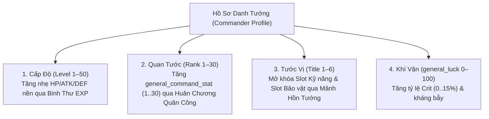

# 09. Tiến trình và nguyên tắc cân bằng (Meta-Progression & Balance)

[← Quay lại Mục lục GDD](../README.md)

---

> [!IMPORTANT]
> **Phạm vi áp dụng:** Hệ thống Tiến trình Ngoại trận (Meta-Progression) thuộc phạm vi **P3 Alpha+** (dùng cho chế độ *Domination*, *Conquest* và *Legion*), **ẩn hoàn toàn trong Slice-01 Bạch Đằng 1288**.

> 📖 **Tài liệu đặc tả chi tiết chuyên sâu:**  
> Xem đầy đủ kiến trúc 4 trục tiến trình Tướng, Duyên phận lịch sử, 5 ô Bảo vật Đại Việt và Kinh tế Meta F2P thân thiện tại:  
> 👉 [Hệ thống Tướng & Kinh Tế Meta (generals_and_meta_economy.md)](../progression/generals_and_meta_economy.md)

---

## 9.1. Triết lý Tiến trình & Định hướng F2P Thân thiện (`D-07`)

Hệ thống Meta-Progression của **Đại Việt Chiến Kỳ** (100% Single-player trên Web & Android) được thiết kế để tạo động lực sưu tầm dài hạn mà **không bao giờ phá vỡ tính chiến thuật cốt lõi hay khóa danh tướng dân tộc sau tường phí**:

1. **Mọi Danh tướng (cả Đại Việt lẫn Đối phương Lịch sử) đều có thể sở hữu miễn phí (`F2P-Friendly — D-07`):** Người chơi tích lũy **`Ngọc Bích` (`Jade`)**, **`Lệnh Chiêu Mộ` (`RecruitOrder`)** và **`Huân Chương Quân Công` (`Merit`)** từ vượt ải 3 sao, thành tựu lịch sử, chế độ Chinh phạt và sự kiện để chiêu mộ hoặc quy đổi trực tiếp tại **Shop Quân Công (Quân Cơ Xứ)** cho **mọi bậc phẩm tướng (bao gồm cả bậc Đỏ — Thần Thoại)**. Hệ thống bao gồm đầy đủ cả các **Danh tướng Đối phương** từ bậc Lục đến Tím, Cam và Đỏ (ví dụ: **Mã Viện**, **Hốt Tất Liệt / Bá Nhan**, **Trương Phụ** ở bậc Đỏ; **Ô Mã Nhi**, **Quách Quỳ**, **Cao Biền**, **Tôn Sĩ Nghị** ở bậc Cam): sau khi người chơi đánh bại họ trong Chiến dịch để mở khóa hồ sơ, có thể chiêu mộ và điều động tự do trong *Conquest*, *Legion*, *Domination* và *Chơi lại Tự do (Free Replay)*.
2. **Tầm vóc Tướng lĩnh quyết định thế trận nhưng vẫn tôn trọng chiến thuật:** Bồi dưỡng tướng mở thêm ô kỹ năng phối hợp, kích hoạt Duyên phận lịch sử (`Fetters`), phát huy **Sát thương Sở trường (`CommandProfile` bậc `S` `+25%`)** và **Hào quang Chỉ huy (`CommandAura` `1–2 hex`)**, biến tướng thành trụ cột chiến dịch nhưng vẫn cần đội hình bọc lót trước địa hình và bao vây `CHAOS`.
3. **Hai chốt chặn bảo vệ cân bằng Single-player:**
   * **Historical Scenario (Chiến dịch Lịch sử chuẩn):** **Khóa hồ sơ tướng theo kịch bản (`Fixed Historical Roster`)** để mọi người chơi trải nghiệm đúng bối cảnh và thử thách chiến thuật được thiết kế.
   * **Challenge Mode / Legion (Thử thách Tác chiến):** Áp dụng **Giới hạn Cấp Trần (`Level / Stat Cap`)** công khai theo từng màn, loại bỏ việc cày cấp quá mức để vượt ải bằng sức mạnh thuần số học.
4. **Thương mại hóa văn minh (nếu bật ở P4/P5):** Các gói tùy chọn (Thẻ Tháng, Chiến Lệnh, Gói Ủng Hộ) chỉ hỗ trợ rút ngắn thời gian tích lũy tài nguyên hoặc mở khóa ngoại trang/khung biểu trưng lịch sử, đi kèm cơ chế bảo hiểm (`Pity`) và đổi mảnh minh bạch.

> **Lưu ý tôn trọng lịch sử:** Hệ thống 5 bậc phẩm màu (`Đỏ / Cam / Tím / Lam / Lục`) chỉ phản ánh **độ hiếm sưu tầm và độ phức tạp cơ chế bộ kỹ năng trong gameplay (`QualityTier`)**, **tuyệt đối không phải sự xếp hạng hay phán xét công trạng lịch sử** của các nhân vật.

---

## 9.2. Tóm tắt Khung Tiến trình 4 Trục Danh Tướng

---

## 9.3. Hệ thống Duyên phận Lịch sử & 5 Ô Bảo vật Đại Việt

* **Duyên phận Lịch sử (`FetterDef` — `res://data/defs/fetters/*.tres`):** Kích hoạt hiệu ứng cộng hưởng chiến thuật khi các danh tướng đồng thời kỳ/cùng chí hướng sát cánh trên chiến trường (ví dụ: *Trần Triều Tam Kiệt*, *Vua Tôi Đồng Lòng*, *Hội Thề Lũng Nhai*, *Tây Sơn Tam Kiệt*, *Hào Khí Mê Linh*).
* **Năm Ô Bảo vật Chuẩn Niên đại (`EquipmentDef` — `res://data/defs/equipment/*.tres`):**
  1. **Cận chiến:** *Thuận Thiên Kiếm*, *Gươm Thái A*, *Trường Đao Trần Triều*...
  2. **Tầm xa:** *Nỏ Liên Châu Kim Quy*, *Cung Thần Đại Việt*, *Hỏa Hổ Ống Đồng*...
  3. **Hộ giáp:** *Khôi Giáp Thiết Lĩnh*, *Áo Bào Chiến Trận*, *Hộ Tâm Kính*...
  4. **Thú cưỡi:** *Thớt Voi Chiến Tây Sơn*, *Bạch Mã Phiên Đao*, *Chiến Mã Thiết Giáp*...
  5. **Binh thư:** *Binh Thư Yếu Lược*, *Hịch Tướng Sĩ*, *Quân Trung Từ Mệnh Tập*...
* **Định hướng chỉ số:** Tập trung vào `damage_deepen` (`+%` sát thương đầu ra), `damage_resist` (`-%` sát thương nhận vào, chặn biên tối đa `75%`), `crit_rate_bonus`, `crit_damage_bonus` và hiệu ứng chiến thuật có điều kiện.

---

## 9.4. Bảng Tiền tệ & Nguyên liệu Ngoại trận Đồng bộ (Meta Currencies)

Toàn bộ danh mục tiền tệ Meta được chuẩn hóa tên gọi và mã định danh thống nhất 100% trên toàn dự án:

| Tên Tiền tệ / Nguyên liệu | Mã Định danh | Nguồn tích lũy miễn phí trong Game | Công dụng chính |
| :--- | :---: | :--- | :--- |
| **Tiền Đồng** | `Coin` | Thưởng hoàn thành màn chơi, nhiệm vụ ngày, Chinh phạt | Thăng cấp `Level` tướng, rèn/cường hóa trang bị cơ bản, chiêu mộ Tỳ tướng. |
| **Ngọc Bích** *(kèm `Lệnh Chiêu Mộ`)* | `Jade` / `RecruitOrder` | Thưởng vượt ải 3 sao lần đầu, thành tựu lịch sử, sự kiện mùa, nhiệm vụ tuần | Quay Đài Chiêu Mộ Danh Tướng (kể cả Banner Giới Hạn bậc Đỏ) & đổi Lệnh Chiêu Mộ. |
| **Huân Chương Quân Công** | `Merit` | Đạt 3 sao chiến dịch, mục tiêu phụ, Chinh phạt & Thử thách Legion | Phong `Quan Tước` (`Rank 1–30`), **đổi trực tiếp Danh Tướng & Bảo vật tại Shop Quân Công**. |
| **Binh Thư EXP** | `TomeExp` | Thao diễn võ học, ải thử thách Legion, phân giải mảnh dư | Bồi dưỡng EXP cấp độ tướng và nâng bậc Kỹ năng chiến thuật chủ động/bị động. |
| **Mảnh Hồn Tướng** *(Nguyên liệu)* | `GeneralShard` | Thưởng cột mốc lịch sử, Shop Quân Công, chiêu mộ trùng tướng | Thức tỉnh `Tước Vị` (`Title 1–6`) và ghép mở khóa trực tiếp danh tướng. |

---

## 9.5. Cơ chế Chiêu mộ & Bảo hiểm Minh bạch (`Pity & Exchange`)

1. **Hai kênh sở hữu bổ trợ nhau (Không khóa tường phí):**
   * **Shop Quân Công (`Quân Cơ Xứ`):** Đổi trực tiếp các danh tướng và mảnh hồn tướng (từ bậc Lam đến bậc Cam và mảnh bậc Đỏ theo chu kỳ luân phiên) bằng `Huân Chương Quân Công` (`Merit`).
   * **Đài Chiêu Mộ (`Recruitment Pools`):** Sử dụng `Ngọc Bích` (`Jade`) hoặc `Lệnh Chiêu Mộ` (`RecruitOrder`) tích lũy từ quá trình chơi để rút thẻ ở Bể Tân Thủ, Bể Thường và Bể Sự Kiện Lịch Sử.
2. **Năm Bậc Phẩm Gameplay (`QualityTier`):** **Đỏ** (*Thần Thoại*) → **Cam** (*Sử Thi*) → **Tím** (*Danh Tướng*) → **Lam** (*Dũng Tướng*) → **Lục** (*Tỳ Tướng*).
3. **Bảo hiểm & Đổi trực tiếp (`Hard Pity & Sparking`):**
   * **Bể Tân Thủ:** Giảm `20%` chi phí, tối đa `10` lượt đầu chắc chắn nhận 1 Tướng bậc Cam.
   * **Bể Thường:** Có 1 lượt miễn phí mỗi ngày; bảo hiểm `50` lượt chắc chắn nhận Tướng bậc Cam.
   * **Bể Sự Kiện Lịch Sử (Bậc Đỏ):** Mở cho cả `Ngọc Bích` (`Jade`) và `Lệnh Chiêu Mộ` tích lũy miễn phí; bảo hiểm cứng `80` lượt ra Tướng bậc Đỏ và đạt `120` điểm tích lũy được chọn đổi trực tiếp tướng tâm điểm.
