# ĐẶC TẢ KIẾN TRÚC RA QUYẾT ĐỊNH CỦA AI MÁY (AI DECISION MATRIX)
## DỰ ÁN: ĐẠI VIỆT CHIẾN KỲ (VIETNAM HISTORY STRATEGY)
### MODULE: AI GENERATORS, 5 EVALUATORS & DETERMINISTIC STOCHASTIC SCORING
*(Chuẩn hóa cho Godot 4.7 — Thuần Typed GDScript 2.0, Tuân thủ Fog of War & Seeded RNG)*

> **Vị trí tài liệu:** `docs/gdd/ai/ai_decision_matrix.md`  
> **Trạng thái:** Chuẩn hóa kiến trúc Utility AI 3 giai đoạn: **Generators $\rightarrow$ 5 Evaluators (có `ObjectiveEvaluator`) $\rightarrow$ Additive Stochastic Scoring**, đọc cấu hình động từ `AIDifficultyProfile` cho đủ 4 cấp độ khó (`Easy`, `Normal`, `Hard`, `Challenge`), tuân thủ tuyệt đối Fog of War (Zero Map-Hack) và bảo toàn tính tất định Replay nhờ `RandomNumberGenerator` có seed của trận đấu.

---

## 1. Kiến trúc Tổng quát 3 Giai đoạn (AI Pipeline)

AI máy vận hành trên cùng tập luật chiến trường và giới hạn tầm nhìn sương mù chiến tranh (`AIVisibleMapView`) như người chơi, kết nối trực tiếp với `ScenarioDirector` để bám sát mục tiêu kịch bản:

```mermaid
flowchart TD
    Start["🤖 Lượt AI Khởi Động\n(Nhận AIVisibleMapView & Seeded RNG)"] --> P1["GIAI ĐOẠN 1: GENERATORS\n(Tạo lập ứng viên hợp lệ trong vùng nhìn thấy)"]

    subgraph Generators["Bộ Tạo Sinh Ứng Viên (Generators)"]
        G1["ReachableHexGenerator\n(Các ô Hex hợp lệ trong tầm MP & ZoC)"]
        G2["AttackTargetGenerator\n(Mục tiêu địch lộ diện trong tầm & LOS)"]
        G3["SkillTargetGenerator\n(Mục tiêu thi triển Kỹ năng / Mưu lược)"]
    end
    P1 --> Generators

    Generators --> P2["GIAI ĐOẠN 2: 5 EVALUATORS\n(Chấm điểm Heuristic đa tiêu chí)"]

    subgraph Evaluators["5 Bộ Chấm Điểm Chiến Thuật (Evaluators)"]
        E1["1. ReachableAreaEvaluator (S_pos)\n(Vị trí, FondTerrain, Thế thủ & Né bẫy ĐÃ LỘ)"]
        E2["2. AttackTargetEvaluator (S_atk)\n(Sát thương khắc chế, KillSecuring & Flank)"]
        E3["3. ObjectiveEvaluator (S_obj)\n(Chiếm/Giữ cứ điểm SignalDock & Săn/Bảo vệ Tướng)"]
        E4["4. StatusEffectEvaluator (S_status)\n(Gây hiệu ứng CC: InChaos, Cấm đi, Cấm đánh)"]
        E5["5. ManaEfficiencyEvaluator (S_mana)\n(Hiệu suất tiêu thụ Mana cho Kỹ năng/Mưu lược)"]
    end
    P2 --> Evaluators

    Evaluators --> P3["GIAI ĐOẠN 3: TỔNG HỢP & NHIỄU CỘNG TÍNH\n(Weighted Sum + Additive Noise η_RNG)"]
    P3 --> Decision["Chọn Ứng Viên có TotalUtilityScore cao nhất"]
    Decision --> Execution["Đóng gói BattleCommand & Thực thi trên Chiến trường"]
```



---

## 2. Chi tiết Giai đoạn 1: Các Bộ Tạo Sinh & Kỷ luật Fog of War (Zero Map-Hack)

| Bộ Tạo Sinh (GDScript Class) | Nhiệm vụ | Ràng buộc Không gian & Giới hạn Thông tin |
| :--- | :--- | :--- |
| **`ReachableHexGenerator`** | Quét toàn bộ ô hex trong tầm `current_mp` hợp lệ, dừng bước khi chạm vùng ZOC của đơn vị địch **đang nhìn thấy** hoặc địa hình cấm theo `domain` (`Land` / `Naval`). | Chỉ đọc địa hình hiện hành trên `visible_map_view`; không được biết đơn vị địch đang nấp trong sương mù hay rừng rậm chưa bị phát hiện. |
| **`AttackTargetGenerator`** | Từ mỗi ô đứng ứng viên, quét các đơn vị đối phương đã lộ diện nằm trong `[min_range, max_range]` và thỏa đường ngắm LOS. | Bị cản tầm nhìn bởi Rừng rậm / Cao điểm theo đúng quy tắc chiến trường. |
| **`SkillTargetGenerator`** | Quét mục tiêu hợp lệ để thi triển Kỹ năng / Mưu kế chủ động của Tướng (`res://data/settings/tactic_settings.json`). | Kiểm tra `cooldown == 0` và `current_mana >= mana_cost`. |

> [!IMPORTANT] **Quy tắc Cấm Tuyệt Đối AI "Map-Hack" Bãi Cọc Ngầm & Sương Mù:**  
> Mọi hàm của AI chỉ nhận đối tượng khung nhìn đã lọc **`visible_map_view: AIVisibleMapView`**, tuyệt đối không truy cập trực tiếp `BattleMap` gốc chứa dữ liệu ẩn.  
> Cụ thể tại **Slice-01 Đại Chiến Bạch Đằng 1288 (`stage_id: 10101`)**: Từ Vòng 1 đến hết Vòng 3 (trước khi sự kiện `MapPhase_TideFall` kích hoạt ở đầu Vòng 4), các ô thuộc vùng `area_bai_coc` có địa hình là mặt nước bình thường (`Water`). AI của phe Đại Nguyên **hoàn toàn không được biết trước đó là bãi cọc ngầm để trừ điểm né tránh**! Chỉ từ đầu Vòng 4 trở đi, khi bãi cọc đã lộ diện thành địa hình `StakedWater` trên bản đồ công khai, AI mới nhận biết và tính điểm phạt địa hình nguy hiểm.

---

## 3. Chi tiết Giai đoạn 2: 5 Bộ Chấm Điểm Chiến Thuật (Evaluators)

### 3.1. `ReachableAreaEvaluator` — Điểm Vị trí Đứng ($S_{\text{pos}}$)
* **Thưởng (+):**
  * Tận dụng Địa hình Sở trường (`fond_terrain`): **`+25.0`** điểm.
  * Đứng trên Cao điểm (`Hill`) hoặc ẩn mình trong Rừng (`Forest` tăng giáp): **`+20.0`** điểm.
  * Thiết lập thế gọng kìm bao vây Pincer (`TrappedLevel >= 2`) lên kẻ địch đã lộ diện: **`+45.0`** điểm.
  * Phát ZOC che chắn sườn cho Chủ tướng phe mình: **`+35.0`** điểm.
* **Phạt (-):**
  * Bước vào vùng giao thoa ZOC nguy hiểm của nhiều đạo quân địch đang nhìn thấy: **`-30.0`** điểm.
  * Đi vào Đầm lầy (`Swamp`) hoặc ô **Bãi cọc đã lộ diện (`StakedWater`)**: **`-50.0`** điểm *(chỉ áp dụng khi ô đó thực sự đang có trạng thái `StakedWater` trên `visible_map_view`)*.
  * Đứng cô lập hở sườn dễ bị địch kẹp Flank ở lượt kế tiếp: **`-25.0`** điểm.

### 3.2. `AttackTargetEvaluator` — Điểm Đòn Tấn công ($S_{\text{atk}}$)
* **Thưởng (+):**
  * Sát thương kỳ vọng theo ma trận khắc chế: **`+0.6`** điểm cho mỗi `1%` HP tối đa của mục tiêu dự kiến bị trừ.
  * **Đòn kết liễu dứt điểm mục tiêu (`KillSecuring`, `target.current_hp <= min_expected_damage`):** **`+80.0`** điểm *(chấm duy nhất một lần tại đây; không cộng lặp ở bước tổng hợp bên ngoài)*.
  * Đánh mục tiêu đang **Dao Động** để đẩy xuống **Hỗn Loạn (`InChaos`)**: **`+40.0`** điểm.
  * Tập trung hỏa lực vào đạo quân chủ lực nhiều cờ (`troop_stack == 3`): **`+25.0`** điểm.
* **Phạt (-):**
  * Tổn thất do bị mục tiêu phản kích hợp lệ: **`-0.4`** điểm cho mỗi `1%` HP tối đa của bản thân dự kiến mất.

### 3.3. `ObjectiveEvaluator` — Điểm Mục tiêu Kịch bản ($S_{\text{obj}}$) *(Bắt buộc — Kết nối `ScenarioDirector`)*
Đọc danh sách mục tiêu công khai từ `ScenarioDirector` để dẫn dắt thế trận vĩ mô thay vì chỉ đánh giáp lá cà vô định:
* **Chiếm giữ / Tranh chấp Cứ điểm Sống còn (như `SignalDock (2, 8)`):**
  * Bước trực tiếp lên ô cứ điểm mục tiêu đang thuộc phe đối phương hoặc chưa có quân giữ: **`+90.0`** điểm.
  * Đứng chốt giữ hoặc chắn mặt tiền (bán kính `1 hex`) bảo vệ cứ điểm phe mình khi có địch áp sát trong bán kính `3 hex`: **`+65.0`** điểm.
  * Rút ngắn khoảng cách lưới Hex tới cứ điểm mục tiêu chính (khi ngoài tầm giao chiến trực tiếp): **`+8.0`** điểm cho mỗi ô tiến gần hơn so với vị trí hiện tại.
* **Săn tìm / Hộ vệ Tướng Mục tiêu Kịch bản (như Ô Mã Nhi `9001` hoặc Trần Quốc Tuấn `1001`):**
  * Chọn mục tiêu tấn công chính là Tướng chỉ huy thuộc điều kiện Thắng/Thua của kịch bản: **`+50.0`** điểm.
  * Di chuyển về sát cạnh để hộ vệ Chủ tướng phe mình khi Chủ tướng còn dưới `50%` HP hoặc bị `>= 2` đạo quân địch uy hiếp: **`+55.0`** điểm.

### 3.4. `StatusEffectEvaluator` — Điểm Khống chế Trạng thái ($S_{\text{status}}$)
* Gây **Hỗn Loạn (`InChaos`)**: **`+60.0`** điểm (vô hiệu hóa hoàn toàn khả năng đánh và phát ZOC của địch).
* Gây **Cấm Tấn Công (`AttackDisabled`)**: **`+40.0`** điểm.
* Gây **Khóa Di Chuyển (`MarchDisabled`)**: **`+30.0`** điểm (cầm chân mũi đột kích hoặc thuyền giặc).

### 3.5. `ManaEfficiencyEvaluator` — Điểm Hiệu suất Mưu lược ($S_{\text{mana}}$)
* Đánh giá chi phí cơ hội khi dùng Kỹ năng / Mưu kế tiêu tốn Mana của Tướng (trả về `0.0` nếu ứng viên không dùng kỹ năng tốn Mana):
  $$S_{\text{mana}} = \frac{\text{TacticalGain}}{\max(\text{ManaCost}, 1)} \times 20.0$$

---

## 4. Công thức Tổng hợp Điểm & Nhiễu Cộng Tính Tất Định ($\eta_{\text{RNG}}$)

Hệ thống gom nhóm 5 bộ Evaluator vào **4 trọng số điều phối vĩ mô** `(w_atk, w_pos, w_obj, w_skill)` đọc từ `AIDifficultyProfile`, trong đó nhánh kỹ năng chiến thuật $S_{\text{skill}} = S_{\text{status}} + S_{\text{mana}}$:

$$\text{DeterministicBaseScore}(A) = w_{\text{atk}} \cdot S_{\text{atk}} + w_{\text{pos}} \cdot S_{\text{pos}} + w_{\text{obj}} \cdot S_{\text{obj}} + w_{\text{skill}} \cdot \left(S_{\text{status}} + S_{\text{mana}}\right)$$

$$\text{TotalUtilityScore}(A) = \text{DeterministicBaseScore}(A) + \eta_{\text{RNG}}, \quad \eta_{\text{RNG}} \sim \mathcal{U}(-\text{noise\_amp}, +\text{noise\_amp})$$

> [!WARNING] **Lý do toán học bắt buộc dùng Nhiễu Cộng Tính (Additive Noise) thay vì Nhiễu Nhân:**  
> Nếu dùng công thức nhân `base_score * (1.0 + noise)`, khi mọi phương án rút lui phòng ngự đều mang điểm âm (ví dụ phương án ít tệ hơn `A = -20.0` và phương án rất tệ `B = -30.0`), hệ số nhiễu âm sẽ **đảo ngược dấu bất đẳng thức** (khiến điểm âm nặng bớt âm hơn và được chọn nhầm!). Sử dụng **nhiễu cộng tính có biên độ tuyệt đối `[-noise_amp, +noise_amp]`** sinh từ `RandomNumberGenerator` có seed của trận đấu vừa bảo toàn đúng thứ tự ưu tiên trên cả miền điểm âm lẫn điểm dương, vừa đảm bảo Replay/Resume khớp 100%.

---

## 5. Bảng Cấu hình Trọng số 4 Cấp Độ Khó (`AIDifficultyProfile`)

| Cấp độ (`difficulty_id`) | `w_atk` | `w_pos` | `w_obj` | `w_skill` | Biên độ nhiễu `noise_amp` | Hành vi Chiến thuật Đặc trưng |
| :--- | :---: | :---: | :---: | :---: | :---: | :--- |
| **`easy` (Dễ)** | `0.50` | `0.15` | `0.20` | `0.15` | **`±18.0` đ** | Thiên về lao lên đánh trực diện, ít bọc sườn, đôi khi bỏ qua thế thủ tối ưu do biên độ nhiễu rộng; hỗ trợ người mới học luật. |
| **`normal` (Thường)** | `0.35` | `0.25` | `0.25` | `0.15` | **`±6.0` đ** | Cân bằng chuẩn mực giữa công kích, chọn địa hình có lợi và tiến chiếm cứ điểm kịch bản (`SignalDock`); biến hóa tự nhiên qua mỗi lần chơi. |
| **`hard` (Khó)** | `0.30` | `0.25` | `0.25` | `0.20` | **`±1.5` đ** | Tính toán sắc sảo, ưu tiên kẹp sườn Pincer, khóa kỹ năng chủ lực người chơi và gây áp lực dồn dập lên mục tiêu chính mà vẫn tuân thủ Fog of War. |
| **`challenge` (Thử thách)** | `0.28` | `0.27` | `0.25` | `0.20` | **`±0.5` đ** | Gần như tất định tối ưu tuyệt đối về mặt vị trí – mục tiêu – mưu lược, đi kèm điều kiện thử thách kịch bản công bố trước tại Briefing. |

---

## 6. Mã Nguồn Triển khai Mẫu — Godot 4.7 Typed GDScript 2.0

### 6.1. Cấu hình Độ khó (`res://scripts/ai/ai_difficulty_profile.gd`)
```gdscript
class_name AIDifficultyProfile
extends Resource

@export var difficulty_id: StringName = &"normal"
@export_range(0.0, 1.0, 0.01) var w_atk: float = 0.35
@export_range(0.0, 1.0, 0.01) var w_pos: float = 0.25
@export_range(0.0, 1.0, 0.01) var w_obj: float = 0.25
@export_range(0.0, 1.0, 0.01) var w_skill: float = 0.15
@export_range(0.0, 50.0, 0.5) var noise_amp: float = 6.0


static func create_preset(preset_id: StringName) -> AIDifficultyProfile:
	var p := AIDifficultyProfile.new()
	p.difficulty_id = preset_id
	match preset_id:
		&"easy":
			p.w_atk = 0.50
			p.w_pos = 0.15
			p.w_obj = 0.20
			p.w_skill = 0.15
			p.noise_amp = 18.0
		&"normal":
			p.w_atk = 0.35
			p.w_pos = 0.25
			p.w_obj = 0.25
			p.w_skill = 0.15
			p.noise_amp = 6.0
		&"hard":
			p.w_atk = 0.30
			p.w_pos = 0.25
			p.w_obj = 0.25
			p.w_skill = 0.20
			p.noise_amp = 1.5
		&"challenge":
			p.w_atk = 0.28
			p.w_pos = 0.27
			p.w_obj = 0.25
			p.w_skill = 0.20
			p.noise_amp = 0.5
		_:
			push_warning("AIDifficultyProfile: Unknown preset '%s', using normal." % preset_id)
	return p
```

### 6.2. Bộ Điều Phối Quyết Định AI (`res://scripts/ai/ai_decision_matrix.gd`)
```gdscript
class_name AIDecisionMatrix
extends RefCounted

var profile: AIDifficultyProfile


func _init(difficulty_profile: AIDifficultyProfile = null) -> void:
	profile = difficulty_profile if difficulty_profile != null else AIDifficultyProfile.create_preset(&"normal")


## Lập kế hoạch lượt đi cho 1 đơn vị AI.
## - `visible_map_view`: Khung nhìn đã lọc Fog of War của phe AI (Zero Map-Hack;
##   trước Vòng 4 Bạch Đằng, vùng cọc ngầm vẫn hiển thị là mặt nước bình thường).
## - `scenario_director`: Cung cấp tọa độ cứ điểm (như SignalDock) & Tướng mục tiêu.
## - `rng`: Bộ sinh số ngẫu nhiên có seed của phiên trận đấu (bảo đảm Replay tất định).
func plan_turn(
	unit: UnitEntity,
	visible_map_view: AIVisibleMapView,
	scenario_director: ScenarioDirector,
	rng: RandomNumberGenerator
) -> Array[BattleCommand]:
	var reachable_hexes: Array[Vector2i] = AIGenerators.get_reachable_hexes(unit, visible_map_view)
	var candidates: Array[AIActionCandidate] = AIGenerators.generate_candidates(
		unit, reachable_hexes, visible_map_view
	)

	if candidates.is_empty():
		return [WaitCommand.new(unit.faction_id, unit.unit_id)]

	var best_candidate: AIActionCandidate = null
	var highest_score: float = -INF

	for candidate: AIActionCandidate in candidates:
		# Chấm điểm qua đủ 5 bộ Evaluators trên không gian thông tin hợp lệ
		var atk_score: float = AIEvaluators.evaluate_attack(candidate, unit, visible_map_view)
		var pos_score: float = AIEvaluators.evaluate_position(candidate.dest_hex, unit, visible_map_view)
		var obj_score: float = AIEvaluators.evaluate_objective(
			candidate, unit, visible_map_view, scenario_director
		)
		var status_score: float = AIEvaluators.evaluate_status(candidate, unit, visible_map_view)
		var mana_score: float = AIEvaluators.evaluate_mana(candidate.skill_id, candidate, unit)
		var skill_score: float = status_score + mana_score

		var base_score: float = (
			profile.w_atk * atk_score
			+ profile.w_pos * pos_score
			+ profile.w_obj * obj_score
			+ profile.w_skill * skill_score
		)

		# Nhiễu cộng tính tất định (không đảo dấu khi base_score < 0; KillSecuring +80.0
		# đã được tính duy nhất trong evaluate_attack, không cộng trùng ở đây)
		var noise: float = rng.randf_range(-profile.noise_amp, profile.noise_amp)
		var total_score: float = base_score + noise

		if total_score > highest_score:
			highest_score = total_score
			best_candidate = candidate

	if best_candidate == null:
		return [WaitCommand.new(unit.faction_id, unit.unit_id)]

	return best_candidate.to_commands(unit)
```
