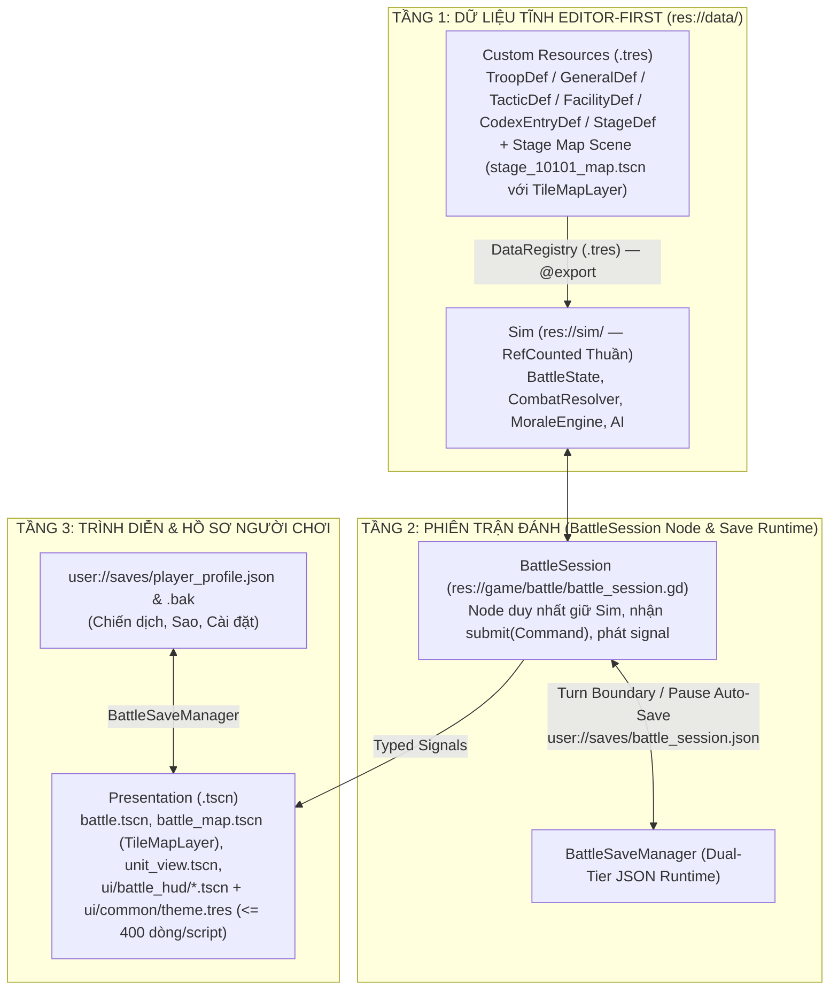
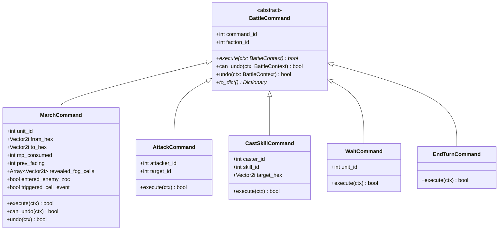

# ĐẶC TẢ KIẾN TRÚC DỮ LIỆU, VÒNG LẶP 7 PHA & HỆ THỐNG SAVE/LOAD
## DỰ ÁN: ĐẠI VIỆT CHIẾN KỲ (VIETNAM HISTORY STRATEGY)
### MODULE: DATA ARCHITECTURE, 7-PHASE TURN LOOP, COMMAND UNDO & PERSISTENCE
*(Chuẩn hóa cho Godot 4.7 — Thuần Typed GDScript 2.0, `gl_compatibility`, Web & Android 60 FPS)*

> **Vị trí tài liệu:** `docs/gdd/architecture/data_and_save_system.md`  
> **Trạng thái:** Thiết kế thuần **Typed GDScript 2.0** theo **Kiến trúc 4 Tầng Editor-First (`DEC-021..DEC-026`)** cho Godot 4.7 (`data/` Custom `Resource` `.tres` + `@tool` Map Scene `.tscn` → `sim/` `RefCounted` thuần → `BattleSession` → `game/battle/` & `ui/` `.tscn` + `theme.tres`), đồng bộ **Vòng lặp Chiến trường 7 Pha**, **Command Pattern (chỉ `MarchCommand` hỗ trợ Undo 5 điều kiện)** và **Save 2 tầng JSON runtime ở `user://saves/`**.

---

## 1. Tổng quan Kiến trúc 4 Tầng & Dữ liệu Editor-First

Hệ thống quản trị mã nguồn và dữ liệu phân tách 4 tầng rành mạch ("Lõi thuần + Vỏ dựng trong Editor") kết hợp tách biệt cấu hình tĩnh (`.tres` + `.tscn` chỉnh được trong Godot Inspector/View 2D) với dữ liệu phiên lưu runtime (`user://saves/*.json`):



> [!NOTE] **Quy ước Kiến trúc 4 Tầng, `.tres` vs `.json` & Đường dẫn Web/Android:**
> - **Mọi dữ liệu thiết kế game tĩnh** (binh chủng, danh tướng, mưu lược, công trình, màn chơi, sử ký) đặt tại **`res://data/defs/*.tres`** và **`res://data/stages/<id>_<slug>/`** dưới dạng **Custom `Resource` (`.tres`) có `@export`**, chỉnh trực tiếp trong Godot Inspector và tổng hợp qua `res://data/registry.tres` (`DataRegistry`). Tuyệt đối không dùng JSON tĩnh buộc designer phải sửa tay text.
> - **Định dạng `.json` chỉ dùng duy nhất cho Save/Load runtime** (`user://saves/battle_session.json`, `user://saves/player_profile.json`) và xuất/nhập Replay ở `user://saves/` (vì `res://` chỉ đọc khi xuất bản Web/APK, đồng thời JSON save không thực thi script khi nạp lại).
> - **Cây thư mục 4 tầng chuẩn (`<= 400 dòng/script`):** `res://autoload/` (chỉ dịch vụ toàn cục: Settings, SaveService, Audio, SceneRouter — không chứa state trận đấu), `res://data/`, `res://sim/`, `res://game/battle/`, `res://ui/`, `res://tests/`. Phụ thuộc truyền có kiểu qua `@export var session: BattleSession` (cấm service locator biến `Node` không kiểu và `get_node("/root/...")`).
> - Mọi tên tệp/thư mục mới bắt buộc **chữ thường `snake_case` 100%** để tương thích tuyệt đối hệ tệp phân biệt hoa-thường trên Web/Android.

---

## 2. Đặc tả Schema Dữ liệu Cấu hình Tĩnh (Custom `Resource` `.tres` — Chỉnh trong Inspector)

### 2.1. Binh chủng (`TroopDef` — `res://data/defs/troops/*.tres`)
Thay thế `troop_settings.json` bằng lớp `class_name TroopDef extends Resource` có `@export`, chỉnh trực tiếp trong Godot Inspector kèm xem trước icon/sprite:

```gdscript
class_name TroopDef
extends Resource

@export var troop_id: int = 40101
@export var code: String = "dai_viet_spear_infantry"
@export var display_name: String = "Bộ Binh Trường Giáo"
@export_enum("Land", "Naval") var domain: int = 0
@export_enum("Infantry", "Archer", "Cavalry", "Siege", "NavalLight", "NavalHeavy") var command_branch: int = 0
@export_range(1, 6) var attack_mode: int = 1
@export_range(1, 5) var defense_mode: int = 2
@export_range(1, 9999) var base_hp: int = 160
@export_range(1, 3) var max_stack: int = 3
@export_range(0, 999) var base_atk: int = 40
@export_range(0, 999) var base_def: int = 12
@export_range(50, 100) var damage_roll_min: int = 80
@export_range(80, 100) var damage_roll_max: int = 100
@export_range(1, 16) var mobility: int = 6
@export_range(1, 8) var vision_range: int = 3
@export_range(1, 6) var min_range: int = 1
@export_range(1, 6) var max_range: int = 1
@export_range(0, 100) var critical_percent: int = 5
@export_range(0, 150) var counter_percent: int = 100
@export var fond_terrain: int = -1
@export var cost_coin: int = 40
@export var cost_food: int = 50
@export var meal_food: int = 10
@export var features: Array[StringName] = []
@export var sprite_sheet: Texture2D
@export var unit_scene: PackedScene
@export var attack_sound: AudioStream
```

### 2.2. Màn chơi Chiến dịch (`StageDef` — `res://data/stages/<id>_<slug>/stage_<id>.tres` + `stage_<id>_map.tscn`)
Mỗi màn chơi kết hợp **Scene Bản đồ (`stage_<id>_map.tscn`)** (địa hình vẽ trực tiếp trên `TileMapLayer` + điểm đặt quân kéo-thả trong View 2D nhờ `@tool`) với **`StageDef.tres`** chứa các Sub-Resource chỉnh trong Inspector (`VictoryConditionDef`, `DefeatConditionDef`, `StarConditionDef`, `ScenarioEventDef`, `DialogueLineDef`, `UnitPlacementDef`):

```gdscript
class_name StageDef
extends Resource

@export var stage_id: int = 10101
@export var code: String = "bach_dang_1288"
@export var stage_name: String = "Đại Chiến Bạch Đằng 1288"
@export var chapter_id: int = 1
@export var historical_era: String = "Tran_Nguyen"
@export var modeling_type: String = "fixture"
@export var map_scene: PackedScene # trỏ tới res://data/stages/10101_bach_dang/stage_10101_map.tscn
@export_range(6, 60) var map_width: int = 12
@export_range(6, 60) var map_height: int = 10
@export_range(1, 50) var max_rounds: int = 10
@export var enable_economy: bool = false
@export var general_seat: int = 2
@export var banned_troop_ids: Array[int] = []
@export var victory_conditions: Array[VictoryConditionDef] = []
@export var defeat_conditions: Array[DefeatConditionDef] = []
@export var star_conditions: Array[StarConditionDef] = []
@export var placements: Array[UnitPlacementDef] = []
@export var scripted_events: Array[ScenarioEventDef] = []
@export var dialogues: Array[DialogueSequenceDef] = []
```

### 2.3. Tướng, Mưu lược, Công trình, Sử ký & `DataRegistry` (`res://data/registry.tres`)
Các danh mục còn lại (`GeneralDef`, `TacticDef` có `cooldown` & `mana_cost`, `FacilityDef`, `CodexEntryDef`) đều là Custom `Resource` (`.tres`) tương ứng, được tập hợp vào **`res://data/registry.tres` (`DataRegistry`)** để nạp read-only vào tầng `Sim` (giúp unit test có thể truyền `DataRegistry` giả độc lập hoàn toàn với ổ đĩa).

---

## 3. Kiến trúc Vòng lặp Chiến trường 7 Pha (7-Phase Battle Loop)

Đồng bộ tuyệt đối với [core_loop.md](../02_gameplay_systems/core_loop.md) và [scenario_scripting_and_events.md](../level_design/scenario_scripting_and_events.md):

```mermaid
sequenceDiagram
    autonumber
    actor Actor as Người Chơi / AI
    participant BC as BattleGameController
    participant Evt as ScenarioEventManager
    participant Map as BattleMapState
    participant Sav as BattleSaveManager

    Note over BC,Map: PHA 1: KHỞI TẠO VÒNG ĐẤU (OnBeginRound)
    BC->>Map: Tăng current_round (+1), giảm Cooldown kỹ năng (-1)
    BC->>Map: Nếu enable_economy == true -> Thu hoạch Coin/Food/Tech & trừ meal_food
    BC->>Evt: check_and_execute("OnRoundStart") (VD: Đầu Vòng 4 kích hoạt MapPhase_TideFall)

    loop Qua từng Phe (Player -> Ally -> Enemy -> Neutral)
        Note over BC,Map: PHA 2: KHỞI TẠO LƯỢT PHE (FactionPhaseStart)
        BC->>Map: Hồi phục current_mp = max_mobility, reset has_acted = false, has_used_undo_this_turn = false
        BC->>Evt: check_and_execute("OnFactionTurnStart")
        BC->>Sav: Auto-Save đầu lượt Người chơi (an toàn cho Web IndexedDB)

        loop Chu trình Ra Lệnh Đơn Vị
            Note over Actor,Map: PHA 3: QUAN SÁT & TÍNH TOÁN (Observation & UnitInspector)
            BC->>Map: Cập nhật Fog of War (AIVisibleMapView) của phe đang đi
            Actor->>BC: Đọc thông số thô qua UnitInspector, xem tầm đi/ZOC/LOS (hoặc AI gọi plan_turn) — không biết trước sát thương dự kiến

            Note over Actor,Map: PHA 4: GỬI LỆNH (CommandExecution)
            Actor->>BC: Gửi BattleCommand (March / Attack / CastSkill / ApplyTactic / Wait)

            Note over BC,Evt: PHA 5: GIẢI QUYẾT, SỰ KIỆN TỨC THÌ & XÉT THẮNG/THUA NGAY
            BC->>Map: Thực thi lệnh, giải quyết phản kích & cập nhật Fog of War
            BC->>Evt: check_and_execute("OnAfterCommand") (OnEnterCell / GeneralClash / OnUnitDefeated)
            BC->>BC: check_immediate_victory_or_defeat() (Hạ Ô Mã Nhi khi giữ SignalDock -> Thắng ngay!)
        end

        Note over BC,Sav: PHA 6: KẾT THÚC LƯỢT PHE (OnFactionTurnEnd)
        Actor->>BC: Gửi EndTurnCommand
        BC->>Map: Giảm bộ đếm CC & Buff/Debuff (-1 turn: chaos_turns, march_disabled_turns, attack_disabled_turns) của phe vừa kết thúc lượt
        BC->>Sav: Ghi Checkpoint Auto-Save cuối lượt phe
    end

    Note over BC,Map: PHA 7: KẾT THÚC VÒNG & XÉT MỤC TIÊU CUỐI VÒNG (OnEndRound & VictoryCheck)
    BC->>Evt: check_and_execute("OnRoundEnd")
    BC->>BC: check_round_end_victory_or_defeat() (VD: Hết Vòng 10 giữ SignalDock + diệt >= 75% địch)
```

> **Lưu ý thiết kế quan trọng tại Pha 5 & Pha 6:**
> 1. **Xét Thắng / Thua tức thì ở Pha 5:** Ngay khi một lệnh thực thi xong làm thỏa mãn điều kiện kết thúc tức thời (chẳng hạn tiêu diệt Ô Mã Nhi khi `SignalDock (2, 8)` đang thuộc Đại Việt, hoặc để mất `SignalDock (2, 8)` vào tay giặc, hoặc Trần Quốc Tuấn tử trận), `BattleGameController` lập tức dừng vòng lặp và chuyển sang màn hình tổng kết mà không bắt người chơi chờ hết vòng.
> 2. **Giảm thời hạn Khống chế (CC) ở Pha 6 (`OnFactionTurnEnd`):** Hiệu ứng như `march_disabled_turns = 2` hoặc `chaos_turns = 1` gắn lên thuyền địch ở đầu Vòng 4 sẽ khóa trọn vẹn lượt đi của phe địch trong Vòng 4, rồi mới giảm `-1` khi phe địch kết thúc lượt ở Pha 6 (tránh lỗi giảm CC ở đầu vòng làm hiệu ứng 1 lượt bị mất trắng trước khi địch kịp bị khóa!).

---

## 4. Kiến trúc Mẫu Thiết kế Lệnh & Quy tắc Undo (Command Pattern)

Mọi thao tác chiến thuật được đóng gói thành lớp kế thừa `BattleCommand` phục vụ ghi nhật ký trận đánh (Replay tất định) và kiểm soát chặt quyền hoàn tác:
- **Tuyệt đối XÓA `AttackCommand.undo()`:** Các lệnh `AttackCommand`, `CastSkillCommand`, `ApplyTacticCommand`, `WaitCommand`, `EndTurnCommand` tiêu thụ số ngẫu nhiên chiến đấu hoặc chốt trạng thái lượt nên **không thể hoàn tác (`can_undo() == false`)**.
- **Chỉ duy nhất `MarchCommand` hỗ trợ `can_undo()` & `undo()`**, và bắt buộc lưu đủ các cờ trạng thái phát sinh trong bước đi để kiểm định **5 điều kiện cho phép Undo** (khớp GDD §11.4):
  1. Đơn vị chưa thực hiện hành động chính (`not unit.has_acted`).
  2. Chưa làm lộ thêm bất kỳ ô sương mù hay đơn vị địch ẩn nào (`revealed_fog_cells.is_empty()`).
  3. Chưa bước vào vùng kiểm soát ZOC của địch (`not entered_enemy_zoc`).
  4. Chưa kích hoạt bẫy hoặc sự kiện ô bản đồ (`not triggered_cell_event`).
  5. Đơn vị chưa dùng quyền Undo trong lượt hiện tại (`not unit.has_used_undo_this_turn`).



### Đoạn mã GDScript 2.0 cho `BattleCommand` & `MarchCommand`:
```gdscript
class_name BattleCommand
extends RefCounted

var command_id: int = 0
var faction_id: int = 0


func execute(_ctx: BattleContext) -> bool:
	return false


func can_undo(_ctx: BattleContext) -> bool:
	return false


func undo(_ctx: BattleContext) -> bool:
	return false


func to_dict() -> Dictionary:
	return {"command_id": command_id, "faction_id": faction_id}
```

```gdscript
class_name MarchCommand
extends BattleCommand

var unit_id: int
var from_hex: Vector2i
var to_hex: Vector2i
var mp_consumed: int = 0
var prev_facing: int = 0

# 4 nhóm dữ liệu kiểm tra điều kiện cấm Undo (kết hợp cờ trên UnitEntity)
var revealed_fog_cells: Array[Vector2i] = []
var entered_enemy_zoc: bool = false
var triggered_cell_event: bool = false


func _init(p_faction_id: int, p_unit_id: int, p_from: Vector2i, p_to: Vector2i) -> void:
	faction_id = p_faction_id
	unit_id = p_unit_id
	from_hex = p_from
	to_hex = p_to


func execute(ctx: BattleContext) -> bool:
	var unit: UnitEntity = ctx.get_unit(unit_id)
	if unit == null or unit.has_acted:
		return false

	prev_facing = unit.facing
	var move_report: Dictionary = ctx.move_unit_along_valid_path(unit, from_hex, to_hex)
	if not move_report.get("ok", false):
		return false

	mp_consumed = int(move_report.get("mp_cost", 0))
	revealed_fog_cells.assign(move_report.get("revealed_fog_cells", []))
	entered_enemy_zoc = bool(move_report.get("entered_enemy_zoc", false))
	triggered_cell_event = bool(move_report.get("triggered_cell_event", false))
	return true


func can_undo(ctx: BattleContext) -> bool:
	var unit: UnitEntity = ctx.get_unit(unit_id)
	if unit == null:
		return false
	if unit.has_acted:
		return false
	if unit.has_used_undo_this_turn:
		return false
	if not revealed_fog_cells.is_empty():
		return false
	if entered_enemy_zoc:
		return false
	if triggered_cell_event:
		return false
	return true


func undo(ctx: BattleContext) -> bool:
	if not can_undo(ctx):
		return false
	var unit: UnitEntity = ctx.get_unit(unit_id)
	ctx.teleport_unit_without_triggers(unit, from_hex)
	unit.current_mp += mp_consumed
	unit.facing = prev_facing
	unit.has_used_undo_this_turn = true
	return true
```

---

## 5. Hệ thống Lưu trữ 2 Tầng, Chống Desync & Tối ưu Web IndexedDB

### 5.1. Hồ sơ Tiến trình Người chơi (`user://saves/player_profile.json` & `.bak`)
* Lưu trữ danh sách màn chơi đã vượt qua, số sao kỷ lục mỗi màn, danh tướng, bảo vật và cài đặt trợ năng.
* **Cơ chế Sao lưu Kép (`Dual-Backup`):** Trước khi ghi đè `player_profile.json`, hệ thống sao chép bản hợp lệ hiện có sang `player_profile.bak`. Khi khởi động game, nếu file chính bị hỏng dữ liệu (mất nguồn đột ngột), hệ thống tự động khôi phục từ `.bak`.

### 5.2. Phiên Trận đánh Dở dang (`user://saves/battle_session.json`)
Để Resume trận đánh khớp tuyệt đối 100% mà không bị nổ lặp sự kiện hoặc lệch kết quả ngẫu nhiên, `BattleSessionState` bắt buộc tuần tự hóa đầy đủ:
* `version`: Số nguyên phiên bản schema (mặc định `1`) phục vụ nâng cấp tương thích ngược.
* `stage_id`, `current_round`, `current_faction_id`.
* **`rng_seed: int` và `rng_state: int`:** Khôi phục chính xác trạng thái tức thời của `RandomNumberGenerator` đang dùng cho Combat & AI.
* **`triggered_event_ids: Array[String]`:** Danh sách ID các sự kiện kịch bản `once: true` đã kích hoạt (ví dụ `["evt_10101_battle_start", "evt_10101_tide_fall"]`) — nạp lại cho `ScenarioEventManager` khi Resume để sự kiện một lần không bao giờ bị chạy lặp lại!
* `hex_cell_states`: Địa hình hiện tại của từng ô (bảo toàn các ô đã chuyển sang `StakedWater`), phe kiểm soát cứ điểm (`SignalDock`), trạng thái Fog of War đã mở của từng phe.
* `unit_states`: Tọa độ `(q, r)`, `current_hp`, `morale`, `current_mp`, `has_acted`, `has_used_undo_this_turn`, cùng các bộ đếm CC (`chaos_turns`, `march_disabled_turns`, `attack_disabled_turns`).

> [!IMPORTANT] **Quy tắc Nhịp Lưu Tự Động trên Web (IndexedDB) & Android:**  
> Trên bản xuất HTML5/Web của Godot 4.7, mỗi thao tác đóng tệp `user://` kích hoạt đồng bộ hóa hệ thống tệp ảo lên **IndexedDB** của trình duyệt. Nếu ghi file sau từng bước đi lẻ của từng lính sẽ gây khựng khung hình (frame hitch).  
> Vì vậy, `BattleSaveManager.save_battle_session()` **chỉ được gọi tại ranh giới đầu/cuối lượt phe (`FactionPhaseStart` / `OnFactionTurnEnd`) hoặc khi người chơi bấm nút `Pause / Thoát ra Menu`**.

---

## 6. Mã Nguồn Triển khai Mẫu — `BattleSaveManager` (Typed GDScript 2.0)

```gdscript
class_name BattleSaveManager
extends Node

const SAVE_SCHEMA_VERSION: int = 1
const SAVE_DIR: String = "user://saves"
const SESSION_SAVE_PATH: String = "user://saves/battle_session.json"
const PROFILE_SAVE_PATH: String = "user://saves/player_profile.json"
const PROFILE_BACKUP_PATH: String = "user://saves/player_profile.bak"


static func _ensure_save_dir() -> Error:
	# Bắt buộc tạo thư mục trước khi mở FileAccess.WRITE để tránh crash trên máy cài mới
	var abs_dir: String = ProjectSettings.globalize_path(SAVE_DIR)
	var err: Error = DirAccess.make_dir_recursive_absolute(abs_dir)
	if err != OK:
		push_error("BattleSaveManager: Không thể tạo thư mục lưu '%s' (err=%d)" % [abs_dir, err])
	return err


## Lưu phiên trận đánh tại đầu/cuối lượt phe hoặc khi Pause/Thoát (không gọi sau từng bước lẻ).
static func save_battle_session(
	state_dict: Dictionary,
	rng: RandomNumberGenerator,
	triggered_event_ids: Array[String]
) -> bool:
	if _ensure_save_dir() != OK:
		return false

	var payload: Dictionary = state_dict.duplicate(true)
	payload["version"] = SAVE_SCHEMA_VERSION
	payload["rng_seed"] = str(rng.seed)     # Lưu chuỗi để không mất độ chính xác uint64 trong JSON
	payload["rng_state"] = str(rng.state)
	payload["triggered_event_ids"] = triggered_event_ids.duplicate()

	var json_text: String = JSON.stringify(payload, "\t")
	var file := FileAccess.open(SESSION_SAVE_PATH, FileAccess.WRITE)
	if file == null:
		push_error("BattleSaveManager: Mở file '%s' thất bại (err=%d)" % [
			SESSION_SAVE_PATH, FileAccess.get_open_error()
		])
		return false

	file.store_string(json_text)
	file.close()
	return true


## Khôi phục phiên trận đánh kèm đúng trạng thái RNG tất định và danh sách sự kiện đã chạy.
static func load_battle_session(
	out_rng: RandomNumberGenerator,
	out_triggered_event_ids: Array[String]
) -> Dictionary:
	if not FileAccess.file_exists(SESSION_SAVE_PATH):
		return {}

	var file := FileAccess.open(SESSION_SAVE_PATH, FileAccess.READ)
	if file == null:
		push_error("BattleSaveManager: Không thể đọc '%s'" % SESSION_SAVE_PATH)
		return {}

	var parsed: Variant = JSON.parse_string(file.get_as_text())
	file.close()
	if not (parsed is Dictionary):
		push_error("BattleSaveManager: Dữ liệu JSON phiên trận đánh không hợp lệ.")
		return {}

	var data: Dictionary = parsed as Dictionary
	out_rng.seed = int(String(data.get("rng_seed", "1")))
	out_rng.state = int(String(data.get("rng_state", "1")))

	out_triggered_event_ids.clear()
	var raw_events: Array = data.get("triggered_event_ids", [])
	for evt_id: Variant in raw_events:
		out_triggered_event_ids.append(String(evt_id))

	return data


## Lưu hồ sơ người chơi với cơ chế Dual-Backup an toàn.
static func save_player_profile(profile_data: Dictionary) -> bool:
	if _ensure_save_dir() != OK:
		return false

	var payload: Dictionary = profile_data.duplicate(true)
	payload["version"] = SAVE_SCHEMA_VERSION
	var json_text: String = JSON.stringify(payload, "\t")

	if FileAccess.file_exists(PROFILE_SAVE_PATH):
		var src_abs: String = ProjectSettings.globalize_path(PROFILE_SAVE_PATH)
		var bak_abs: String = ProjectSettings.globalize_path(PROFILE_BACKUP_PATH)
		DirAccess.copy_absolute(src_abs, bak_abs)

	var file := FileAccess.open(PROFILE_SAVE_PATH, FileAccess.WRITE)
	if file == null:
		push_error("BattleSaveManager: Ghi hồ sơ thất bại (err=%d)" % FileAccess.get_open_error())
		return false

	file.store_string(json_text)
	file.close()
	return true


## Đọc hồ sơ người chơi, tự động chuyển sang bản sao lưu .bak nếu bản chính lỗi.
static func load_player_profile() -> Dictionary:
	for path: String in [PROFILE_SAVE_PATH, PROFILE_BACKUP_PATH]:
		if not FileAccess.file_exists(path):
			continue
		var file := FileAccess.open(path, FileAccess.READ)
		if file == null:
			continue
		var parsed: Variant = JSON.parse_string(file.get_as_text())
		file.close()
		if parsed is Dictionary:
			return parsed as Dictionary
		push_warning("BattleSaveManager: File '%s' bị lỗi cú pháp JSON, thử bản dự phòng..." % path)
	return {}
```
