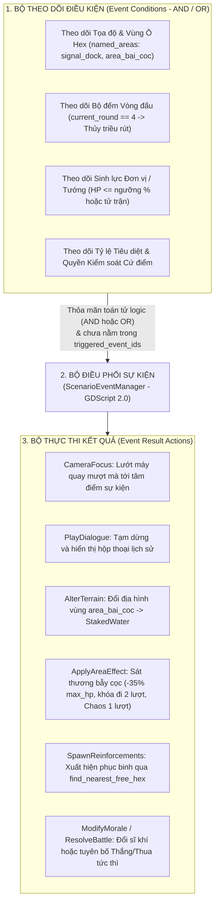
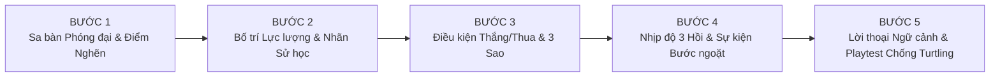

# ĐẶC TẢ THIẾT KẾ MÀN CHƠI, HỆ THỐNG SỰ KIỆN & BỘ QUY CHUẨN KỊCH BẢN
## DỰ ÁN: ĐẠI VIỆT CHIẾN KỲ (VIETNAM HISTORY STRATEGY)
### MODULE: LEVEL DESIGN, SCRIPTING ENGINE & SCENARIO AUTHORING PROTOCOL
*(Chuẩn hóa cho Godot 4.7 — Thuần Typed GDScript 2.0 & Đồng bộ Slice-01 Bạch Đằng 1288)*

> **Vị trí tài liệu:** `docs/gdd/level_design/scenario_scripting_and_events.md`  
> **Trạng thái:** Chuẩn hóa kiến trúc hướng dữ liệu **Event – Condition (`AND`/`OR`) – Action** bằng **Typed GDScript 2.0**, đồng bộ tuyệt đối thông số **Slice-01 Đại Chiến Bạch Đằng 1288 (`stage_id: 10101`)**: sa bàn chiến thuật `12 × 10` hex Pointy-topped Axial, tối đa `10` vòng, thủy triều rút ở **đầu Vòng 4 (`current_round == 4`)** kèm sát thương vùng bãi cọc `ApplyAreaEffect` và cơ chế tiếp viện an toàn `find_nearest_free_hex`.

---

## 1. Kiến trúc Hệ thống Sự kiện Kịch bản (Scripting & Trigger Engine)

Hệ thống kịch bản màn chơi vận hành theo mô hình hướng dữ liệu tách thành 3 khối độc lập, đồng bộ danh sách `triggered_event_ids` với `BattleSaveManager` để đảm bảo tính tất định khi Save/Resume:



---

## 2. Chuẩn Biên Tập Màn Chơi 2 Chiều Editor-First (`stage_10101_map.tscn` + `stage_10101.tres`)

Thay vì chỉnh sửa một tệp JSON khổng lồ bằng text (`battle_10101.json` cũ), mỗi màn chơi chiến dịch được tổ chức trực quan trong thư mục `res://data/stages/<id>_<slug>/` gồm **2 phần đồng bộ hai chiều qua script `@tool`** (`DEC-023`):
1. **Scene Bản đồ (`stage_10101_map.tscn`):** Dựng bằng `TileMapLayer` (vẽ trực tiếp địa hình sông, rừng, đồi, bãi cọc, Bến Hiệu Lệnh trong View 2D của Godot Editor) và các Node điểm đặt quân (`UnitSpawnMarker2D`) / vùng đặt tên (`NamedArea2D`: `signal_dock`, `area_bai_coc`) kéo-thả trực tiếp trên lưới Hex.
2. **Resource Kịch bản (`stage_10101.tres` — `StageDef`):** Chứa thông số vòng đấu (`max_rounds = 10`, `enable_economy = false`), phe phái, điều kiện Thắng/Thua/3 Sao, danh sách sự kiện (`ScenarioEventDef`: `evt_10101_tide_fall` đầu Vòng 4) và hội thoại (`DialogueSequenceDef`: `talk_trieu_rut`) dưới dạng các Sub-Resource có `@export`, chỉnh trực tiếp trong Godot Inspector.

Dưới đây là cấu trúc dữ liệu mẫu chuẩn đã chốt của **Slice-01 Bạch Đằng 1288 (`stage_id: 10101`)** trong `StageDef` & `stage_10101_map.tscn`:

```gdscript
# Cấu trúc Resource StageDef (res://data/stages/10101_bach_dang/stage_10101.tres)
stage_id = 10101
code = "bach_dang_1288"
stage_name = "Đại Chiến Bạch Đằng 1288"
historical_era = "Tran_Nguyen"
modeling_type = "fixture"
coordinate_space = "odd_r" # quy đổi sang Pointy-topped Axial qua HexMath
map_width = 12
map_height = 10
max_rounds = 10
enable_economy = false
player_faction_id = 1
ai_profile = "normal"

# Factions: [{id: 1, "Đại Việt"}, {id: 2, "Đại Nguyên (Quân Nguyên)"}]
# NamedAreas (đồng bộ từ stage_10101_map.tscn):
# - "signal_dock": [(2, 8)]
# - "area_bai_coc": [(5, 4), (6, 4), (6, 5), (7, 5)]
# VictoryConditions:
# 1. DefeatGeneralWhileHoldingArea(general=9001 Ô Mã Nhi, area="signal_dock", instant=true)
# 2. HoldAreaAndEnemyCasualtyAtMaxRound(area="signal_dock", min_enemy_defeated_percent=75, at_round=10)
# DefeatConditions: LoseKeyArea("signal_dock"), GeneralDefeated(1001 Trần Quốc Tuấn), AllUnitsEliminated(1), MaxRoundsUnfulfilled(10)
# StarConditions: 1★ Victory | 2★ MaxRoundLimit <= 8 | 3★ CasualtyHpPercentLimit <= 20%
# ScriptedEvents:
# - evt_10101_tide_fall ("MapPhase_TideFall"): OnRoundStart (current_round == 4, once=true)
#   -> CameraFocus((6, 5), 1.0s)
#   -> PlayDialogue("talk_trieu_rut")
#   -> AlterTerrain("area_bai_coc", "StakedWater")
#   -> ApplyAreaEffect("area_bai_coc", faction=2, hp_loss_max_ratio=0.35, march_disabled_turns=2, chaos_turns=1)
#   -> SpawnReinforcements(policy="find_nearest_free_hex", unit_id=105, troop=40502, hex=(8, 3))
```

---

## 3. BỘ QUY CHUẨN THIẾT KẾ KỊCH BẢN 5 BƯỚC (Scenario Authoring Framework)

> **Dành cho Level Designer:** Khi biên soạn bất kỳ màn chơi chiến dịch lịch sử nào (Bạch Đằng, Như Nguyệt, Chi Lăng, Đống Đa,...), **bắt buộc tuân thủ tuần tự 5 bước chuẩn hóa dưới đây**:



### Bước 1: Thiết kế Sa bàn Phóng đại Chiến thuật (`Tactical Zoom-in Map`) & Điểm Nghẽn

#### 1. Quy chuẩn Kích thước Lưới Hex (`Pointy-topped Axial`):
| Cấp Quy mô | Kích thước Lưới (Cột $\times$ Hàng) | Tổng số Hex | Số Vòng chuẩn | Quân số Hai phe | Mục đích Thiết kế |
| :--- | :---: | :---: | :---: | :---: | :--- |
| **Nhỏ / Mở màn (Skirmish / Slice)** | **$12 \times 10$** đến **$14 \times 12$** | **120 – 168 hex** | **8 – 10 lượt** | Ta: 4–6 đạo<br/>Địch: 7–10 đạo | Kiểm chứng cơ chế cốt lõi, nhập môn hoặc Vertical Slice (**Slice-01 Bạch Đằng 1288: `12 × 10` hex, `10` lượt**). |
| **Tiêu chuẩn (Standard)** | **$16 \times 14$** đến **$18 \times 15$** | **224 – 270 hex** | **12 – 16 lượt** | Ta: 6–10 đạo<br/>Địch: 12–18 đạo | Các trận đánh then chốt trong chương chiến dịch (phá ải, vây thành, giữ đồn). |
| **Đại Chiến dịch (Major Decisive)** | **$24 \times 20$** đến **$32 \times 26$** | **480 – 832 hex** | **16 – 22 lượt** | Ta: 10–16 đạo<br/>Địch: 20–32 đạo | Đại quyết chiến bước ngoặt lịch sử có bật kinh tế chiến trường (`enable_economy: true`). |

#### 2. Kiến trúc Sa bàn Phóng đại Chiến thuật (`Tactical Zoom-in Map`):
> [!IMPORTANT] **Phân tách rõ Tỷ lệ Chiến thuật (Scenario) và Tỷ lệ Chiến lược (Conquest):**  
> Trên bản đồ chiến lược toàn quốc (chế độ Conquest ở P3+), toàn bộ khu vực cửa sông Bạch Đằng chỉ tương ứng với 1–2 ô lục giác vĩ mô, nên **tuyệt đối không thể cắt thô cửa sổ `12 × 10` ô trực tiếp từ bản đồ toàn quốc để làm màn chơi chiến dịch**.  
> Thay vào đó, mỗi màn Scenario như `stage_10101.tres` + `stage_10101_map.tscn` là một **Sa bàn Phóng đại Chiến thuật (`Tactical Zoom-in Map`)** được bố cục chuyên biệt theo địa thế cục bộ (lòng sông chính, lạch triều bãi cọc, bãi rừng phục kích hai bên bờ và Bến Hiệu Lệnh), nhưng **tái sử dụng chung 100% Thư viện `TileSet` địa hình và Prefab công trình** của dự án để tiết kiệm chi phí sản xuất mỹ thuật.

#### 3. Phân bố Địa hình & Điểm Nghẽn (`Choke Points`):
* Mỗi bản đồ phải có ít nhất **1–2 điểm nghẽn tự nhiên** (khúc sông hẹp có cọc ngầm `area_bai_coc`, hẻm núi Chi Lăng, đầm lầy Dạ Trạch) buộc đội hình đông đảo của địch bị bó hẹp, mở cơ hội cho người chơi khóa ZOC, đánh bọc sườn Flank hoặc kích hoạt bẫy địa hình.

### Bước 2: Bố trí Lực lượng, Quốc hiệu & Minh bạch Nhãn Sử học (`modeling_type`)
1. **Tương quan lấy ít địch nhiều:** Giữ tỷ lệ lực lượng **Đại Việt (1) vs. Đối phương (1.5 – 2.2)**, bù đắp bằng lợi thế địa hình sở trường (`fond_terrain`), Sĩ khí và cơ chế kịch bản.
2. **Thẩm định danh xưng & gắn nhãn `modeling_type`:** Tuân thủ nghiêm quy định tại [historical_framework.md](../03_content_presentation/historical_framework.md). Mọi sự điều chuyển tướng hoặc cô đọng không gian – thời gian phục vụ gameplay phải ghi rõ `"modeling_type": "abstraction"` hoặc `"fixture"` trong thuộc tính Resource `.tres` và mục từ Codex.

### Bước 3: Định nghĩa Điều kiện Thắng / Thua & Thách thức 3 Sao
1. **Điều kiện Thắng / Thua hai chiều rõ ràng:** Kết hợp mục tiêu tấn công quyết định (hạ Chủ tướng giặc) với mục tiêu bảo vệ cứ điểm then chốt (như `SignalDock`), ngăn người chơi bỏ mặc căn cứ hoặc co cụm tiêu cực.
2. **Bộ tiêu chuẩn 3 Sao thống nhất:**
   * ⭐ **1 Sao:** Giành chiến thắng màn chơi.
   * ⭐⭐ **2 Sao:** Hoàn thành trong giới hạn lượt thần tốc (ví dụ **`<= 8` lượt** trên tổng `10` lượt ở Slice-01).
   * ⭐⭐⭐ **3 Sao:** Bảo toàn lực lượng — tổng lượng HP tổn thất của toàn quân ta **`<= 20%`** (hoặc đạt điều kiện phụ lịch sử của màn chơi).

### Bước 4: Xây dựng Nhịp điệu 3 Hồi & Sự kiện Bước ngoặt (`Battle Beats`)
* **Hồi 1 — Mở màn & Nhử địch (Vòng 1 – 3):** Tiền quân giặc ồ ạt tiến vào tuyến luồng; quân ta giữ thế phòng ngự linh hoạt, bảo vệ cứ điểm và dụ thuyền địch lọt vào khu vực hiểm địa.
* **Hồi 2 — Bước ngoặt Bùng nổ (Vòng 4 – 6):** Kích hoạt sự kiện môi trường ở **đầu Vòng 4 (`current_round == 4`)** kết hợp `AlterTerrain` + `ApplyAreaEffect` và tung phục binh tạt sườn (`SpawnReinforcements` với `find_nearest_free_hex`).
* **Hồi 3 — Tổng phản công & Quyết định (Vòng 7 – 10):** Khép chặt vòng vây hạ Chủ tướng địch để thắng tức thì, hoặc quét sạch tối thiểu `75%` quân địch trong khi giữ vững cứ điểm tới hết Vòng 10.

### Bước 5: Biên tập Lời thoại Ngắn gọn & Kiểm thử Chống Co cụm (`Anti-Turtling Playtest`)
* Lời thoại súc tích (tối đa 2–3 câu mỗi sự kiện) tại thời khắc khai trận, chạm trán tướng và khi triều rút.
* Kiểm thử với AI: Nếu người chơi chỉ co cụm quanh `SignalDock (2, 8)` suốt 10 lượt mà vẫn thắng dễ dàng $\implies$ yêu cầu tiêu diệt `>= 75%` quân địch ở điều kiện thắng cuối vòng buộc người chơi phải chủ động xuất kích khai thác thời cơ bãi cọc ở Vòng 4!

---

## 4. Kịch bản Chi tiết Chuẩn hóa: SLICE-01 ĐẠI CHIẾN BẠCH ĐẰNG 1288 (`stage_id: 10101`)

> [!NOTE] **Ghi chú Thẩm định Sử học cho Slice-01 (`[S12]`–`[S16]`):**  
> - **Quốc hiệu đối phương (`historical_claim` — Grade A):** Định danh chính xác là **Đại Nguyên (Quân Nguyên)** (`historical_era: "Tran_Nguyen"`).  
> - **Vai trò Phó tướng Trần Khánh Dư (`modeling_type: "abstraction"` / `"fixture"`):** Trong chính sử (`[S12]` *Đại Việt Sử Ký Toàn Thư*, `[S13]` *An Nam Chí Lược*, `[S14]` *Nguyên Sử*), Nhân Huệ Vương Trần Khánh Dư lập đại công đánh tan đoàn thuyền lương Trương Văn Hổ tại **trận Vân Đồn (cuối năm 1287)**; còn tại đại chiến sông Bạch Đằng (9/4/1288) có Quốc công Tiết chế Trần Quốc Tuấn, hai vua Trần, Nguyễn Khoái, Phạm Ngũ Lão, Trần Nhật Duật... Trong phạm vi Vertical Slice MVP, Trần Khánh Dư được đưa vào làm phó tướng thủy quân để kiểm thử cơ chế phối hợp 2 tướng có kỹ năng riêng. Bố cục dải cọc `area_bai_coc` tham chiếu khảo cổ Yên Giang – Cao Quỳ (`[S15]`, `[S16]`) và được mô hình hóa dưới nhãn `"fixture"`.

| Hồi | Vòng đấu | Sự kiện / Trigger | Diễn biến Gameplay & Tác động Hệ thống | Lời thoại Kịch bản |
| :---: | :---: | :--- | :--- | :--- |
| **Hồi 1** | **Vòng 1** | `OnRoundStart`<br/>(`current_round == 1`) | Hạm đội **Đại Nguyên (Quân Nguyên)** do Ô Mã Nhi dẫn đầu tiến vào cửa sông. Quân Đại Việt giữ `SignalDock (2, 8)` và đánh nhử trên mặt nước sâu. | **Trần Quốc Tuấn:** *"Trận này không phá tan giặc Nguyên, thề không về bến sông này!"* |
| | **Vòng 3** | `OnAfterCommand`<br/>(`GeneralClash`) | Thuyền nhẹ phó tướng Trần Khánh Dư (`abstraction`) giao chiến cản mũi tiên phong, kéo đội hình Ô Mã Nhi tiến sâu vào vùng `area_bai_coc` (lúc này vẫn là `Water` bình thường). | **Ô Mã Nhi:** *"Chiến thuyền nhỏ bé của các ngươi cản sao nổi đại quân thủy chiến Đại Nguyên?"* |
| **Hồi 2** | **Đầu Vòng 4** | `OnRoundStart`<br/>(`current_round == 4`)<br/>**`MapPhase_TideFall`** | **Bước ngoặt Thủy triều rút!**<br/>1. `AlterTerrain`: Toàn bộ ô trong `area_bai_coc` chuyển thành **`StakedWater`**.<br/>2. `ApplyAreaEffect`: Mọi thuyền địch đang nằm trong `area_bai_coc` lập tức mất **`35% max_hp`**, dính **`march_disabled_turns = 2`** và **`chaos_turns = 1`**.<br/>3. `SpawnReinforcements`: Phục binh Đại Việt xuất hiện tại ô trống hợp lệ gần nhất (`find_nearest_free_hex`) đánh bọc sườn. | **Trần Quốc Tuấn:** *"Thủy triều đã rút mạnh! Trận địa cọc ngầm đã lộ diện! Toàn quân quay thuyền tổng phản công!"* |
| **Hồi 3** | **Vòng 5–10** | `OnAfterCommand` / `OnRoundEnd` | Quân Đại Việt tận dụng 2 lượt giặc mắc cọc và hỗn loạn để kẹp gọng kìm Pincer.<br/>• **Thắng tức thì:** Hạ gục Ô Mã Nhi khi `SignalDock (2, 8)` thuộc Đại Việt.<br/>• **Thắng cuối Vòng 10:** Giữ vững `SignalDock (2, 8)` và diệt `>= 75%` quân địch.<br/>• **2★:** Thắng `<= 8` lượt; **3★:** Tổn thất HP toàn quân ta `<= 20%`. | **Ô Mã Nhi:** *"Trời hại ta rồi!"* $\rightarrow$ Chuyển ngay sang **Màn hình Chiến Thắng**. |

---

## 5. Mã Nguồn Triển khai Mẫu — `ScenarioEventManager` (Typed GDScript 2.0)

Hỗ trợ đầy đủ toán tử điều kiện **`AND` / `OR`**, đồng bộ `triggered_event_ids: Array[String]` chống nổ lặp sự kiện sau khi Load game, thực thi sát thương vùng bãi cọc `ApplyAreaEffect` và thuật toán BFS vòng lục giác `find_nearest_free_hex` chống đè quân khi gọi tiếp viện:

```gdscript
class_name ScenarioEventManager
extends RefCounted

const AXIAL_DIRECTIONS: Array[Vector2i] = [
	Vector2i(1, 0), Vector2i(1, -1), Vector2i(0, -1),
	Vector2i(-1, 0), Vector2i(-1, 1), Vector2i(0, 1)
]

var scripted_events: Array[Dictionary] = []
var triggered_event_ids: Array[String] = []


func setup(events_data: Array[Dictionary], restored_triggered_ids: Array[String] = []) -> void:
	scripted_events = events_data.duplicate(true)
	triggered_event_ids = restored_triggered_ids.duplicate()


func check_and_execute(trigger_type: String, ctx: BattleContext) -> void:
	for evt: Dictionary in scripted_events:
		var evt_id: String = String(evt.get("event_id", ""))
		var is_once: bool = bool(evt.get("once", true))
		if is_once and triggered_event_ids.has(evt_id):
			continue
		if String(evt.get("trigger_type", "")) != trigger_type:
			continue

		var conditions: Array[Dictionary] = []
		conditions.assign(evt.get("conditions", []))
		var logic_op: String = String(evt.get("logic_operator", "AND")).to_upper()

		if _evaluate_conditions(conditions, logic_op, ctx):
			if is_once and not evt_id.is_empty():
				triggered_event_ids.append(evt_id)
			var results: Array[Dictionary] = []
			results.assign(evt.get("results", []))
			_execute_results(results, ctx)


## Hỗ trợ đầy đủ cả hai cổng logic AND và OR.
func _evaluate_conditions(
	conditions: Array[Dictionary],
	logic_op: String,
	ctx: BattleContext
) -> bool:
	if conditions.is_empty():
		return true

	if logic_op == "OR":
		for cond: Dictionary in conditions:
			if ctx.evaluate_single_condition(cond):
				return true
		return false

	# Mặc định: AND — toàn bộ điều kiện con phải thỏa mãn
	for cond: Dictionary in conditions:
		if not ctx.evaluate_single_condition(cond):
			return false
	return true


func _execute_results(results: Array[Dictionary], ctx: BattleContext) -> void:
	for action_data: Dictionary in results:
		var action_type: String = String(action_data.get("action", ""))
		match action_type:
			"CameraFocus":
				var hex_dict: Dictionary = action_data.get("target_hex", {})
				var duration: float = float(action_data.get("duration", 1.0))
				ctx.focus_camera_on_hex(Vector2i(int(hex_dict.get("q", 0)), int(hex_dict.get("r", 0))), duration)
			"PlayDialogue":
				ctx.queue_dialogue(String(action_data.get("dialogue_id", "")))
			"AlterTerrain":
				var area_id: String = String(action_data.get("area_id", ""))
				var new_terrain: StringName = StringName(String(action_data.get("new_terrain", "Plain")))
				for cell_hex: Vector2i in ctx.get_named_area_hexes(area_id):
					ctx.set_cell_terrain(cell_hex, new_terrain)
			"ApplyAreaEffect":
				_apply_area_effect(action_data, ctx)
			"SpawnReinforcements":
				_spawn_reinforcements(action_data, ctx)
			_:
				push_warning("ScenarioEventManager: Action chưa hỗ trợ '%s'" % action_type)


## Áp dụng hiệu ứng sát thương & khống chế vùng (VD: Bãi cọc Bạch Đằng lộ diện ở Vòng 4).
func _apply_area_effect(action_data: Dictionary, ctx: BattleContext) -> void:
	var area_id: String = String(action_data.get("area_id", ""))
	var target_faction_id: int = int(action_data.get("target_faction_id", -1))
	var hp_loss_ratio: float = float(action_data.get("hp_loss_max_ratio", 0.35))
	var march_lock: int = int(action_data.get("march_disabled_turns", 2))
	var chaos_lock: int = int(action_data.get("chaos_turns", 1))

	for cell_hex: Vector2i in ctx.get_named_area_hexes(area_id):
		var unit: UnitEntity = ctx.get_unit_at_hex(cell_hex)
		if unit == null:
			continue
		if target_faction_id != -1 and unit.faction_id != target_faction_id:
			continue

		var stake_damage: int = maxi(1, roundi(float(unit.max_hp) * hp_loss_ratio))
		unit.apply_direct_damage(stake_damage)
		if unit.current_hp > 0:
			unit.march_disabled_turns = maxi(unit.march_disabled_turns, march_lock)
			unit.chaos_turns = maxi(unit.chaos_turns, chaos_lock)
		ctx.emit_area_trap_feedback(cell_hex, unit, stake_damage)


## Xuất hiện quân tiếp viện an toàn: tự động tìm ô hợp lệ trống gần nhất nếu tâm điểm đã có quân đứng.
func _spawn_reinforcements(action_data: Dictionary, ctx: BattleContext) -> void:
	var placements: Array = action_data.get("placements", [])
	for raw_item: Variant in placements:
		if not (raw_item is Dictionary):
			continue
		var p: Dictionary = raw_item as Dictionary
		var hex_dict: Dictionary = p.get("hex", {})
		var desired_hex := Vector2i(int(hex_dict.get("q", 0)), int(hex_dict.get("r", 0)))
		var troop_id: int = int(p.get("troop_id", 0))
		var domain: StringName = ctx.get_troop_domain(troop_id)

		var spawn_hex: Vector2i = find_nearest_free_hex(desired_hex, domain, ctx)
		if spawn_hex.x < 0:
			push_warning("ScenarioEventManager: Không còn ô trống hợp lệ gần %s để sinh tiếp viện." % desired_hex)
			continue
		ctx.spawn_unit_from_placement(p, spawn_hex)


## Duyệt BFS theo vòng lục giác đồng tâm để tìm ô hợp lệ chưa có đơn vị chiếm chỗ.
func find_nearest_free_hex(origin_hex: Vector2i, domain: StringName, ctx: BattleContext) -> Vector2i:
	if ctx.is_hex_free_and_passable(origin_hex, domain):
		return origin_hex

	var visited: Dictionary = {origin_hex: true}
	var queue: Array[Vector2i] = [origin_hex]

	while not queue.is_empty():
		var current: Vector2i = queue.pop_front()
		for dir: Vector2i in AXIAL_DIRECTIONS:
			var neighbor: Vector2i = current + dir
			if visited.has(neighbor) or not ctx.is_inside_map(neighbor):
				continue
			visited[neighbor] = true
			if ctx.is_hex_free_and_passable(neighbor, domain):
				return neighbor
			queue.append(neighbor)

	return Vector2i(-1, -1)
```
