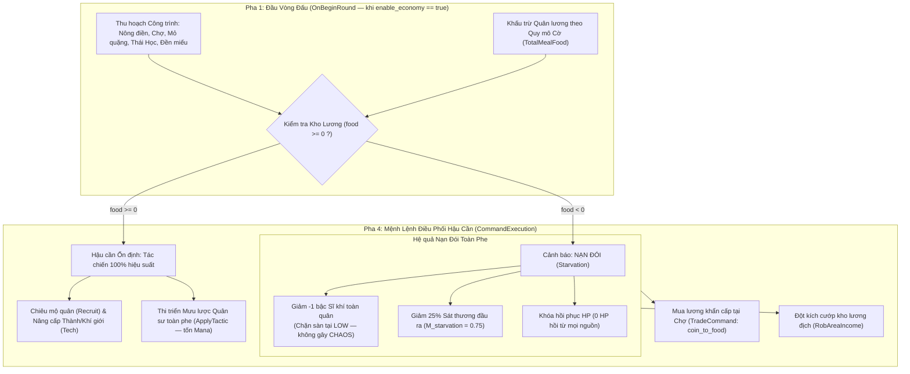

# Kinh Tế Chiến Trường & Hậu Cần Trong Trận (In-Battle Tactical Economy)

[← Quay lại Mục lục GDD](../README.md)

---

> [!IMPORTANT]
> **Phạm vi áp dụng:** Mô-đun Kinh tế Chiến trường này thuộc phạm vi **P3 Alpha / Chế độ Conquest & Chiến dịch lớn (`enable_economy = true`)**, và **ẩn hoàn toàn trong Slice-01 Bạch Đằng 1288 (`enable_economy = false`)** để người chơi tập trung làm chủ địa hình, thủy triều và bao vây cốt lõi trước.

---

## 1. Tầm nhìn Chiến thuật: Hậu Cần Tác Chiến (Combat Logistics)

Kinh tế trong trận của **Đại Việt Chiến Kỳ** không biến trò chơi thành game xây dựng vĩ mô rườm rà, mà đóng vai trò **đòn bẩy hậu cần tác chiến** trực tiếp trên bản đồ Hex:

> *"Binh mã chưa động, lương thảo đi trước."*  
> Mọi cuộc hành quân đường dài, vây thành hay phản công chiến lược đều phụ thuộc vào khả năng bảo vệ tuyến lương Nông điền – Bến thuyền và chặt đứt mạch tiếp tế của đối phương.



---

## 2. Bốn Nguồn Lực Chiến Thuật Cấp Phe & Công dụng Điểm `Tech`

Mỗi Faction quản lý một ngân quỹ tức thời gồm 4 nguồn lực số nguyên (`int`):

| Tài nguyên | Biến dữ liệu | Công dụng Chiến thuật Trực tiếp | Nguồn thu trong trận | Hệ quả khi cạn kiệt / âm |
| :--- | :---: | :--- | :--- | :--- |
| **Tiền Đồng** | `coin` | Chiêu mộ đạo quân mới (`Recruit`), sửa chữa công sự, mua lương khẩn cấp tại Chợ. | Chợ (`Type 18`), Thành trì (`Type 1–5`), Mỏ (`Type 31–32`). | Không thể tuyển quân bổ sung hoặc mua lương cứu đói. |
| **Lương Thảo** | `food` | Duy trì toàn bộ đạo quân trên bản đồ ở đầu mỗi vòng (`TotalMealFood`). | Nông điền (`Type 33`), Thành trì, cướp bóc (`RobAreaIncome`). | Kích hoạt **Nạn đói (`Starvation`)** khi `food < 0`. |
| **Kỹ Nghệ** | `tech` | Nâng cấp cấp Thành trì mở binh chủng cao cấp, gia cố lũy và nghiên cứu Khí giới Bậc 1–3. | Mỏ khoáng sản (`Type 31–32`), Quốc Tử Giám / Thái Học (`Type 13`). | Bị kẹt ở binh chủng sơ cấp, thiếu hỏa khí công thành. |
| **Khí Lực** | `mana` | Tiêu hao để thi triển **Mưu lược Quân sư toàn phe (`ApplyTactic`)** *(không dùng cho `CastSkill` của Tướng)*. | Chùa cổ / Đền miếu (`Type 14`), Quốc Tử Giám (`Type 13`). | Không thể phát động sách lược diện rộng (*Hịch Tướng Sĩ*, *Hỏa Công*). |

### Đặc tả Công dụng Điểm `Tech` Trong Trận (`In-Battle Tech Actions`)
Để điểm `tech` luôn mang giá trị quyết định rõ ràng trong chế độ Conquest và đại chiến dịch P3+:
1. **Nâng cấp Cấp độ Thành trì / Doanh trại tại chỗ (`UpgradeFacility`):** Tiêu hao `coin + tech` nâng Thành trì từ Cấp 1 → 5 để mở khóa chiêu mộ các đạo quân tinh nhuệ ngay gần tiền tuyến (Cấp 3 mở Thiết kỵ & Nỏ liên châu; Cấp 4 mở Tượng binh & Mông đồng; Cấp 5 mở Thần cơ pháo & Đại lâu thuyền).
2. **Gia cố Công sự Chiến trường (`FortifyHex`):** Tiêu `40 Tech + 60 Coin` khôi phục độ bền ô `FORT` hoặc dựng lũy phòng ngự tại điểm nghẽn chiến lược.
3. **Nghiên cứu Khí giới Tức thời theo Phe (`UnlockBattleTech` 3 Bậc — thực hiện tại Quốc Tử Giám / Xưởng Binh Khí):**
   * **Bậc 1 — Rèn Mũi Tên Đồng & Giáo Dài (`60 Tech`):** Tăng `+10%` `damage_deepen` cho toàn bộ nhánh `INFANTRY` và `ARCHERY` của phe.
   * **Bậc 2 — Đóng Thuyền Bọc Đồng & Giáp Thiết Lĩnh (`120 Tech`):** Tăng `+10%` `damage_resist` cho toàn bộ nhánh `NAVAL` và `CAVALRY`.
   * **Bậc 3 — Chế Tạo Hỏa Hổ & Súng Thần Cơ (`200 Tech`):** Mở khóa chiêu mộ binh chủng hỏa khí nhánh `SIEGE` và cộng `+20%` sát thương khi đánh vào `DefenseMode.FORT`.

---

## 3. Khấu trừ Quân Lương (`MealFood`) & Trừng phạt Nạn Đói (`Starvation`)

### 3.1. Thang Định mức `MealRate` Số nguyên (Cân bằng với Nông điền `80–200 Food/lượt`)
Tại Pha 1 `OnBeginRound`, tổng quân lương tiêu thụ của một phe được tính bằng tổng định mức của từng đạo quân nhân với quy mô cờ biên chế đầu trận (`max_stack` $\in \{1, 2, 3\}$):

$$\text{TotalMealFood} = \sum_{i=1}^{N} \text{MealRate}(\text{unit}_i) \times \text{max\_stack}_i$$

| Nhánh Binh chủng (`CommandBranch`) | Định mức `MealRate` (1 Cờ) | Đạo 2 Cờ (`2x`) | Đạo 3 Cờ (`3x`) | Đối chiếu cân bằng với 1 Nông điền Cấp 1 (`80 Food/lượt`) |
| :--- | :---: | :---: | :---: | :--- |
| **Bộ binh (`INFANTRY`)** | **`10`** Food / lượt | `20` Food | `30` Food | 1 Nông điền nuôi đủ ~2.6 đạo Bộ binh 3 cờ. |
| **Cung / Nỏ (`ARCHERY`)** | **`12`** Food / lượt | `24` Food | `36` Food | 1 Nông điền nuôi đủ ~2.2 đạo Cung nỏ 3 cờ. |
| **Thủy quân (`NAVAL`)** | **`15`** Food / lượt | `30` Food | `45` Food | Đòi hỏi kiểm soát bến cảng và vựa lúa ven sông. |
| **Kỵ binh (`CAVALRY`)** | **`20`** Food / lượt | `40` Food | `60` Food | Tiêu tốn gấp đôi bộ binh do nhu cầu cỏ thóc chiến mã. |
| **Công thành / Hỏa khí (`SIEGE`)** | **`20`** Food / lượt | `40` Food | `60` Food | Chi phí hậu cần đoàn xe pháo và thuốc súng nặng nề. |
| **Tượng binh (`CAVALRY` tag `elephant`)** | **`30`** Food / lượt | `60` Food | `90` Food | 1 đạo Voi chiến 3 cờ tiêu thụ vượt 1 Nông điền Cấp 1! |

### 3.2. Quy tắc Nạn Đói (`Starvation` — Chống Soft-lock)
Sau bước cộng thu nhập và trừ `TotalMealFood` ở `OnBeginRound`, nếu tồn kho `food < 0`:
1. **Hạ `-1 bậc` Sĩ khí toàn quân nhưng chặn sàn ở `MoraleLevel.LOW` (*Dao Động*):**
   * Đơn vị đang `HIGH` → xuống `NORMAL`; đang `NORMAL` → xuống `LOW`; đang `LOW` vẫn giữ ở `LOW` (**không bao giờ hạ xuống `CHAOS`** chỉ vì đói, đảm bảo người chơi hoặc AI vẫn điều khiển được quân đi chiếm Nông điền hoặc mua lương cứu vãn tình thế).
2. **Suy kiệt Lực chiến (`M_starvation = 0.75`):** Toàn bộ đòn tấn công của phe đang đói bị giảm **`25%` sát thương** ([combat_formulas.md](combat_formulas.md)).
3. **Tê liệt Quân y:** Mọi hiệu ứng hồi phục `current_hp` (đồn trú tại Thành trì, kỹ năng hồi máu) trả về `0 HP` cho đến khi `food >= 0` trở lại.

---

## 4. Danh mục Công trình Hậu cần Chiến lược (`FacilitySettings.json`)

| Mã Loại | Tên Công trình | Cấp độ | Sản lượng / Vòng (`int`) | Hiệu ứng Chiến thuật Đặc biệt |
| :--- | :--- | :---: | :--- | :--- |
| `Type 1–5` | **Thành trì / Đô thành** | `1 – 5` | `40–200 Coin`, `20–100 Food` | Ô `FORT` phát `CoC` (`step_cost * 2`); hồi HP đồn trú; chiêu mộ quân & bổ nhiệm Tướng. |
| `Type 18` | **Chợ / Thương điếm** | `1 – 3` | `60 / 100 / 150 Coin` | Mở khóa lệnh Giao thương khẩn cấp (`TradeCommand`); cấp Chợ càng cao tỷ giá càng lợi. |
| `Type 33` | **Nông điền / Bãi bồi** | `1 – 3` | `80 / 140 / 200 Food` | Nguồn cung lương chủ lực; mục tiêu hàng đầu cần bảo vệ hoặc tiêu thổ. |
| `Type 31–32` | **Mỏ Đồng / Mỏ Sắt** | `1 – 2` | `30 Coin`, `25 / 50 Tech` | Cung cấp nguyên liệu nâng cấp thành lũy và rèn khí giới. |
| `Type 13` | **Quốc Tử Giám / Thái Học** | `1 – 2` | `40 Tech`, `15 Mana` | Mở bảng nghiên cứu Khí giới Bậc 1–3 (`UnlockBattleTech`). |
| `Type 14` | **Chùa cổ / Đền miếu** | `1 – 2` | `25 / 40 Mana` | Cung cấp `Mana` cho Mưu lược Quân sư `ApplyTactic`. |
| `Type 20` | **Kho Lương Kiên Cố** | `1 – 2` | Trần chứa `+500 / +1000 Food` | **Bảo vệ hậu cần:** Giảm **`50%`** lượng tài nguyên bị địch cướp (`M_granary = 0.50`). |

---

## 5. Công thức Cướp Lương (`RobAreaIncome`) & Tỷ giá Chợ Khẩn cấp (`TradeCommand`)

### 5.1. Công thức Cướp Bóc Công trình Kinh tế (`RobAreaIncome`)
Khi một đạo quân đánh chiếm thành công một ô Thành trì, Nông điền, Chợ hoặc Mỏ của đối phương, phe tấn công thu giữ ngay lập tức lượng chiến lợi phẩm tính theo số vòng tích lũy chưa bị cướp (tối đa **trần `3` vòng**) và hệ số bảo vệ của Kho Lương kiên cố:

$$\text{Loot}(R) = \text{round\_half\_up}\Big(\text{FacilityIncome}(R) \times \min(\text{turns\_unrobbed}, \ 3) \times \text{plunder\_rate} \times M_{\text{granary}}\Big)$$

* `turns_unrobbed` $\in \mathbb{Z}_{\ge 0}$: Số vòng liên tiếp kể từ đầu trận (hoặc từ lần bị cướp gần nhất) công trình đó chưa bị cướp — **khóa trần tại `min(turns_unrobbed, 3)`** để tránh bùng nổ tài nguyên phi thực tế ở cuối trận. Ngay sau khi cướp, đặt lại `turns_unrobbed = 0`.
* `plunder_rate`: Mặc định **`0.80`** (`80%` sản lượng tích lũy); đạt **`1.00`** (`100%`) nếu đơn vị chiếm đóng là Khinh kỵ hoặc mang thuộc tính đột kích hậu cần (`raider`).
* **`M_granary`:** Bằng **`0.50`** (giảm `50%` tài nguyên bị cướp) nếu khu vực/thành trì đó có công trình **Kho Lương Kiên Cố (`Type 20`)** bảo vệ; ngược lại bằng **`1.00`**.

### 5.2. Công thức Tỷ giá Chợ Khẩn cấp (`TradeCommand`)
Khi phe đang kiểm soát ít nhất 1 ô **Chợ (`Type 18`)**, người chỉ huy có thể phát lệnh `TradeCommand` (không làm mất lượt của đơn vị quân):

* **Hệ số cấp Chợ cao nhất đang sở hữu (`market_bonus`):**
  $$\text{market\_bonus} = 1.0 + 0.10 \times (\text{highest\_market\_level} - 1) \quad (\text{Cấp } 1: 1.0, \text{ Cấp } 2: 1.1, \text{ Cấp } 3: 1.2)$$
* **Hệ số Khủng hoảng thời chiến (`crisis_mult`):**
  $$\text{crisis\_mult} = \begin{cases} 2.0 & \text{nếu phe đang bị } \text{Starvation } (\text{food} < 0) \text{ hoặc mọi Thành trì đang bị vây } (\text{TrappedLevel} \ge 1) \\ 1.0 & \text{trong điều kiện bình thường} \end{cases}$$
* **Chiều 1 — Mua Lương Cứu Đói (`trade_coin_to_food`):** Với lượng tiền chi ra `coin_spent` (bội số của `100 Coin`):
  $$\text{FoodReceived} = \text{round\_half\_up}\left(\text{coin\_spent} \times \frac{0.75 \times \text{market\_bonus}}{\text{crisis\_mult}}\right)$$
  *(Ở Chợ Cấp 1 bình thường: `100 Coin → 75 Food`; khi rơi vào Nạn đói `crisis_mult = 2.0`: phải chi `200 Coin → 75 Food`, tức `100 Coin → 38 Food`).*
* **Chiều 2 — Bán Lương Đổi Ngân Sách (`trade_food_to_coin`, chỉ hợp lệ khi `food >= TotalMealFood`):** Với lượng lương bán ra `food_sold` (bội số của `100 Food`):
  $$\text{CoinReceived} = \text{round\_half\_up}\Big(\text{food\_sold} \times 0.60 \times \text{market\_bonus}\Big)$$
  *(Ở Chợ Cấp 1: `100 Food → 60 Coin`; Chợ Cấp 3: `100 Food → 72 Coin`).*

---

## 6. Mã Mẫu Giải Quyết Hậu Cần GDScript 2.0 (Godot 4.7)

```gdscript
class_name BattleEconomyResolver
extends RefCounted

const MEAL_RATE_BY_BRANCH: Dictionary[CommanderData.CommandBranch, int] = {
	CommanderData.CommandBranch.INFANTRY: 10,
	CommanderData.CommandBranch.ARCHERY: 12,
	CommanderData.CommandBranch.NAVAL: 15,
	CommanderData.CommandBranch.CAVALRY: 20,
	CommanderData.CommandBranch.SIEGE: 20,
}
const ELEPHANT_MEAL_RATE: int = 30


static func compute_unit_meal_food(
	branch: CommanderData.CommandBranch,
	max_stack: int,
	is_elephant: bool = false
) -> int:
	var rate: int = ELEPHANT_MEAL_RATE if is_elephant else MEAL_RATE_BY_BRANCH.get(branch, 10)
	return rate * clampi(max_stack, 1, 3)


static func compute_rob_area_loot(
	facility_income: int,
	turns_unrobbed: int,
	plunder_rate: float = 0.80,
	has_fortified_granary: bool = false
) -> int:
	var capped_turns: int = clampi(turns_unrobbed, 0, 3)
	var granary_mult: float = 0.50 if has_fortified_granary else 1.00
	var raw_loot: float = float(facility_income * capped_turns) * plunder_rate * granary_mult
	return CombatFormulaResolver.round_half_up(raw_loot)


static func compute_coin_to_food(
	coin_spent: int,
	highest_market_level: int,
	in_crisis: bool
) -> int:
	if coin_spent <= 0 or highest_market_level <= 0:
		return 0
	var market_bonus: float = 1.0 + 0.10 * float(clampi(highest_market_level, 1, 3) - 1)
	var crisis_mult: float = 2.0 if in_crisis else 1.0
	var raw_food: float = float(coin_spent) * (0.75 * market_bonus) / crisis_mult
	return CombatFormulaResolver.round_half_up(raw_food)


static func compute_food_to_coin(food_sold: int, highest_market_level: int) -> int:
	if food_sold <= 0 or highest_market_level <= 0:
		return 0
	var market_bonus: float = 1.0 + 0.10 * float(clampi(highest_market_level, 1, 3) - 1)
	var raw_coin: float = float(food_sold) * 0.60 * market_bonus
	return CombatFormulaResolver.round_half_up(raw_coin)
```
