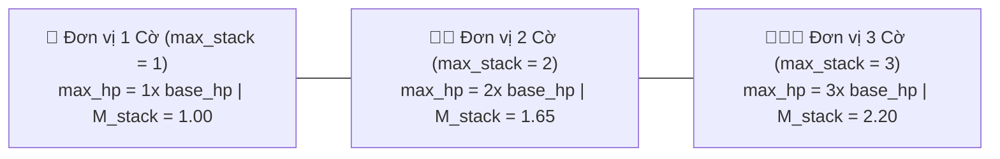

# Đặc Tả Chi Tiết Công Thức Chiến Đấu & Tính Toán Sát Thương

[← Quay lại Mục lục GDD](../README.md)

---

> **Vị trí tài liệu:** `docs/gdd/mechanics/combat_formulas.md`  
> **Nền tảng mục tiêu:** Godot 4.7 — Thuần GDScript 2.0 (Static Typing) cho Web & Android  
> **Trạng thái:** Chuẩn hóa đồng bộ với [battlefield_rules.md](../02_gameplay_systems/battlefield_rules.md), [units_commanders.md](../02_gameplay_systems/units_commanders.md) và [morale_and_status.md](morale_and_status.md).

---

## 1. Hệ thống Chỉ số & Miền Giá trị Chuẩn hóa (Combat Attributes & Domains)

Mọi biến số tham gia tính toán sát thương đều dùng tên thuộc tính chuẩn GDScript / Custom `Resource` (`snake_case`) với miền giá trị xác định rõ ràng:

| Nhóm | Thuộc tính (`snake_case`) | Kiểu | Miền giá trị | Ý nghĩa & Quy tắc Gameplay |
| :--- | :--- | :---: | :---: | :--- |
| **Sinh lực & Cờ** | `base_hp` | `int` | `100 .. 600` | Sinh lực chuẩn của 1 cờ biên chế. |
| | `max_stack` | `int` | `1, 2, 3` | Quy mô gộp cờ đầu trận (`1x, 2x, 3x`). Cố định `max_hp = base_hp * max_stack` và `M_stack`. |
| | `current_hp` | `int` | `0 .. max_hp` | Sinh lực hiện tại. Tỷ lệ `hp_ratio = float(current_hp) / float(max_hp)` làm giảm lực đánh mượt theo `M_hp`. |
| **Tấn công & RNG** | `base_atk` | `int` | `25 .. 120` | Lực tấn công danh định tối đa của đơn vị. |
| | `damage_roll_min`, `damage_roll_max` | `int` | `[75..85]` – `[95..100]` | Biên độ dao động sát thương (`%`): mặc định **`80% – 100%`**; khinh binh/du kích **`75% – 95%`**; cấm vệ tinh nhuệ **`85% – 100%`**. |
| | `attack_mode` | `int` | `1 .. 6` | Kiểu tấn công đối chiếu ma trận khắc chế (Mục 4). |
| | `min_range`, `max_range` | `int` | `[1, 1]` .. `[2, 3]` | Cự ly Hex tối thiểu và tối đa được phép công kích hoặc phản kích. |
| **Phòng thủ** | `base_def` | `int` | `5 .. 60` | Điểm giáp cơ bản trước khi nhân địa hình và sĩ khí. |
| | `defense_mode` | `int` | `1 .. 5` | Loại giáp của mục tiêu đối chiếu ma trận khắc chế (Mục 4). |
| | `damage_percent` | `int` | `35 .. 150` | Hệ số phần trăm khắc chế (`%`) tra từ bảng `attack_mode × defense_mode`. |
| **Địa hình** | `fond_terrain` | `int` | `-1` hoặc `0 .. 8` | Địa hình sở trường (`TerrainType`). Khi đứng đúng ô sở trường: thưởng **`+15% ATK/DEF`** và **`-1 MP`** di chuyển. |
| | `M_terrain` | `float` | `0.85 .. 1.30` | Hệ số công địa hình của bên công (gồm nội tại ô đứng + `+0.15` nếu khớp `fond_terrain`). |
| | `TerrainDefMult` | `float` | `0.80 .. 1.45` | Hệ số giáp địa hình của mục tiêu (gồm nội tại ô đứng + `+0.15` nếu khớp `fond_terrain`). |
| **Tướng chỉ huy** | `general_command_stat` | `int` | `0` hoặc `1 .. 30` | Chỉ số Thống lĩnh của tướng (`0` nếu không gắn tướng). Cộng `GenBonus = general_command_stat * 1` vào lực công nền. |
| | `M_command` | `float` | `0.90 .. 1.25` | Hệ số thông thạo 5 nhánh binh chủng `CommandProfile`: `S = 1.25` (+25%), `A = 1.15` (+15%), `B = 1.08` (+8%), `C = 1.00` (+0%), `D = 0.90` (-10%). |
| | `general_luck` | `int` | `0 .. 100` | Chỉ số Khí vận của tướng (`0` nếu không có tướng), cộng `int(general_luck * 0.15)` (`0..15%`) vào tỷ lệ Crit. |
| | `aura_radius_hex` | `int` | `0 .. 2` | Bán kính Hào quang Chỉ huy (`CommandAura`): `1 hex` (Lam/Tím) hoặc `2 hex` (Cam/Đỏ), cộng thưởng `damage_deepen` / `damage_resist` cho đồng minh trong vùng. |
| **Bạo kích & Phản kích** | `base_crit` | `int` | `0 .. 25` | Tỷ lệ chí mạng cơ bản (`%`), mặc định bằng `5`. |
| | `crit_rate_bonus` | `int` | `-20 .. 50` | Điểm cộng/trừ tỷ lệ Crit (`%`) từ bảo vật hoặc kỹ năng thụ động (mặc định `0`). |
| | `crit_damage_bonus` | `int` | `0 .. 100` | Phần trăm sát thương chí mạng cộng thêm (`%`, mặc định `0`); chia cho `100.0` khi cộng vào nền `1.50`. |
| | `counter_percent` | `int` | `0 .. 120` | Hiệu suất sát thương phản kích (`%`), **mặc định `75`** (tức `75%` đòn chuẩn; giáo binh thủ trận có thể đạt `100`). |
| **Khuếch đại & Kháng** | `damage_deepen` | `int` | `0 .. 100` | Phần trăm gia tăng sát thương đầu ra (`%`, mặc định `0`). |
| | `damage_resist` | `int` | `-50 .. 75` | Phần trăm giảm sát thương nhận vào (`%`, mặc định `0`), luôn chặn biên `clampi(damage_resist, -50, 75)`. |

---

## 2. Controlled RNG Có Hạt giống Tất định (Seeded Deterministic RNG)

* **Bộ sinh số riêng biệt:** Mỗi phiên trận đánh khởi tạo một thực thể `RandomNumberGenerator` riêng biệt chuyên phục vụ giải quyết giao tranh (`combat_rng`), tách rời khỏi hiệu ứng hạt VFX hoặc âm thanh UI.
* **Lưu trữ trạng thái Replay:** Cấu trúc phiên trận (`BattleSessionState` tại [data_and_save_system.md](../architecture/data_and_save_system.md)) lưu cả `rng_seed: int` lẫn `rng_state: int` sau mỗi `BattleCommand`. Khi phát lại Replay hoặc tải lại Checkpoint giữa trận, chuỗi kết quả `roll_factor` và `crit_roll` khớp tuyệt đối **100% Deterministic** trên cả Web (Wasm) và Android (ARM64).
* **Quy tắc làm tròn chuẩn (`round_half_up`):** Mọi phép quy đổi sát thương sang số nguyên ở bước chốt cuối cùng đều dùng hàm làm tròn nửa lên dương (`int(floor(x + 0.5))` cho số dương `x`), không làm tròn cắt cụt sớm ở các bước trung gian.

---

## 3. Cơ chế Gộp cờ (`TroopStack`: 1x, 2x, 3x) — Xóa bỏ "Vách đá Sát thương"



| Biên chế Đầu trận (`max_stack`) | Sinh lực Tối đa (`max_hp`) | Hệ số Quy mô Cố định (`M_stack`) | Định mức Lương (`MealFood`) | Chi phí Chiêu mộ |
| :---: | :---: | :---: | :---: | :---: |
| **1 Cờ (`1x`)** | `base_hp * 1` | **`1.00`** | `1 * MealRate` | `1.0x` |
| **2 Cờ (`2x`)** | `base_hp * 2` | **`1.65`** (+65% lực công) | `2 * MealRate` | `1.8x` |
| **3 Cờ (`3x`)** | `base_hp * 3` | **`2.20`** (+120% lực công) | `3 * MealRate` | `2.5x` |

> [!IMPORTANT]
> **Quy tắc chống phạt kép ("No Damage Cliff"):**
> * `max_stack` được khóa từ lúc xuất quân đầu trận (hoặc lúc chiêu mộ): cả `max_hp` lẫn `M_stack` **giữ nguyên không đổi** trong suốt trận đánh.
> * Khi đơn vị mất máu, lực đánh suy giảm **mượt và liên tục** duy nhất qua thừa số sinh lực:
>   $$M_{\text{hp}} = 0.50 + 0.50 \times \left(\frac{\text{current\_hp}}{\text{max\_hp}}\right)$$
> * Số cờ hiển thị trên đầu mô hình (`active_banners = 3 / 2 / 1` tương ứng ngưỡng máu `> 66%`, `33% – 66%`, `< 33%` `max_hp` đối với đạo 3 cờ; tổng quát `clampi(ceili(hp_ratio * max_stack), 1, max_stack)`) **chỉ là chỉ báo thị giác trực quan**, tuyệt đối không hạ bậc `M_stack` và không cắt giảm `max_hp`.

---

## 4. Ma trận Khắc chế Binh chủng (`6 AttackMode × 5 DefenseMode`)

Giá trị ô tương giao là `damage_percent` (`35` đến `150`, tương ứng `0.35x` đến `1.50x`):

| `attack_mode` \ `defense_mode` | 1. Giáp vải (`LIGHT`) | 2. Giáp da (`MEDIUM`) | 3. Giáp sắt (`HEAVY`) | 4. Voi chiến (`BEAST`) | 5. Thành/Lũy (`FORT`) |
| :--- | :---: | :---: | :---: | :---: | :---: |
| **1. Đao thương cận chiến** | `105%` | **`120%`** | `100%` | `80%` | **`45%`** |
| **2. Xung kích Kỵ / Tượng** | **`135%`** | `110%` | `100%` | `90%` | `85%` |
| **3. Cung tên / Nỏ liên châu** | **`125%`** | `100%` | **`75%`** | `85%` | **`35%`** |
| **4. Thần cơ pháo / Súng lớn** | `80%` | `85%` | **`120%`** | **`110%`** | **`150%`** |
| **5. Chiến thuyền / Thủy công** | `110%` | `100%` | `90%` | **`120%`** | **`130%`** |
| **6. Hỏa tiễn / Hỏa hổ / Bè lửa** | **`125%`** | `115%` | `105%` | `100%` | **`125%`** |

*(Ánh xạ chi tiết giữa 5 nhánh chỉ huy `CommandBranch` và bảng này xem tại [units_commanders.md](../02_gameplay_systems/units_commanders.md)).*

---

## 5. Công thức Tính Sát thương Chuẩn hóa (`FinalDamage`)

### 5.1. Công thức Tổng quát
Khi đơn vị tấn công hợp lệ (`morale != MoraleLevel.CHAOS`):

$$\text{RawDamage} = \text{Atk}_{\text{rolled}} \times \text{DefReduction} \times \left(\frac{\text{damage\_percent}}{100.0}\right) \times M_{\text{command}} \times M_{\text{morale}} \times M_{\text{target\_chaos}} \times M_{\text{flank}} \times M_{\text{terrain}} \times M_{\text{stack}} \times M_{\text{starvation}} \times M_{\text{deepen}} \times M_{\text{resist}}$$

$$\text{FinalDamage} = \max\Big(1, \ \text{round\_half\_up}(\text{RawDamage})\Big)$$

*(Nếu bên công đang ở `MoraleLevel.CHAOS`, đơn vị bị khóa tấn công hoàn toàn và `M_morale = 0.00`).*

### 5.2. Giải trình Chi tiết Từng Thừa số

1. **Lực công sau gieo biên độ & Tướng thống lĩnh ($\text{Atk}_{\text{rolled}}$):**
   $$\text{RollFactor} = \text{combat\_rng.randf\_range}\left(\frac{\text{damage\_roll\_min}}{100.0}, \ \frac{\text{damage\_roll\_max}}{100.0}\right)$$
   $$\text{GenBonus} = \text{general\_command\_stat} \times 1 \quad (\text{miền } 0..30)$$
   $$M_{\text{hp}} = 0.50 + 0.50 \times \left(\frac{\text{current\_hp}}{\text{max\_hp}}\right)$$
   $$\text{Atk}_{\text{rolled}} = \Big(\text{base\_atk} \times \text{RollFactor} + \text{GenBonus}\Big) \times M_{\text{hp}}$$
   * **Không biết trước kết quả (`DEC-026`):** `UnitInspector` chỉ hiển thị thông số thô của từng đạo quân (`base_atk`, `base_def`, `max_hp`/`current_hp`, sĩ khí, địa hình); người chơi tự tính toán chiến thuật trước khi chạm 1 lần tấn công ngay, còn `RollFactor` và `Crit` được hệ thống gieo thực tế qua `combat_rng` tại thời điểm va chạm và hiển thị bằng số nhảy sát thương (`FloatingDamageText`). *(Hàm ước lượng nội bộ chỉ dùng cho chấm điểm AI trong `AIDecisionMatrix`, không hiển thị ra UI).*

2. **Đường cong Giáp phi tuyến thống nhất ($\text{DefReduction}$):**
   $$\text{EffectiveDef} = \text{base\_def} \times \text{TerrainDefMult} \times \text{MoraleDefMult}$$
   $$\text{DefReduction} = \frac{100.0}{100.0 + \max(0.0, \ \text{EffectiveDef})}$$
   * Trong đó **`MoraleDefMult = 0.80`** nếu mục tiêu đang ở bậc Sĩ khí **`MoraleLevel.LOW`** (*Dao Động*, bị phạt `-20%` Giáp), ngược lại bằng **`1.00`** ở mọi bậc khác.
   * Hàm `max(0.0, EffectiveDef)` chặn biên an toàn, loại bỏ hoàn toàn nguy cơ mẫu số âm hoặc chia cho `0`.

3. **Hệ số Thông thạo Binh chủng của Tướng ($M_{\text{command}}$):**
   * Tra từ `CommandProfile` của tướng bên công ứng với `CommandBranch` của đạo quân ([units_commanders.md](../02_gameplay_systems/units_commanders.md)):
     * `S = 1.25` (`+25%`) | `A = 1.15` (`+15%`) | `B = 1.08` (`+8%`) | `C = 1.00` (`+0%`, hoặc khi không gắn tướng) | `D = 0.90` (`-10%`).
   * Ngoài ra, các đơn vị đồng minh đứng trong bán kính `CommandAura` (`1–2 hex`) của Danh tướng nhận thêm `+5%` đến `+10%` vào `damage_deepen` / `damage_resist` (lấy giá trị hào quang cao nhất, không cộng dồn nhiều hào quang cùng loại).

4. **Hệ số Sĩ khí bên công ($M_{\text{morale}}$) & Phạt Hỗn loạn bên thủ ($M_{\text{target\_chaos}}$):**
   * `M_morale` (bên công): `HIGH = 1.15` | `NORMAL = 1.00` | `LOW = 0.75` | `CHAOS = 0.00`.
   * `M_target_chaos` (bên thủ): **`1.30`** nếu mục tiêu đang ở trạng thái `MoraleLevel.CHAOS` (+30% sát thương nhận vào), ngược lại **`1.00`**.

5. **Hệ số Bọc sườn ($M_{\text{flank}}$) & Địa hình ($M_{\text{terrain}}$):**
   * `M_flank`: **`1.15`** khi có ít nhất 1 đồng minh khác (không bị `CHAOS`) đứng kề mục tiêu tại ô không kề bên công (góc $120^\circ$ hoặc $180^\circ$), ngược lại **`1.00`**.
   * `M_terrain`: Tổng hợp điều chỉnh công nội tại của địa hình ô bên công đang đứng (ví dụ: tầm xa đứng trên `HILLS` `+0.10`, Kỵ/Pháo sa lầy `SWAMP` `-0.15`, lục quân trên thuyền vận tải `-0.20`) cộng thêm **`+0.15`** nếu ô đó trùng `fond_terrain` của đơn vị/tướng.

6. **Hệ số Nạn đói ($M_{\text{starvation}}$ — Phạm vi P3+):**
   * Bằng **`0.75`** (-25% sát thương đầu ra) khi màn chơi bật kinh tế (`enable_economy == true`) và phe tấn công đang bị âm lương (`food < 0`); bằng **`1.00`** trong mọi trường hợp còn lại (bao gồm toàn bộ Slice-01).

7. **Hệ số Khuếch đại ($M_{\text{deepen}}$) & Kháng sát thương chặn biên ($M_{\text{resist}}$):**
   $$M_{\text{deepen}} = 1.0 + \frac{\max(0, \ \text{damage\_deepen})}{100.0}$$
   $$M_{\text{resist}} = 1.0 - \frac{\text{clampi}(\text{damage\_resist}, \ -50, \ 75)}{100.0}$$
   * Kháng sát thương bị khóa trần ở **`75%`** (`M_resist >= 0.25`, không bao giờ bất tử) và sàn ở **`-50%`** (`M_resist <= 1.50`, tối đa tăng 50% sát thương nhận thêm khi dính hiệu ứng phá giáp).

---

## 6. Cơ chế Đòn Bạo kích (`Critical Strike`)

### 6.1. Công thức Tỷ lệ Bạo kích (`crit_rate`)
Nếu bên công ở `MoraleLevel.CHAOS`, `crit_rate = 0`. Ngược lại:

$$\text{crit\_rate} = \text{clampi}\Big(\text{base\_crit} + \text{int}(\text{hp\_ratio} \times 10.0) + \text{int}(\text{general\_luck} \times 0.15) + \text{morale\_crit\_mod} + \text{crit\_rate\_bonus}, \ 0, \ 100\Big)$$

| Thành phần | Giá trị / Công thức | Diễn giải |
| :--- | :---: | :--- |
| `base_crit` | Mặc định `5` (`5%`) | Xác suất bạo kích nền của binh chủng. |
| `int(hp_ratio * 10.0)` | `0 .. 10` (`0% – 10%`) | Quân số sung mãn dễ tạo đột biến hơn quân tàn binh. |
| `int(general_luck * 0.15)` | `0 .. 15` (`0% – 15%`) | Quy đổi từ chỉ số Khí vận của tướng (`general_luck` $\in [0, 100]$). |
| `morale_crit_mod` | `HIGH: +20` · `NORMAL: 0` · `LOW: -5` | Thưởng lớn khi quân sĩ đang *Hưng Phấn*, giảm khi *Dao Động*. |
| `crit_rate_bonus` | `-20 .. +50` | Cộng thêm từ bảo vật hoặc kỹ năng nội tại. |

### 6.2. Sát thương & Hiệu ứng Tâm lý khi Nổ Bạo kích
Khi `combat_rng.randi_range(1, 100) <= crit_rate`:

$$\text{CritDamage} = \max\left(1, \ \text{round\_half\_up}\left(\text{FinalDamage} \times \left(1.50 + \frac{\text{crit\_damage\_bonus}}{100.0}\right)\right)\right)$$

* **Lưu ý chia `100.0`:** Ví dụ `crit_damage_bonus = 20` (+20% sát thương bạo kích từ bảo vật) sẽ cho hệ số nhân `1.50 + 0.20 = 1.70x` `FinalDamage`.
* **Áp chế tinh thần:** Đòn bạo kích lập tức giáng **`-1 bậc` Sĩ khí** lên mục tiêu (trừ khi mục tiêu có `is_morale_locked == true`).

---

## 7. Cơ chế Phản kích (`Retaliation`) & Mã mẫu GDScript 2.0

### 7.1. Quy trình và 6 Điều kiện Phản kích
1. **Thứ tự tuần tự:** Đòn chủ động của bên công giải quyết trước (trừ `current_hp` của bên thủ và áp dụng giảm bậc Sĩ khí do `Flank` / `Crit`). Chỉ khi bên thủ **còn sống (`current_hp > 0`)**, hệ thống mới xét phản kích dựa trên trạng thái sau khi nhận đòn của bên thủ.
2. **Sáu điều kiện bắt buộc để bên thủ phản kích:**
   * `defender.current_hp > 0` (còn sống sau đòn công).
   * `defender.state.can_retaliate() == true` (tức `morale != MoraleLevel.CHAOS`, `chaos_turns == 0`, `attack_disabled_turns == 0`, và **`not has_retaliated_this_round`** — tối đa **1 lần phản kích / vòng đối phương**, đặt lại ở `FactionTurnStart` của bên thủ).
   * Khoảng cách Hex `dist = hex_distance(defender.hex, attacker.hex)` nằm trong `[defender.min_range, defender.max_range]`.
   * **Có đường ngắm hợp lệ (`hex_map.has_line_of_sight(defender.hex, attacker.hex) == true`)** — đơn vị tầm xa bị khuất sau `FOREST`, `HILLS` hoặc `FORT` không được phản kích xuyên vật cản (chi tiết thuật toán LOS tại [hex_grid_pathfinding.md](hex_grid_pathfinding.md)).
   * Đòn đánh chủ động không mang thuộc tính miễn phản kích (`no_retaliation`, ví dụ: phục kích từ `FOREST`, pháo kích tầm xa đặc chủng).
   * Phản kích không bao giờ kích hoạt phản kích ngược lại lần thứ hai.
3. **Công thức Sát thương Phản kích (`CounterDamage`):**
   * Tính `counter_raw_damage` từ bên thủ đánh trả bên công theo công thức `RawDamage` ở Mục 5.1 (không tính `Flank` và không nổ `Crit` trong đòn phản kích tiêu chuẩn), sau đó nhân tỷ lệ `counter_percent` (mặc định `75`) rồi làm tròn:
   $$\text{CounterDamage} = \max\left(1, \ \text{round\_half\_up}\left(\text{counter\_raw\_damage} \times \frac{\text{counter\_percent}}{100.0}\right)\right)$$

### 7.2. Tham chiếu Triển khai GDScript 2.0 (Godot 4.7)

```gdscript
class_name CombatFormulaResolver
extends RefCounted

const STACK_MULTIPLIERS: Dictionary[int, float] = {
	1: 1.00,
	2: 1.65,
	3: 2.20,
}


class CombatInput:
	var attacker_hp: int = 100
	var attacker_max_hp: int = 100
	var base_atk: int = 40
	var general_command_stat: int = 0
	var attacker_morale: UnitCombatState.MoraleLevel = UnitCombatState.MoraleLevel.NORMAL
	var target_base_def: int = 10
	var target_terrain_def_mult: float = 1.00
	var target_morale: UnitCombatState.MoraleLevel = UnitCombatState.MoraleLevel.NORMAL
	var damage_percent: int = 100
	var m_command: float = 1.00
	var is_flanked: bool = false
	var m_terrain: float = 1.00
	var max_stack: int = 1
	var is_starving: bool = false
	var damage_deepen: int = 0
	var damage_resist: int = 0


static func round_half_up(value: float) -> int:
	return int(floor(value + 0.5))


static func compute_effective_def(
	base_def: int,
	terrain_def_mult: float,
	target_morale: UnitCombatState.MoraleLevel
) -> float:
	var morale_def_mult: float = 0.80 if target_morale == UnitCombatState.MoraleLevel.LOW else 1.00
	return float(base_def) * terrain_def_mult * morale_def_mult


static func compute_def_reduction(effective_def: float) -> float:
	return 100.0 / (100.0 + maxf(0.0, effective_def))


static func compute_raw_damage(ctx: CombatInput, roll_factor: float) -> float:
	if ctx.attacker_morale == UnitCombatState.MoraleLevel.CHAOS:
		return 0.0

	var max_hp: int = maxi(1, ctx.attacker_max_hp)
	var hp_ratio: float = clampf(float(ctx.attacker_hp) / float(max_hp), 0.0, 1.0)
	var m_hp: float = 0.50 + 0.50 * hp_ratio

	var gen_cmd: int = clampi(ctx.general_command_stat, 0, 30)
	var atk_rolled: float = (float(ctx.base_atk) * roll_factor + float(gen_cmd)) * m_hp

	var eff_def: float = compute_effective_def(
		ctx.target_base_def,
		ctx.target_terrain_def_mult,
		ctx.target_morale
	)
	var def_reduction: float = compute_def_reduction(eff_def)
	var m_matchup: float = float(ctx.damage_percent) / 100.0

	var m_morale: float = 1.00
	match ctx.attacker_morale:
		UnitCombatState.MoraleLevel.HIGH:
			m_morale = 1.15
		UnitCombatState.MoraleLevel.NORMAL:
			m_morale = 1.00
		UnitCombatState.MoraleLevel.LOW:
			m_morale = 0.75
		_:
			m_morale = 0.00

	var m_target_chaos: float = (
		1.30 if ctx.target_morale == UnitCombatState.MoraleLevel.CHAOS else 1.00
	)
	var m_flank: float = 1.15 if ctx.is_flanked else 1.00
	var clamped_stack: int = clampi(ctx.max_stack, 1, 3)
	var m_stack: float = STACK_MULTIPLIERS.get(clamped_stack, 1.00)
	var m_starvation: float = 0.75 if ctx.is_starving else 1.00

	var deepen: int = maxi(0, ctx.damage_deepen)
	var resist: int = clampi(ctx.damage_resist, -50, 75)
	var m_deepen: float = 1.0 + float(deepen) / 100.0
	var m_resist: float = 1.0 - float(resist) / 100.0

	return (
		atk_rolled
		* def_reduction
		* m_matchup
		* ctx.m_command
		* m_morale
		* m_target_chaos
		* m_flank
		* ctx.m_terrain
		* m_stack
		* m_starvation
		* m_deepen
		* m_resist
	)


static func compute_final_damage(ctx: CombatInput, roll_factor: float) -> int:
	if ctx.attacker_morale == UnitCombatState.MoraleLevel.CHAOS:
		return 0
	return maxi(1, round_half_up(compute_raw_damage(ctx, roll_factor)))


static func compute_crit_rate(
	attacker_morale: UnitCombatState.MoraleLevel,
	hp_ratio: float,
	base_crit: int,
	general_luck: int,
	crit_rate_bonus: int = 0
) -> int:
	if attacker_morale == UnitCombatState.MoraleLevel.CHAOS:
		return 0
	var morale_mod: int = 0
	match attacker_morale:
		UnitCombatState.MoraleLevel.HIGH:
			morale_mod = 20
		UnitCombatState.MoraleLevel.LOW:
			morale_mod = -5
		_:
			morale_mod = 0
	var clamped_luck: int = clampi(general_luck, 0, 100)
	var raw_crit: int = (
		base_crit
		+ int(hp_ratio * 10.0)
		+ int(float(clamped_luck) * 0.15)
		+ morale_mod
		+ crit_rate_bonus
	)
	return clampi(raw_crit, 0, 100)


static func apply_crit_damage(final_damage: int, crit_damage_bonus: int = 0) -> int:
	var crit_mult: float = 1.50 + float(crit_damage_bonus) / 100.0
	return maxi(1, round_half_up(float(final_damage) * crit_mult))


static func compute_retaliation_damage(
	counter_raw_damage: float,
	counter_percent: int = 75
) -> int:
	if counter_percent <= 0 or counter_raw_damage <= 0.0:
		return 0
	return maxi(1, round_half_up(counter_raw_damage * float(counter_percent) / 100.0))
```
