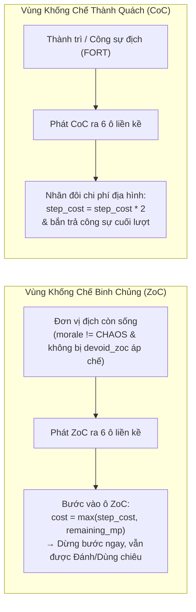

# Đặc Tả Hệ Thống Lưới Hex, 9 Loại Địa Hình, LOS & Vùng Kiểm Soát (`ZoC` / `CoC`)

[← Quay lại Mục lục GDD](../README.md)

---

> **Vị trí tài liệu:** `docs/gdd/mechanics/hex_grid_pathfinding.md`  
> **Nền tảng mục tiêu:** Godot 4.7 — Thuần GDScript 2.0 (Static Typing, số nguyên `int` cho MP) trên Web & Android  
> **Trạng thái:** Chuẩn hóa đồng bộ hệ tọa độ Pointy-topped Axial `(q, r)`, 9 loại địa hình, thuật toán A* `ZoC`/`CoC` và tầm nhìn `hex_linedraw` với [battlefield_rules.md](../02_gameplay_systems/battlefield_rules.md) và [game_modes.md](../02_gameplay_systems/game_modes.md).

---

## 1. Hệ Tọa độ Lưới Hex (Pointy-topped Axial & Offset `odd-r`)

Toàn bộ logic chiến thuật trong trận tính toán trên hệ trục **Pointy-topped Axial `(q, r)`** (với trục thứ ba ẩn `s = -q - r`), trong khi tệp bản đồ chữ nhật `width × height` và `TileMapLayer` của Godot lưu theo hệ **Offset `odd-r` `(col, row)`**:

* **Khoảng cách Cube / Hex (`hex_distance`) giữa 2 ô $A(q_1, r_1)$ và $B(q_2, r_2)$:**
  $$\text{hex\_distance}(A, B) = \frac{|q_1 - q_2| + |(q_1 + r_1) - (q_2 + r_2)| + |r_1 - r_2|}{2}$$
* **Sáu hướng lân cận chuẩn (theo chiều kim đồng hồ quanh tâm):**
  $$\Delta \text{Axial} = \big[(+1, 0),\ (+1, -1),\ (0, -1),\ (-1, 0),\ (-1, +1),\ (0, +1)\big]$$
  *(Hai hướng đối diện $180^\circ$ luôn có chỉ số `d` và `(d + 3) % 6` — dùng trực tiếp để xét hợp vây Pincer `TrappedLevel 2`).*
* **Công thức chuyển đổi hai chiều Offset `odd-r` `(col, row)` ↔ Axial `(q, r)`:**
  * Từ `odd-r (col, row)` sang `Axial (q, r)`:
    $$q = \text{col} - \left\lfloor \frac{\text{row} - (\text{row} \ \& \ 1)}{2} \right\rfloor, \quad r = \text{row}$$
  * Từ `Axial (q, r)` sang `odd-r (col, row)`:
    $$\text{col} = q + \left\lfloor \frac{r - (r \ \& \ 1)}{2} \right\rfloor, \quad \text{row} = r$$

---

## 2. Chín Loại Địa hình Chuẩn hóa & Cơ chế Địa hình Sở trường (`fond_terrain`)

Toàn bộ điểm di chuyển (`max_mp`, `current_mp`, `terrain_cost`) dùng **số nguyên `int`** để loại bỏ sai số dấu phẩy động. Ví dụ biên độ chuẩn: Bộ binh `6–8 MP`, Cung/Pháo `6 MP`, Kỵ binh `10–12 MP`, Thủy quân `8–10 MP`.

### Phân tách 2 lớp Hiệu ứng Địa hình
1. **Hiệu ứng Nội tại của Địa hình (Intrinsic Terrain Effect):** Tác dụng như nhau lên **mọi đơn vị** thuộc miền di chuyển tương ứng khi đi vào hoặc đứng trên ô đó (`terrain_cost`, `TerrainDefMult`, điều chỉnh công nội tại và quy tắc chặn LOS).
2. **Hiệu ứng Thưởng Địa hình Sở trường (`fond_terrain` Bonus):** Chỉ kích hoạt khi đơn vị hoặc tướng chỉ huy có thuộc tính `fond_terrain == terrain_type`:
   * **Thưởng Tác chiến:** **`+15% ATK/DEF`** (cộng `+0.15` vào `M_terrain` khi tấn công và cộng `+0.15` vào `TerrainDefMult` khi phòng thủ — xem [combat_formulas.md](combat_formulas.md)).
   * **Thưởng Cơ động:** Giảm **`-1 MP`** chi phí địa hình gốc của ô đó, giữ mức sàn tối thiểu **`1 MP`** (`maxi(1, base_cost - 1)`).

### Bảng Thông số Kỹ thuật 9 Loại Địa hình (`TerrainType`)

| Mã Enum | Loại Địa hình | MP Cơ bản (`int`)<br/>*(Bộ-Cung / Kỵ-Pháo / Thủy)* | `TerrainDefMult` Nội tại | Cản LOS? | Hiệu ứng Nội tại & Ghi chú Kịch bản |
| :--- | :--- | :---: | :---: | :---: | :--- |
| `0: PLAINS` | **1. Đồng bằng / Đất trống** | `2` / `2` / Cấm | `1.00` | Không | Mặt bằng chuẩn; thuận lợi dàn trận và xung kích. |
| `1: FOREST` | **2. Rừng rậm / Tre nứa** | `3` / `4` / Cấm | **`1.20`** (+20% DEF) | **Có*** | Che khuất đơn vị `is_invisible`; đơn vị có tag `ambush_forest` đánh từ Rừng không bị phản kích. |
| `2: HILLS` | **3. Đồi núi / Cao điểm** | `4` / `5` / Cấm | **`1.15`** (+15% DEF) | **Có** | Đơn vị tầm xa đứng trên `HILLS` được `+0.10` `M_terrain` (+10% ATK) và nhìn xuyên qua `FOREST`. |
| `3: SWAMP` | **4. Đầm lầy / Bãi bùn** | `4` / `6` / `4` (Thuyền nhẹ) | **`0.90`** (-10% DEF) | Không | Kỵ binh / Pháo đứng trên đầm lầy chịu `-0.15` `M_terrain` (-15% ATK); che khuất `is_invisible`. |
| `4: SHALLOW_RIVER` | **5. Sông cạn / Bờ sông** | `4` / `5` / `2` (Nhẹ) · `3` (Lớn) | `0.90` (Lục) / `1.00` (Thủy) | Không | Bến lội tự nhiên; lục quân đang lội nước giảm 10% Giáp. |
| `5: DEEP_WATER` | **6. Mặt nước sâu** | Cấm** / Cấm** / `2` | `1.00` (`0.80` vận tải) | Không | **Lục quân chỉ đi được khi đã lên thuyền vận tải tại Bến (`3 MP`, chịu `-0.20` `M_terrain`). |
| `6: FORT` | **7. Thành trì / Công sự** | `2` / `3` / Cấm | **`1.30`** (+30% DEF) | **Có*** | Phát vùng **`CoC`** ra 6 ô kề cạnh (`terrain_cost * 2`); đơn vị giữ thành có tầm nhìn cao điểm. |
| `7: ROAD_PORT` | **8. Đường cái / Bến thuyền** | `1` / `1` / `2` (tại Bến) | `1.00` | Không | Trục hành quân thần tốc `1 MP`; ô Bến thuyền cho phép chuyển đổi Lục quân ↔ Thuyền vận tải (`2 MP`). |
| `8: STAKED_WATER` | **9. Bãi cọc ngầm lộ diện** | Cấm / Cấm / `4` (Địch) · `2` (Ta) | **`0.85`** (-15% DEF) | Không | Xuất hiện qua sự kiện `MapPhase` (triều rút): tàu địch trên/bước vào cọc chịu `35% max_hp` sát thương xuyên giáp + `march_disabled_turns = 2`. |

*(\* `FOREST` và `FORT` chặn LOS của các đơn vị đứng ở địa hình thấp, không chặn tầm nhìn của người quan sát đang đứng trên `HILLS` hoặc `FORT`).*

---

## 3. Hệ thống Kiểm soát Không gian: `ZoC`, `CoC` & Quy tắc Rút lui



### 3.1. Vùng Khống chế Thành quách (`CoC` — Castle of Control)
* Mọi ô `FORT` thuộc phe địch phát vùng `CoC` ra 6 ô Hex kề cạnh.
* Khi đơn vị không có thuộc tính `ignore_coc` bước vào ô nằm trong `CoC` địch, chi phí MP của bước đó bị **nhân đôi: `step_cost = step_cost * 2`** (áp dụng thống nhất cả trong tài liệu thiết kế lẫn hàm định tuyến A*).
* Đơn vị địch kết thúc lượt đứng trong `CoC` chịu sát thương hỏa lực phòng thủ tự động từ thành lũy (nếu thành còn độ bền / đơn vị đồn trú).

### 3.2. Vùng Khống chế Binh chủng (`ZoC`) & Quy tắc Rút lui Đầu lượt
* **Điều kiện phát `ZoC`:** Một đơn vị địch tại ô `E` phát `ZoC` ra 6 ô kề cạnh khi và chỉ khi:
  1. Đơn vị `E` còn sống và `E.state.morale != MoraleLevel.CHAOS` (`chaos_turns == 0`).
  2. Không có bất kỳ đơn vị đồng minh nào của phe đang di chuyển mang thuộc tính **`devoid_zoc == true`** đứng kề cạnh `E` (`hex_distance <= 1`).
* **Bước vào ô `ZoC` trên đường đi A*:** Khi xét bước chuyển `from_hex → to_hex` mà `to_hex` nằm trong `ZoC` hoạt động của địch (và đơn vị đi không có `ignore_zoc`), chi phí bước đi là:
  $$\text{step\_cost} = \max\big(\text{step\_cost}, \ \text{remaining\_mp}\big)$$
  Trong đó **`remaining_mp = unit.current_mp - g_cost_so_far`** là lượng MP thực tế còn lại tại nút `from_hex` trên cây tìm đường A* (**tuyệt đối không dùng `unit.max_mp` đầu lượt**). Nếu `remaining_mp >= terrain_step_cost`, đơn vị bước vào được `to_hex` và tiêu sạch phần MP còn lại (`new_remaining_mp = 0`), buộc dừng tại đó.
* **Quy tắc Rút lui khi đầu lượt đã đứng sẵn trong `ZoC` (`Start-in-ZoC Withdrawal`):**
  * **Thoát ly ra vùng an toàn:** Nếu đầu lượt đơn vị đang đứng trong `ZoC` địch và bước thẳng sang một ô liền kề **không nằm trong bất kỳ `ZoC` địch nào** (`to_in_zoc == false`), bước đó chỉ tính `step_cost` bình thường — cho phép rút lui chiến thuật và tiếp tục di chuyển nếu còn MP.
  * **Chống trượt vòng quanh lưng địch (`ZoC-to-ZoC Pinning`):** Nếu đơn vị bước trực tiếp từ ô `ZoC` hiện tại sang **một ô `ZoC` khác** của địch (`to_in_zoc == true` và không có `ignore_zoc`), công thức `maxi(step_cost, remaining_mp)` lập tức tiêu hết toàn bộ MP còn lại, ghìm chân đơn vị ngay sau 1 ô dịch chuyển.

### 3.3. Bảng Thuộc tính Không gian Đặc biệt (`snake_case`)

| Thuộc tính JSON / GDScript | Kiểu | Tên tiếng Việt | Tác động Hình học & Định tuyến | Binh chủng / Vai trò tiêu biểu |
| :--- | :---: | :--- | :--- | :--- |
| **`ignore_zoc`** | `bool` | **Xuyên ZoC** | Bỏ qua hoàn toàn hiệu ứng dừng bước của `ZoC` quân địch; tự do luồn lách qua khe hở trận tuyến. | *Thám báo / Nội gián*, *Tản binh du kích*, *Khinh kỵ trinh sát*. |
| **`ignore_coc`** | `bool` | **Xuyên CoC** | Miễn phạt `step_cost * 2` khi áp sát thành trì/cửa quan của địch. | *Công binh phá lũy*, *Đội thang mây tiên phong*. |
| **`devoid_zoc`** | `bool` | **Phá ZoC** | Triệt tiêu khả năng phát `ZoC` của mọi đơn vị địch đứng sát cạnh (`hex_distance <= 1`), mở hành lang đột phá cho quân ta tràn lên. | *Tượng binh xung kích Đại Việt*, *Thiết kỵ phá trận*. |

---

## 4. Thuật toán Tầm nhìn (`LOS`) & Sương mù Chiến tranh (`Fog of War`)

### 4.1. Nội suy Đường ngắm `hex_linedraw`
Để kiểm tra tầm nhìn (phục vụ mở bản đồ, công kích tầm xa và **kiểm tra điều kiện phản kích `Retaliation`** tại [combat_formulas.md](combat_formulas.md)):
1. Chuyển tọa độ `A(q_1, r_1)` và `B(q_2, r_2)` sang không gian Cube thực `(x, y, z) = (q, -q - r, r)` rồi cộng độ lệch vi sai cố định `EPSILON = Vector3(1e-6, 2e-6, -3e-6)` nhằm khử hoàn toàn trường hợp tia ngắm đi trùng cạnh chung giữa 2 ô Hex.
2. Nội suy đều `N = hex_distance(A, B)` điểm dọc đoạn thẳng `A → B` và làm tròn `cube_round` để thu được dãy ô `line_hexes`.
3. Duyệt các ô **trung gian** `H` (bỏ qua 2 đầu mút `A` và `B`):
   * Nếu người quan sát tại `A` đứng ở địa hình thấp (`terrain(A) != HILLS` và `terrain(A) != FORT`): mọi ô trung gian `H` thuộc **`FOREST`, `HILLS` hoặc `FORT`** đều **chặn LOS**.
   * Nếu người quan sát tại `A` đứng trên cao điểm (`HILLS` hoặc `FORT`): nhìn vượt qua `FOREST` và đội hình quân; chỉ bị chặn nếu có một ô **`HILLS`** khác chắn ở giữa (trừ khi cả `A` và `B` cùng ở `HILLS`).

### 4.2. Ba Trạng thái Sương mù Chiến tranh (`FogState`)
* **`UNEXPLORED` (*Chưa khám phá*):** Phủ lớp mây mù sa bàn cổ; chưa thấy địa hình chi tiết và quân địch.
* **`SHROUDED` (*Khuất tầm nhìn hiện tại*):** Đã từng đi qua nên hiển thị rõ địa hình và công trình tĩnh, nhưng ẩn mọi biến động vị trí quân địch.
* **`VISIBLE` (*Đang quan sát trực tiếp*):** Nằm trong `vision_range` của ít nhất 1 đơn vị/công trình đồng minh có `has_line_of_sight == true`. *Lưu ý:* Đơn vị địch đang có `is_invisible == true` trong ô `FOREST` hoặc `SWAMP` vẫn ẩn mình ngay cả trong vùng `VISIBLE`, trừ khi có đơn vị ta áp sát ở cự ly **`hex_distance == 1`** hoặc khi đơn vị đó chủ động tấn công.

---

## 5. Tham chiếu Triển khai Định tuyến A* & LOS bằng GDScript 2.0 (Godot 4.7)

```gdscript
class_name HexGridNavigator
extends RefCounted

enum TerrainType {
	PLAINS = 0,
	FOREST = 1,
	HILLS = 2,
	SWAMP = 3,
	SHALLOW_RIVER = 4,
	DEEP_WATER = 5,
	FORT = 6,
	ROAD_PORT = 7,
	STAKED_WATER = 8,
}

enum FogState {
	UNEXPLORED = 0,
	SHROUDED = 1,
	VISIBLE = 2,
}

const IMPASSABLE_MP: int = 999999
const AXIAL_DIRECTIONS: Array[Vector2i] = [
	Vector2i(1, 0),
	Vector2i(1, -1),
	Vector2i(0, -1),
	Vector2i(-1, 0),
	Vector2i(-1, 1),
	Vector2i(0, 1),
]
const LOS_NUDGE: Vector3 = Vector3(0.000001, 0.000002, -0.000003)


static func odd_r_to_axial(offset: Vector2i) -> Vector2i:
	var parity: int = offset.y & 1
	@warning_ignore("integer_division")
	var q: int = offset.x - ((offset.y - parity) / 2)
	return Vector2i(q, offset.y)


static func axial_to_odd_r(axial: Vector2i) -> Vector2i:
	var parity: int = axial.y & 1
	@warning_ignore("integer_division")
	var col: int = axial.x + ((axial.y - parity) / 2)
	return Vector2i(col, axial.y)


static func hex_distance(a: Vector2i, b: Vector2i) -> int:
	var dq: int = absi(a.x - b.x)
	var dr: int = absi(a.y - b.y)
	var ds: int = absi((a.x + a.y) - (b.x + b.y))
	@warning_ignore("integer_division")
	return (dq + dr + ds) / 2


static func hex_linedraw(a: Vector2i, b: Vector2i) -> Array[Vector2i]:
	var n: int = hex_distance(a, b)
	if n == 0:
		return [a]

	var ac: Vector3 = Vector3(float(a.x), float(-a.x - a.y), float(a.y)) + LOS_NUDGE
	var bc: Vector3 = Vector3(float(b.x), float(-b.x - b.y), float(b.y)) + LOS_NUDGE
	var results: Array[Vector2i] = []

	for i: int in range(n + 1):
		var t: float = float(i) / float(n)
		results.append(_cube_round(ac.lerp(bc, t)))
	return results


static func _cube_round(frac: Vector3) -> Vector2i:
	var rx: float = roundf(frac.x)
	var ry: float = roundf(frac.y)
	var rz: float = roundf(frac.z)

	var x_diff: float = absf(rx - frac.x)
	var y_diff: float = absf(ry - frac.y)
	var z_diff: float = absf(rz - frac.z)

	if x_diff > y_diff and x_diff > z_diff:
		rx = -ry - rz
	elif y_diff > z_diff:
		ry = -rx - rz
	else:
		rz = -rx - ry
	return Vector2i(int(rx), int(rz))


func has_line_of_sight(map_state: BattleMapState, from_hex: Vector2i, to_hex: Vector2i) -> bool:
	var line: Array[Vector2i] = hex_linedraw(from_hex, to_hex)
	if line.size() <= 2:
		return true

	var from_terrain: TerrainType = map_state.get_terrain(from_hex)
	var to_terrain: TerrainType = map_state.get_terrain(to_hex)
	var observer_elevated: bool = (
		from_terrain == TerrainType.HILLS or from_terrain == TerrainType.FORT
	)
	var target_elevated: bool = (to_terrain == TerrainType.HILLS)

	for i: int in range(1, line.size() - 1):
		var mid_terrain: TerrainType = map_state.get_terrain(line[i])
		if observer_elevated:
			if mid_terrain == TerrainType.HILLS and not target_elevated:
				return false
		else:
			if (
				mid_terrain == TerrainType.FOREST
				or mid_terrain == TerrainType.HILLS
				or mid_terrain == TerrainType.FORT
			):
				return false
	return true


func is_in_active_enemy_zoc(
	map_state: BattleMapState,
	hex: Vector2i,
	mover_faction: int
) -> bool:
	for dir: Vector2i in AXIAL_DIRECTIONS:
		var adj: Vector2i = hex + dir
		if not map_state.is_valid_hex(adj):
			continue
		var occupant: BattleUnit = map_state.get_unit_at(adj)
		if occupant == null or not map_state.is_hostile(mover_faction, occupant.faction_id):
			continue
		if not occupant.state.emits_zoc():
			continue
		if _is_enemy_zoc_suppressed_by_devoid(map_state, adj, mover_faction):
			continue
		return true
	return false


func _is_enemy_zoc_suppressed_by_devoid(
	map_state: BattleMapState,
	enemy_hex: Vector2i,
	mover_faction: int
) -> bool:
	for dir: Vector2i in AXIAL_DIRECTIONS:
		var around: Vector2i = enemy_hex + dir
		if not map_state.is_valid_hex(around):
			continue
		var ally: BattleUnit = map_state.get_unit_at(around)
		if ally != null and map_state.is_allied(mover_faction, ally.faction_id):
			if ally.devoid_zoc and ally.state.morale != UnitCombatState.MoraleLevel.CHAOS:
				return true
	return false


func get_hex_step_cost(
	map_state: BattleMapState,
	_from_hex: Vector2i,
	to_hex: Vector2i,
	unit: BattleUnit,
	remaining_mp: int
) -> int:
	if remaining_mp <= 0 or not map_state.is_valid_hex(to_hex):
		return IMPASSABLE_MP

	# Không thể đi xuyên qua ô đang có địch chiếm đóng
	var occupant: BattleUnit = map_state.get_unit_at(to_hex)
	if occupant != null and map_state.is_hostile(unit.faction_id, occupant.faction_id):
		return IMPASSABLE_MP

	var to_terrain: TerrainType = map_state.get_terrain(to_hex)
	var step_cost: int = map_state.get_base_terrain_mp(to_terrain, unit)
	if step_cost >= IMPASSABLE_MP:
		return IMPASSABLE_MP

	# 1. Thưởng Địa hình Sở trường (-1 MP, tối thiểu còn 1 MP)
	if unit.fond_terrain == int(to_terrain):
		step_cost = maxi(1, step_cost - 1)

	# 2. Phạt Vùng Khống chế Thành quách (CoC: nhân 2 chi phí MP)
	if map_state.is_in_enemy_coc(to_hex, unit.faction_id) and not unit.ignore_coc:
		step_cost *= 2

	# 3. Xử lý Vùng Khống chế Binh chủng (ZoC: tính trên remaining_mp tại bước A* hiện tại)
	# Nếu rút từ trong ZoC ra ô ngoài ZoC -> to_in_zoc == false -> chỉ tốn step_cost bình thường.
	# Nếu từ ngoài bước vào ZoC, hoặc trượt từ ô ZoC này sang ô ZoC khác -> tiêu hết remaining_mp.
	if is_in_active_enemy_zoc(map_state, to_hex, unit.faction_id) and not unit.ignore_zoc:
		step_cost = maxi(step_cost, remaining_mp)

	return step_cost
```
