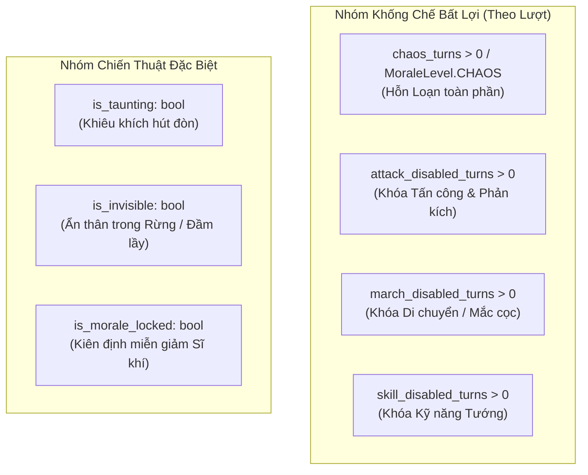
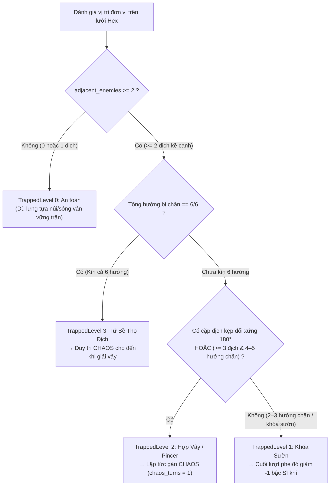

# Đặc Tả Hệ Thống Sĩ Khí, Bao Vây & Hiệu Ứng Trạng Thái

[← Quay lại Mục lục GDD](../README.md)

---

> **Vị trí tài liệu:** `docs/gdd/mechanics/morale_and_status.md`  
> **Nền tảng mục tiêu:** Godot 4.7 — Thuần GDScript 2.0 (Static Typing) cho Web & Android  
> **Trạng thái:** Chuẩn hóa đồng bộ 4 bậc Enum `MoraleLevel`, quy tắc dịch chuyển `±1 bậc`, bao vây `TrappedLevel 0..3` và 7 trạng thái khống chế với [core_loop.md](../02_gameplay_systems/core_loop.md), [battlefield_rules.md](../02_gameplay_systems/battlefield_rules.md) và [combat_formulas.md](combat_formulas.md).

---

## 1. Bốn Bậc Sĩ khí Rời rạc (`MoraleLevel` Enum)

Toàn bộ trò chơi sử dụng **4 bậc Enum rời rạc** thay cho điểm số `0–100`. Mọi tác động tâm lý trên chiến trường đều quy đổi thành bước dịch chuyển **`+1 bậc`** hoặc **`-1 bậc`** (hoặc gán thẳng `CHAOS` khi hợp vây):

```text
[HIGH: Hưng Phấn]  <======>  [NORMAL: Ổn Định]  <======>  [LOW: Dao Động]  <======>  [CHAOS: Hỗn Loạn]
 (+15% ATK, +20% Crit)        (Chuẩn 100% ATK/DEF)         (-25% ATK, -20% DEF,       (Khóa Di chuyển/Công/Kỹ năng/Phản kích,
                                                            -5% Crit)                  Mất ZoC, Nhận +30% sát thương)
```

| Bậc Enum (`MoraleLevel`) | Tên hiển thị | Hệ số Công (`M_morale`) | Hệ số Giáp (`MoraleDefMult`) | Hiệu chỉnh Crit | Khả năng Hành động & Không gian |
| :--- | :---: | :---: | :---: | :---: | :--- |
| **`MoraleLevel.HIGH`** | **Hưng Phấn** | **`1.15`** (+15%) | `1.00` (100%) | **`+20%`** | Di chuyển, tấn công, kỹ năng bình thường; phát `ZoC`. |
| **`MoraleLevel.NORMAL`** | **Ổn Định** *(Mặc định)* | **`1.00`** (100%) | `1.00` (100%) | `0%` | Trạng thái tiêu chuẩn đầu trận của các đơn vị. |
| **`MoraleLevel.LOW`** | **Dao Động** | **`0.75`** (-25%) | **`0.80`** (-20% Giáp) | **`-5%`** | Vẫn điều khiển được nhưng suy giảm mạnh cả công lẫn thủ. |
| **`MoraleLevel.CHAOS`** | **Hỗn Loạn** | **`0.00`** (Khóa đòn) | Nhận **`+30%`** sát thương (`M_target_chaos = 1.30`) | `0%` tuyệt đối | **Tê liệt toàn phần:** Khóa `can_move()`, `can_attack()`, `can_use_skill()`, `can_retaliate()` và **mất vùng `ZoC`**. |

---

## 2. Quy tắc Tăng, Giảm & Hồi phục Sĩ khí

### 2.1. Các nguồn Tăng Sĩ khí (`+1 bậc`, trần tối đa `HIGH`)
* **Kết liễu đơn vị địch:** Đơn vị tung đòn tiêu diệt hoàn toàn 1 đạo quân địch (`current_hp == 0`) được tăng ngay **`+1 bậc`** Sĩ khí.
* **Hạ gục Tướng chỉ huy địch:** Khi một đạo quân mang Tướng địch bị loại khỏi vòng chiến, toàn bộ đơn vị đồng minh của bên hạ gục trong **bán kính `2 hex`** quanh ô đó được tăng **`+1 bậc`** Sĩ khí.
* **Kỹ năng Khích lệ / Trống đồng / Mưu lược:** Kích hoạt kỹ năng tướng (`CastSkill` dạng *Khích Lệ*, *Trống Đồng Đông Sơn*) hoặc mưu lược phe (`ApplyTactic` như *Hịch Tướng Sĩ*) tăng `+1 bậc` Sĩ khí (các chiêu giải cứu chuyên biệt đồng thời xóa trạng thái `CHAOS` đưa đơn vị về `LOW` hoặc `NORMAL`).
* **Chiếm cứ điểm mục tiêu:** Đơn vị chiếm giữ thành công cứ điểm mục tiêu chính/phụ của kịch bản được thưởng `+1 bậc` Sĩ khí.

### 2.2. Các nguồn Giảm Sĩ khí (`-1 bậc`, miễn nhiễm nếu `is_morale_locked == true`)
* **Bị đánh Bọc sườn (`Flank`):** Mục tiêu bị tấn công khi bên công có ít nhất 1 đồng minh khác (còn sống, không bị `CHAOS`) đứng kề mục tiêu tại ô **không kề cạnh** với ô của bên công (hợp lệ ở cả góc kẹp chéo $120^\circ$ và góc đối diện $180^\circ$) → giảm ngay **`-1 bậc`**.
* **Trúng đòn Bạo kích (`Crit`):** Mục tiêu nhận đòn chí mạng → giảm ngay **`-1 bậc`**.
* **Tướng chỉ huy phe mình bị loại (`GeneralDefeatedShock — D-15`):** Khi một đạo quân mang Tướng chỉ huy bị loại khỏi vòng chiến, toàn bộ đơn vị cùng phe trong **bán kính `2 hex`** (hoặc **`3 hex`** nếu là Chủ soái `is_commander_in_chief == true`) lập tức giảm **`-1 bậc`** Sĩ khí.
* **Đồng minh sát cạnh tử trận (`NeighboringDeadMates`):** Khi một đơn vị thường bị tiêu diệt hoàn toàn, mọi đơn vị cùng phe trong **bán kính `1 hex`** quanh vị trí tử trận lập tức giảm **`-1 bậc`** Sĩ khí (`HIGH → NORMAL → LOW → CHAOS`), trừ khi đơn vị đó đang đứng sát cạnh (`1 hex`) một Danh tướng bậc Cam/Đỏ của phe mình còn sống.
* **Bị khóa sườn cuối lượt (`TrappedLevel 1`):** Tại Pha 6 `FactionTurnEnd`, đơn vị đang ở `TrappedLevel 1` bị giảm **`-1 bậc`** Sĩ khí.
* **Nạn đói đầu vòng (`Starvation` — phạm vi P3+):** Tại Pha 1 `OnBeginRound` khi `enable_economy == true` và `food < 0`, toàn bộ đơn vị của phe bị đói giảm **`-1 bậc`**, nhưng **chặn sàn tại `MoraleLevel.LOW`** (`HIGH → NORMAL → LOW`). **Nạn đói tuyệt đối không hạ Sĩ khí xuống `CHAOS`** nhằm tránh khóa cứng toàn bộ quân đội (chống soft-lock).

### 2.3. Chu trình Hồi phục từ `CHAOS`
* Khi rơi vào `CHAOS` (do tụt bậc từ `LOW` hoặc dính `TrappedLevel 2`), đơn vị nhận bộ đếm `chaos_turns = maxi(chaos_turns, 1)`.
* Tại Pha 6 **`FactionTurnEnd`** của chính phe sở hữu đơn vị đó:
  1. Hệ thống giảm `chaos_turns = maxi(0, chaos_turns - 1)`.
  2. Nếu `chaos_turns == 0` **và** đơn vị hiện **không** nằm trong thế vây kín `TrappedLevel 3`, Sĩ khí tự động hồi phục từ **`CHAOS → LOW`** (*Dao Động*), cho phép đơn vị hành động trở lại ở lượt kế tiếp.

---

## 3. Hệ thống 7 Thuộc tính Trạng thái & Khống chế (Status & CC Properties)

Toàn bộ cờ trạng thái sử dụng tên biến chuẩn GDScript / `Resource` (`snake_case`):



| Thuộc tính (`snake_case`) | Kiểu | Tên tiếng Việt | Tác động Gameplay | Nguồn kích hoạt tiêu biểu |
| :--- | :---: | :--- | :--- | :--- |
| `chaos_turns` | `int` | **Hỗn Loạn** | Đưa `morale = MoraleLevel.CHAOS`: khóa di chuyển, tấn công, kỹ năng, phản kích; mất `ZoC`; nhận `+30%` sát thương. | Hợp vây `TrappedLevel 2/3`, tụt bậc từ `LOW`, hỏa công kịch bản. |
| `attack_disabled_turns` | `int` | **Cấm Tấn Công** | Vẫn di chuyển được nhưng khóa `Attack` và khóa `Retaliation`. | Khói mù nghi binh, trúng tên độc chế áp. |
| `march_disabled_turns` | `int` | **Khóa Di Chuyển** | Bị ghìm chân tại chỗ (`can_move() == false`), nhưng vẫn tấn công và phản kích trong tầm được. | Mắc bãi cọc ngầm `STAKED_WATER` (`2` lượt), sa lầy đầm bùn, bẫy lưới. |
| `skill_disabled_turns` | `int` | **Khóa Kỹ Năng** | Khóa lệnh `CastSkill` của Tướng gắn trên đạo quân trong thời gian hiệu lực. | Đòn đột kích quấy rối của *Thám báo / Nội gián*. |
| `is_taunting` | `bool` | **Khiêu Khích** | Quân địch trong tầm đánh ưu tiên/buộc phải chọn đơn vị này làm mục tiêu công kích. | Kỹ năng chủ động của *Thiết Vệ Tiên Phong* hoặc *Tượng Binh*. |
| `is_invisible` | `bool` | **Ẩn Thân** | Khuất khỏi tầm nhìn xa của địch khi đứng ở `FOREST` / `SWAMP`; chỉ lộ diện khi địch đứng sát cạnh (`distance == 1`) hoặc khi tự phát động tấn công. | Đặc tính của *Tản binh du kích*, *Thám báo / Nội gián*. |
| `is_morale_locked` | `bool` | **Kiên Định** | Miễn nhiễm mọi hiệu ứng trừ bậc Sĩ khí và miễn nhiễm `CHAOS` từ bao vây/lan truyền tâm lý. | Hào quang chủ soái hoặc mưu lược *Hịch Tướng Sĩ*. |

---

## 4. Cơ chế Bao vây Đa cấp (`TrappedLevel 0..3`)

Để loại bỏ triệt để lỗi "tự hoảng loạn khi đứng tựa lưng vào núi/sông" và lỗi giao miền điều kiện, hệ thống `TrappedLevel` bắt buộc phải có **ít nhất 2 đơn vị địch kề cạnh (`adjacent_enemies >= 2`)** (chỉ tính địch còn sống và không ở trạng thái `CHAOS`):



### Quy tắc Phân cấp Chính xác:
* **Định nghĩa hướng bị chặn (`blocked_dirs` $\in [0, 6]$):** Một hướng lân cận `d` (`0..5`) được tính là bị chặn nếu ô Hex ở hướng đó nằm ngoài biên bản đồ, mang địa hình cấm đi đối với đơn vị đang xét, hoặc đang có đơn vị địch chiếm giữ.
* **`TrappedLevel 0` (*An toàn*):** `adjacent_enemies < 2` **hoặc** `blocked_dirs <= 1`.
* **`TrappedLevel 1` (*Khóa sườn*):** `adjacent_enemies >= 2` và tổng hướng bị chặn là **`2–3` hướng** (cũng bao hàm trường hợp chỉ có đúng `2` địch không đối xứng $180^\circ$ ép đơn vị dựa vào vách núi) → tại `FactionTurnEnd` của phe đó, đơn vị giảm **`-1 bậc`** Sĩ khí.
* **`TrappedLevel 2` (*Hợp vây / Pincer*):** Có **`>= 2` địch đứng kẹp đối xứng $180^\circ$** qua tâm đơn vị (tồn tại hướng `d` và `(d + 3) % 6` cùng có địch không bị `CHAOS`), **hoặc** có **`>= 3` địch kề cạnh với tổng `4–5` hướng bị chặn** → lập tức gán `MoraleLevel.CHAOS` (`chaos_turns = 1`) ngay tại Pha 5 `ImmediateResolutionAndVictoryCheck` (trừ khi có `is_morale_locked`).
* **`TrappedLevel 3` (*Tứ bề thọ địch*):** Có **`>= 2` địch kề cạnh** và **kín toàn bộ `6/6` hướng bị chặn** → gán và giữ nguyên `MoraleLevel.CHAOS` qua các lượt cho đến khi đồng minh đánh thủng vòng vây giải phóng ít nhất 1 hướng.

---

## 5. Cấu trúc Quản lý Trạng thái Chuẩn GDScript 2.0 (Godot 4.7)

```gdscript
class_name UnitCombatState
extends RefCounted

enum MoraleLevel {
	HIGH = 3,
	NORMAL = 2,
	LOW = 1,
	CHAOS = 0,
}

var morale: MoraleLevel = MoraleLevel.NORMAL
var is_morale_locked: bool = false

var chaos_turns: int = 0
var attack_disabled_turns: int = 0
var march_disabled_turns: int = 0
var skill_disabled_turns: int = 0

var is_taunting: bool = false
var is_invisible: bool = false
var has_retaliated_this_round: bool = false
var has_acted: bool = false


func can_move() -> bool:
	return morale != MoraleLevel.CHAOS and chaos_turns == 0 and march_disabled_turns == 0


func can_attack() -> bool:
	return morale != MoraleLevel.CHAOS and chaos_turns == 0 and attack_disabled_turns == 0


func can_use_skill() -> bool:
	return morale != MoraleLevel.CHAOS and chaos_turns == 0 and skill_disabled_turns == 0


func can_retaliate() -> bool:
	return can_attack() and not has_retaliated_this_round


func emits_zoc() -> bool:
	return morale != MoraleLevel.CHAOS and chaos_turns == 0


func shift_morale(delta: int, min_floor: MoraleLevel = MoraleLevel.CHAOS) -> void:
	if delta < 0 and is_morale_locked:
		return
	if morale == MoraleLevel.CHAOS and delta > 0:
		# Đang CHAOS chỉ được giải trừ qua clear_chaos() hoặc hết chaos_turns ở FactionTurnEnd
		return
	var next_val: int = clampi(int(morale) + delta, int(min_floor), int(MoraleLevel.HIGH))
	morale = next_val as MoraleLevel
	if morale == MoraleLevel.CHAOS:
		chaos_turns = maxi(chaos_turns, 1)


func apply_starvation_morale_penalty() -> void:
	# Nạn đói chỉ hạ tối đa xuống LOW, tuyệt đối không gây CHAOS để chống soft-lock
	if morale == MoraleLevel.CHAOS:
		return
	shift_morale(-1, MoraleLevel.LOW)


func apply_chaos(turns: int = 1) -> void:
	if is_morale_locked:
		return
	morale = MoraleLevel.CHAOS
	chaos_turns = maxi(chaos_turns, maxi(1, turns))


func clear_chaos(restore_to: MoraleLevel = MoraleLevel.LOW) -> void:
	chaos_turns = 0
	if morale == MoraleLevel.CHAOS:
		morale = restore_to


func on_faction_turn_start() -> void:
	has_acted = false
	has_retaliated_this_round = false


func on_faction_turn_end(current_trapped_level: int) -> void:
	if current_trapped_level == 1:
		shift_morale(-1)
	elif current_trapped_level >= 2:
		apply_chaos(1)

	if chaos_turns > 0 and current_trapped_level < 3:
		chaos_turns -= 1
		if chaos_turns == 0 and morale == MoraleLevel.CHAOS:
			morale = MoraleLevel.LOW

	if attack_disabled_turns > 0:
		attack_disabled_turns -= 1
	if march_disabled_turns > 0:
		march_disabled_turns -= 1
	if skill_disabled_turns > 0:
		skill_disabled_turns -= 1


static func evaluate_trapped_level(
	enemy_at_dir: Array[bool],
	impassable_at_dir: Array[bool]
) -> int:
	assert(enemy_at_dir.size() == 6 and impassable_at_dir.size() == 6)
	var adjacent_enemies: int = 0
	var blocked_dirs: int = 0

	for d: int in range(6):
		if enemy_at_dir[d]:
			adjacent_enemies += 1
			blocked_dirs += 1
		elif impassable_at_dir[d]:
			blocked_dirs += 1

	if adjacent_enemies < 2 or blocked_dirs <= 1:
		return 0

	if blocked_dirs == 6:
		return 3

	var has_pincer_180: bool = false
	for d: int in range(3):
		if enemy_at_dir[d] and enemy_at_dir[d + 3]:
			has_pincer_180 = true
			break

	if has_pincer_180 or (adjacent_enemies >= 3 and blocked_dirs >= 4):
		return 2

	return 1
```
