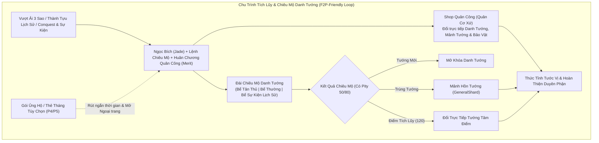
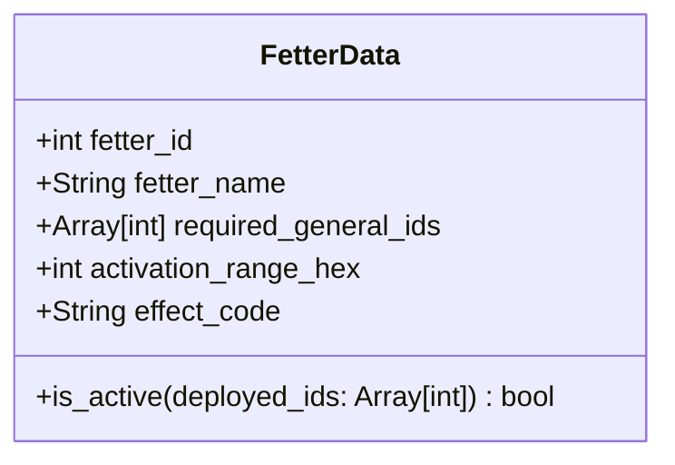

# Hệ Thống Tướng & Kinh Tế Meta (Generals & Meta-Progression)

[← Quay lại Mục lục GDD](../README.md)

---

> **Vị trí tài liệu:** `docs/gdd/progression/generals_and_meta_economy.md`  
> **Phạm vi áp dụng:** **P3 Alpha+** (dành cho chế độ *Domination*, *Conquest* và *Legion*), **ẩn trong Slice-01 Bạch Đằng 1288**.  
> **Trạng thái:** Chuẩn hóa theo quyết định thiết kế **`D-07` (F2P Thân thiện)** và đồng bộ 100% với [meta_progression.md](../02_gameplay_systems/meta_progression.md), [units_commanders.md](../02_gameplay_systems/units_commanders.md) và [combat_formulas.md](../mechanics/combat_formulas.md).

---

## 1. Tầm nhìn & Triết lý Thiết kế F2P Thân thiện (`D-07`)

> [!IMPORTANT]
> **Quy chuẩn Định hướng Thiết kế (`LOCKED — D-07`):**
> 1. **Thân thiện tuyệt đối với Người chơi Miễn phí (Fair F2P):** Mọi danh tướng ở tất cả các bậc phẩm (bao gồm cả bậc cao nhất **Đỏ — Thần Thoại**) đều có thể sở hữu hoàn toàn miễn phí thông qua việc tích lũy **`Ngọc Bích` (`Jade`)**, **`Lệnh Chiêu Mộ` (`RecruitOrder`)** và **`Huân Chương Quân Công` (`Merit`)** từ vượt ải 3 sao, thành tựu lịch sử, sự kiện theo mùa và **Shop Quân Công (Quân Cơ Xứ)**. Tuyệt đối không khóa bất kỳ danh tướng dân tộc nào sau tường phí tiền thật.
> 2. **Tôn trọng Lịch sử (`QualityTier` ≠ Phán xét Lịch sử):** Hệ thống 5 bậc màu (`Đỏ / Cam / Tím / Lam / Lục`) chỉ biểu thị **độ hiếm sưu tầm và độ phức tạp cơ chế bộ kỹ năng trong gameplay**, không phải sự so sánh hay phán xét công trạng lịch sử của các nhân vật. Danh sách tướng mẫu và tên bảo vật trong tài liệu là khung thiết kế để rà soát hồ sơ chứng cứ (`source_ref`) trước khi đưa vào bản chính thức.
> 3. **Bảo toàn Thử thách Chiến thuật Single-player:** Trò chơi là 100% Single-player; chế độ *Historical Scenario* khóa hồ sơ tướng lịch sử cố định, còn *Challenge Mode (Legion)* áp dụng trần cấp độ (`Level / Stat Cap`) để chiến thắng luôn đến từ tư duy điều binh.



---

## 2. Bảng Tiền tệ & Nguyên liệu Ngoại trận Chuẩn hóa

Khớp 100% với [meta_progression.md](../02_gameplay_systems/meta_progression.md):

| Tên Tiền tệ / Nguyên liệu | Mã Định danh | Nguồn thu thập chính trong Game | Công dụng cốt lõi |
| :--- | :---: | :--- | :--- |
| **Tiền Đồng** | `Coin` | Thưởng qua màn, nhiệm vụ hằng ngày, chế độ Conquest | Tăng `Level` tướng, rèn/cường hóa trang bị cơ bản, chiêu mộ Tỳ tướng. |
| **Ngọc Bích** *(kèm `Lệnh Chiêu Mộ`)* | `Jade` / `RecruitOrder` | Vượt ải 3 sao lần đầu, thành tựu lịch sử, sự kiện, nhiệm vụ tuần/tháng | Chiêu mộ tại mọi bể Đài Chiêu Mộ (kể cả Bể Sự Kiện bậc Đỏ) và đổi Lệnh Chiêu Mộ. |
| **Huân Chương Quân Công** | `Merit` | Đạt 3 sao chiến dịch, mục tiêu phụ, Conquest & Thử thách Legion | Phong `Quan Tước` (`Rank 1–30`), đổi trực tiếp Danh Tướng & Bảo vật tại **Shop Quân Công**. |
| **Binh Thư EXP** | `TomeExp` | Thao diễn võ học, thử thách Legion, phân giải mảnh dư | Cấp EXP lên cấp tướng và nâng bậc Kỹ năng chiến thuật chủ động/bị động. |
| **Mảnh Hồn Tướng** | `GeneralShard` | Thưởng mốc chiến dịch, Shop Quân Công, chiêu mộ trùng tướng | Ghép mở khóa danh tướng và thức tỉnh `Tước Vị` (`Title 1–6`). |

---

## 3. Bốn Trục Tiến Trình Danh Tướng (Four Progression Axes)

Mỗi danh tướng phát triển trên 4 trục độc lập, kết nối trực tiếp vào công thức sát thương tại [combat_formulas.md](../mechanics/combat_formulas.md):

| Trục Tiến trình | Miền Giá trị | Tài nguyên Tiêu hao | Tác động Cơ chế Chiến đấu | Cơ chế Cân bằng Single-player |
| :--- | :---: | :--- | :--- | :--- |
| **1. Cấp Độ (`level`)** | `1 .. 50` | EXP trận đánh hoặc `Binh Thư EXP` (`TomeExp`) | Tăng nhẹ chỉ số nền HP/ATK/DEF của đạo quân chỉ huy (`+1.0%` đến `+1.5%` mỗi cấp). | Bị giới hạn bởi trần cấp độ chương hiện tại và `Level Cap` trong *Challenge Mode*. |
| **2. Quan Tước (`rank`)** | `1 .. 30` | `Huân Chương Quân Công` (`Merit`) | Quyết định trực tiếp **`general_command_stat` (`1..30`)**, cộng `GenBonus = general_command_stat * 1` vào lực công nền. | Mở khóa tuần tự theo tiến độ chiến dịch; không vượt quá ngưỡng `30`. |
| **3. Tước Vị (`title`)** | `1 .. 6` *(Dũng Tướng → Vương)* | `Mảnh Hồn Tướng` (`GeneralShard`) & Ải Danh Tướng | Mở khóa các ô Kỹ năng bị động (tối đa 5 ô) và mở khóa ô Bảo vật thứ 5 (Binh thư). | Yêu cầu vượt qua bài kiểm tra chiến thuật lịch sử riêng của tướng đó. |
| **4. Khí Vận (`general_luck`)** | `0 .. 100` | Lễ vật Đền Miếu / Thành tựu Lịch sử | Cộng **`int(general_luck * 0.15)`** (`0%..15%`) vào `crit_rate` và giảm `30%` sát thương từ bẫy/công sự. | Khóa trần cứng tại `100` (tối đa `+15%` Crit). |

*(Song song với 4 trục trên, mỗi tướng sở hữu hồ sơ thông thạo 5 nhánh binh chủng `CommandProfile` bậc `S/A/B/C/D` nhân hệ số `M_command` từ `0.90` đến `1.25` — trong đó bậc `S` cộng `+25%`, bậc `A` cộng `+15%`, bậc `B` cộng `+8%` — cùng **Hào quang Chỉ huy (`CommandAura` `1–2 hex`)** giúp gia tăng sát thương/kháng sát thương và ổn định Sĩ khí cho đồng minh xung quanh. Xem [units_commanders.md](../02_gameplay_systems/units_commanders.md)).*

---

## 4. Hệ Thống Duyên Phận Lịch Sử (`FetterSystem`)

Hệ thống Duyên phận kích hoạt hiệu ứng cộng hưởng khi các danh tướng gắn bó trong lịch sử cùng xuất trận (sử dụng chuẩn Sĩ khí 4 bậc Enum `MoraleLevel` tại [morale_and_status.md](../mechanics/morale_and_status.md)):



### Bảng Duyên Phận Tiêu Biểu Đại Việt (Khung Thiết Kế Mẫu)

| Tên Duyên Phận | Danh Tướng Yêu Cầu | Phạm Vi Kích Hoạt | Hiệu Ứng Cơ Chế Chuẩn Hóa | Ý Nghĩa Bối Cảnh Lịch Sử |
| :--- | :--- | :---: | :--- | :--- |
| **Trần Triều Tam Kiệt** | Trần Quốc Tuấn, Trần Khánh Dư, Trần Quang Khải | Toàn bản đồ (khi cùng ra trận) | `+15%` `damage_deepen` cho nhánh `NAVAL`; các đạo quân thuộc duyên phận khởi đầu trận ở bậc **Hưng Phấn (`MoraleLevel.HIGH`)**. | Ba trụ cột quân sự lãnh đạo đại thắng chống Nguyên Mông thế kỷ XIII. |
| **Vua Tôi Đồng Lòng** | Trần Thánh Tông, Trần Nhân Tông, Trần Quốc Tuấn | Bán kính `<= 3 hex` | Giảm `-1` lượt thời hạn khống chế bất lợi (tối thiểu `0`); miễn nhiễm giảm Sĩ khí từ `TrappedLevel 1`. | Hào khí Hội nghị Bình Than và Hội nghị Diên Hồng. |
| **Hội Thề Lũng Nhai** | Lê Lợi, Nguyễn Trãi, Lê Lai, Trần Nguyên Hãn | Bán kính `<= 2 hex` | Giảm `20%` định mức `MealFood` tiêu thụ; đơn vị trong `FOREST` nhận hiệu ứng `is_invisible` đầu lượt. | Mười tám anh hào dựng cờ khởi nghĩa Lam Sơn gian khổ. |
| **Tây Sơn Tam Kiệt** | Nguyễn Nhạc, Nguyễn Huệ, Nguyễn Lữ | Toàn bản đồ | `+2 MP` (`max_mp`) cho toàn quân trong vòng đầu tiên; Kỵ binh & Tượng binh tăng `+15%` sát thương xung kích. | Nhịp hành quân thần tốc của nghĩa quân Tây Sơn thế kỷ XVIII. |
| **Hào Khí Mê Linh** | Trưng Trắc, Trưng Nhị, Lê Chân | Bán kính `<= 2 hex` | `+15%` `damage_resist` trước đòn tầm xa (`ARCHERY`); hồi `8% max_hp` đầu lượt khi không bị `Starvation`. | Cuộc khởi nghĩa Hai Bà Trưng thu phục 65 thành trì Lĩnh Nam. |
| **Kình Ngạc Bạch Đằng** *(Phe Đối phương)* | Thoát Hoan, Ô Mã Nhi, Trương Văn Hổ | Toàn bản đồ (khi cùng ra trận) | `+12%` `damage_deepen` cho nhánh `NAVAL` & `CAVALRY`; giảm `15%` sát thương nhận vào từ hỏa công ở vòng đầu. | Đại quân thủy – bộ Đại Nguyên trong chiến dịch năm 1287–1288. |
| **Phục Ba Thiết Kỵ** *(Phe Đối phương)* | Mã Viện, Lưu Long, Đoàn Chí | Bán kính `<= 2 hex` | `+15%` `damage_deepen` cho nhánh `CAVALRY` & `INFANTRY`; miễn phạt giảm tốc độ `MP` khi tiến qua `SWAMP` trong `2` vòng đầu. | Đạo quân viễn chinh Đông Hán do Phục Ba Tướng Quân Mã Viện thống lĩnh (năm 42–43). |

---

## 5. Năm Ô Trang Bị & Bảo Vật Chuẩn Niên Đại Đại Việt (`EquipmentSystem`)

Toàn bộ danh mục trang bị tuân thủ niên đại lịch sử – huyền sử Việt Nam từ thời dựng nước đến thế kỷ XVIII (loại bỏ hoàn toàn các cổ vật lệch niên đại thế kỷ XX):

```text
[Slot 1: Vũ Khí Cận Chiến] --- Thuận Thiên Kiếm, Gươm Thái A, Trường Đao Trần Triều
[Slot 2: Vũ Khí Tầm Xa]    --- Nỏ Liên Châu Kim Quy, Cung Thần Đại Việt, Hỏa Hổ Ống Đồng
[Slot 3: Hộ Giáp]          --- Khôi Giáp Thiết Lĩnh, Áo Bào Chiến Trận, Hộ Tâm Kính
[Slot 4: Thú Cưỡi]         --- Thớt Voi Chiến Tây Sơn, Bạch Mã Phiên Đao, Chiến Mã Thiết Giáp
[Slot 5: Binh Thư]         --- Binh Thư Yếu Lược, Hịch Tướng Sĩ, Quân Trung Từ Mệnh Tập
```

### Bảng Cơ Chế Thuộc Tính Bảo Vật Mẫu

| Ô Trang Bị | Tên Bảo Vật Mẫu | Bậc Phẩm | Chỉ Số Cộng Thêm (`snake_case`) | Hiệu Ứng Chiến Thuật Đặc Biệt |
| :--- | :--- | :---: | :--- | :--- |
| **1. Cận Chiến** | *Thuận Thiên Kiếm* | Sử Thi (Cam) | `base_atk +15`, `damage_deepen +12`, `crit_damage_bonus +20` | Khi mục tiêu có `hp_ratio >= 0.80`, tăng thêm `+15` `crit_rate_bonus`. |
| **2. Tầm Xa** | *Nỏ Liên Châu Kim Quy* | Sử Thi (Cam) | `base_atk +12`, `crit_rate_bonus +10` | Khi đứng trên `HILLS` hoặc `FORT`, tăng `+15%` sát thương phản kích tầm xa. |
| **3. Hộ Giáp** | *Khôi Giáp Thiết Lĩnh* | Danh Tướng (Tím) | `base_def +12`, `damage_resist +12` | Giảm thêm `15%` sát thương nhận vào từ `AttackMode` xung kích Kỵ/Tượng. |
| **4. Thú Cưỡi** | *Thớt Voi Chiến Tây Sơn* | Danh Tướng (Tím) | `base_hp +80`, `max_mp +1` | Ban thuộc tính `ignore_coc` khi tiếp cận công sự địch. |
| **5. Binh Thư** | *Binh Thư Yếu Lược* | Thần Thoại (Đỏ) | `general_command_stat +5`, `crit_rate_bonus +10` | Kích hoạt `is_morale_locked` trong `2` vòng đầu và miễn nhiễm rơi vào **`MoraleLevel.CHAOS`** từ `TrappedLevel 2` (giữ tối thiểu ở `MoraleLevel.LOW`). |

---

## 6. Hệ Thống Chiêu Mộ & Kênh Sở Hữu Minh Bạch (`Recruitment & Merit Shop`)

### 6.1. Năm Bậc Phẩm Gameplay (`QualityTier`) & Nguồn Sở Hữu F2P

| Bậc Phẩm (`QualityTier`) | Màu Nhận Diện | Kênh Sở Hữu Miễn Phí (F2P) & Đài Chiêu Mộ | Tỷ Lệ Rơi Bể Chuẩn | Tác Dụng Khi Trùng (`GeneralShard`) |
| :--- | :---: | :--- | :---: | :--- |
| **1. ĐỎ — THẦN THOẠI (`MYTHIC`)** | **Đỏ son** | Quay Bể Sự Kiện bằng **`Ngọc Bích` (`Jade`) / `Lệnh Chiêu Mộ`** tích lũy miễn phí + Ghép mảnh từ **Shop Quân Công** & Thành tựu Lịch sử | `1.5%` *(Bảo hiểm cứng 80 lượt)* | Quy đổi `50 GeneralShard`; thức tỉnh `Title` bậc 5–6 & mở khóa kỹ năng đặc trưng. |
| **2. CAM — SỬ THI (`LEGENDARY`)** | **Cam kim** | Đổi trực tiếp bằng **`Huân Chương Quân Công` (`Merit`)** tại Shop Quân Công + Bể Thường / Bể Tân Thủ | `4.0%` *(Bảo hiểm 50 lượt; Tân thủ 10 lượt)* | Quy đổi `30 GeneralShard`; nâng bậc kỹ năng chủ động. |
| **3. TÍM — DANH TƯỚNG (`EPIC`)** | **Tím đậm** | Đổi bằng `Merit` mức trung + Thưởng hoàn thành chương Chiến dịch + Đài Chiêu Mộ | `12.5%` | Quy đổi `20 GeneralShard`; mở ô bảo vật. |
| **4. LAM — DŨNG TƯỚNG (`RARE`)** | **Xanh lam** | Thưởng vượt ải cốt truyện + Đổi bằng `Merit` cơ bản + Đài Chiêu Mộ | `32.0%` | Quy đổi `10 GeneralShard`; kích hoạt Duyên phận phụ. |
| **5. LỤC — TỲ TƯỚNG (`COMMON`)** | **Xanh lục** | Tặng sẵn tân thủ + Chiêu mộ bằng **`Tiền Đồng` (`Coin`)** | `50.0%` | Quy đổi `5 GeneralShard` hoặc phân giải thành `Binh Thư EXP` (`TomeExp`). |

### 6.2. Ba Bể Chiêu Mộ & Cơ Chế Bảo Hiểm (`Pity & Sparking`)
1. **Bể Sự Kiện Lịch Sử (`pool_event` — Rate-Up Bậc Đỏ & Cam):**
   * Luân phiên theo chủ đề thời kỳ (ví dụ: *Hào Khí Đông A*, *Bình Ngô Đại Cáo*, *Thần Tốc Đống Đa*).
   * Chấp nhận hoàn toàn **`Ngọc Bích` (`Jade`)** và **`Lệnh Chiêu Mộ` (`RecruitOrder`)** kiếm được miễn phí từ quá trình chơi (vượt ải 3 sao, thành tựu, Conquest).
   * **Bảo hiểm cứng (`Hard Pity`):** Tối đa `80` lượt rút chắc chắn nhận Tướng bậc Đỏ của sự kiện; tích lũy đủ `120` điểm chiêu mộ được chọn đổi trực tiếp (`Spark`) tướng tâm điểm.
2. **Bể Chiêu Mộ Thường (`pool_standard`):**
   * Tặng **1 lượt rút miễn phí mỗi 24 giờ**; sử dụng `Lệnh Chiêu Mộ` hoặc `Ngọc Bích`. Bảo hiểm tối đa `50` lượt chắc chắn nhận Tướng bậc Cam.
3. **Bể Tân Thủ (`pool_beginner`):**
   * Giảm `20%` chi phí cho `10` lượt đầu tiên và đảm bảo chắc chắn nhận ít nhất **1 Danh Tướng bậc Cam** để người chơi khởi đầu thuận lợi.

### 6.3. Hệ Thống Danh Tướng Đối Phương Lịch Sử & Cơ Chế Chiêu Mộ (`Adversary Generals System`)

Để các trận đánh lịch sử thực sự kịch tính và mở rộng chiều sâu sưu tầm ở các chế độ tự do, toàn bộ **Tướng lĩnh Đối phương trong lịch sử** cũng được thiết kế đầy đủ **5 bậc phẩm (`Lục / Lam / Tím / Cam / Đỏ`)** với `CommandProfile`, `CommandAura`, `UniqueSkill` và `Fetters` hoàn chỉnh:

| Bậc Phẩm (`QualityTier`) | Vai Trò Trên Chiến Trường (Khi Là Địch) | Danh Tướng Đối Phương Tiêu Biểu (Qua Các *Era Pack*) | Điều Kiện Mở Khóa & Kênh Chiêu Mộ F2P |
| :--- | :--- | :--- | :--- |
| **1. ĐỎ — THẦN THOẠI (`MYTHIC`)** | **Đại Thống Soái / Boss Cuối Thời Kỳ:** Sở hữu `CommandProfile` bậc `S` (+25%), `CommandAura` `2 hex` (+10%) và kỹ năng độc quyền xoay chuyển cục diện. | • **Mã Viện** (*Phục Ba Tướng Quân* — Đông Hán, Era Hai Bà Trưng)<br/>• **Hốt Tất Liệt / Bá Nhan / Ngột Lương Hợp Thai** (Mông – Nguyên, Era Thời Trần)<br/>• **Trương Phụ** (*Anh Quốc Công* — Đại Minh, Era Hồ – Lam Sơn) | Vượt qua màn Boss lịch sử tương ứng để **mở khóa hồ sơ** (tặng mảnh khởi đầu) $\to$ Chiêu mộ qua **Bể Sự Kiện (`Ngọc Bích` / `Lệnh Chiêu Mộ`)** hoặc ghép mảnh tại **Shop Quân Công (`Merit`)**. |
| **2. CAM — SỬ THI (`LEGENDARY`)** | **Chủ Tướng Chiến Dịch Lớn:** Dẫn đầu các mũi tiến công chiến lược, có `CommandAura` `2 hex` (+8%) và kỹ năng chủ động nguy hiểm. | • **Cao Biền** (Nhà Đường)<br/>• **Lưu Hoằng Tháo** (Nam Hán — Bạch Đằng 938)<br/>• **Quách Quỳ** (Nhà Tống — Như Nguyệt 1077)<br/>• **Thoát Hoan, Ô Mã Nhi (Omar), Trương Văn Hổ** (Đại Nguyên — 1288)<br/>• **Vương Thông, Liễu Thăng** (Đại Minh — 1427)<br/>• **Tôn Sĩ Nghị** (Nhà Thanh — 1789) | Đánh bại trong Chiến dịch để mở khóa $\to$ Đổi trực tiếp bằng **`Huân Chương Quân Công` (`Merit`)** tại Shop Quân Công hoặc rút tại Đài Chiêu Mộ. |
| **3. TÍM — DANH TƯỚNG (`EPIC`)**<br/>& **4. LAM (`RARE`)** | **Phó Tướng / Đô Đốc Cánh Quân:** Trấn giữ cứ điểm, chỉ huy cánh quân tiên phong hoặc hậu cần. | • **Lưu Long, Đoàn Chí** (Đông Hán)<br/>• **Triệu Tiết** (Nhà Tống)<br/>• **Phàn Tiếp, Tích Lệ Cơ Ngọc, Lưu Lưu** (Đại Nguyên)<br/>• **Mộc Thạnh, Hoàng Phúc, Phương Chính** (Đại Minh)<br/>• **Sầm Nghi Đống, Hứa Thế Hanh** (Nhà Thanh) | Thưởng mảnh khi đạt 3 sao màn chơi tương ứng + Đổi bằng `Merit` tại Shop Quân Công + Đài Chiêu Mộ. |

### 6.4. Định hướng Gói Ủng Hộ Tùy Chọn (Optional IAP — Phạm vi P4/P5)
Nếu triển khai thương mại hóa ở giai đoạn phát hành mở rộng (P4/P5), cửa hàng chỉ bao gồm các gói tiện ích minh bạch:
* **Thẻ Nguyệt Bổng (`Monthly Pass`) & Chiến Lệnh Đại Việt (`Season Pass`):** Cung cấp thêm `Ngọc Bích` (`Jade`), `Binh Thư EXP` (`TomeExp`) mỗi ngày và **Trang phục / Khung cờ hiệu lịch sử thuần thẩm mỹ (Cosmetics)**, không cộng chỉ số độc quyền.
* **Shop Quân Công (`Quân Cơ Xứ` — 100% In-game `Merit`):** Luôn mở miễn phí để người chơi dùng `Huân Chương Quân Công` (`Merit`) đổi thẳng Danh Tướng (cả Đại Việt lẫn Đối phương đã mở khóa), Mảnh Hồn Tướng bậc Cam/Đỏ và Bảo vật chuẩn niên đại.

---

## 7. Nguyên Tắc Bảo Vệ Cân Bằng Chiến Thuật & Phân Tách Chế Độ (Single-Player Safeguards)

1. **Historical Scenario — Khóa Hồ Sơ Chuẩn Lịch Sử Ở Lần Vượt Ải Chính Sử (`Fixed Historical Roster — D-02`):**
   * Toàn bộ các màn chiến dịch lịch sử chính tuyến (như Slice-01 Bạch Đằng 1288) cấp sẵn lực lượng và danh tướng đúng biên chế kịch bản với chỉ số cố định đã kiểm thử cân bằng. Người chơi không mang chỉ số cày cuốc bên ngoài hay dùng Tướng đối phương vào làm sai lệch mạch lịch sử chính tuyến.
2. **Mở Rộng Tự Do Ở Conquest, Legion, Domination & Chơi Lại Tự Do (`Free Replay / What-If Mode`):**
   * Sau khi đã hoàn thành màn chơi ở chế độ Lịch sử chuẩn, hoặc khi tham gia các chế độ **Conquest (Chinh phạt)**, **Legion (Thử thách)** và **Domination (Tổng hành dinh)**, người chơi được **toàn quyền điều động mọi Danh tướng Đại Việt và Danh tướng Đối phương (Tím / Cam / Đỏ như Mã Viện, Bá Nhan, Ô Mã Nhi...)** đã chiêu mộ vào đội hình để xây dựng thế trận tự do.
3. **Challenge Mode / Legion — Giới Hạn Cấp Trần (`Stage Stat / Level Cap`):**
   * Trong các ải thử thách cho phép tự chọn đội hình tướng từ Tổng hành dinh (*Domination*), mỗi ải quy định rõ trần `max_allowed_level` và `max_allowed_rank`. Mọi tướng vượt trần được tự động điều chỉnh tạm thời về đúng ngưỡng trần của ải trong suốt trận đấu, đảm bảo chiến thắng luôn thuộc về người đọc địa hình, tận dụng `ZoC`/`Flank` và quản lý Sĩ khí xuất sắc nhất.
