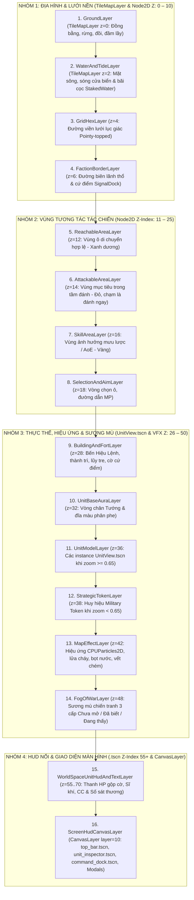
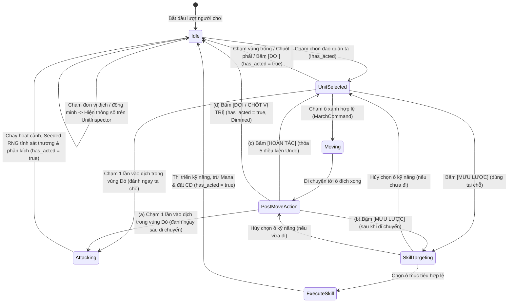

# ĐẶC TẢ GIAO DIỆN CHIẾN TRƯỜNG, ĐỒ HỌA & KẾT XUẤT (UI/UX & RENDERING)
## DỰ ÁN: ĐẠI VIỆT CHIẾN KỲ (VIETNAM HISTORY STRATEGY)
### MODULE: BATTLE UI/UX, 16-LAYER RENDERING PIPELINE, INPUT FSM & CAMERA
*(Chuẩn hóa cho Godot 4.7 — Thuần Typed GDScript 2.0, `gl_compatibility`, Web & Android 60 FPS)*

> **Vị trí tài liệu:** `docs/gdd/ui_ux/battle_ui_and_rendering.md`  
> **Trạng thái:** Thiết kế thuần **Typed GDScript 2.0** cho Godot 4.7 (`gl_compatibility`) theo chuẩn **Editor-First (`DEC-021..DEC-026`)**: Scene dựng trực quan trong View 2D (`battle.tscn`, `battle_map.tscn` dùng `TileMapLayer`, `unit_view.tscn` ghép Component như `HexCrown`), **HUD tách thành các Scene `.tscn` riêng + `theme.tres` (`<= 400 dòng/script`)**, loại bỏ hoàn toàn `CombatPreviewBox` / xác nhận đánh 2 bước (`AimingTarget`) thay bằng **`UnitInspector` + đánh ngay 1 chạm**, và `BattleCameraController` dùng nội suy độc lập FPS kèm `Trauma Shake` tách biệt RNG.

---

## 1. Kiến trúc Scene Chiến trường & Kết xuất Bản đồ Phân lớp (`TileMapLayer` + `UnitView.tscn`)

Thay vì vẽ bản đồ bằng đa giác bệt `_draw()` hoặc sinh toàn bộ cây UI bằng `Node.new()` lúc chạy game, toàn bộ không gian chiến trường được tổ chức thành cây **Scene `.tscn` mở và chỉnh được trực tiếp trong View 2D của Godot Editor**, phân tách 16 lớp kết xuất chuẩn (15 lớp không gian bản đồ `Node2D` theo `z_index` cố định và 1 lớp giao diện màn hình `CanvasLayer`):

- **`res://game/battle/battle.tscn`**: Scene gốc của một trận đánh, gắn `BattleSession`, `BattleCameraController`, `BattleMap` và `BattleHud`.
- **`res://game/battle/map/battle_map.tscn` (`TileMapLayer`)**: Sử dụng **`TileMapLayer`** của Godot 4.7 với bộ `TileSet` địa hình thật (kết hợp `stage_<id>_map.tscn` và script `@tool` hiển thị ngay sông ngòi, rừng núi, thành trì, bãi cọc trên View 2D trong Editor).
- **`res://game/battle/units/unit_view.tscn` (Prefab ghép Component như `HexCrown`)**: Mỗi đạo quân là một instance của Scene `unit_view.tscn` gồm `Sprite2D` (sprite hoạt ảnh + `FactionTint.gdshader`), `AnimationPlayer` (`idle/move/attack/hit/death`), `UnitAnimatorComponent`, `HealthBarComponent` (thanh máu chia nấc theo `troop_stack`), `StatusBadgeComponent` (sĩ khí & CC).



### Ba Nấc Zoom & Ngưỡng Cắt Tự Động `StrategicTokenLayer` (60 FPS trên Web & Android):
* **3 nấc phóng đại chuẩn:**
  * `1.2x` — *Tactical Zoom* (Cận cảnh chi tiết tiểu đội giao chiến).
  * `1.0x` — *Default Zoom* (Khung nhìn tác chiến chuẩn 10–12 hex).
  * `0.5x` — *Strategic Zoom* (Toàn cảnh sa bàn chiến dịch).
* **Ngưỡng chuyển đổi LOD tự động (`zoom < 0.65`):**
  * Khi `zoom >= 0.65`: Bật `UnitModelLayer.visible = true` và ẩn `StrategicTokenLayer.visible = false`.
  * Khi `zoom < 0.65`: Tự động ẩn `UnitModelLayer.visible = false` và bật **`StrategicTokenLayer.visible = true`** (hiển thị huy hiệu quân sự tối giản kèm màu phe & nhánh binh chủng). Cơ chế này cắt giảm hơn 80% Draw Calls trên `gl_compatibility`, giữ vững 60 FPS ổn định.

---

## 2. Máy Trạng thái Tương tác Đầu vào (`BattleInputFSM` — 7 Trạng thái Khép kín, Đánh Ngay 1 Chạm)

Theo quyết định **`DEC-026`**, hệ thống **bỏ hoàn toàn trạng thái `AimingTarget` và hộp dự báo sát thương `CombatPreviewBox`**. Quản lý toàn bộ thao tác chuột và cảm ứng qua **7 trạng thái rõ ràng**, kết hợp **`UnitInspector`** (hiển thị thông số thô của đạo quân) và **tấn công trực tiếp 1 chạm như `HexCrown`**:



### Quy trình 4 lựa chọn tại `PostMoveAction` & Cơ chế `UnitInspector` + Đánh Ngay 1 Chạm:
1. **Xem thông số trên `UnitInspector` (Không tính trước sát thương):**
   * Khi người chơi chạm vào bất kỳ đạo quân nào ở trạng thái `Idle` (hoặc click chuột phải / chạm vào quân địch ngoài vùng tấn công Đỏ), bảng **`UnitInspector`** (`res://ui/battle_hud/unit_inspector.tscn`) chỉ hiển thị **thông số bản thân đạo quân đó**: Tên tướng & binh chủng, HP & số cờ (`1x–3x`), Công (`base_atk` & kiểu công), Thủ (`base_def` & loại giáp), Tầm đi / Tầm đánh, Bậc Sĩ khí, và hiệu ứng Địa hình ô đang đứng.
   * **Tuyệt đối không tính toán hay hiển thị trước** khoảng sát thương dự kiến `[Min, Max]`, tỷ lệ Crit đối đầu hay sát thương phản kích dự kiến — người chơi tự đọc thông số hai bên để cân nhắc chiến thuật.
2. **Nhánh (a) — Tấn công Trực tiếp 1 Chạm (`UnitSelected` hoặc `PostMoveAction -> Attacking -> Idle`):**
   * *Chạm/Click 1 lần vào ô địch đang sáng Đỏ (`AttackableAreaLayer`):* Lập tức chuyển sang `Attacking`, thực thi `AttackCommand`, hệ thống tính công thức và tung số ngẫu nhiên (`Seeded RNG`), hiển thị số sát thương thực tế nảy lên (`FloatingDamageText`), đặt `unit.has_acted = true` rồi về `Idle`.
3. **Nhánh (b) — Thi triển Kỹ năng/Mưu lược (`PostMoveAction -> SkillTargeting -> ExecuteSkill -> Idle`):**
   * Bấm `[MƯU LƯỢC]` để chọn ô tác động, thực thi `CastSkillCommand`, đặt `unit.has_acted = true` rồi về `Idle`.
4. **Nhánh (c) — Hoàn tác Di chuyển (`PostMoveAction -> UnitSelected`):**
   * Bấm `[HOÀN TÁC]` (chỉ sáng nút khi `march_cmd.can_undo(ctx) == true` thỏa đủ 5 điều kiện tại GDD §11.4): trả quân về `from_hex`, hoàn lại MP, đánh dấu `unit.has_used_undo_this_turn = true` và quay về `UnitSelected`.
5. **Nhánh (d) — Chốt vị trí / Đợi (`PostMoveAction -> Idle`):**
   * Bấm nút `[ĐỢI]` (hoặc chạm xác nhận lần nữa lên chính ô đang đứng): gửi `WaitCommand`, đánh dấu `unit.has_acted = true`, chuyển màu quân sang trạng thái nghỉ (`Dimmed`) và trở về `Idle`.

---

## 3. Bố cục Giao diện Trận đánh (`res://ui/battle_hud/*.tscn` & `theme.tres`)

Tuân thủ triết lý **Map-First** (dành trọn $\ge 80\%$ diện tích màn hình cho sa bàn chiến thuật) và nguyên tắc **Editor-First**: toàn bộ HUD và Modal được dựng bằng các **Scene `.tscn` độc lập** dùng chung **`res://ui/common/theme.tres`** (mỗi script gắn kèm `<= 400` dòng, không sinh node hàng loạt trong `_ready()`). Ở **Slice-01 Bạch Đằng 1288 (`enable_economy = false`)**, cụm tài nguyên `Coin / Food / Tech` trên Top Bar tự động ẩn đi:

```text
┌──────────────────────────────────────────────────────────────────────────────┐
│ [PAUSE]  VÒNG: 03/10  │ PHE: ĐẠI VIỆT │ 🔮 120 │ MỤC TIÊU: Giữ Bến (2,8) & Hạ Ô Mã Nhi │
├──────────────────────────────────────────────────────────────────────────────┤
│ ┌──────────────────────┐                                                     │
│ │ UNIT INSPECTOR       │        [ SA BÀN CHIẾN TRƯỜNG 12×10 HEX ]             │
│ │ Ô Mã Nhi - Lâu Thuyền│         (Ô địch trong tầm sáng Đỏ ->                │
│ │ HP: 520/520 (3x cờ)  │          Chạm 1 lần để ĐÁNH NGAY!)                  │
│ │ Công: 46 | Thủ: 18   │                                                     │
│ │ Đi: 8 | Tầm: 1-2     │                                                     │
│ │ Sĩ khí: Ổn định      │                                                     │
│ └──────────────────────┘                                                     │
├──────────────────────────────────────────────────────────────────────────────┤
│ [AVATAR] TƯỚNG: Trần Khánh Dư      [MƯU LƯỢC]  [HOÀN TÁC]  [ĐỢI]             │
│ [HÌNH QUÂN] Thủy Quân Đại Việt      (Mana/CD)   (Undo 1x)  (Wait)            │
│ HP: 320/320 | Công: 36 | Thủ: 12    ──────────────────────────────────────── │
│ Địa hình: Mặt nước (+15% Công)             [ KẾT THÚC LƯỢT / END TURN 🔔 ]   │
└──────────────────────────────────────────────────────────────────────────────┘
```

### Quy chuẩn Thành phần HUD & Modal An toàn (Không Cắt Nút):
1. **Top Status Bar (`res://ui/battle_hud/top_bar.tscn`):**
   * Khi `enable_economy == false` (Slice-01): Hiển thị `[PAUSE]`, `VÒNG: 03/10`, Phe hiện tại, `🔮 Mana` và Mục tiêu chính.
   * Khi `enable_economy == true` (các màn hậu cần): Tự động hiện thêm `🪙 Tiền (Coin)`, `🌾 Lương thảo (Food)` và `⚙️ Kỹ nghệ (Tech)`.
2. **`UnitInspector` (`res://ui/battle_hud/unit_inspector.tscn`):**
   * Chỉ hiển thị thông số thô của 1 đạo quân đang được xem (quân ta hoặc quân địch ngoài tầm / chuột phải), tuyệt đối không hiển thị phép tính dự báo giao tranh.
3. **Bottom Command Dock (`res://ui/battle_hud/command_dock.tscn`):**
   * Bên trái: Thẻ tóm tắt đạo quân đang chọn. Bên phải: Cụm nút thao tác `[MƯU LƯỢC]`, `[HOÀN TÁC]`, `[ĐỢI]` và `[KẾT THÚC LƯỢT]`.
4. **Quy tắc Modal An toàn (`res://ui/common/modal_frame.tscn` — Áp dụng cho Briefing, Dialogue, Pause, Result Summary):**
   * Mọi modal bắt buộc dùng cấu trúc `PanelContainer > MarginContainer > VBoxContainer`, nội dung văn bản dài nằm trong `ScrollContainer`, và hàng nút hành động chính (`ButtonRow`: `BẮT ĐẦU` / `BỎ QUA` / `TIẾP TỤC` / `ĐÓNG`) **luôn nằm ngoài `ScrollContainer` ở chân modal, luôn nhìn thấy được**.
   * **Cấm tuyệt đối** đặt cứng `size` cố định kèm `clip_contents = true` làm cắt nội dung hoặc cắt nút, và **cấm** tự viết logic xác định hit-test nút trong `_input()` — phải dùng hệ thống GUI chuẩn của Godot và kiểm chứng bằng `assert_button_reachable()`.
5. **Overhead Unit HUD (`WorldSpaceUnitHudAndTextLayer` / `unit_view.tscn`):**
   * Thanh máu chia vạch theo số cờ gộp (`troop_stack`: 1, 2, 3 cờ), biểu tượng 4 bậc Sĩ khí và huy hiệu khống chế (`InChaos`, `MarchDisabled`, `AttackDisabled`).

---

## 4. Hệ thống Điều hướng Camera & Rung Chấn (`BattleCameraController`)

1. **Nội suy Mượt Độc lập FPS (`Exponential Smoothing`):**
   * Thay vì dùng `lerp(pos, target, delta * speed)` bị phụ thuộc tốc độ khung hình (lệch tốc độ giữa màn hình 30Hz, 60Hz và 120Hz), camera bắt buộc dùng hệ số hàm mũ chuẩn `alpha = 1.0 - exp(-smooth_speed * delta)`.
2. **Kẹp Biên Bản Đồ theo Zoom (`Zoom-Aware Viewport Clamping`):**
   * Tâm camera `_focus_position` được giới hạn trong khung `[map_rect.position + half_view, map_rect.end - half_view]` với `half_view = viewport_size * 0.5 / zoom_level` (trường hợp bản đồ nhỏ hơn khung nhìn trên một trục thì tự động căn giữa trục đó) để không bao giờ lộ khoảng đen ngoài rìa bản đồ.
3. **Rung Chấn Phi Tuyến (`Trauma-based Shake`) Tách Biệt RNG:**
   * Độ rung tính bằng bình phương chấn thương `shake = trauma * trauma * shake_user_scale` và ghi riêng vào thuộc tính `Camera2D.offset` (không ghi đè vào `global_position` để tránh xung đột với thuật toán pan mượt).
   * Bắt buộc dùng bộ sinh số ngẫu nhiên cục bộ **`_fx_rng: RandomNumberGenerator`** của riêng Camera — **tuyệt đối không gọi vào `rng` của Simulation**, đảm bảo người chơi bật/tắt rung màn hình cũng không làm sai lệch bất kỳ kết quả chiến đấu hay Replay nào!

---

## 5. Mã Nguồn Triển khai Mẫu — `BattleCameraController` (Typed GDScript 2.0)

```gdscript
class_name BattleCameraController
extends Camera2D

signal strategic_lod_changed(use_strategic_tokens: bool)

const ZOOM_TACTICAL: float = 1.2
const ZOOM_DEFAULT: float = 1.0
const ZOOM_STRATEGIC: float = 0.5
const STRATEGIC_TOKEN_THRESHOLD: float = 0.65

@export_group("Navigation & Bounds")
@export var smooth_speed: float = 10.0
@export var zoom_smooth_speed: float = 12.0
@export var map_world_bounds: Rect2 = Rect2(0.0, 0.0, 1920.0, 1400.0)

@export_group("Trauma Screen Shake")
@export var trauma_decay: float = 1.2
@export var max_shake_offset: Vector2 = Vector2(14.0, 10.0)
@export_range(0.0, 1.0, 0.05) var shake_user_scale: float = 1.0

var camera_locked: bool = false

var _focus_position: Vector2 = Vector2.ZERO
var _target_position: Vector2 = Vector2.ZERO
var _target_zoom: float = ZOOM_DEFAULT
var _current_zoom: float = ZOOM_DEFAULT
var _is_strategic_mode: bool = false
var _trauma: float = 0.0

# RNG riêng cho hiệu ứng hình ảnh UI — tuyệt đối tách rời khỏi RNG mô phỏng trận đánh!
var _fx_rng := RandomNumberGenerator.new()


func _ready() -> void:
	_fx_rng.randomize()
	_focus_position = global_position
	_target_position = global_position
	zoom = Vector2(_current_zoom, _current_zoom)


func _process(delta: float) -> void:
	# 1. Nội suy Zoom độc lập FPS & phát tín hiệu chuyển đổi StrategicTokenLayer (< 0.65)
	var zoom_t: float = 1.0 - exp(-zoom_smooth_speed * delta)
	_current_zoom = lerpf(_current_zoom, _target_zoom, zoom_t)
	zoom = Vector2(_current_zoom, _current_zoom)

	var should_use_tokens: bool = _current_zoom < STRATEGIC_TOKEN_THRESHOLD
	if should_use_tokens != _is_strategic_mode:
		_is_strategic_mode = should_use_tokens
		strategic_lod_changed.emit(_is_strategic_mode)

	# 2. Nội suy vị trí tâm nhìn độc lập FPS & kẹp biên bản đồ theo tỷ lệ Zoom
	_target_position = _clamp_to_map_bounds(_target_position)
	var move_t: float = 1.0 - exp(-smooth_speed * delta)
	_focus_position = _focus_position.lerp(_target_position, move_t)
	global_position = _clamp_to_map_bounds(_focus_position)

	# 3. Trauma-based Screen Shake phi tuyến (trauma^2) theo thời gian thực
	if _trauma > 0.0:
		var real_dt: float = delta / maxf(Engine.time_scale, 0.0001)
		_trauma = maxf(_trauma - trauma_decay * real_dt, 0.0)
		var shake: float = _trauma * _trauma * shake_user_scale
		offset = Vector2(
			_fx_rng.randf_range(-1.0, 1.0) * max_shake_offset.x * shake,
			_fx_rng.randf_range(-1.0, 1.0) * max_shake_offset.y * shake
		)
	elif offset != Vector2.ZERO:
		offset = Vector2.ZERO


## Cộng dồn chấn thương va chạm (Small: 0.15, Medium: 0.40, Large/Crit: 0.80).
func add_trauma(amount: float) -> void:
	_trauma = clampf(_trauma + amount, 0.0, 1.0)


## Lia camera mượt tới tâm ô Hex mục tiêu.
func pan_to_world_pos(world_pos: Vector2, instant: bool = false) -> void:
	_target_position = _clamp_to_map_bounds(world_pos)
	if instant:
		_focus_position = _target_position
		global_position = _focus_position


## Đặt mức phóng đại trong giới hạn [0.5x, 1.2x].
func set_zoom_level(new_zoom: float) -> void:
	_target_zoom = clampf(new_zoom, ZOOM_STRATEGIC, ZOOM_TACTICAL)


func _clamp_to_map_bounds(pos: Vector2) -> Vector2:
	var half_view: Vector2 = (get_viewport_rect().size * 0.5) / maxf(_current_zoom, 0.1)
	var clamped := pos

	if map_world_bounds.size.x <= half_view.x * 2.0:
		clamped.x = map_world_bounds.get_center().x
	else:
		clamped.x = clampf(
			pos.x,
			map_world_bounds.position.x + half_view.x,
			map_world_bounds.end.x - half_view.x
		)

	if map_world_bounds.size.y <= half_view.y * 2.0:
		clamped.y = map_world_bounds.get_center().y
	else:
		clamped.y = clampf(
			pos.y,
			map_world_bounds.position.y + half_view.y,
			map_world_bounds.end.y - half_view.y
		)

	return clamped
```
