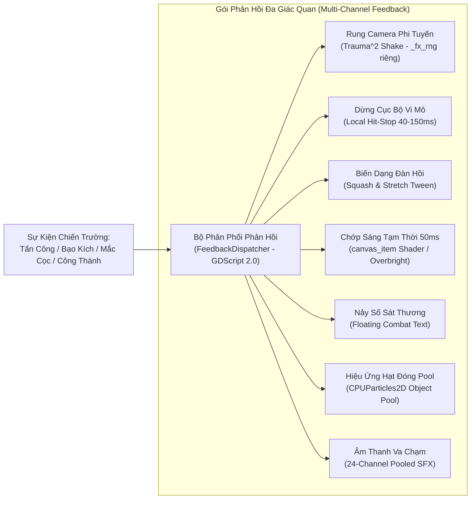

# 13. Hệ Thống VFX, SFX & Đánh Bóng Phản Hồi (Audio/Visual FX & Polish)

[← Quay lại Mục lục GDD](../README.md)

---

## 1. Tầm Nhìn & Triết Lý "Game Feel" (Juice & Polish Philosophy)

Một tựa game chiến thuật theo lượt (turn-based wargame) dễ rơi vào cảm giác khô cứng nếu thiếu lớp **Phản hồi xúc giác (Juice / Game Feel)**. Được chuẩn hóa cho **Godot 4.7 (`gl_compatibility`, Thuần Typed GDScript 2.0)** hướng tới mục tiêu **60 FPS trên Web & Android**, hệ thống VFX/SFX của **Đại Việt Chiến Kỳ** tuân thủ nguyên tắc cốt lõi:

> **"Mọi quyết định chiến thuật đều phải đem lại cảm giác va chạm đầm tay, trung thực với thời đại lịch sử và tuyệt đối không xâm phạm tính tất định của mô phỏng."**  
> Khi một đạo quân ra đòn, người chơi cảm nhận rõ sức nặng của trường giáo, đao khiên, cung nỏ, tiếng chiến thuyền vướng cọc gỗ hay tiếng gầm của voi chiến tùy theo đúng niên đại kịch bản.



---

## 2. Hệ Thống Phản Hồi Va Chạm (Game Feel & Impact Mechanics)

### 2.1. Rung Màn Hình Dựa Trên Độ Chấn Thương (`Trauma-based Screen Shake`)
Chuẩn hóa theo mô hình chấn thương phi tuyến tích hợp trong `BattleCameraController` ([battle_ui_and_rendering.md](../ui_ux/battle_ui_and_rendering.md)):
- **Độ chấn thương ($\text{Trauma} \in [0.0, 1.0]$):** Các va chạm cộng dồn vào `_trauma` và kẹp trần ở `1.0`.
- **Suy hao theo thời gian thực (`Real-time Decay`):**
  $$\text{Trauma}_{t} = \max\left(0.0,\; \text{Trauma}_{t-1} - \text{DecayRate} \times \Delta t_{\text{real}}\right)$$
  *(với $\text{DecayRate} = 1.2\text{ s}^{-1}$).*
- **Biên độ rung phi tuyến ($\text{Trauma}^2$) tách biệt RNG:**
  $$\text{Shake} = \text{Trauma}^2 \times \text{UserShakeScale}$$
  Sử dụng bình phương $\text{Trauma}^2$ giúp đòn nhẹ chỉ nhích rất êm, trong khi đòn bạo kích hoặc chiến thuyền va bãi cọc tạo chấn động mạnh mẽ; mọi dao động lấy từ `_fx_rng` riêng của giao diện để không chạm vào `rng` của trận đánh.

| Cấp Độ Va Chạm (Tier) | Giá Trị Trauma | Thời Gian Local Hit-Stop | Hiệu Ứng Đi Kèm | Ví Dụ Sự Kiện Áp Dụng |
| :--- | :---: | :---: | :--- | :--- |
| **Nhẹ (Small)** | $0.10 - 0.20$ | Không (`0 ms`) | `2 - 4` hạt bụi/nước | Chọn đạo quân, bước chân hành quân, thao tác nút lệnh. |
| **Trung bình (Medium)** | $0.30 - 0.50$ | `40 - 60 ms` | `8 - 15` hạt tia lửa/bọt nước, Hit Flash trắng `50 ms` | Giáo đâm, đao khiên chạm giáp, loạt tên nỏ bắn trúng đích, phản kích. |
| **Nặng (Large / Heavy)** | $0.70 - 1.00$ | `100 - 150 ms` | `25 - 45` hạt khói lửa/mảnh gỗ, Flash đậm, Số sát thương phóng đại | Bạo kích (`Critical`), Thuyền giặc sập bẫy cọc `StakedWater` ở Vòng 4, Voi chiến xung kích, Sập công sự. |

### 2.2. Dừng Khung Hình Vi Mô Cục Bộ (`Local Hit-Stop`), `Squash & Stretch` & `Hit Flash`

- **Quy tắc Bắt Buộc — `Local Hit-Stop` (Không đóng băng `Engine.time_scale` toàn cục):**
  - Khi đòn đánh chạm đích, hệ thống **chỉ tạm dừng hoạt cảnh cục bộ (`speed_scale = 0.0` trên `AnimatedSprite2D` / `AnimationPlayer`) của đúng 2 đơn vị đang trực tiếp giao chiến** trong khoảng `0.04 – 0.15s`, kết hợp chờ bằng bộ đếm thời gian thực của SceneTree:
    `await get_tree().create_timer(hit_stop_sec, true, false, true).timeout`
  - **Tuyệt đối KHÔNG đặt `Engine.time_scale = 0.0` toàn cục**, nhờ đó thao tác cuộn camera, hiệu ứng suy hao rung màn hình, tween giao diện HUD và luồng âm thanh vẫn mượt mà 60 FPS, không bao giờ xảy ra lỗi kẹt đóng băng vĩnh viễn khi hai hiệu ứng gối lên nhau.

- **Biến dạng Đàn hồi (`Squash & Stretch`):**
  - Ngay khoảnh khắc trúng đòn, node hiển thị của mục tiêu nén theo phương chịu lực `scale = Vector2(1.18, 0.84)`, sau đó đàn hồi về `Vector2.ONE` qua `Tween` (`Tween.TRANS_BACK` + `Tween.EASE_OUT` trong `0.16s`). Luôn hủy tween cũ trên cùng đơn vị trước khi tạo tween mới để tránh lệch tỷ lệ gốc.

- **Chớp Sáng Va Chạm (`Hit Flash Shader`) & Tối ưu 2D Batching trên `gl_compatibility`:**
  ```glsl
  shader_type canvas_item;

  uniform vec4 flash_color : source_color = vec4(1.0, 1.0, 1.0, 0.85);
  uniform float flash_modifier : hint_range(0.0, 1.0) = 0.0;

  void fragment() {
      vec4 tex_color = texture(TEXTURE, UV);
      COLOR = vec4(mix(tex_color.rgb, flash_color.rgb, flash_modifier), tex_color.a);
  }
  ```
  > [!TIP] **Kỹ thuật Bảo toàn 2D Batching trên `gl_compatibility` (Web & Android):**  
  > Trên renderer `gl_compatibility`, nếu mỗi đơn vị trên bản đồ giữ thường trực một bản sao `ShaderMaterial` riêng với uniform khác nhau sẽ làm đứt chuỗi gộp lệnh vẽ (**2D Batching**). Do đó:
  > 1. Bình thường toàn bộ đơn vị để `material = null` để gom chung 1 batch vẽ siêu nhẹ.
  > 2. Chỉ khi trúng đòn mới gán tạm `ShaderMaterial` dùng chung trong đúng **`50 ms`** rồi trả lại `material = null` (hoặc ở chế độ Đồ họa Thấp / *Reduce Flashing*, đổi trực tiếp `self_modulate = Color(1.8, 1.8, 1.8, 1.0)` / sắc đỏ dịu rồi hoàn nguyên `Color.WHITE` mà không cần đổi shader!).

### Đoạn mã GDScript 2.0 chuẩn cho `Local Hit-Stop` + `Hit Flash`:
```gdscript
class_name CombatJuiceHelper
extends RefCounted


static func play_local_impact(
	tree: SceneTree,
	attacker_anim: AnimatedSprite2D,
	defender_visual: CanvasItem,
	defender_anim: AnimatedSprite2D,
	hit_stop_sec: float = 0.06,
	flash_mat: ShaderMaterial = null,
	reduce_flashing: bool = false
) -> void:
	# 1. Kích hoạt Hit Flash 50ms (hoặc tint dịu khi bật Reduce Flashing)
	if is_instance_valid(defender_visual):
		if reduce_flashing or flash_mat == null:
			defender_visual.self_modulate = Color(1.45, 0.75, 0.75, 1.0)
		else:
			defender_visual.material = flash_mat

	# 2. Local Hit-Stop: Chỉ dừng cục bộ 2 đơn vị giao chiến, KHÔNG sửa Engine.time_scale!
	var prev_atk_speed: float = attacker_anim.speed_scale if is_instance_valid(attacker_anim) else 1.0
	var prev_def_speed: float = defender_anim.speed_scale if is_instance_valid(defender_anim) else 1.0
	if is_instance_valid(attacker_anim):
		attacker_anim.speed_scale = 0.0
	if is_instance_valid(defender_anim):
		defender_anim.speed_scale = 0.0

	var flash_duration: float = 0.05
	await tree.create_timer(flash_duration, true, false, true).timeout

	if is_instance_valid(defender_visual):
		defender_visual.material = null
		defender_visual.self_modulate = Color.WHITE

	var remaining_stop: float = maxf(0.0, hit_stop_sec - flash_duration)
	if remaining_stop > 0.0:
		await tree.create_timer(remaining_stop, true, false, true).timeout

	# Kiểm tra an toàn sau await trước khi khôi phục tốc độ hoạt cảnh
	if is_instance_valid(attacker_anim):
		attacker_anim.speed_scale = prev_atk_speed
	if is_instance_valid(defender_anim):
		defender_anim.speed_scale = prev_def_speed
```

### 2.3. Hiển Thị Số Sát Thương Động (`Damage Number Popups`)
- Xuất hiện trên lớp `WorldSpaceUnitHudAndTextLayer` ngay phía trên đầu đơn vị chịu tác động: nảy vọt lên `36 px`, khựng `0.08 s` rồi mờ dần trong `0.55 s`.
- **Bảng mã màu & ký hiệu trực quan (không phụ thuộc duy nhất vào màu):**
  - **Trắng (`-58`):** Sát thương vật lý thông thường.
  - **Vàng cam cỡ lớn (`💥 -96!`):** Đòn bạo kích (`Critical Hit`).
  - **Đỏ tươi (`⚔️ -74`):** Đòn kẹp sườn (`Flank`) hoặc sập bẫy cọc ngầm (`StakedWater`).
  - **Xanh lục (`+45`):** Hồi phục quân số / trị thương.
  - **Xám bạc (`🛡️ 0`):** Sát thương bị hấp thụ tối đa bởi công sự/giáp.

---

## 3. Hệ Thống Hiệu Ứng Hạt Chiến Trường (`CPUParticles2D` + Object Pooling)

> [!IMPORTANT] **Quyết định Kỹ thuật cho `gl_compatibility` (Web & Android 60 FPS):**  
> Trên trình duyệt Web (WebGL2) và nhiều GPU di động tầm trung chạy `gl_compatibility`, `GPUParticles2D` dễ phát sinh khựng khung hình lúc biên dịch shader hạt lần đầu hoặc hạn chế phần cứng transform feedback. Vì các vụ nổ và va chạm trong game có số lượng hạt rất gọn (**`8 – 50` hạt/hiệu ứng**), dự án **ưu tiên sử dụng `CPUParticles2D` kết hợp Object Pooling** (hoặc fallback tự động từ `GPUParticles2D` về `CPUParticles2D` khi chạy Web/Mobile) đặt trên lớp `MapEffectLayer` (`z_index = 42`).

### Danh Mục Các Hiệu Ứng Hạt & Phân Kỳ Thời Đại (`Era-gating`)

| Loại Hiệu Ứng | Tên Prefab Pool | Số Hạt (`amount`) | Thời Gian Sống | Phân Kỳ Thời Đại (`Era-gating`) & Mô Tả |
| :--- | :--- | :---: | :---: | :--- |
| **Bụi Hành Quân / Kỵ Binh** | `DustTrailCPU2D` | `8 – 15` | `0.40 s` | **Mọi thời kỳ:** Cụm bụi đất mờ bốc lên dưới chân bộ binh, kỵ binh, tượng binh trên cạn. |
| **Tia Lửa Kim Khí** | `MetalSparksCPU2D` | `12 – 20` | `0.25 s` | **Mọi thời kỳ:** Tia lửa lóe tóe hình nón khi trường giáo, đao kiếm va chạm giáp khiên. |
| **Bọt Nước & Vỡ Mạn Thuyền** | `WaterSplashCPU2D` | `15 – 28` | `0.50 s` | **Thủy chiến (Slice-01 Bạch Đằng 1288):** Bọt sóng trắng xóa kèm dăm gỗ văng tung khi thuyền giặc đâm phải bãi cọc `StakedWater`. |
| **Hỏa Công & Bè Lửa** | `FireEmbersCPU2D` | `25 – 50` | `1.10 s` | **Mọi thời kỳ:** Ngọn lửa đỏ cam và tàn tro bay lên khi dùng tên lửa, hỏa thuyền hoặc đốt rừng. |
| **Hào Quang Sĩ Khí** | `MoraleAuraCPU2D` | `10 – 15` | `1.40 s` | **Mọi thời kỳ:** Hạt sáng vàng kim khi Hưng phấn; khói xám sẫm khi rơi vào Hỗn Loạn (`InChaos`). |
| **Khói Nổ Súng Thần Cơ** | `GunpowderSmokeCPU2D` | `20 – 35` | `0.80 s` | ⚠️ **`Era-gating` (Thế kỷ XV+):** Chỉ mở khóa từ thời **Hồ – Lê Sơ đến Tây Sơn**; **tuyệt đối khóa trong Slice-01 Bạch Đằng 1288**! |

---

## 4. Kiến Trúc Âm Thanh (Sound Design & Audio Bus Architecture)

Hệ thống âm thanh Godot 4.7 định tuyến qua 4 Audio Bus độc lập (quản lý âm lượng bằng `linear_to_db()` / `db_to_linear()` và lưu cấu hình qua `ConfigFile`):

```text
[Master Bus] (kèm HardLimiter chống vỡ tiếng)
 ├── [BGM Bus]        (Nhạc nền thích ứng theo pha lượt đi)
 ├── [SFX Bus]        (Âm thanh va chạm binh khí, sông nước, bẫy cọc, hỏa khí)
 ├── [Voice/Horn Bus] (Tiếng trống trận, tù và hiệu lệnh, tiếng voi chiến)
 └── [UI Bus]         (Thao tác chọn ô hex, mở bảng lệnh, kết thúc lượt)
```

### 4.1. Bộ Quản Lý Cấp Phát Âm Thanh (`AudioStreamPlayer2D` Pooling)
- Khởi tạo sẵn một Pool cố định gồm **24 Node `AudioStreamPlayer2D`** (cho âm thanh định vị trên sa bàn) và **6 Node `AudioStreamPlayer`** (cho âm thanh UI toàn cục) ngay từ đầu trận.
- Mọi yêu cầu phát SFX mượn node đang rảnh trong Pool để gọi `play()`, ngăn chặn hoàn toàn chi phí khởi tạo/hủy node liên tục gây giật khung hình trên Android và Web.

### 4.2. Thư Viện Âm Thanh Tham Chiếu & Quy Tắc `Era-gating`

> **Lưu ý kiểm kê & bản quyền:** Các tệp trong `res://Assets/Audio/` dưới đây đều là tệp **thực sự tồn tại trên ổ đĩa** dùng làm Placeholder thử nghiệm nội bộ ở giai đoạn MVP và bắt buộc thay mới 100% ở bản 1.0 (xem [ASSET_CATALOG.md](../../assets/ASSET_CATALOG.md)).

| Danh Mục | File Placeholder Hiện Có (`res://Assets/Audio/`) | Quy Tắc Phân Kỳ Thời Đại (`Era-gating`) | Hoàn Cảnh Kích Hoạt |
| :--- | :--- | :---: | :--- |
| **Đao Kiếm & Khiên** | `sfx_knifestrike1.wav`, `sfx_StrikeIron.wav`, `sfx_block1.wav` | Mở mọi thời kỳ | Bộ binh cận chiến chém giáp, đỡ khiên phản kích. |
| **Trường Giáo** | `sfx_pierce.wav`, `sfx_lancer1.wav` | Mở mọi thời kỳ | Bộ binh trường giáo Đại Việt đâm chặn kỵ binh/đổ bộ. |
| **Cung & Nỏ** | `sfx_crossbow.wav`, `sfx_archery.wav`, `sfx_archery4.wav` | Mở mọi thời kỳ | Loạt tên nỏ bắn từ chiến thuyền hoặc bờ sông Bạch Đằng. |
| **Thủy Chiến & Cọc Ngầm** | `sfx_naval.wav`, `sfx_wave.wav`, `sfx_shiphit.wav`, `sfx_burn.wav` | **Trọng tâm Slice-01 (1288)** | Thủy triều rút ở Vòng 4, chiến thuyền Đại Nguyên đâm cọc gỗ vỡ đáy, hỏa thuyền bốc cháy. |
| **Chiến Tượng & Kỵ Binh** | `sfx_elephant_move.wav`, `sfx_leg_heavy.wav`, `sfx_cavalrymove.wav` | Mở theo roster màn chơi | Voi chiến dẫm đất xung kích, vó ngựa kỵ binh cơ động. |
| **Quân Hiệu & Hỗn Loạn** | `sfx_horn.wav`, `sfx_Bugle.wav`, `sfx_chaos.wav` | Mở mọi thời kỳ | Tù và khai trận, báo hiệu đạo quân địch rơi vào `InChaos`. |
| **Hỏa Khí (Súng / Pháo)** | `sfx_naval_gun.wav`, `sfx_gunfire.wav` | ⚠️ **Khóa trước TK XV** *(Cấm dùng ở Bạch Đằng 1288)* | Chỉ kích hoạt từ các màn thời **Hồ – Lê Sơ (TK XV) đến Tây Sơn (TK XVIII)** (Súng Thần Cơ, Hỏa pháo, Hỏa hổ). |

### 4.3. Nhạc Nền Thích Ứng (`Dynamic Adaptive BGM`)
- **Pha Người Chơi Suy Tính (`Player Turn`):** Âm hưởng nhạc cụ truyền thống (đàn tranh, đàn bầu, sáo trúc, tiêu) khoan thai, hỗ trợ tập trung đọc thế trận.
- **Pha Giao Chiến & Lượt AI (`AI Turn / Climax`):** Chuyển mượt (`Crossfade` hoặc `AudioStreamInteractive`) sang nhịp trống trận dồn dập khi bước vào Hồi 2 (Thủy triều rút ở Vòng 4 Slice-01).
- **Pha Khủng Hoảng Hậu Cần (các màn P3+ có `enable_economy == true`):** Hạ âm sắc trầm căng thẳng khi lương thảo cạn kiệt.

---

## 5. Tùy Chọn Trợ Năng & Đảm Bảo Hiệu Năng 60 FPS

1. **Thanh Trượt Rung Màn Hình (`Screen Shake Scale: 0% – 100%`):** Cho phép người chơi giảm nhẹ hoặc tắt hẳn rung camera (`shake_user_scale = 0.0`).
2. **Chế Độ Giảm Chớp Sáng (`Reduce Flashing Mode` — Chuẩn WCAG 2.3.1):** Tắt hoàn toàn chớp trắng cường độ cao của Hit Flash shader, thay bằng sắc đỏ dịu trên `self_modulate` và giới hạn tần suất chớp dưới 3 lần/giây.
3. **Ba Mức Chất Lượng Hiệu Ứng (`Low / Medium / High`):**
   - *Low (Tối ưu Web di động / Máy yếu):* Điều chỉnh `amount_ratio = 0.4` trên Pool `CPUParticles2D`, dùng `self_modulate` thay cho shader rời, khóa vững 60 FPS.
   - *Medium / High:* Bật đầy đủ `amount_ratio = 1.0`, bọt sóng cửa sông và hiệu ứng khói lửa chiến trường.
